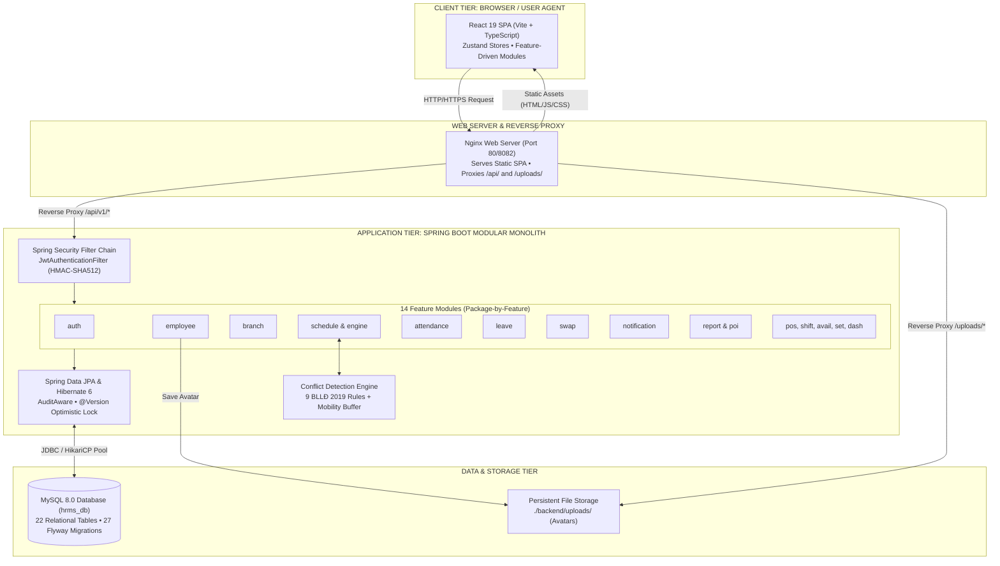

# Hệ Thống Quản Trị Nhân Sự & Điều Phối Ca Làm Việc Đa Chi Nhánh (HRMS)
*(Human Resource Management & Intelligent Shift Scheduling System)*

Hệ thống Quản trị Nhân sự, Ma trận Phân ca Thông minh & Giám sát Chấm công Đa Chi nhánh tuân thủ toàn diện **Bộ luật Lao động Việt Nam 2019**.

---

## 1. Project Overview (Tổng Quan Dự Án)

Hệ thống **HRMS (Employee Management & Shift Scheduling System)** được nghiên cứu và phát triển nhằm giải quyết bài toán phức tạp và đặc thù trong công tác điều phối nhân sự, xếp ca làm việc và theo dõi chấm công tại các doanh nghiệp hoạt động theo mô hình chuỗi đa chi nhánh (bán lẻ, dịch vụ F&B, chuỗi nhà hàng, khách sạn, siêu thị). 

### 1.1. Mục Tiêu & Bài Toán Giải Quyết
- **Giải quyết bài toán ma trận ca phức tạp**: Doanh nghiệp chuỗi thường có nhiều loại ca làm việc (ca sáng, ca chiều, ca gãy, ca đêm, ca vắt ngày qua đêm `cross-midnight`) với các yêu cầu định biên nhân sự khắt khe.
- **Tự động hóa kiểm soát tuân thủ luật pháp**: Tự động phát hiện xung đột và ngăn chặn các vi phạm đối với **Bộ luật Lao động Việt Nam 2019** (nghỉ giữa ca tối thiểu 11h/12h, trần 48h/tuần, ít nhất 1 ngày nghỉ trọn vẹn 24h, trùng ca, trùng ngày phép đã duyệt).
- **Minh bạch hóa chấm công và giải trình**: Tích hợp điểm danh ra/vào, tự động tính toán thời gian đi muộn/về sớm, bóc tách chính xác số giờ làm việc ban đêm (`22:00 - 06:00`), và quy trình duyệt giải trình quẹt thẻ trực tiếp trên hệ thống.
- **Linh hoạt trong điều chuyển và hoán đổi ca**: Cho phép nhân sự thuộc nhiều chi nhánh (chi nhánh chính và chi nhánh kiêm nhiệm), tự do đề xuất đổi ca hoặc nhường ca cho đồng nghiệp với quy trình phê duyệt chặt chẽ.

### 1.2. Đối Tượng Sử Dụng (Target Users)
1. **Ban Giám Đốc / Quản trị viên cấp cao (`ROLE_DIRECTOR`)**: Quản trị toàn bộ danh mục chi nhánh, xem Dashboard KPI toàn chuỗi, thiết lập tham số luật lao động, phê duyệt các ngoại lệ và xuất báo cáo tổng hợp.
2. **Quản Lý Chi Nhánh / Cửa Hàng Trưởng (`ROLE_MANAGER`)**: Điều hành nhân sự tại cơ sở được phân công; trực tiếp xếp ca tuần, duyệt đơn nghỉ phép, duyệt giải trình chấm công, duyệt đề xuất đổi ca của nhân viên.
3. **Nhân Viên Cơ Sở (`ROLE_EMPLOYEE`)**: Theo dõi lịch làm việc cá nhân, thực hiện điểm danh vào/ra ca, đăng ký nguyện vọng làm việc (availability), nộp đơn xin nghỉ phép, nộp đơn giải trình chấm công và gửi yêu cầu đổi/nhường ca.

---

## 2. Main Features (Các Tính Năng Chính)

Hệ thống gồm 9 phân hệ tính năng cốt lõi được đồng bộ hóa chặt chẽ giữa Backend và Frontend:

### 2.1. Ma Trận Xếp Ca Thông Minh (Smart Shift Scheduling Matrix)
- **Giao diện ma trận 8 cột trực quan**: Hiển thị mẫu ca làm việc cột đầu tiên và 7 ngày trong tuần (Thứ Hai đến Chủ Nhật).
- **Động cơ kiểm soát xung đột thời gian thực (Conflict Detection Engine)**: Tích hợp 9 quy tắc kiểm tra theo Bộ luật Lao động 2019 và khoảng đệm di chuyển giữa các cơ sở.
- **Cơ chế Snapshot Isolation**: Đóng băng toàn bộ thông số định mức của ca (tên ca, giờ bắt đầu, giờ kết thúc, thời gian nghỉ) tại thời điểm gán ca, bảo vệ dữ liệu lịch sử khi mẫu ca được cập nhật sau này.
- **Tự động hóa xếp ca & Tiện ích**:
  - Gán ca đồng loạt (Bulk Assign).
  - Tự động gợi ý xếp ca dựa trên lịch khả dụng (Auto Assign Algorithm).
  - Sao chép toàn bộ lịch ca tuần trước (Copy Week).
  - Xuất bản lịch (`PUBLISHED`) và Thu hồi về bản nháp (`DRAFT`).
  - Đăng ký nhận ca trống dành cho nhân viên (Open Shift Claiming): Hỗ trợ nhân viên tự nguyện đăng ký nhận ca mở kèm cờ xác nhận `self_volunteered_confirm` và tự động gắn nhãn nguồn gốc phân ca (`source = 'CLAIMED'` so với ca do quản lý chỉ định `'ASSIGNED'`).
  - Khóa lạc quan (`@Version`) chống ghi đè dữ liệu khi nhiều quản lý thao tác cùng lúc.
  - Ghi nhật ký kiểm toán thay đổi phân ca (`schedule_change_history`).

### 2.2. Đổi Ca & Nhường Ca Làm Việc (Shift Swap & Handover)
- **2 phương thức hoán đổi**:
  - **Đổi ca chéo (2-Way Swap)**: Đổi ca của mình lấy ca của đồng nghiệp trong cùng chi nhánh.
  - **Nhường ca 1 chiều (1-Way Handover)**: Chuyển giao ca của mình cho một đồng nghiệp đủ điều kiện nhận.
- **Truy vết bàn giao ca (Shift Handover Traceability)**: Khi duyệt nhường ca, bảo tồn tuyệt đối thông tin nhân sự được xếp ca ban đầu qua trường `transferred_from_employee_id`. Trên ô ca tuần (`ShiftGridCell`), hiển thị người nhận thay thực tế và cung cấp thanh thu gọn `▾ 1 NV đã nhường ca` để mở rộng xem nhân sự ban đầu (gạch ngang mờ) kèm lý do giải trình chi tiết, đảm bảo minh bạch và zero side-effects tới công thức tính giờ.
- **Mô phỏng xung đột trước khi gửi (`/api/v1/shift-swaps/simulate`)**: Đảm bảo việc hoán đổi không gây vi phạm luật lao động cho cả 2 nhân sự.
- **Quy trình phê duyệt 2 bước minh bạch**: Đồng nghiệp xác nhận (`PEER_ACCEPTED`) -> Quản lý cơ sở phê duyệt (`APPROVED`) -> Hệ thống tự động hoán đổi phân ca trên lịch tuần.

### 2.3. Quản Lý Hồ Sơ Nhân Sự & Mạng Lưới Đa Chi Nhánh
- **Hồ sơ nhân viên hợp nhất**: Mã nhân viên (`EMP-xxx`), thông tin cá nhân, chức danh, hợp đồng, trạng thái làm việc (`ACTIVE`, `PROBATION`, `RESIGNED`).
- **Mô hình đa cơ sở (Multi-Branch)**: Quản lý chi nhánh chính và danh sách chi nhánh kiêm nhiệm (`employee_secondary_branches`).
- **Tự động cấp tài khoản đăng nhập**: Tự động sinh tài khoản người dùng (`User`) và gán Role tương ứng với chức danh công tác.
- **Quản lý ảnh đại diện (Avatar Storage)**: Tải lên, cập nhật và xóa ảnh đại diện nhân viên lưu trữ tại volume máy chủ.
- **Điều chuyển chi nhánh an toàn**: Tự động bảo toàn lịch sử phân ca và đồng bộ danh mục ca khả dụng khi nhân viên luân chuyển cơ sở.

### 2.4. Đăng Ký Thời Gian Khả Dụng (Employee Availability)
- **Đăng ký ngày rảnh trong tuần**: Nhân viên chủ động tích chọn các ngày trong tuần có thể đi làm.
- **Đăng ký ca làm mong muốn (Preferred Shifts)**: Lựa chọn các ca ưu tiên nhằm hỗ trợ quản lý tối ưu hóa lịch xếp ca.

### 2.5. Chấm Công Thời Gian Thực & Giải Trình (Attendance & Time Tracking)
- **Điểm danh vào/ra ca**: Ghi nhận check-in/check-out theo thời gian thực đối chiếu với ca được phân bổ.
- **Tự động tính toán sai lệch**: Tính số phút đi muộn, về sớm theo cấu hình thời gian ân hạn (`grace_period_minutes`).
- **Bóc tách giờ công ban đêm**: Tự động phân tách chính xác số giờ làm việc trong khung giờ đêm (`22:00 - 06:00`) để làm căn cứ tính phụ cấp lương.
- **Quy trình giải trình quẹt thẻ (`AttendanceCorrection`)**: Nhân viên gửi đơn giải trình quên quẹt thẻ, đính kèm lý do để quản lý xem xét phê duyệt cập nhật lại giờ công.

### 2.6. Quản Lý Nghỉ Phép & Sổ Cái Quỹ Phép (Leave Management)
- **Danh mục loại phép**: Phép năm (Annual Leave), Nghỉ ốm (Sick Leave), Nghỉ không lương (Unpaid Leave), Nghỉ chế độ thai sản...
- **Sổ cái quỹ phép điện tử (`leave_balances`)**: Theo dõi tổng số ngày phép năm, số ngày đã dùng và số ngày còn lại theo năm.
- **Tự động khấu trừ và hoàn trả**: Tự động trừ ngày phép khi đơn được duyệt; kích hoạt cơ chế hoàn trả ngày phép tức thì khi nhân viên hủy đơn.

### 2.7. Báo Cáo Phân Tích & Xuất Dữ Liệu (Reports & Analytics)
- **3 Báo cáo vận hành tiêu chuẩn**:
  1. Bảng chấm công tổng hợp tháng (Monthly Attendance Summary).
  2. Bảng đối soát giờ phân ca so với giờ thực tế (Scheduled vs Actual Hours).
  3. Báo cáo vi phạm kỷ luật lao động (Late In / Early Out Violations).
- **Xuất file đa định dạng**:
  - File Microsoft Excel (`.xlsx`) nguyên bản định dạng chuẩn qua **Apache POI**.
  - File CSV định dạng chuẩn RFC-4180 có tiền tố **UTF-8 BOM (`\uFEFF`)** chống lỗi font tiếng Việt khi mở bằng Excel.
- **Kiểm soát phạm vi dữ liệu (Branch Scoping)**: Quản lý chi nhánh chỉ được xem và xuất báo cáo cơ sở phụ trách; Giám đốc được xem toàn bộ mạng lưới.

### 2.8. Cấu Hình Tham Số Hệ Thống (System Settings)
- Cấu hình động thời gian nghỉ giữa 2 ca (11 giờ thông thường, 12 giờ sau ca đêm).
- Cấu hình trần giờ làm việc tối đa trong tuần (48 giờ/tuần).
- Cấu hình thời gian ân hạn đi muộn (15 phút).
- Cấu hình khoảng đệm di chuyển giữa các chi nhánh (30 phút).

### 2.9. Trung Tâm Thông Báo Nội Bộ (In-App Notification Center)
- **Chuông thông báo thời gian thực (`NotificationBell`)**: Tích hợp trên Top Navigation Bar, hiển thị huy hiệu đếm số lượng thông báo chưa đọc theo thời gian thực.
- **Tự động phát sinh thông báo sự kiện (Event-driven Notifications)**:
  - Thông báo đơn nghỉ phép: Tự động gửi thông báo tới cấp quản lý khi nhân viên nộp đơn và phản hồi kết quả tới nhân viên khi đơn được phê duyệt/từ chối (`LeaveNotifier`).
  - Thông báo đổi/nhường ca: Thông báo cho đồng nghiệp được đề xuất khi có yêu cầu hoán đổi và thông báo kết quả phê duyệt từ quản lý chi nhánh.
  - Thông báo nhận ca trống: Cập nhật ngay khi nhân viên hoàn tất đăng ký ca mở.
- **Quản lý trạng thái thông báo**: Menu dropdown phân trang, hỗ trợ lọc thông báo chưa đọc, đánh dấu đã đọc từng thông báo hoặc đọc tất cả một chạm (`/api/v1/notifications/read-all`).

---

## 3. Technology Stack (Ngăn Xếp Công Nghệ)

| Tầng Hệ Thống | Công Nghệ / Thư Viện | Phiên Bản | Mục Đích Sử Dụng Thực Tế Trong Dự Án |
| :--- | :--- | :--- | :--- |
| **Backend Runtime** | Java OpenJDK (LTS) | 21 | Môi trường thực thi chính, tối ưu hiệu năng và quản lý bộ nhớ |
| **Backend Framework**| Spring Boot | 3.3.4 | Khung ứng dụng Web, REST API, Inversion of Control & Dependency Injection |
| **Security** | Spring Security | 6.3.3 | Xác thực người dùng, bảo vệ endpoint và phân quyền phương thức `@PreAuthorize` |
| **Token Authentication** | jjwt (`jjwt-api`, `jjwt-impl`, `jjwt-jackson`) | 0.12.5 | Cấp phát, xác minh và giải mã Stateless JWT Token với thuật toán HMAC-SHA512 |
| **ORM / Persistence**| Spring Data JPA / Hibernate | 6.5.3 | Quản lý truy cập dữ liệu, ánh xạ Object-Relational, khóa lạc quan `@Version` |
| **Database Migration**| Flyway Core & Flyway MySQL | 10.18.0 | Tự động hóa khởi tạo schema và kiểm soát phiên bản CSDL (27 migration scripts: V1 -> V27) |
| **Connection Pool** | HikariCP | 5.1.0 | Quản lý kết nối CSDL hiệu năng cao với cấu hình 10 connection tối đa |
| **Database** | MySQL Server | 8.0 | Hệ quản trị cơ sở dữ liệu quan hệ chính (InnoDB, utf8mb4_unicode_ci) |
| **Office Export** | Apache POI (`poi-ooxml`) | 5.2.5 | Tạo và xuất báo cáo bảng công định dạng Microsoft Excel `.xlsx` chuẩn mực |
| **API Documentation** | SpringDoc OpenAPI Starter WebMVC UI | 2.5.0 | Tự động sinh đặc tả OpenAPI 3.0 và giao diện tương tác Swagger UI |
| **Boilerplate Helper**| Project Lombok | 1.18.36 | Tự động sinh Getters, Setters, Constructors, Builders trong Java 21 |
| **Frontend Framework**| React | 19.2.8 | Xây dựng giao diện ứng dụng Single Page Application (SPA) hiệu năng cao |
| **Language** | TypeScript | ~6.0.2 | Tăng tính an toàn kiểu dữ liệu và nâng cao năng suất bảo trì source code |
| **Build Tool & Server**| Vite | ^8.3.0 | Bundler siêu tốc, HMR nhanh và thiết lập Reverse Proxy tới Backend |
| **Client Routing** | React Router DOM | ^7.18.4 | Quản lý định tuyến trang, bảo vệ Route dựa trên Role (`RoleRoute`) |
| **State Management** | Zustand | ^5.0.15 | Quản lý trạng thái phân tán theo Feature (Auth, Schedule, Employees, UI...) |
| **Icons Library** | Lucide React | ^1.55.0 | Bộ biểu tượng SVG đồng nhất chuẩn hệ thống thiết kế |
| **Date Processing** | Date-fns | ^4.4.0 | Xử lý tính toán ngày tuần, ISO-8601, offset tuần và định dạng ngày tiếng Việt |
| **Typography** | Fontsource Be Vietnam Pro & Inter | ^5.3.0 | Tải phông chữ chuẩn hiển thị tiếng Việt thẩm mỹ doanh nghiệp |
| **Linter** | Oxlint | ^1.81.0 | Bộ kiểm tra chất lượng code JavaScript/TypeScript tốc độ cao |
| **Containerization** | Docker & Docker Compose | Latest | Đóng gói toàn bộ Backend, Frontend Nginx và MySQL vào container |

---

## 4. System Architecture (Kiến Trúc Hệ Thống)

Dự án được xây dựng theo mô hình **Tách biệt Client-Server (Decoupled Client-Server Architecture)** với phong cách thiết kế **Package-by-Feature Modular Monolith** ở Backend và **Feature-Driven Architecture** ở Frontend:



### Luồng Xử Lý Một Request Điển Hình:
1. **Client**: Người dùng thao tác trên giao diện React, native fetch client (`apiClient.ts`) đính kèm Header `Authorization: Bearer <JWT_TOKEN>`.
2. **Reverse Proxy (Nginx)**: Tiếp nhận yêu cầu, chuyển tiếp các request `/api/v1/*` tới cổng `8080` của Backend.
3. **Security Filter**: `JwtAuthenticationFilter` chặn request, giải mã token bằng khóa bí mật HMAC-SHA512, trích xuất `UserPrincipal` và nạp vào `SecurityContext`.
4. **Controller**: Kiểm tra phân quyền method level (`@PreAuthorize("hasAnyRole(...)")`), kiểm tra dữ liệu đầu vào (`@Valid`).
5. **Service**: Thực thi logic nghiệp vụ (ví dụ: kiểm tra 9 luật xung đột ca, đóng băng snapshot thông số ca, tính toán giờ công đêm, kiểm tra hạn mức phép).
6. **Repository**: Spring Data JPA sinh mã SQL tối ưu, thực thi xuống CSDL MySQL 8.0 qua HikariCP Connection Pool.
7. **Response**: Đóng gói dữ liệu đầu ra theo cấu trúc chuẩn `ApiResponse<T>` hoặc `PageResponse<T>`.

---

## 5. Project Structure (Cấu Trúc Thư Mục Dự Án)

```text
D:\Project\Employee Management\
├── .env.example                     # Mẫu cấu hình biến môi trường toàn hệ thống
├── docker-compose.yml               # Cấu hình khởi chạy cụm dịch vụ MySQL, Backend, Frontend
├── README.md                        # Tài liệu hướng dẫn kỹ thuật chính của dự án
│
├── backend/                         # MÃ NGUỒN MÁY CHỦ BACKEND (SPRING BOOT)
│   ├── pom.xml                      # Cấu hình Maven dependencies & plugins
│   ├── Dockerfile                   # Multi-stage Docker build cho Spring Boot
│   ├── src/
│   │   ├── main/
│   │   │   ├── java/com/company/hrms/
│   │   │   │   ├── HrmsApplication.java       # Spring Boot Main Entry Point
│   │   │   │   ├── common/                    # Hạ tầng dùng chung (Cross-cutting Concerns)
│   │   │   │   │   ├── audit/                 # SpringSecurityAuditorAware (created_by, updated_by)
│   │   │   │   │   ├── config/                # Cấu hình WebMvc, Static Resource Uploads
│   │   │   │   │   ├── entity/                # BaseAuditableEntity (@Version, Soft Delete)
│   │   │   │   │   ├── exception/             # GlobalExceptionHandler, BusinessException
│   │   │   │   │   ├── response/              # ApiResponse<T>, PageResponse<T>, ErrorResponse
│   │   │   │   │   └── service/               # FileStorageService (Quản lý tệp tải lên)
│   │   │   │   ├── security/                  # Hệ thống bảo mật & Xác thực
│   │   │   │   │   ├── config/                # SecurityConfig (FilterChain, PasswordEncoder, CORS)
│   │   │   │   │   ├── jwt/                   # JwtTokenProvider, JwtAuthenticationFilter
│   │   │   │   │   └── service/               # CustomUserDetailsService, UserPrincipal
│   │   │   │   └── modules/                   # 14 Module nghiệp vụ (Package-by-Feature)
│   │   │   │       ├── attendance/            # Điểm danh, tính giờ đêm, giải trình quẹt thẻ
│   │   │   │       ├── auth/                  # Đăng nhập, đăng ký, đồng bộ quyền hạn
│   │   │   │       ├── availability/          # Lịch khả dụng & ca làm mong muốn của nhân viên
│   │   │   │       ├── branch/                # Quản lý mạng lưới chi nhánh & người phụ trách
│   │   │   │       ├── dashboard/             # Thống kê KPI vận hành tổng thể
│   │   │   │       ├── employee/              # Hồ sơ nhân sự, chi nhánh kiêm nhiệm, avatar
│   │   │   │       ├── leave/                 # Quản lý phép, sổ cái quỹ phép, duyệt đơn
│   │   │   │       ├── notification/          # Trung tâm thông báo nội bộ (Leave, Swap, Claim)
│   │   │   │       ├── position/              # 3 Chức danh chuẩn mực doanh nghiệp
│   │   │   │       ├── report/                # Tổng hợp báo cáo, xuất Excel POI & CSV UTF-8
│   │   │   │       ├── schedule/              # Xếp ca tuần & Conflict Detection Engine (9 rules)
│   │   │   │       ├── setting/               # Tham số luật lao động & cấu hình hệ thống
│   │   │   │       ├── shift/                 # Mẫu ca làm việc theo chi nhánh
│   │   │   │       └── swap/                  # Đề xuất và duyệt đổi ca / nhường ca
│   │   │   └── resources/
│   │   │       ├── application.yml            # Cấu hình JPA, Datasource, JWT, Port
│   │   │       ├── application-dev.yml        # Cấu hình môi trường dev
│   │   │       └── db/migration/              # 27 Flyway migration scripts (V1 -> V27)
│   │   └── test/java/com/company/hrms/        # 5 Test suites kiểm thử tích hợp trọng điểm
│   └── uploads/                               # Thư mục lưu trữ ảnh đại diện tải lên
│
├── frontend/                        # MÃ NGUỒN GIAO DIỆN NGƯỜI DÙNG (REACT SPA)
│   ├── package.json                 # Cấu hình dependencies (React 19, Zustand, Vite...)
│   ├── vite.config.ts               # Cấu hình Vite & Reverse Proxy tới Backend
│   ├── tsconfig.json                # Thiết lập TypeScript Strict Mode
│   ├── nginx.conf                   # Cấu hình Nginx phục vụ SPA và Reverse Proxy Docker
│   ├── Dockerfile                   # Multi-stage Docker build cho Frontend
│   └── src/
│       ├── main.tsx                 # Entry point gắn kết React DOM
│       ├── App.tsx                  # Khởi tạo App, Auth bootstrap, Toast container
│       ├── routes/                  # AppRoutes.tsx, route-paths.ts, RoleRoute.tsx
│       ├── components/              # layout/ (AppLayout, Topbar, Sidebar), common/
│       ├── features/                # 11 Module chức năng giao diện (Collocation Pattern)
│       │   ├── attendance/          # Màn hình chấm công, lịch sử, modal giải trình
│       │   ├── auth/                # Màn hình đăng nhập, quên mật khẩu, đăng ký
│       │   ├── branches/            # Quản lý danh sách & form chi nhánh
│       │   ├── dashboard/           # Dashboard KPI, biểu đồ xu hướng chấm công
│       │   ├── employees/           # Danh sách nhân viên, hồ sơ chi tiết, đăng ký ca
│       │   ├── leaves/              # Quản lý đơn xin nghỉ, thẻ số dư quỹ phép
│       │   ├── notification/        # Chuông thông báo, menu dropdown, store
│       │   ├── reports/             # 3 Bảng báo cáo, nút xuất Excel/CSV
│       │   ├── schedule/            # Ma trận xếp ca 8 cột, drawer gán ca, swap ca
│       │   ├── settings/            # Giao diện cấu hình tham số luật lao động
│       │   └── shifts/              # Danh mục mẫu ca làm việc theo chi nhánh
│       ├── shared/                  # apiClient.ts, useAuthStore, useUIStore, useDirectoryStore
│       ├── styles/                  # tokens.css, global.css, reset.css, schedule.css
│       ├── types/                   # Khai báo TypeScript types chuẩn hóa miền nghiệp vụ
│       └── utils/                   # conflict-detector, date.utils, csv-exporter, auto-assign
│
└── docs/                            # KHO TÀI LIỆU KỸ THUẬT DỰ ÁN
    ├── images/                      # Sơ đồ kiến trúc, luồng xử lý và ERD
    ├── 01-product-requirements.md   # Đặc tả yêu cầu sản phẩm
    ├── 03-database-design.md        # Thiết kế cơ sở dữ liệu & từ điển dữ liệu
    ├── 04-api-specification.md      # Đặc tả chi tiết RESTful API
    ├── 18-project-structure-and-modules-guide.md # Cẩm nang cấu trúc module v3.0
    └── Project_Summary.docx         # Tài liệu tổng hợp dự án kỹ thuật (Word chuẩn A4)
```

---

## 6. Prerequisites (Yêu Cầu Môi Trường Tiên Quyết)

Trước khi tiến hành cài đặt hoặc chạy dự án, máy tính cần đáp ứng các yêu cầu sau:

| Công Cụ / Phần Mềm | Phiên Bản Tối Thiểu | Kiểm Tra Cài Đặt | Mục Đích |
| :--- | :--- | :--- | :--- |
| **Docker & Docker Compose** | Docker 24.0+ / Compose v2+ | `docker --version`<br/>`docker compose version` | Chạy toàn bộ hệ thống bằng container (khuyên dùng) |
| **Java Development Kit (JDK)**| Java 21 LTS | `java --version` | Biên dịch và chạy Backend Spring Boot cục bộ |
| **Apache Maven** | Maven 3.9+ | `mvn -v` | Quản lý dependencies và build gói JAR Backend |
| **Node.js** | Node.js 20.x LTS hoặc mới hơn | `node -v` | Môi trường runtime JavaScript cho Frontend |
| **npm** | npm 10.x+ | `npm -v` | Quản lý gói thư viện Frontend |
| **MySQL Database Server** | MySQL 8.0 Community | `mysql --version` | Cơ sở dữ liệu quan hệ (nếu chạy local không qua Docker) |

---

## 7. Installation Guide (Hướng Dẫn Cài Đặt Chi Tiết)

### Bước 1: Clone kho mã nguồn từ Git
```bash
git clone https://github.com/NguyenThanhSon2002/EmployeeManagement.git
cd EmployeeManagement
```

### Bước 2: Thiết lập cấu hình biến môi trường
Sao chép file `.env.example` thành file `.env` tại thư mục gốc dự án:
```bash
# Trên Linux / macOS
cp .env.example .env

# Trên Windows PowerShell
Copy-Item .env.example .env
```

### Bước 3: Cài đặt Dependencies cho từng phân hệ (Nếu chạy Local)
- **Cài đặt thư viện Backend**:
  ```bash
  cd backend
  mvn clean install -DskipTests
  cd ..
  ```
- **Cài đặt thư viện Frontend**:
  ```bash
  cd frontend
  npm install
  cd ..
  ```

---

## 8. Environment Configuration (Cấu Hình Biến Môi Trường)

Bảng chi tiết các biến môi trường được định nghĩa trong `.env.example`:

| Tên Biến Môi Trường | Giá Trị Mẫu Mặc Định | Bắt Buộc | Diễn Giải Chi Tiết |
| :--- | :--- | :---: | :--- |
| `DB_HOST` | `localhost` (hoặc `hrms-mysql`) | Có | Địa chỉ máy chủ CSDL MySQL |
| `DB_PORT` | `3306` (hoặc `3308` trong Compose) | Có | Cổng kết nối tới CSDL MySQL |
| `DB_NAME` | `hrms_db` | Có | Tên cơ sở dữ liệu của ứng dụng |
| `DB_USER` | `root` | Có | Tên tài khoản kết nối CSDL |
| `DB_PASSWORD` | `1` (hoặc mật khẩu của bạn) | Có | Mật khẩu truy cập CSDL (Không chia sẻ lên Git) |
| `JWT_SECRET` | *(Khóa Base64 256-bit)* | Có | Chuỗi khóa bí mật dùng để ký và xác thực mã JWT Token |
| `SERVER_PORT` | `8080` (hoặc `8081` trong Compose)| Không | Cổng dịch vụ lắng nghe của Spring Boot Backend |
| `FRONTEND_PORT` | `5173` (hoặc `8082` trong Compose)| Không | Cổng dịch vụ giao diện Frontend |
| `CORS_ALLOWED_ORIGINS`| `http://localhost:5173,http://localhost:8082` | Không | Danh sách tên miền được phép gửi CORS request |

> [!WARNING]
> Tuyệt đối không commit file `.env` có chứa mật khẩu thật, JWT Secret sản xuất hoặc thông tin kết nối nhạy cảm lên Git repository.

---

## 9. Database Configuration (Cấu Hình Cơ Sở Dữ Liệu)

### 9.1. Khởi Tạo Cơ Sở Dữ Liệu Thủ Công (Nếu Không Dùng Docker)
Nếu chạy MySQL cục bộ trên máy tính:
1. Đăng nhập vào MySQL Client:
   ```bash
   mysql -u root -p
   ```
2. Tạo database với mã hóa chuẩn `utf8mb4`:
   ```sql
   CREATE DATABASE IF NOT EXISTS hrms_db CHARACTER SET utf8mb4 COLLATE utf8mb4_unicode_ci;
   ```
3. Kiểm tra thông tin đăng nhập trong file `.env` khớp với tài khoản MySQL của bạn.

### 9.2. Cơ Chế Migration Tự Động (Flyway)
Khi Backend khởi động, **Flyway** sẽ tự động quét thư mục `backend/src/main/resources/db/migration/` và áp dụng tuần tự toàn bộ **23 tệp migration** (từ `V1__init_schema.sql` đến `V23__allow_null_shift_colors.sql`).
- Bạn **không cần** chạy bất kỳ script SQL nào bằng tay.
- Toàn bộ 21 bảng dữ liệu, các ràng buộc toàn vẹn khóa ngoại, dữ liệu mẫu ban đầu (Master Data: chức vụ, loại phép, tài khoản mẫu) sẽ được thiết lập tự động 100%.

---

## 10. How to Run the Project (Hướng Dẫn Khởi Chạy Ứng Dụng)

### Phương Án 1: Khởi Chạy Bằng Docker Compose (Khuyên Dùng Cho Mọi Môi Trường)

Phương án này tự động đóng gói, liên kết mạng và khởi chạy toàn bộ 3 dịch vụ: MySQL 8.0, Backend Spring Boot và Frontend Nginx:

1. **Khởi chạy container ở chế độ background**:
   ```bash
   docker compose up -d --build
   ```
2. **Kiểm tra trạng thái hoạt động của các container**:
   ```bash
   docker compose ps
   ```
   *Kết quả mong đợi*: Cả 3 container `hrms-mysql`, `hrms-backend`, `hrms-frontend` đều ở trạng thái `running` (hoặc `healthy`).
3. **Truy cập ứng dụng**:
   - **Giao diện Người dùng (Frontend)**: [http://localhost:8082](http://localhost:8082)
   - **Tài liệu API Swagger UI (Backend)**: [http://localhost:8081/swagger-ui.html](http://localhost:8081/swagger-ui.html)
   - **Cơ sở dữ liệu MySQL**: Cổng `3308` (User: `root`, Mật khẩu: cấu hình trong `.env`).
4. **Dừng toàn bộ hệ thống**:
   ```bash
   docker compose down
   ```

---

### Phương Án 2: Khởi Chạy Thủ Công Từng Phân Hệ (Dành Cho Lập Trình Viên Phát Triển)

#### Bước 1: Khởi động Cơ sở dữ liệu MySQL
Đảm bảo máy chủ MySQL đang chạy trên cổng `3306` với cơ sở dữ liệu `hrms_db`. (Hoặc có thể chỉ chạy MySQL qua Docker: `docker compose up -d mysql`).

#### Bước 2: Khởi động Backend (Spring Boot)
Mở một cửa sổ Terminal mới:
```bash
cd backend
mvn clean spring-boot:run
```
- Máy chủ Backend sẽ lắng nghe tại: `http://localhost:8080`.
- Tài liệu tương tác API Swagger UI: `http://localhost:8080/swagger-ui.html`.

#### Bước 3: Khởi động Frontend (React + Vite)
Mở một cửa sổ Terminal khác:
```bash
cd frontend
npm install
npm run dev
```
- Máy chủ phát triển Vite sẽ khởi động tại: `http://localhost:5173`.
- Vite được cấu hình reverse proxy: Các cuộc gọi tới `/api` và `/uploads` sẽ được tự động điều hướng ngầm sang Backend tại `http://localhost:8080`.

---

## 11. API Documentation (Đặc Tả Danh Mục RESTful API)

Hệ thống cung cấp hơn 40 API chuẩn RESTful, toàn bộ được cấu trúc trong các Controller tại gói `com.company.hrms.modules.*.controller`:

### 11.1. Bảng Tổng Hợp Endpoint Theo Phân Hệ

| Module | Method | Endpoint | Quyền Hạn (`@PreAuthorize`) | Mục Đích Nghiệp Vụ |
| :--- | :---: | :--- | :--- | :--- |
| **Xác thực (Auth)** | `POST` | `/api/v1/auth/login` | Public | Đăng nhập hệ thống, cấp Access Token & Refresh Token |
| | `POST` | `/api/v1/auth/register` | Public | Đăng ký tài khoản nhân viên mới |
| | `POST` | `/api/v1/auth/refresh` | Public | Làm mới Access Token khi token cũ hết hạn |
| | `POST` | `/api/v1/auth/change-password` | Authenticated | Đổi mật khẩu cá nhân của tài khoản hiện tại |
| | `GET` | `/api/v1/auth/branches` | Public | Danh sách chi nhánh phục vụ chọn khi đăng ký |
| **Nhân sự (Employees)**| `GET` | `/api/v1/employees` | Authenticated | Tra cứu danh sách nhân sự có phân trang, tìm kiếm & bộ lọc |
| | `GET` | `/api/v1/employees/{id}` | Authenticated | Chi tiết hồ sơ nhân sự theo ID |
| | `POST` | `/api/v1/employees` | `DIRECTOR`, `MANAGER` | Thêm mới hồ sơ nhân sự, tự tạo User tương ứng |
| | `PUT` | `/api/v1/employees/{id}` | `DIRECTOR`, `MANAGER` | Cập nhật thông tin cá nhân, chức danh, chi nhánh kiêm nhiệm |
| | `DELETE`| `/api/v1/employees/{id}` | `DIRECTOR` | Xóa mềm hồ sơ nhân viên (`deleted_at = NOW()`) |
| | `POST` | `/api/v1/employees/{id}/avatar` | Authenticated | Tải lên ảnh đại diện nhân viên (Multipart/form-data) |
| | `DELETE`| `/api/v1/employees/{id}/avatar` | Authenticated | Xóa ảnh đại diện nhân viên khỏi hệ thống |
| | `POST` | `/api/v1/employees/{id}/reset-password`| `DIRECTOR` | Đặt lại mật khẩu nhân viên theo yêu cầu quản trị |
| **Chi nhánh (Branches)**| `GET` | `/api/v1/branches` | Authenticated | Danh sách toàn bộ mạng lưới chi nhánh |
| | `POST` | `/api/v1/branches` | `DIRECTOR` | Thành lập chi nhánh / cơ sở mới |
| | `PUT` | `/api/v1/branches/{id}` | `DIRECTOR` | Cập nhật thông tin chi nhánh, chỉ định Cửa hàng trưởng |
| | `DELETE`| `/api/v1/branches/{id}` | `DIRECTOR` | Xóa mềm chi nhánh |
| **Mẫu ca (Work Shifts)**| `GET` | `/api/v1/work-shifts` | Authenticated | Danh sách mẫu ca làm việc (hỗ trợ lọc theo `branchId`) |
| | `POST` | `/api/v1/work-shifts` | `DIRECTOR`, `MANAGER` | Tạo mới mẫu ca làm việc cho chi nhánh |
| | `PUT` | `/api/v1/work-shifts/{id}` | `DIRECTOR`, `MANAGER` | Cập nhật định mức ca (bảo vệ lịch sử nhờ snapshot) |
| | `DELETE`| `/api/v1/work-shifts/{id}` | `DIRECTOR`, `MANAGER` | Xóa mềm mẫu ca |
| **Phân ca (Schedules)**| `GET` | `/api/v1/schedules/weekly` | Authenticated | Lấy toàn bộ ma trận phân ca tuần theo chi nhánh & thứ Hai |
| | `POST` | `/api/v1/schedules/validate-conflicts`| Authenticated | Động cơ kiểm tra xung đột thời gian thực (9 rules BLLĐ) |
| | `POST` | `/api/v1/schedules/assignments` | `DIRECTOR`, `MANAGER` | Gán ca làm việc cho nhân viên |
| | `POST` | `/api/v1/schedules/assignments/claim`| `EMPLOYEE` | Nhân viên tự nguyện đăng ký nhận ca trống |
| | `DELETE`| `/api/v1/schedules/assignments/{id}` | `DIRECTOR`, `MANAGER` | Hủy phân công ca làm việc của nhân viên |
| | `PATCH` | `/api/v1/schedules/assignments/{id}/override`| `DIRECTOR`, `MANAGER` | Lưu lý do cưỡng chế gán ca khi có xung đột chấp nhận được |
| | `POST` | `/api/v1/schedules/bulk-assign` | `DIRECTOR`, `MANAGER` | Phân ca hàng loạt theo lịch khả dụng |
| | `POST` | `/api/v1/schedules/copy-week` | `DIRECTOR`, `MANAGER` | Sao chép toàn bộ phân ca tuần trước sang tuần này |
| | `POST` | `/api/v1/schedules/{id}/publish` | `DIRECTOR`, `MANAGER` | Xuất bản lịch chính thức cho nhân viên xem |
| | `POST` | `/api/v1/schedules/{id}/unpublish` | `DIRECTOR` | Thu hồi lịch đã công bố về trạng thái bản nháp để chỉnh sửa |
| **Đổi ca (Shift Swap)**| `POST` | `/api/v1/shift-swaps/simulate` | Authenticated | Mô phỏng đổi ca kiểm tra xung đột BLLĐ trước khi gửi |
| | `POST` | `/api/v1/shift-swaps` | Authenticated | Khởi tạo đơn đổi ca (2 chiều) hoặc nhường ca (1 chiều) |
| | `PUT` | `/api/v1/shift-swaps/{id}/peer-respond`| Authenticated | Đồng nghiệp xác nhận Đồng ý / Từ chối nhận đổi ca |
| | `PUT` | `/api/v1/shift-swaps/{id}/manager-review`| `DIRECTOR`, `MANAGER` | Quản lý Phê duyệt / Bác bỏ đơn đổi ca |
| | `DELETE`| `/api/v1/shift-swaps/{id}` | Authenticated | Người tạo tự hủy yêu cầu khi chưa được duyệt |
| | `GET` | `/api/v1/shift-swaps/my-requests` | Authenticated | Xem danh sách các đơn liên quan đến tài khoản cá nhân |
| | `GET` | `/api/v1/shift-swaps/pending-manager` | `DIRECTOR`, `MANAGER` | Danh sách các đơn chờ Quản lý cơ sở phê duyệt |
| **Chấm công (Attendance)**| `POST`| `/api/v1/attendance/check-in` | Authenticated | Điểm danh vào ca làm việc |
| | `POST` | `/api/v1/attendance/check-out` | Authenticated | Điểm danh ra ca làm việc (tính giờ đêm, làm thêm) |
| | `GET` | `/api/v1/attendance/records` | Authenticated | Xem lịch sử bảng ghi nhận chấm công |
| | `POST` | `/api/v1/attendance/corrections` | Authenticated | Gửi đơn giải trình quẹt thẻ (quên check-in/out) |
| | `PUT` | `/api/v1/attendance/corrections/{id}/review`| `DIRECTOR`, `MANAGER` | Quản lý duyệt/từ chối giải trình quẹt thẻ |
| **Nghỉ phép (Leaves)** | `GET` | `/api/v1/leaves/balances` | Authenticated | Tra cứu sổ cái quỹ phép năm của nhân viên |
| | `POST` | `/api/v1/leaves/requests` | Authenticated | Nộp đơn xin nghỉ phép mới |
| | `PUT` | `/api/v1/leaves/requests/{id}/cancel` | Authenticated | Nhân viên hủy đơn xin phép (hoàn trả ngày phép tức thì) |
| | `PUT` | `/api/v1/leaves/requests/{id}/review` | `DIRECTOR`, `MANAGER` | Quản lý duyệt/bác bỏ đơn xin nghỉ phép |
| **Báo cáo (Reports)** | `GET` | `/api/v1/reports/attendance-summary` | `DIRECTOR`, `MANAGER` | Báo cáo tổng hợp công tháng (ngày làm, giờ đêm, giờ OT) |
| | `GET` | `/api/v1/reports/export/excel` | `DIRECTOR`, `MANAGER` | Xuất file báo cáo Microsoft Excel `.xlsx` chuẩn Apache POI |
| | `GET` | `/api/v1/reports/export/csv` | `DIRECTOR`, `MANAGER` | Xuất file CSV tiêu chuẩn UTF-8 BOM chống lỗi font tiếng Việt |
| **Dashboard** | `GET` | `/api/v1/dashboard/overview` | Authenticated | Thống kê số lượng nhân sự, ca làm việc, tỷ lệ đi làm |
| | `GET` | `/api/v1/dashboard/pending-approvals`| `DIRECTOR`, `MANAGER` | Đếm số lượng đơn nghỉ phép, giải trình, đổi ca chờ duyệt |
| **Cấu hình (Settings)**| `GET` | `/api/v1/settings` | Authenticated | Lấy danh sách tham số luật lao động hệ thống |
| | `PUT` | `/api/v1/settings/{key}` | `DIRECTOR` | Cập nhật giá trị tham số cấu hình hệ thống |

---

## 12. Authentication & Authorization (Xác Thực & Phân Quyền)

### 12.1. Cơ Chế Xác Thực (Stateless JWT Authentication)
- Hệ thống áp dụng cơ chế xác thực **Stateless** hoàn toàn qua mã **JWT (JSON Web Token)** được ký bằng thuật toán bảo mật `HMAC-SHA512`.
- **Access Token**: Thời hạn hiệu lực mặc định 24 giờ (`86400s`), truyền qua Header:
  ```http
  Authorization: Bearer <access_token>
  ```
- **Refresh Token**: Thời hạn hiệu lực 7 ngày (`604800s`), dùng để lấy Access Token mới qua API `/api/v1/auth/refresh` mà không yêu cầu người dùng đăng nhập lại.
- **Mật khẩu người dùng**: Được băm an toàn một chiều bằng thuật toán `BCryptPasswordEncoder` trước khi lưu vào CSDL.

### 12.2. Phân Quyền Theo Vai Trò (Role-Based Access Control)
Hệ thống chuẩn hóa 3 vai trò quyền hạn kế thừa theo cơ cấu tổ chức:

1. **Giám Đốc (`ROLE_DIRECTOR`)**:
   - Quyền hạn cao nhất toàn hệ thống.
   - Quản trị toàn chuỗi chi nhánh, xem báo cáo của mọi cơ sở.
   - Có quyền xóa mềm nhân viên, thiết lập tham số luật lao động, thu hồi lịch ca đã công bố.
2. **Quản Lý Chi Nhánh (`ROLE_MANAGER`)**:
   - Quản lý điều hành giới hạn trong phạm vi chi nhánh phụ trách.
   - Lập kế hoạch phân ca tuần, gán ca, xuất bản lịch cho nhân viên cơ sở.
   - Phê duyệt đơn xin nghỉ phép, giải trình chấm công, đơn đổi ca của nhân sự cơ sở.
   - Bị giới hạn phạm vi dữ liệu (Branch Scoping): Không thể truy cập dữ liệu ca hoặc nhân viên chi nhánh khác.
3. **Nhân Viên (`ROLE_EMPLOYEE`)**:
   - Quyền thao tác cá nhân: Xem lịch phân ca của mình, đăng ký thời gian rảnh, nhận ca trống.
   - Điểm danh vào/ra ca, gửi đơn giải trình quẹt thẻ, gửi yêu cầu đổi/nhường ca cho đồng nghiệp.
   - Không được can thiệp vào ma trận ca hoặc duyệt đơn của nhân sự khác.

### 12.3. Danh Sách Tài Khoản Mẫu Mặc Định (Seed Accounts)

| Mã Nhân Viên | Tên Đăng Nhập | Mật Khẩu Mặc Định | Họ Và Tên | Vai Trò (Role) | Chi Nhánh Phụ Trách |
| :--- | :--- | :--- | :--- | :--- | :--- |
| `EMP-001` | `EMP-001` (hoặc `admin`) | `emp001@123` (hoặc `admin123`)| Nguyễn Văn An | `ROLE_DIRECTOR` | Toàn chuỗi (Headquarters) |
| `EMP-002` | `EMP-002` | `emp002@123` | Trần Thị Bình | `ROLE_MANAGER` | Chi nhánh Cầu Giấy (ID: 1) |
| `EMP-003` | `EMP-003` | `emp003@123` | Lê Hoàng Long | `ROLE_EMPLOYEE` | Chi nhánh Cầu Giấy (ID: 1) |
| `EMP-004` | `EMP-004` | `emp004@123` | Phạm Minh Tuấn | `ROLE_MANAGER` | Chi nhánh Đống Đa (ID: 2) |
| `EMP-005` | `EMP-005` | `emp005@123` | Hoàng Mai Linh | `ROLE_EMPLOYEE` | Chi nhánh Đống Đa (ID: 2) |

---

## 13. Troubleshooting (Xử Lý Sự Cố Phổ Biến)

Dưới đây là các sự cố kỹ thuật thực tế đã được kiểm chứng và giải pháp khắc phục:

### 13.1. Lỗi Không Kết Nối Được MySQL Trong Docker (`CommunicationsException`)
- **Triệu chứng**: Container `hrms-backend` báo lỗi `Communications link failure` khi khởi động.
- **Nguyên nhân**: Container MySQL chưa kịp hoàn tất khởi tạo schema trong lần chạy đầu tiên hoặc container backend kết nối trước khi MySQL sẵn sàng.
- **Khắc phục**:
  1. Kiểm tra trạng thái container: `docker compose ps`.
  2. Xem log MySQL: `docker compose logs -f mysql`.
  3. Khởi động lại backend sau khi MySQL đã healthy: `docker compose restart backend`.

### 13.2. Lỗi CORS Khi Gọi API Từ Trình Duyệt (`Cross-Origin Request Blocked`)
- **Triệu chứng**: Trình duyệt báo đỏ `Access to XMLHttpRequest at 'http://localhost:8080/api/v1/...' from origin 'http://localhost:5173' has been blocked by CORS policy`.
- **Nguyên nhân**: Biến môi trường `CORS_ALLOWED_ORIGINS` trong `application.yml` chưa chứa địa chỉ origin đang chạy của frontend.
- **Khắc phục**: Đảm bảo file `.env` chứa đầy đủ origin của bạn:
  ```env
  CORS_ALLOWED_ORIGINS=http://localhost:5173,http://localhost:8082,http://127.0.0.1:5173,http://127.0.0.1:8082
  ```

### 13.3. Lỗi Xung Đột Khóa Lạc Quan Khi Xếp Ca (`OPTIMISTIC_LOCK_CONFLICT`)
- **Triệu chứng**: Khi gán ca hoặc xóa ca, hệ thống trả về mã lỗi `409 Conflict`.
- **Nguyên nhân**: Một quản lý khác đã vừa cập nhật lịch phân ca của tuần đó, làm tăng trường `version` trong CSDL.
- **Khắc phục**: Hệ thống tự động tải lại dữ liệu mới nhất. Người dùng chỉ cần bấm nút làm mới để đồng bộ trạng thái mới nhất trước khi thao tác tiếp.

### 13.4. Lỗi Font Tiếng Việt Khi Mở File CSV Trong Microsoft Excel
- **Triệu chứng**: Mở file CSV xuất từ hệ thống trên Excel phiên bản cũ bị lỗi ký tự có dấu (`H? Th?ng Qu?n Lý...`).
- **Nguyên nhân**: Excel mặc định mở file CSV bằng bảng mã ANSI thay vì UTF-8.
- **Khắc phục**: Hệ thống Backend đã tự động gắn tiền tố **Byte Order Mark (`\uFEFF`)** vào đầu luồng xuất CSV. Nếu máy tính người dùng tắt chế độ tự nhận dạng BOM, khuyến nghị xuất trực tiếp qua nút **Xuất Excel (.xlsx)** nguyên bản.

---

## 14. Development Guidelines (Quy Chuẩn Phát Triển & Đóng Góp)

Nhằm đảm bảo chất lượng source code và tính nhất quán dài hạn của dự án:

1. **Quy chuẩn mã nguồn Backend**:
   - Tuân thủ quy ước đặt tên Java chuẩn mực (CamelCase cho class, camelCase cho method/variable, SNAKE_CASE cho hằng số).
   - Mọi thực thể nghiệp vụ kế thừa từ `BaseAuditableEntity` để được tự động ghi nhận kiểm toán và khóa lạc quan.
   - Xử lý ngoại lệ tập trung qua `GlobalExceptionHandler` và ném `BusinessException` có mã lỗi tường minh.
   - Nghiêm cấm viết câu lệnh SQL nối chuỗi trực tiếp; bắt buộc sử dụng Hibernate Query hoặc JPA Parameterized queries để phòng chống SQL Injection.
2. **Quy chuẩn mã nguồn Frontend**:
   - Sử dụng TypeScript ở chế độ Strict Mode (`noImplicitAny: true`).
   - Thiết kế giao diện tuân thủ hệ thống Design Tokens (`var(--color-...)`, `var(--space-...)`), không sử dụng giá trị màu sắc hoặc padding tùy ý.
   - Tuân thủ độ tương phản tối thiểu 4.5:1 (WCAG 2.1 AA) cho toàn bộ văn bản và nút bấm tương tác.
3. **Quy trình Git & Commit**:
   - Áp dụng quy chuẩn **Conventional Commits**: `feat(...)`, `fix(...)`, `docs(...)`, `chore(...)`, `refactor(...)`.
   - Mọi tính năng mới phải được phát triển trên nhánh tính năng (`feature/ten-tinh-nang`) tách từ nhánh `dev`, sau đó tạo Pull Request để kiểm tra trước khi gộp vào `main`.

---

## 15. Future Improvements (Định Hướng Phát Triển Tương Lai)

Các cải tiến kỹ thuật và nghiệp vụ được lên kế hoạch cho các phiên bản tiếp theo:

1. **Tích Hợp Trí Tuệ Nhân Tạo Xếp Ca Tối Ưu (AI/ML Shift Optimizer)**: Áp dụng thuật toán tối ưu hóa di truyền (Genetic Algorithm) kết hợp Machine Learning dự báo lưu lượng khách hàng để tự động đề xuất lịch phân ca tối ưu chi phí nhân công.
2. **Ứng Dụng Di Động Chuyên Biệt (Mobile App iOS & Android)**: Phát triển ứng dụng React Native / Flutter hỗ trợ chấm công bằng nhận diện khuôn mặt (FaceID) và định vị vệ tinh GPS (Geofencing) ngay tại cửa hàng.
3. **Tích Hợp Thiết Bị Máy Chấm Công Phần Cứng**: Cung cấp Webhook / Background Daemon đồng bộ dữ liệu tự động từ các dòng máy chấm công vân tay, thẻ từ phổ biến (Hikvision, ZKTeco, Ronald Jack).
4. **Hệ Thống Thông Báo Thời Gian Thực (WebSocket / Push Notifications)**: Gửi thông báo đẩy tức thì cho nhân viên khi lịch tuần được xuất bản, khi có đồng nghiệp gửi lời mời đổi ca hoặc khi đơn nghỉ phép được duyệt.
5. **Cơ Chế Phân Quyền Hạt Mịn (Fine-Grained Permissions)**: Mở rộng từ RBAC tĩnh sang mô hình RBAC kết hợp ABAC (Attribute-Based Access Control) cho phép doanh nghiệp tự định nghĩa nhóm quyền tùy biến linh hoạt.

---

## 16. Giấy Phép & Bản Quyền

Dự án được phát triển cho mục đích quản trị doanh nghiệp chuyên nghiệp. Mọi hành vi sao chép, phân phối lại hoặc sử dụng thương mại cần có sự đồng thuận bằng văn bản của đơn vị phát triển.

**Bản quyền © 2026 HRMS Enterprise Platform. All rights reserved.**
