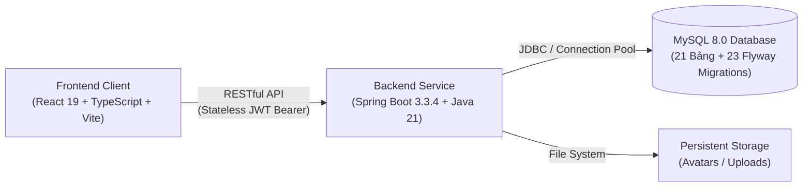

# Hệ Thống Quản Trị Nhân Sự & Điều Phối Ca Làm Việc (HRMS)
*(Employee Management & Shift Scheduling System)*

Hệ thống Quản trị Nhân sự, Ma trận Phân ca Thông minh & Giám sát Chấm công Đa Chi nhánh tuân thủ toàn diện **Bộ luật Lao động Việt Nam 2019**.

---

## 1. Tổng Quan Giải Pháp

Hệ thống HRMS được xây dựng nhằm giải quyết bài toán phức tạp trong công tác điều phối nhân sự và xếp ca tại các doanh nghiệp có mô hình kinh doanh đa chi nhánh (bán lẻ, dịch vụ, chuỗi nhà hàng, khách sạn). Hệ thống tự động hóa toàn bộ quy trình từ đăng ký nguyện vọng làm việc, ma trận xếp ca tuần chống xung đột thời gian thực, điểm danh vào/ra, quy trình giải trình - đổi ca - nghỉ phép, đến xuất báo cáo tính lương chuẩn mực.



---

## 2. Các Tính Năng Nổi Bật

### 📅 Ma Trận Xếp Ca Thông Minh (Smart Shift Scheduling)
- **Giao diện ma trận 8 cột trực quan:** Điều phối ca theo tuần cho từng chi nhánh, hỗ trợ ca ngày, ca gãy, ca đêm và ca vắt ngày (`cross-midnight`).
- **Động cơ kiểm soát xung đột thời gian thực (Conflict Detection Engine):** Tự động phát hiện và cảnh báo theo **9 quy tắc Luật Lao Động 2019 & điều phối di chuyển** (trùng ca, nghỉ giữa ca tối thiểu 11h/12h, trần 48h tuần, trùng phép, lịch làm việc ngày lễ, định mức nhân sự tối thiểu/tối đa, khoảng đệm di chuyển giữa các cơ sở).
- **Cơ chế Snapshot Isolation:** Đóng băng toàn bộ thông số định mức của ca tại thời điểm phân bổ, đảm bảo sự toàn vẹn lịch sử khi mẫu ca được cập nhật trong tương lai.
- **Tiện ích xếp ca nhanh:** Sao chép lịch tuần trước, phân ca hàng loạt, xuất bản lịch và ghi nhận nhật ký kiểm toán thay đổi (`Audit Trail`).

### 🏢 Quản Trị Nhân Sự & Mạng Lưới Đa Chi Nhánh
- **Hồ sơ nhân viên hợp nhất:** Quản lý thông tin cá nhân, chức danh, hợp đồng, hình đại diện và lịch sử công tác.
- **Mô hình đa cơ sở & Điều chuyển công tác:** Hỗ trợ chi nhánh chính và danh sách chi nhánh kiêm nhiệm (`Secondary Branches`), tự động bảo toàn lịch sử phân ca khi nhân viên được luân chuyển.
- **Đăng ký thời gian khả dụng (Availability):** Nhân viên chủ động đăng ký ca làm mong muốn và các ngày rảnh trong tuần để hỗ trợ quản lý xếp lịch tối ưu.

### ⏱️ Chấm Công & Điểm Danh Đa Chế Độ
- **Điểm danh thời gian thực:** Ghi nhận check-in/out, tự động áp dụng thời gian ân hạn và tính toán số phút đi muộn, về sớm.
- **Tự động bóc tách giờ công đêm:** Tách bạch chính xác số giờ làm việc trong khung giờ đêm (`22:00 - 06:00`) theo quy định luật lao động để phục vụ tính phụ cấp.
- **Quy trình giải trình quẹt thẻ:** Xử lý đơn giải trình quên quẹt thẻ vào/ra với quy trình xét duyệt minh bạch lưu trữ trực tiếp vào CSDL.

### 🔄 Hoán Đổi Ca (Shift Swap) & Quản Lý Quỹ Phép Năm
- **Đổi ca làm việc:** Nhân viên chủ động gửi đề xuất đổi ca cho đồng nghiệp, hệ thống tự động hoán đổi phân ca trên lịch tuần ngay khi quản lý phê duyệt.
- **Sổ cái quỹ phép điện tử:** Quản lý hạn mức phép năm, tự động trừ ngày phép khi đơn được duyệt và kích hoạt cơ chế hoàn trả ngày phép tức thì khi người dùng hủy đơn.

### 📊 Báo Cáo Phân Tích & Xuất Dữ Liệu Chuyên Nghiệp
- **3 Báo cáo vận hành:** Bảng chấm công tổng hợp tháng, Bảng đối soát lịch xếp so với thực tế, và Báo cáo vi phạm đi muộn/về sớm.
- **Định dạng xuất chuẩn mực:** Xuất file Microsoft Excel (`.xlsx`) nguyên bản định dạng đẹp qua **Apache POI** và file CSV tiêu chuẩn RFC-4180 có tiền tố **UTF-8 BOM (`\uFEFF`)** chống lỗi hiển thị tiếng Việt.
- **Kiểm soát phạm vi cơ sở (Branch Scoping):** Quản lý chi nhánh bị giới hạn dữ liệu trong cơ sở trực thuộc; chỉ Giám đốc mới có quyền truy cập số liệu toàn chuỗi.

---

## 3. Kiến Trúc & Công Nghệ Chủ Đạo

| Tầng Hệ Thống | Công Nghệ Sử Dụng | Điểm Nổi Bật Về Kỹ Thuật |
| :--- | :--- | :--- |
| **Frontend** | React 19, TypeScript, Vite, Zustand Store, Lucide Icons | Kiến trúc Feature-Driven; Hỗ trợ Dual-Mode (kết nối Backend thực hoặc chạy Mock độc lập); Hệ thống CSS Design Tokens chuẩn tiếp cận WCAG 2.1 AA. |
| **Backend** | Spring Boot 3.3.4, Java 21 LTS, Spring Security, Spring Data JPA, Hibernate 6, Apache POI | Kiến trúc Package-by-Feature Modular Monolith; Xác thực Stateless JWT HMAC-SHA512; Khóa lạc quan `@Version` chống ghi đè đồng thời. |
| **Cơ sở dữ liệu** | MySQL 8.0, Flyway Migrations | 21 bảng quan hệ chuẩn hóa; 23 migrations tự động quản lý phiên bản; Lưu vết Audit Trail tự động (`created_by`, `updated_by`). |
| **Đóng gói & Vận hành** | Docker, Docker Compose, Nginx | Multi-stage build tối ưu kích thước image; Điều phối cụm dịch vụ tự động chỉ với một câu lệnh. |

---

## 4. Phân Quyền Người Dùng (Role-Based Access Control)

Hệ thống áp dụng kiến trúc **Single Source of Truth**: Vai trò đăng nhập và quyền hạn hệ thống được quyết định động dựa trên chức danh công tác thực tế của nhân sự:

- **Giám Đốc (`ROLE_DIRECTOR`):** Quyền điều hành cao nhất toàn hệ thống. Quản lý toàn bộ các chi nhánh, xem Dashboard KPI tổng thể, quản trị cấu hình tham số Luật Lao Động và xuất báo cáo toàn chuỗi.
- **Quản Lý Chi Nhánh (`ROLE_MANAGER`):** Quản lý điều hành trong phạm vi chi nhánh trực thuộc. Xếp ca tuần cho nhân viên cơ sở, duyệt đơn nghỉ phép, duyệt giải trình chấm công, duyệt đổi ca và xuất báo cáo tại cơ sở phụ trách.
- **Nhân Viên (`ROLE_EMPLOYEE`):** Xem lịch phân ca cá nhân, điểm danh vào/ra ca, đăng ký nguyện vọng làm việc, nộp đơn xin nghỉ phép, nộp yêu cầu đổi ca và giải trình giờ công.

---

## 5. Hướng Dẫn Khởi Chạy Nhanh

### Cách 1: Sử dụng Docker Compose (Khuyên Dùng)

1. **Khởi tạo file cấu hình môi trường:**
   Sao chép file mẫu và cấu hình các tham số bảo mật của bạn:
   ```bash
   cp .env.example .env
   ```
2. **Khởi động cụm dịch vụ (MySQL, Backend, Frontend):**
   ```bash
   docker compose up -d --build
   ```
3. **Truy cập ứng dụng:**
   - **Giao diện Người dùng (Frontend):** [http://localhost:5173](http://localhost:5173)
   - **Tài liệu API tương tác (Swagger UI):** [http://localhost:8080/swagger-ui.html](http://localhost:8080/swagger-ui.html)

---

### Cách 2: Chạy Từng Phân Hệ Dành Cho Lập Trình Viên (Local Development)

#### Yêu cầu tiên quyết:
- Java JDK 21+ & Apache Maven 3.9+
- Node.js 20+ & npm
- Máy chủ MySQL 8.0 đang hoạt động

#### Bước 1: Khởi động Backend (Spring Boot)
Thiết lập các biến môi trường trong file `.env` hoặc hệ thống, sau đó khởi chạy:
```bash
cd backend
mvn clean spring-boot:run
```
*(Hệ thống sẽ tự động kích hoạt Flyway để khởi tạo cấu trúc CSDL và nạp dữ liệu nền tảng ban đầu).*

#### Bước 2: Khởi động Frontend (React Vite)
```bash
cd frontend
npm install
npm run dev
```
Giao diện phát triển sẽ sẵn sàng tại `http://localhost:5173`. Các yêu cầu API sẽ được Vite Proxy tự động chuyển tiếp tới Backend tại cổng `8080`.

---

## 6. Danh Mục Tài Liệu Kỹ Thuật (Documentation Hub)

Để tìm hiểu chi tiết về đặc tả nghiệp vụ, mô hình dữ liệu và hướng dẫn mở rộng hệ thống, vui lòng tham khảo kho tài liệu trong thư mục [`docs/`](./docs):

| Mã Tài Liệu | Tên Tài Liệu & Nội Dung Chi Tiết |
| :--- | :--- |
| [`DOC-01`](./docs/01-product-requirements.md) | Đặc tả Yêu cầu Sản phẩm (Product Requirements Document) |
| [`DOC-02`](./docs/02-ui-ux-specification.md) | Đặc tả Thiết kế Trải nghiệm Người dùng & Giao diện (UI/UX Specification) |
| [`DOC-03`](./docs/03-database-design.md) | Thiết kế Cơ sở Dữ liệu & Từ điển Dữ liệu Chi tiết |
| [`DOC-04`](./docs/04-api-specification.md) | Đặc tả Toàn bộ Danh mục RESTful API & Chuẩn Dữ liệu Trao Đổi |
| [`DOC-05`](./docs/05-architecture-and-tech-stack.md) | Kiến trúc Hệ thống & Ngăn xếp Công nghệ Nền tảng |
| [`DOC-07`](./docs/07-scheduling-business-rules.md) | Đặc tả Các Quy Tắc Xếp Ca Tuân Thủ Bộ Luật Lao Động 2019 |
| [`DOC-11`](./docs/11-schedule-screen-specification.md) | Đặc tả Màn hình Ma trận Xếp ca Tuần & Tương tác Người dùng |
| [`DOC-12`](./docs/12-frontend-design-system-and-screens.md) | Hệ thống Design Tokens & Hướng dẫn Triển khai Giao diện |
| [`DOC-18`](./docs/18-project-structure-and-modules-guide.md) | **Tài liệu Cấu trúc Thư mục & Phân tích Chi tiết Toàn bộ Module Dự án (v3.0)** |

---

## 7. Giấy Phép & Bản Quyền

Dự án được bảo hộ quyền tác giả và phát triển cho mục đích quản trị doanh nghiệp chuyên nghiệp. Mọi hành vi sao chép hoặc phân phối lại cần tuân thủ theo quy định nội bộ của tổ chức.
