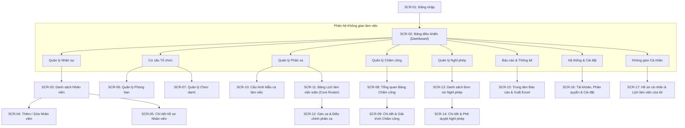
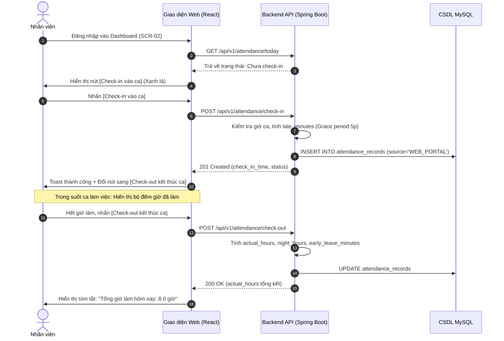
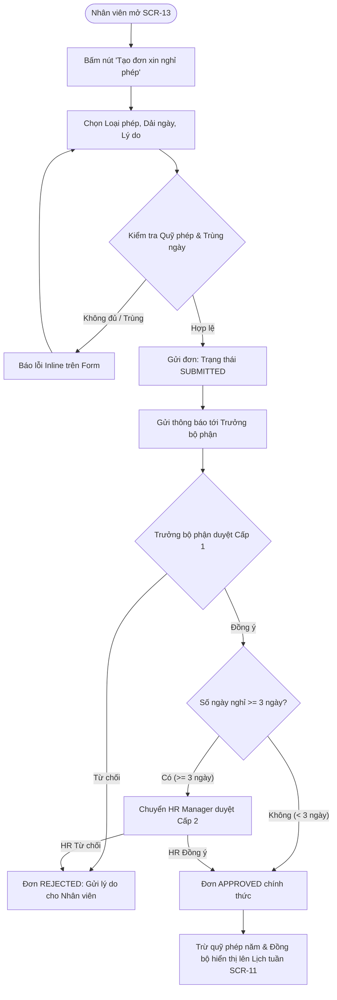
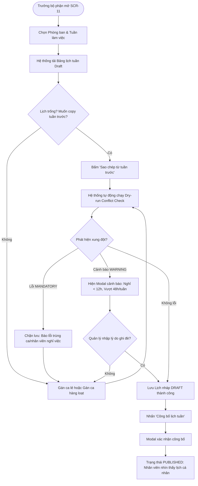

# TÀI LIỆU 02: ĐẶC TẢ GIAO DIỆN VÀ TRẢI NGHIỆM NGƯỜI DÙNG (UI/UX SPECIFICATION)
**Dự án:** Employee Management System  
**Phiên bản:** 1.0.0  
**Ngày cập nhật:** 13/10/2026  
**Trạng thái:** Confirmed / Baseline  

---

## 1. SƠ ĐỒ CẤU TRÚC GIAO DIỆN (SITEMAP & NAVIGATION)

### 1.1. Sơ đồ Trang (Sitemap Mermaid)



### 1.2. Bố cục Khung Giao diện Tổng thể (App Layout Structure)
Giao diện ứng dụng sử dụng mô hình chuẩn Enterprise Dashboard:
1. **Collapsible Left Sidebar (Thanh điều hướng bên trái):** Chiều rộng cố định 250px (khi mở rộng) và 80px (khi thu gọn dạng icon). Hiển thị Logo, tên công ty và cây danh mục menu nhóm theo phân hệ. Tự động ẩn trên màn hình Tablet/Mobile (chuyển thành Drawer trượt ra khi nhấn hamburger icon).
2. **Top Navigation Bar (Thanh tiêu đề trên cùng):** Chiều cao 64px, cố định (Sticky). Bao gồm:
   - Nút thu gọn/mở rộng Sidebar.
   - Đường dẫn phân cấp (Breadcrumbs): Trang chủ > Phân hệ > Màn hình hiện tại.
   - Đồng hồ số thời gian thực chuẩn hệ thống (`Asia/Ho_Chi_Minh`).
   - Nút Check-in / Check-out nhanh (cho nhân viên).
   - Icon chuông thông báo (In-app notifications badge).
   - Menu tài khoản người dùng: Avatar, Họ tên, Chức vụ, Nút đổi mật khẩu, Đăng xuất.
3. **Main Content Canvas (Vùng làm việc chính):** Background xám nhạt (`#F5F7FA`), padding 24px, co giãn tự động theo kích thước màn hình.
4. **Footer:** Thông tin bản quyền, phiên bản hệ thống `v1.0.0-mvp` và hotline hỗ trợ kỹ thuật nội bộ.

---

## 2. QUY TRÌNH THAO TÁC NGƯỜI DÙNG CỐT LÕI (CORE USER FLOWS)

### Quy trình 1: Nhân viên thực hiện Check-in / Check-out trên Web


---

### Quy trình 2: Nhân viên Nộp đơn Nghỉ phép & Phê duyệt Phân cấp


---

### Quy trình 3: Trưởng bộ phận Lập và Công bố Lịch làm việc tuần


---

### Quy trình 4: Trưởng phòng Nhân sự Rà soát Công tháng, Duyệt giải trình & Xuất Báo cáo
```mermaid
flowchart TD
    A([HR mở SCR-08 & SCR-15]) --> B[Chọn Tháng cần chốt công & Phòng ban]
    B --> C[Lọc các bản ghi MISSING_CHECKOUT hoặc LATE]
    C --> D{Có đơn giải trình chờ duyệt?}
    D -- Có --> E[Mở SCR-09 duyệt đơn giải trình: Cập nhật giờ công]
    D -- Không --> F[Chạy tính toán tổng hợp toàn công ty]
    E --> F
    F --> G[Xem trước Bảng tổng hợp công tháng SCR-15]
    G --> H[Đối chiếu Kế hoạch vs Thực tế Scheduled vs Actual]
    H --> I[Bấm 'Xuất Excel (.xlsx)' để gửi Kế toán tiền lương]
    I --> End([Hoàn tất chốt công kỳ tháng])
```

---

## 3. HỆ THỐNG THIẾT KẾ (DESIGN SYSTEM)

### 3.1. Bảng Màu Chuẩn (Color Palette & Tokens)

| Token Tên gọi | Mã Hex | Ý nghĩa & Vị trí Sử dụng |
|:---|:---:|:---|
| `color-primary` | `#1677FF` | Màu thương hiệu chính: Nút hành động chính, tab active, link, focus border. |
| `color-primary-hover` | `#4096FF` | Trạng thái hover của nút chính và phần tử tương tác. |
| `color-secondary` | `#595959` | Màu phụ, text mô tả thứ cấp, border phụ. |
| `color-bg-layout` | `#F5F7FA` | Nền tổng thể toàn bộ trang (canvas background). |
| `color-surface` | `#FFFFFF` | Nền card, bảng dữ liệu, modal, dropdown (pure white). |
| `color-border` | `#D9D9D9` | Đường phân cách bảng, viền ô nhập liệu, viền card. |
| `color-text-primary` | `#1F1F1F` | Màu chữ chính, tiêu đề, nội dung bảng (độ tương phản 12.6:1 trên trắng). |
| `color-text-secondary` | `#8C8C8C` | Chữ phụ, placeholder, timestamp, caption mô tả. |
| `color-success` | `#52C41A` | Trạng thái thành công: Có mặt đúng giờ, đơn đã duyệt, lịch đã công bố. |
| `color-warning` | `#FAAD14` | Trạng thái cảnh báo: Đi muộn, về sớm, cảnh báo vi phạm phân ca (Warning). |
| `color-error` | `#FF4D4F` | Trạng thái lỗi: Lỗi chặn phân ca (Mandatory), vắng mặt không phép, đơn bị từ chối. |
| `color-info` | `#1890FF` | Thông tin hướng dẫn, đơn nháp, trạng thái chờ xử lý. |

### 3.2. Bảng Màu Ca Làm Việc An Toàn Cho Người Mù Màu (Colorblind-Safe Shift Palette)
*Quy tắc bắt buộc: Tuyệt đối không chỉ dùng màu sắc đơn độc. Mọi thẻ ca đều phải có Icon đặc trưng và Nhãn chữ (Label).*

| Loại Ca Làm Việc | Màu Nền (`bg`) | Màu Viền (`border`) | Màu Chữ (`text`) | Icon & Ký hiệu Nhận diện |
|:---|:---:|:---:|:---:|:---|
| **Ca Sáng (06:00 - 14:00 / 08:00 - 17:00)** | `#E6F7FF` | `#91CAFF` | `#0958D9` | ☀️ `Sun` / Nhãn: **SÁNG** |
| **Ca Chiều (14:00 - 22:00)** | `#FFF7E6` | `#FFD591` | `#D46B08` | 🌤️ `Sunset` / Nhãn: **CHIỀU** |
| **Ca Tối (18:00 - 24:00)** | `#F9F0FF` | `#D3ADF7` | `#531DAB` | 🌆 `Dusk` / Nhãn: **TỐI** |
| **Ca Đêm / Qua đêm (22:00 - 06:00 hôm sau)** | `#FFF1F0` | `#FFA39E` | `#CF1322` | 🌙 `Moon` / Nhãn: **ĐÊM (+1)** |
| **Ngày Nghỉ / Nghỉ phép (Approved Leave)** | `#F6FFED` | `#B7EB8F` | `#389E0D` | 🏖️ `Palm` / Nhãn: **PHÉP** |
| **Ngày Lễ Công ty (Public Holiday)** | `#FFF0F6` | `#FFADD2` | `#C41D7F` | 🚩 `Flag` / Nhãn: **LỄ** |

### 3.3. Kiểu Chữ và Hệ Thống Cỡ Chữ (Typography Scale)
- **Phông chữ chủ đạo:** `Inter, 'Be Vietnam Pro', -apple-system, BlinkMacSystemFont, 'Segoe UI', Roboto, sans-serif`. Đảm bảo hiển thị hoàn hảo dấu tiếng Việt Unicode không bị lệch chân hay vỡ nét.
- **Thang cỡ chữ:**
  - `Display / H1`: 24px (font-weight 600, line-height 32px) - Tiêu đề trang chính.
  - `H2`: 20px (font-weight 600, line-height 28px) - Tiêu đề phân khu vực/Modal.
  - `H3`: 16px (font-weight 600, line-height 24px) - Tiêu đề card, nhóm dữ liệu.
  - `Body Regular`: 14px (font-weight 400, line-height 22px) - Văn bản nội dung, dữ liệu bảng, ô nhập liệu.
  - `Body Medium`: 14px (font-weight 500, line-height 22px) - Nhãn nút, tiêu đề cột bảng.
  - `Caption / Small`: 12px (font-weight 400, line-height 20px) - Ghi chú phụ, tooltip, badge nhỏ, mốc thời gian.

### 3.4. Hệ Thống Khoảng Cách, Bo Góc và Độ Nổi (Spacing, Radius & Shadows)
- **Hệ thống Spacing (8-point Grid):** `4px` (xxs), `8px` (xs), `12px` (sm), `16px` (md), `24px` (lg), `32px` (xl), `48px` (xxl).
- **Bo góc (Border Radius):**
  - Nút bấm, ô nhập liệu, tag, badge: `6px`.
  - Thẻ card, modal, dropdown container: `8px`.
  - Modal lớn, Drawer container: `12px`.
- **Độ nổi & Bóng đổ (Elevations & Shadows):**
  - `shadow-sm` (Card, Table): `0 1px 2px 0 rgba(0, 0, 0, 0.05)`.
  - `shadow-md` (Dropdown, Popover): `0 4px 6px -1px rgba(0, 0, 0, 0.1), 0 2px 4px -1px rgba(0, 0, 0, 0.06)`.
  - `shadow-lg` (Modal, Drawer): `0 10px 15px -3px rgba(0, 0, 0, 0.1), 0 4px 6px -2px rgba(0, 0, 0, 0.05)`.

### 3.5. Quy Chuẩn Thành Phần Giao Diện (Component Library Guidelines)
- **Buttons:** 4 biến thể: Primary (Xanh đậm, hành động chính duy nhất trên view), Default (Viền xám nền trắng, hành động phụ), Danger (Đỏ, xóa/từ chối), Link/Ghost (Không viền). Luôn có hiệu ứng loading spinner tích hợp khi đang gọi API.
- **Form Controls:** Ô input luôn có nhãn bên trên (Top-aligned label), dấu hoa thị đỏ `*` cho trường bắt buộc. Thông báo lỗi validation hiển thị ngay dưới ô nhập màu đỏ `#FF4D4F`.
- **Table:** Hỗ trợ phân trang server-side, sort cột, thanh chọn số dòng/trang (10, 20, 50, 100), trạng thái hover từng dòng, sticky header khi cuộn dọc.
- **Feedback & Notification:**
  - Toast nhẹ (Message): Thông báo thao tác nhanh (Lưu nháp thành công, Sao chép thành công) tự tắt sau 3 giây.
  - Modal Xác nhận (Confirm Dialog): Bắt buộc cho hành động xóa mềm, công bố lịch, từ chối đơn.
  - Empty State: Hình minh họa tinh gọn kèm thông điệp rõ ràng và nút bấm hành động gợi ý (ví dụ: *"Chưa có ca làm việc nào. Bấm [Tạo mẫu ca mới] để bắt đầu"*).
  - Skeleton Loading: Hiển thị khung xám nhấp nháy mô phỏng cấu trúc bảng/card trong thời gian chờ API phản hồi (thay thế vòng xoay spinner đơn điệu).

---

## 4. DANH MỤC CHI TIẾT 17 MÀN HÌNH (DETAILED SCREEN INVENTORY)

---

### SCR-01: Màn hình Đăng nhập (Login)
- **Mục tiêu:** Xác thực người dùng truy cập hệ thống, hỗ trợ ghi nhớ đăng nhập và chuyển hướng phân quyền.
- **Vai trò áp dụng:** Toàn bộ người dùng chưa đăng nhập.
- **Bố cục:** Căn giữa màn hình (Split screen: Bên trái hình ảnh minh họa doanh nghiệp, bên phải Form đăng nhập).
- **Trường dữ liệu:** Tên đăng nhập / Email / Mã nhân viên, Mật khẩu, Checkbox "Ghi nhớ phiên đăng nhập".
- **Hành động chính:** Nút "Đăng nhập" (Primary).
- **Hành động phụ:** "Quên mật khẩu? (Liên hệ quản trị viên)".
- **Xác thực dữ liệu:** Bắt buộc nhập đầy đủ tài khoản và mật khẩu; kiểm tra định dạng email nếu nhập dạng email.
- **Trạng thái:**
  - *Loading:* Nút đăng nhập hiển thị spinner, disable toàn bộ input.
  - *Error:* Hiển thị banner đỏ phía trên form: "Tài khoản hoặc mật khẩu không chính xác" hoặc "Tài khoản bị tạm khóa 15 phút do nhập sai quá 5 lần".
- **Liên kết:** FR-030, FR-032 | API-001.

---

### SCR-02: Bảng Điều Khiển Tổng Quan (Dashboard) - [KÈM WIREFRAME ASCII]
- **Mục tiêu:** Cung cấp thông tin tổng quan theo vai trò người dùng, thao tác điểm danh nhanh và xử lý việc chờ duyệt.
- **Vai trò:** Admin, HR Manager, Department Manager, Employee (tự động đổi view).
- **Bố cục:** Lưới thẻ KPI trên cùng $\rightarrow$ Vùng thao tác nhanh & Biểu đồ $\rightarrow$ Bảng danh sách chờ duyệt / Lịch cá nhân.

#### Bản vẽ Phác thảo Wireframe ASCII (SCR-02 - Department Manager & Employee View):
```text
+----------------------------------------------------------------------------------------------------+
| [LOGO] EMPLOYEE MANAGEMENT SYSTEM    | T3, 15/10/2026 08:15:20 | [🔔 3] | (Avatar) Nguyễn Văn An ▼  |
+----------------------------------------------------------------------------------------------------+
| [=] Tổng quan        | BẢNG ĐIỀU KHIỂN - PHÒNG VẬN HÀNH DỊCH VỤ                                    |
| [👥] Nhân sự         |-----------------------------------------------------------------------------|
| [🏢] Phòng ban       | [ TỔNG NHÂN SỰ ]   [ ĐANG CÓ MẶT ]   [ ĐI MUỘN/VỀ SỚM ]   [ NGHỈ PHÉP ]    |
| [📅] Lịch làm việc   |       45                 38                2                  3             |
| [⏱️] Chấm công        |-----------------------------------------------------------------------------|
| [📝] Nghỉ phép       | [ ĐIỂM DANH HÔM NAY ]                    | [ CA TRỰC SẮP DIỄN RA ]           |
| [📊] Báo cáo         | Trạng thái: [ ĐÃ CHECK-IN LÚC 07:55 ]    | - Ca Sáng (08:00 - 17:00): 25 người|
| [⚙️] Cài đặt         | Thời gian làm việc: 0 giờ 20 phút        | - Ca Tối (18:00 - 24:00): 10 người |
|                      | [ Nút: Check-out kết thúc ca ] (Vàng)    | - Ca Đêm (22:00 - 06:00): 3 người  |
|                      |------------------------------------------+-----------------------------------|
|                      | [ ĐƠN CHỜ PHÊ DUYỆT (3) ]                                         [Xem tất cả] |
|                      | ----------------------------------------------------------------------------- |
|                      | 1. Trần Thị Bích  | Đơn nghỉ phép năm (16/10)    | [ Chấp thuận ]  [ Từ chối ]|
|                      | 2. Lê Văn Cường   | Giải trình quên checkout     | [ Chấp thuận ]  [ Từ chối ]|
|                      | 3. Phạm Văn Dũng  | Đơn nghỉ ốm (15/10 - 16/10)  | [ Chấp thuận ]  [ Từ chối ]|
+----------------------------------------------------------------------------------------------------+
```
- **Dữ liệu hiển thị:** 4 Cards thống kê (Tổng quân số, Có mặt, Đi muộn, Nghỉ phép); Widget điểm danh nhanh; Widget ca trực hôm nay; Widget duyệt đơn nhanh.
- **Hành động chính:** Check-in / Check-out; Duyệt / Từ chối đơn nhanh.
- **Liên kết:** FR-001, FR-002, FR-003, FR-012 | API-003, API-025, API-026.

---

### SCR-03: Danh Sách Nhân Viên (Employee List) - [KÈM WIREFRAME ASCII]
- **Mục tiêu:** Quản lý toàn bộ danh sách hồ sơ nhân sự, tìm kiếm, lọc và điều hướng chi tiết.
- **Vai trò:** Admin, HR Manager (Toàn quyền), Department Manager (Xem trong phạm vi bộ phận).

#### Bản vẽ Phác thảo Wireframe ASCII (SCR-03):
```text
+----------------------------------------------------------------------------------------------------+
| Trang chủ > Quản lý nhân sự > Danh sách nhân viên                                                   |
| DANH SÁCH NHÂN SỰ                                                [ + Thêm nhân viên mới ] [ Xuất ]  |
+----------------------------------------------------------------------------------------------------+
| [🔍 Tìm mã, tên, email, sđt...] | [Phòng ban: Tất cả ▼] | [Trạng thái: Đang làm việc ▼] | [Bộ lọc]  |
+----------------------------------------------------------------------------------------------------+
| [ Mã NV  ] [ Họ và Tên       ] [ Phòng ban     ] [ Chức danh  ] [ Loại HĐ  ] [ Trạng thái ] [Hành động]|
|----------------------------------------------------------------------------------------------------|
| EMP-001  | Nguyễn Văn An     | Kinh doanh      | Trưởng nhóm  | Chính thức| [🟢 Hoạt động] | [👁️] [✏️] [🔒]|
| EMP-002  | Trần Thị Bích     | Vận hành        | Nhân viên ca | Chính thức| [🟢 Hoạt động] | [👁️] [✏️] [🔒]|
| EMP-003  | Lê Văn Cường      | Kỹ thuật        | Lập trình    | Thử việc  | [🟡 Thử việc ] | [👁️] [✏️] [🔒]|
| EMP-004  | Phạm Thị Dung     | Kế toán         | Kế toán viên | Chính thức| [🔴 Đã thôi việc]| [👁️] [🔄]    |
+----------------------------------------------------------------------------------------------------+
| Đang xem 1 - 10 trong tổng số 142 nhân viên                 | [< Trang trước] [1] [2] [3]... [Trang sau >] |
+----------------------------------------------------------------------------------------------------+
```
- **Cột dữ liệu:** Checkbox chọn, Mã NV, Họ tên, Avatar, Phòng ban, Chức danh, Loại hợp đồng, Trạng thái (Badge), Hành động (Xem chi tiết, Chỉnh sửa, Khóa/Vô hiệu hóa).
- **Bộ lọc:** Thanh tìm kiếm tức thời (debounce 300ms), Dropdown Phòng ban, Dropdown Trạng thái làm việc.
- **Liên kết:** FR-004, FR-006 | API-006.

---

### SCR-04: Thêm Mới / Chỉnh Sửa Nhân Viên (Create/Edit Employee)
- **Mục tiêu:** Nhập liệu và cập nhật hồ sơ thông tin nhân sự.
- **Vai trò:** Admin, HR Manager.
- **Bố cục:** Form 2 cột chia theo cụm thẻ thông tin: (1) Thông tin cá nhân, (2) Thông tin công việc & tổ chức.
- **Trường dữ liệu:** Mã NV, Họ tên, Email, Số ĐT, Ngày sinh, Giới tính, CCCD/CMND, Địa chỉ; Phòng ban, Chức danh, Quản lý trực tiếp, Ngày vào làm, Loại hợp đồng, Trạng thái.
- **Xác thực:** Kiểm tra định dạng Regex Email doanh nghiệp, Số điện thoại di động Việt Nam 10 chữ số, CCCD 12 số, kiểm tra trùng lặp thời gian thực qua API validation.
- **Hành động:** "Lưu hồ sơ" (Primary), "Hủy bỏ" (Default - cảnh báo nếu có dữ liệu chưa lưu).
- **Liên kết:** FR-005 | API-007, API-009.

---

### SCR-05: Chi Tiết Hồ Sơ Nhân Viên (Employee Detail)
- **Mục tiêu:** Cung cấp góc nhìn 360 độ về nhân viên bao gồm thông tin hợp đồng, lịch sử phân ca, lịch sử công và nghỉ phép.
- **Vai trò:** Admin, HR Manager, Department Manager (nhân viên cấp dưới), Employee (xem hồ sơ chính mình).
- **Bố cục:** Header tóm tắt nhân sự (Avatar, Tên, Mã, Chức vụ, Nút sửa nhanh) + 4 Tabs chi tiết:
  - Tab 1: Thông tin lý lịch & Công việc.
  - Tab 2: Lịch phân ca (Xem theo tháng).
  - Tab 3: Bảng chấm công thực tế & Thống kê giờ công.
  - Tab 4: Lịch sử nghỉ phép & Số dư phép năm.
- **Liên kết:** FR-007 | API-008.

---

### SCR-06: Quản Lý Phòng Ban (Department Management)
- **Mục tiêu:** Xây dựng sơ đồ cây cơ cấu tổ chức và chỉ định trưởng phòng.
- **Vai trò:** Admin, HR Manager.
- **Bố cục:** Split view (Bên trái cây thư mục Tree View phân cấp phòng ban, bên phải Form chi tiết phòng ban được chọn).
- **Trường dữ liệu:** Mã phòng ban, Tên phòng ban, Phòng ban cấp trên (`parent_department_id`), Trưởng phòng (`manager_id`), Mô tả.
- **Ràng buộc:** Chặn chọn phòng ban con làm cha của phòng ban cha (Circular hierarchy). Chặn xóa phòng ban còn nhân viên.
- **Liên kết:** FR-008, FR-009, FR-010 | API-011, API-012, API-013, API-014.

---

### SCR-07: Quản Lý Chức Danh (Position Management)
- **Mục tiêu:** Quản lý danh mục chức danh / vị trí công việc nội bộ.
- **Vai trò:** Admin, HR Manager.
- **Bố cục:** Bảng danh mục chức danh kèm Drawer thêm mới/chỉnh sửa.
- **Trường dữ liệu:** Mã chức danh, Tên chức danh, Mô tả trách nhiệm, Số lượng nhân sự đang giữ chức danh.
- **Liên kết:** FR-011 | API-015, API-016, API-017, API-018.

---

### SCR-08: Bảng Tổng Quan Chấm Công (Attendance Overview)
- **Mục tiêu:** Giám sát thời gian làm việc hàng ngày của nhân viên toàn công ty hoặc theo phòng ban.
- **Vai trò:** Admin, HR Manager, Department Manager.
- **Bố cục:** Bộ lọc ngày và phòng ban $\rightarrow$ 4 Thẻ chỉ số tổng kết ngày $\rightarrow$ Bảng danh sách chi tiết chấm công trong ngày.
- **Cột dữ liệu:** Mã NV, Tên NV, Ca làm việc, Giờ quy định, Check-in, Check-out, Đi muộn (phút), Về sớm (phút), Tổng giờ thực tế, Trạng thái (Đúng giờ, Đi muộn, Về sớm, Thiếu check-out, Nghỉ phép), Nguồn chấm công.
- **Hành động:** Nút "Xuất Excel điểm danh ngày", "Xem đơn giải trình".
- **Liên kết:** FR-012, FR-013, FR-026 | API-027.

---

### SCR-09: Chi Tiết & Giải Trình Chấm Công (Attendance Correction)
- **Mục tiêu:** Xử lý đơn yêu cầu bổ sung/sửa giờ chấm công do quên quét hoặc lỗi hệ thống.
- **Vai trò:** Toàn bộ vai trò (Nhân viên tạo đơn; Quản lý/HR duyệt đơn).
- **Bố cục:** Modal / Drawer form:
  - Thông tin bản ghi gốc: Ngày, Giờ check-in cũ, Giờ check-out cũ, Trạng thái cũ.
  - Phần đề xuất điều chỉnh: Giờ check-in mới, Giờ check-out mới, Lý do giải trình bắt buộc, File bằng chứng đính kèm (tùy chọn).
  - Vùng phê duyệt (dành cho Quản lý): Nút "Chấp thuận" (Green), "Từ chối" (Red kèm ô nhập lý do từ chối).
- **Liên kết:** FR-014, FR-015 | API-028, API-029, API-030.

---

### SCR-10: Cấu Hình Mẫu Ca Làm Việc (Shift Configuration)
- **Mục tiêu:** Tạo và thiết lập danh mục mẫu ca làm việc chuẩn hóa cho công ty.
- **Vai trò:** Admin, HR Manager.
- **Bố cục:** Danh sách thẻ Card mẫu ca trực quan (mỗi card mang màu sắc của ca đó) + Modal thêm/sửa ca.
- **Trường dữ liệu:** Mã ca, Tên ca, Giờ bắt đầu, Giờ kết thúc, Thời gian nghỉ (phút), Cờ ca qua đêm (tự động bật nếu Giờ kết thúc < Giờ bắt đầu), Mã màu (Color picker), Định biên nhân sự tối thiểu/tối đa, Thứ trong tuần áp dụng.
- **Liên kết:** FR-016 | API-019, API-020, API-021.

---

### SCR-11: Bảng Lịch Biểu Tuần (Work Schedule Calendar) - [MÀN HÌNH TRỌNG TÂM CHI TIẾT NHẤT]
- **Mục tiêu:** Không gian làm việc cốt lõi của Quản lý và HR để lập kế hoạch, phát hiện xung đột thời gian thực, sao chép và công bố lịch tuần.
- **Vai trò:** Admin, HR Manager, Department Manager.
- **Bố cục:**
  - **Thanh Công Cụ Trên (Top Control Bar):**
    - Bộ chọn Phòng ban (Dropdown), Bộ chọn Tuần (Nút điều hướng `< Tuần trước`, `Tuần này`, `Tuần sau >` kèm dải ngày hiển thị ví dụ `12/10/2026 - 18/10/2026`).
    - Nút thao tác nhanh: `[ 📋 Sao chép tuần trước ]`, `[ ⚡ Gán hàng loạt ]`, `[ 🧹 Xóa lịch tuần ]`.
    - Thanh trạng thái Lịch: Badge hiển thị `DRAFT` (Màu cam) hoặc `PUBLISHED` (Màu xanh lá).
    - Nút xuất bản chính: `[ 🚀 Công bố lịch tuần ]` (kèm số lượng cảnh báo nếu có).
  - **Lưới Ma Trận Phân Ca Tuần (Weekly Resource Grid):**
    - Cột 1 (Cố định - Sticky Left): Danh sách Nhân viên (Mã NV, Họ tên, Chức danh, Tổng số giờ đã xếp trong tuần / 48h).
    - 7 Cột tiếp theo (Thứ Hai đến Chủ Nhật): Mỗi cột có tiêu đề hiển thị: Tên thứ, Ngày/Tháng, Tổng nhân sự làm việc ngày đó, Cờ ngày lễ/ngày nghỉ.
    - Nội dung mỗi ô (Cell):
      - Nếu chưa gán ca: Hiển thị nút mờ `[ + ]` khi hover.
      - Nếu đã gán ca: Hiển thị Thẻ ca (Shift Chip) mang màu sắc của ca, gồm Tên ca rút gọn, Giờ bắt đầu - Giờ kết thúc, Icon loại ca.
      - Nếu nhân viên có đơn nghỉ phép đã duyệt: Hiển thị Thẻ nghỉ phép màu xanh lá nhạt `[ 🏖️ Nghỉ phép năm ]` (khóa không cho gán ca thường nếu cấu hình chặn).
      - Nếu vi phạm quy tắc: Hiển thị Badge chấm đỏ (Mandatory) hoặc chấm vàng (Warning) nhấp nháy góc phải ô. Hover chuột hiển thị Tooltip chi tiết vi phạm.
  - **Thanh Chú Giải & Phím Tắt (Footer Legend & Shortcuts Bar):**
    - Chú giải màu sắc các ca: Sáng, Chiều, Tối, Đêm, Nghỉ phép, Ngày lễ.
    - Hướng dẫn phím tắt: `Click ô`: Gán ca; `Backspace/Del`: Xóa ca; `Alt + Click`: Sao chép nhanh ca sang ô khác; `Phím mũi tên`: Điều hướng giữa các ô.
  - **Cơ chế Fallback trên Thiết bị Di động (Mobile Fallback):**
    - Trên màn hình nhỏ (< 768px), giao diện chuyển tự động từ ma trận tuần sang chế độ xem theo từng ngày đơn lẻ (Single Day View với bộ chọn thứ dạng tab trượt ngang) để người quản lý vẫn có thể thao tác thuận tiện.

#### Bản vẽ Phác thảo Wireframe ASCII (SCR-11 - Chi tiết Tuyệt đối):
```text
+------------------------------------------------------------------------------------------------------------------------------------------+
| LỊCH LÀM VIỆC TUẦN: PHÒNG VẬN HÀNH DỊCH VỤ                                                        Trạng thái: [ 🟡 BẢN NHÁP (DRAFT) ]     |
| [Phòng ban: Vận hành ▼] | [<] Tuần 42 (12/10 - 18/10/2026) [>] [Hôm nay] | [📋 Chép tuần trước] [⚡ Gán hàng loạt] | [🚀 CÔNG BỐ LỊCH TUẦN] |
+------------------------------------------------------------------------------------------------------------------------------------------+
| NHÂN VIÊN (25)       | T2 (12/10)     | T3 (13/10)     | T4 (14/10)     | T5 (15/10)     | T6 (16/10)     | T7 (17/10)     | CN (18/10)     |
| Đã xếp / Trần 48h    | ĐB: 4/4 người  | ĐB: 4/4 người  | ĐB: 3/4 ⚠️     | ĐB: 4/4 người  | ĐB: 4/4 người  | ĐB: 2/2 người  | [🚩 NGHỈ LỄ]   |
|----------------------+----------------+----------------+----------------+----------------+----------------+----------------+----------------|
| Nguyễn Văn An        | [☀️ CA SÁNG]   | [☀️ CA SÁNG]   | [☀️ CA SÁNG]   | [☀️ CA SÁNG]   | [☀️ CA SÁNG]   |      ---       |      ---       |
| EMP-001 | 40.0h / 48h| 08:00 - 17:00  | 08:00 - 17:00  | 08:00 - 17:00  | 08:00 - 17:00  | 08:00 - 17:00  | (Nghỉ tuần)    | (Nghỉ tuần)    |
|----------------------+----------------+----------------+----------------+----------------+----------------+----------------+----------------|
| Trần Thị Bích        | [🌤️ CA CHIỀU]  | [☀️ CA SÁNG]⚠️ | [🌤️ CA CHIỀU]  | [🏖️ NGHỈ PHÉP] | [🌤️ CA CHIỀU]  | [🌤️ CA CHIỀU]  |      ---       |
| EMP-002 | 40.0h / 48h| 14:00 - 22:00  | 06:00 - 14:00  | 14:00 - 22:00  | (Phép năm đã d)| 14:00 - 22:00  | 14:00 - 22:00  | (Nghỉ tuần)    |
|                      |                | *Nghỉ < 12h!   |                |                |                |                |                |
|----------------------+----------------+----------------+----------------+----------------+----------------+----------------+----------------|
| Lê Văn Cường         |      ---       | [🌙 CA ĐÊM (+1)|      ---       | [🌙 CA ĐÊM (+1)|      ---       | [🌙 CA ĐÊM (+1)|      ---       |
| EMP-003 | 24.0h / 48h| (Nghỉ bù)      | 22:00 - 06:00  | (Nghỉ sau đêm) | 22:00 - 06:00  | (Nghỉ sau đêm) | 22:00 - 06:00  | (Nghỉ tuần)    |
|----------------------+----------------+----------------+----------------+----------------+----------------+----------------+----------------|
| Phạm Văn Dũng        | [☀️ CA SÁNG]   | [☀️ CA SÁNG]   |      ---       | [☀️ CA SÁNG]   | [☀️ CA SÁNG]   | [☀️ CA SÁNG]   | [☀️ CA SÁNG]⚠️ |
| EMP-004 | 56.0h / 48h| 08:00 - 17:00  | 08:00 - 17:00  |                | 08:00 - 17:00  | 08:00 - 17:00  | 08:00 - 17:00  | *Vượt trần 48h!|
+------------------------------------------------------------------------------------------------------------------------------------------+
| CHÚ GIẢI: [☀️ Sáng: 08-17h] [🌤️ Chiều: 14-22h] [🌙 Đêm: 22-06h] [🏖️ Nghỉ phép] [⚠️ Cảnh báo] | Phím tắt: Click ô gán ca, Del xóa ca     |
+------------------------------------------------------------------------------------------------------------------------------------------+
```
- **Liên kết:** FR-017, FR-018, FR-019, FR-020, BR-001..BR-019 | API-022, API-023, API-024.

---

### SCR-12: Gán Ca & Điều Chỉnh Phân Ca (Shift Assignment Drawer) - [KÈM WIREFRAME ASCII]
- **Mục tiêu:** Cung cấp hộp công cụ chọn ca, gán hàng loạt và giải trình ghi đè khi phát hiện cảnh báo vi phạm.
- **Vai trò:** Admin, HR Manager, Department Manager.
- **Bố cục:** Drawer trượt từ cạnh phải màn hình (Width 450px).

#### Bản vẽ Phác thảo Wireframe ASCII (SCR-12):
```text
+---------------------------------------------------+
| GÁN CA LÀM VIỆC                            [ X ]  |
+---------------------------------------------------+
| Nhân viên: Trần Thị Bích (EMP-002)                |
| Ngày làm việc: Thứ Ba, 13/10/2026                 |
|---------------------------------------------------|
| CHỌN MẪU CA LÀM VIỆC:                             |
| ( ) [☀️ Ca Sáng]       08:00 - 17:00 (Nghỉ 60p)   |
| (*) [🌤️ Ca Sáng Sớm]   06:00 - 14:00 (Nghỉ 0p)    |
| ( ) [🌤️ Ca Chiều]      14:00 - 22:00 (Nghỉ 0p)    |
| ( ) [🌙 Ca Đêm (+1)]   22:00 - 06:00 (Nghỉ 0p)    |
| ( ) [🏖️ Đánh dấu ngày nghỉ tuần]                  |
|---------------------------------------------------|
| ⚠️ CẢNH BÁO PHÁT HIỆN VI PHẠM (WARNING):          |
| + [BR-006] Ca trước kết thúc lúc 22:00 ngày T2.   |
|   Khoảng nghỉ chỉ đạt 8.0 giờ (< 12 giờ luật định)|
|---------------------------------------------------|
| [x] Tôi xác nhận đặc cách phân ca này             |
| Lý do giải trình (Bắt buộc tối thiểu 10 ký tự):   |
| [ Nhân viên đồng ý đổi ca hỗ trợ kiểm kê kho.... ]|
|---------------------------------------------------|
| Ghi chú bổ sung (Tùy chọn):                       |
| [ Mang theo chìa khóa cổng chính                ] |
|---------------------------------------------------|
| [ Hủy bỏ ]                         [ Lưu phân ca ]|
+---------------------------------------------------+
```
- **Liên kết:** FR-018, FR-019, BR-006 | API-024.

---

### SCR-13: Danh Sách Đơn Xin Nghỉ Phép (Leave Request List)
- **Mục tiêu:** Quản lý toàn bộ danh sách đơn xin nghỉ phép của nhân viên và cá nhân.
- **Vai trò:** Toàn bộ vai trò (Nhân viên xem đơn mình; Quản lý xem đơn bộ phận; HR xem toàn công ty).
- **Cột dữ liệu:** Mã đơn, Mã NV, Tên NV, Phòng ban, Loại phép, Từ ngày, Đến ngày, Tổng số ngày, Trạng thái (`SUBMITTED`, `APPROVED`, `REJECTED`, `CANCELLED`), Người duyệt, Hành động.
- **Bộ lọc:** Lọc theo Trạng thái, Loại phép, Dải ngày, Phòng ban.
- **Liên kết:** FR-023 | API-031.

---

### SCR-14: Chi Tiết & Phê Duyệt Nghỉ Phép (Leave Detail & Approval)
- **Mục tiêu:** Xem chi tiết lý do nghỉ, hồ sơ minh chứng, số dư phép còn lại và thực hiện duyệt/từ chối.
- **Vai trò:** Department Manager (Duyệt cấp 1), HR Manager (Duyệt cấp 2), Employee (Xem tiến độ).
- **Bố cục:** Thẻ hồ sơ đơn nghỉ + Lịch sử dòng thời gian phê duyệt (Approval Timeline) + Số dư phép năm hiện tại của nhân viên.
- **Hành động:** Nút "Phê duyệt" (Xanh), "Từ chối" (Đỏ kèm popup nhập lý do).
- **Liên kết:** FR-022, FR-024 | API-032, API-033, API-034.

---

### SCR-15: Báo Cáo & Thống Kê (Reports & Analytics)
- **Mục tiêu:** Trung tâm phân tích dữ liệu chuyên sâu và xuất file Excel/CSV phục vụ tính công.
- **Vai trò:** Admin, HR Manager, Department Manager.
- **Bố cục:** 3 Tabs báo cáo:
  - Tab 1: Báo cáo Tổng hợp Công tháng (Bảng ma trận công từng nhân viên).
  - Tab 2: Báo cáo Đi muộn / Về sớm / Vắng mặt.
  - Tab 3: Báo cáo Đối chiếu Kế hoạch vs Thực tế (Scheduled vs. Actual Hours).
- **Hành động:** Bộ lọc Kỳ báo cáo (Tháng/Năm), Phòng ban; Nút "Xuất file Excel (.xlsx)" và "Xuất file CSV".
- **Liên kết:** FR-026, FR-027, FR-028, FR-029 | API-035, API-036, API-037.

---

### SCR-16: Quản Lý Tài Khoản, Phân Quyền & Cài Đặt Hệ Thống (User Accounts & Settings)
- **Mục tiêu:** Quản trị danh sách tài khoản đăng nhập, gán Role và tinh chỉnh tham số chính sách công ty.
- **Vai trò:** Administrator (`ROLE_ADMIN`).
- **Bố cục:** 2 Tabs chính:
  - Tab 1: Danh sách Tài khoản Người dùng (Username, Mã NV, Tên, Roles, Trạng thái Kích hoạt, Lần đăng nhập cuối, Đặt lại mật khẩu).
  - Tab 2: Cài đặt Tham số Chính sách (Bảng chỉnh sửa các tham số trong `system_settings`: Giờ trần tuần, giờ đêm, thời gian ân hạn, bước làm tròn OT).
- **Liên kết:** FR-031, FR-032, FR-033 | API-038, API-039, API-040, API-041.

---

### SCR-17: Hồ Sơ Cá Nhân & Lịch Làm Việc Của Tôi (Personal Profile & Schedule) - [KÈM WIREFRAME ASCII]
- **Mục tiêu:** Cung cấp cổng thông tin tự phục vụ (Self-service Portal) tối ưu hoàn hảo cho Nhân viên trên cả Desktop và Di động.
- **Vai trò:** Toàn bộ nhân viên (`ROLE_EMPLOYEE`, Dept Manager, HR, Admin).

#### Bản vẽ Phác thảo Wireframe ASCII (SCR-17 - Mobile / Desktop Responsive View):
```text
+--------------------------------------------------------------------+
| [🏠] LỊCH LÀM VIỆC VÀ CÔNG CÁ NHÂN           | (Avatar) Nguyễn Văn An|
+--------------------------------------------------------------------+
| [ THÔNG TIN NHÂN SỰ ] Mã: EMP-001 | Chức vụ: Nhân viên Vận hành    |
| Quỹ phép năm: [ 8.5 / 12 ngày còn lại ] | Giờ công tháng này: 96h  |
+--------------------------------------------------------------------+
| [🔘 LỊCH TUẦN NÀY] (12/10 - 18/10/2026)                            |
| ------------------------------------------------------------------ |
| • Thứ Hai (12/10):    [☀️ Ca Sáng: 08:00 - 17:00]  | Check-in: 07:55|
| • Thứ Ba (13/10):     [☀️ Ca Sáng: 08:00 - 17:00]  | Check-in: 07:58|
| • Thứ Tư (14/10):     [☀️ Ca Sáng: 08:00 - 17:00]  | Hôm nay (Đang) |
| • Thứ Năm (15/10):    [☀️ Ca Sáng: 08:00 - 17:00]  | Sắp tới        |
| • Thứ Sáu (16/10):    [☀️ Ca Sáng: 08:00 - 17:00]  | Sắp tới        |
| • Thứ Bảy (17/10):    [--- Nghỉ tuần ---]          |                |
| • Chủ Nhật (18/10):   [--- Nghỉ tuần ---]          |                |
+--------------------------------------------------------------------+
| [ GỬI YÊU CẦU NHANH ]                                              |
| [ + Tạo đơn xin nghỉ phép ]        [ ✍️ Gửi giải trình quên chấm công]|
+--------------------------------------------------------------------+
```
- **Liên kết:** FR-001, FR-012, FR-023, FR-015 | API-004, API-025, API-026, API-031.

---
*Kết thúc Tài liệu 02.*
