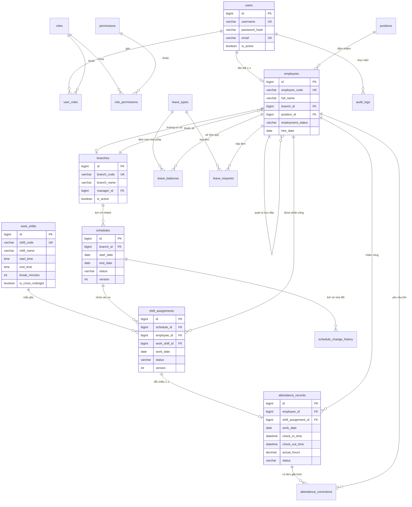

# TÀI LIỆU 03: THIẾT KẾ CƠ SỞ DỮ LIỆU (DATABASE SCHEMA DESIGN)
**Dự án:** Employee Management System  
**Hệ quản trị CSDL:** MySQL 8.0+ (InnoDB Engine, utf8mb4_unicode_ci)  
**Công cụ quản lý migration:** Flyway Migration (V1 - V5)  
**Phiên bản:** 1.2.0  
**Ngày cập nhật:** 19/10/2026  
**Trạng thái:** Confirmed / Baseline (Đã chuẩn hóa Branches và Bổ sung Từ điển Dữ liệu)  
**Từ điển dữ liệu chi tiết:** [DATA_DICTIONARY.md](./database/DATA_DICTIONARY.md)  

---

## 1. NGUYÊN TẮC THIẾT KẾ CSDL & QUY CHUẨN ĐẶT TÊN

1. **Chuẩn hóa & Đặt tên:**
   - Tên bảng: Số nhiều, viết thường theo chuẩn `snake_case` (ví dụ: `employees`, `shift_assignments`, `attendance_records`).
   - Tên cột: Viết thường theo chuẩn `snake_case` (ví dụ: `employee_code`, `check_in_time`, `is_cross_midnight`).
   - Khóa chính (PK): Luôn là `id BIGINT UNSIGNED AUTO_INCREMENT PRIMARY KEY`.
   - Khóa ngoại (FK): Tên bảng số ít kèm hậu tố `_id` (ví dụ: `branch_id`, `work_shift_id`).
   - Cột cờ logic: Bắt đầu bằng tiền tố `is_` hoặc `has_` kiểu `BOOLEAN` (TINYINT(1)).
2. **Quy chuẩn Lưu vết Kiểm toán (Audit Columns):**
   Mọi bảng nghiệp vụ cốt lõi đều bắt buộc có 4 cột kiểm toán hệ thống:
   - `created_at DATETIME NOT NULL DEFAULT CURRENT_TIMESTAMP`
   - `created_by BIGINT UNSIGNED NULL`
   - `updated_at DATETIME NOT NULL DEFAULT CURRENT_TIMESTAMP ON UPDATE CURRENT_TIMESTAMP`
   - `updated_by BIGINT UNSIGNED NULL`
3. **Quy chuẩn Xóa mềm (Soft Delete):**
   - `is_active BOOLEAN NOT NULL DEFAULT TRUE`
   - `deleted_at DATETIME NULL`
   - Mọi câu lệnh truy vấn mặc định áp dụng điều kiện `deleted_at IS NULL`.
4. **Kiểm soát Khóa Lạc quan (Optimistic Concurrency Control):**
   - Các bảng có nguy cơ cập nhật đồng thời cao (`schedules`, `shift_assignments`) bắt buộc có cột `version INT UNSIGNED NOT NULL DEFAULT 0`.
5. **Múi giờ & Chuẩn thời gian:**
   - Toàn bộ cột thời điểm sự kiện (`DATETIME`) được ghi nhận theo chuẩn UTC.
   - Cột ngày lịch nghiệp vụ thuần túy (`work_date`, `holiday_date`) sử dụng kiểu `DATE` (YYYY-MM-DD) tương ứng múi giờ `Asia/Ho_Chi_Minh`.

---

## 2. SƠ ĐỒ THỰC THỂ QUAN HỆ TỔNG THỂ (MERMAID ER DIAGRAM)

---

## 3. ĐẶC TẢ CHI TIẾT CÁC BẢNG CƠ SỞ DỮ LIỆU

---

### PHÂN HỆ 1: TÀI KHOẢN, PHÂN QUYỀN VÀ BẢO MẬT (AUTH & RBAC)

#### 1. Bảng `users` (Tài khoản người dùng)
Lưu thông tin định danh truy cập hệ thống của nhân viên và quản trị viên.

| Tên Cột | Kiểu Dữ Liệu | Ràng Buộc | Ý Nghĩa Nghiệp Vụ |
|:---|:---|:---|:---|
| `id` | `BIGINT UNSIGNED` | `PK, AUTO_INCREMENT` | Định danh tài khoản duy nhất |
| `username` | `VARCHAR(50)` | `NOT NULL, UNIQUE` | Tên đăng nhập (hoặc mã nhân viên) |
| `password_hash` | `VARCHAR(255)` | `NOT NULL` | Mật khẩu băm an toàn bằng BCrypt |
| `email` | `VARCHAR(100)` | `NOT NULL, UNIQUE` | Email đăng nhập doanh nghiệp |
| `must_change_password`| `BOOLEAN` | `NOT NULL DEFAULT TRUE` | Cờ bắt buộc đổi mật khẩu ở lần đầu đăng nhập |
| `failed_login_attempts`| `INT UNSIGNED` | `NOT NULL DEFAULT 0` | Số lần đăng nhập sai liên tiếp hiện tại |
| `locked_until` | `DATETIME` | `NULL` | Mốc thời gian khóa tài khoản do brute-force |
| `last_login_at` | `DATETIME` | `NULL` | Lần đăng nhập thành công gần nhất |
| `is_active` | `BOOLEAN` | `NOT NULL DEFAULT TRUE` | Cờ kích hoạt tài khoản |
| `deleted_at` | `DATETIME` | `NULL` | Thời gian xóa mềm |
| `created_at` | `DATETIME` | `NOT NULL DEFAULT CURRENT_TIMESTAMP` | Thời điểm tạo |
| `updated_at` | `DATETIME` | `NOT NULL DEFAULT CURRENT_TIMESTAMP ON UPDATE CURRENT_TIMESTAMP` | Thời điểm cập nhật |

- **Chỉ mục (Indexes):**
  - `idx_users_username` UNIQUE (`username`)
  - `idx_users_email` UNIQUE (`email`)
  - `idx_users_locked_until` (`locked_until`)

---

#### 2. Bảng `roles` (Vai trò người dùng)
Danh mục các vai trò hệ thống (`ROLE_ADMIN`, `ROLE_HR_MANAGER`, `ROLE_DEPT_MANAGER`, `ROLE_EMPLOYEE`).

| Tên Cột | Kiểu Dữ Liệu | Ràng Buộc | Ý Nghĩa Nghiệp Vụ |
|:---|:---|:---|:---|
| `id` | `BIGINT UNSIGNED` | `PK, AUTO_INCREMENT` | Định danh vai trò |
| `role_code` | `VARCHAR(50)` | `NOT NULL, UNIQUE` | Mã vai trò kỹ thuật (Spring Security prefix ROLE_) |
| `role_name` | `VARCHAR(100)` | `NOT NULL` | Tên hiển thị tiếng Việt (Quản trị viên, Trưởng phòng...) |
| `description` | `VARCHAR(255)` | `NULL` | Mô tả trách nhiệm của vai trò |
| `created_at` | `DATETIME` | `NOT NULL DEFAULT CURRENT_TIMESTAMP` | Thời điểm tạo |

---

#### 3. Bảng `permissions` (Quyền hạn chi tiết)
Danh mục các quyền chức năng (Fine-grained permissions).

| Tên Cột | Kiểu Dữ Liệu | Ràng Buộc | Ý Nghĩa Nghiệp Vụ |
|:---|:---|:---|:---|
| `id` | `BIGINT UNSIGNED` | `PK, AUTO_INCREMENT` | Định danh quyền |
| `permission_code` | `VARCHAR(100)`| `NOT NULL, UNIQUE` | Mã quyền (ví dụ: `schedule:publish`, `attendance:correct`) |
| `permission_name` | `VARCHAR(150)`| `NOT NULL` | Tên quyền hiển thị |
| `module_name` | `VARCHAR(50)` | `NOT NULL` | Tên phân hệ nghiệp vụ (`SCHEDULE`, `ATTENDANCE`...) |

---

#### 4. Bảng `user_roles` (Liên kết Người dùng - Vai trò)
Quan hệ nhiều - nhiều giữa `users` và `roles`.

| Tên Cột | Kiểu Dữ Liệu | Ràng Buộc | Ý Nghĩa Nghiệp Vụ |
|:---|:---|:---|:---|
| `user_id` | `BIGINT UNSIGNED` | `NOT NULL, FK -> users(id)` | ID người dùng |
| `role_id` | `BIGINT UNSIGNED` | `NOT NULL, FK -> roles(id)` | ID vai trò |

- **Ràng buộc khóa chính tổ hợp:** `PRIMARY KEY (user_id, role_id)`.

---

#### 5. Bảng `role_permissions` (Liên kết Vai trò - Quyền hạn)
Quan hệ nhiều - nhiều giữa `roles` và `permissions`.

| Tên Cột | Kiểu Dữ Liệu | Ràng Buộc | Ý Nghĩa Nghiệp Vụ |
|:---|:---|:---|:---|
| `role_id` | `BIGINT UNSIGNED` | `NOT NULL, FK -> roles(id)` | ID vai trò |
| `permission_id` | `BIGINT UNSIGNED` | `NOT NULL, FK -> permissions(id)` | ID quyền hạn |

- **Ràng buộc khóa chính tổ hợp:** `PRIMARY KEY (role_id, permission_id)`.

---

### PHÂN HỆ 2: CƠ CẤU TỔ CHỨC VÀ HỒ SƠ NHÂN SỰ (ORGANIZATION & EMPLOYEES)

#### 6. Bảng `departments` (Phòng ban)
Lưu cấu trúc cây phân cấp phòng ban của doanh nghiệp.

| Tên Cột | Kiểu Dữ Liệu | Ràng Buộc | Ý Nghĩa Nghiệp Vụ |
|:---|:---|:---|:---|
| `id` | `BIGINT UNSIGNED` | `PK, AUTO_INCREMENT` | Định danh phòng ban |
| `department_code` | `VARCHAR(50)` | `NOT NULL, UNIQUE` | Mã phòng ban (ví dụ: `DEPT-OPS`, `DEPT-IT`) |
| `department_name` | `VARCHAR(150)`| `NOT NULL` | Tên phòng ban tiếng Việt |
| `parent_department_id`| `BIGINT UNSIGNED`| `NULL, FK -> departments(id)`| Phòng ban cấp cha trực thuộc (Cây phân cấp) |
| `manager_id` | `BIGINT UNSIGNED` | `NULL` | Trưởng bộ phận phụ trách (FK -> employees(id)) |
| `is_active` | `BOOLEAN` | `NOT NULL DEFAULT TRUE` | Trạng thái hoạt động |
| `deleted_at` | `DATETIME` | `NULL` | Xóa mềm |
| `created_at` | `DATETIME` | `NOT NULL DEFAULT CURRENT_TIMESTAMP` | Thời điểm tạo |
| `updated_at` | `DATETIME` | `NOT NULL DEFAULT CURRENT_TIMESTAMP ON UPDATE CURRENT_TIMESTAMP` | Thời điểm cập nhật |

- **Chỉ mục:** `idx_departments_parent` (`parent_department_id`).

---

#### 7. Bảng `positions` (Chức danh / Vị trí)
Danh mục các vị trí công việc nội bộ.

| Tên Cột | Kiểu Dữ Liệu | Ràng Buộc | Ý Nghĩa Nghiệp Vụ |
|:---|:---|:---|:---|
| `id` | `BIGINT UNSIGNED` | `PK, AUTO_INCREMENT` | Định danh chức danh |
| `position_code` | `VARCHAR(50)` | `NOT NULL, UNIQUE` | Mã chức danh (ví dụ: `POS-DEV`, `POS-LEAD`) |
| `position_name` | `VARCHAR(150)`| `NOT NULL` | Tên chức danh tiếng Việt |
| `description` | `TEXT` | `NULL` | Mô tả tiêu chuẩn công việc |
| `is_active` | `BOOLEAN` | `NOT NULL DEFAULT TRUE` | Trạng thái hoạt động |
| `deleted_at` | `DATETIME` | `NULL` | Xóa mềm |

---

#### 8. Bảng `employees` (Hồ sơ nhân viên)
Lưu trữ đầy đủ thông tin hành chính, hợp đồng và quan hệ tổ chức của nhân viên.

| Tên Cột | Kiểu Dữ Liệu | Ràng Buộc | Ý Nghĩa Nghiệp Vụ |
|:---|:---|:---|:---|
| `id` | `BIGINT UNSIGNED` | `PK, AUTO_INCREMENT` | Định danh nhân viên |
| `user_id` | `BIGINT UNSIGNED` | `NULL, UNIQUE, FK -> users(id)` | Tài khoản đăng nhập liên kết 1-1 |
| `employee_code` | `VARCHAR(50)` | `NOT NULL, UNIQUE` | Mã số nhân viên (ví dụ: `EMP-00123`) |
| `full_name` | `VARCHAR(150)`| `NOT NULL` | Họ và tên đầy đủ |
| `email` | `VARCHAR(100)`| `NOT NULL, UNIQUE` | Email liên hệ công việc |
| `phone_number` | `VARCHAR(20)` | `NOT NULL, UNIQUE` | Số điện thoại di động chính thức |
| `national_id` | `VARCHAR(20)` | `NULL, UNIQUE` | Số CCCD / CMND |
| `date_of_birth` | `DATE` | `NULL` | Ngày sinh |
| `gender` | `VARCHAR(10)` | `NULL` | Giới tính (`MALE`, `FEMALE`, `OTHER`) |
| `address` | `VARCHAR(255)`| `NULL` | Địa chỉ thường trú |
| `department_id` | `BIGINT UNSIGNED`| `NOT NULL, FK -> departments(id)` | Phòng ban trực thuộc |
| `position_id` | `BIGINT UNSIGNED`| `NOT NULL, FK -> positions(id)` | Chức danh đảm nhiệm |
| `manager_id` | `BIGINT UNSIGNED`| `NULL, FK -> employees(id)` | Người quản lý báo cáo trực tiếp |
| `employment_status` | `VARCHAR(20)` | `NOT NULL DEFAULT 'PROBATION'` | `PROBATION`, `OFFICIAL`, `ON_LEAVE`, `RESIGNED` |
| `employment_type` | `VARCHAR(20)` | `NOT NULL DEFAULT 'FULL_TIME'` | `FULL_TIME`, `PART_TIME`, `INTERN`, `CONTRACTOR` |
| `hire_date` | `DATE` | `NOT NULL` | Ngày bắt đầu làm việc chính thức |
| `resignation_date` | `DATE` | `NULL` | Ngày chấm dứt làm việc (nếu thôi việc) |
| `is_active` | `BOOLEAN` | `NOT NULL DEFAULT TRUE` | Trạng thái hoạt động |
| `deleted_at` | `DATETIME` | `NULL` | Xóa mềm |
| `created_at` | `DATETIME` | `NOT NULL DEFAULT CURRENT_TIMESTAMP` | Thời điểm tạo |
| `updated_at` | `DATETIME` | `NOT NULL DEFAULT CURRENT_TIMESTAMP ON UPDATE CURRENT_TIMESTAMP` | Thời điểm cập nhật |

- **Chỉ mục (Indexes):**
  - `idx_employees_code` UNIQUE (`employee_code`)
  - `idx_employees_dept` (`department_id`, `employment_status`, `deleted_at`)
  - `idx_employees_manager` (`manager_id`)

---

### PHÂN HỆ 3: MẪU CA VÀ QUẢN LÝ PHÂN CA (SHIFTS & SCHEDULES - CORE)

#### 9. Bảng `work_shifts` (Mẫu ca làm việc chuẩn hóa)
Lưu trữ định nghĩa các ca làm việc tái sử dụng.

| Tên Cột | Kiểu Dữ Liệu | Ràng Buộc | Ý Nghĩa Nghiệp Vụ |
|:---|:---|:---|:---|
| `id` | `BIGINT UNSIGNED` | `PK, AUTO_INCREMENT` | Định danh mẫu ca |
| `shift_code` | `VARCHAR(50)` | `NOT NULL, UNIQUE` | Mã ca (ví dụ: `SHIFT-MORN`, `SHIFT-NIGHT`) |
| `shift_name` | `VARCHAR(100)`| `NOT NULL` | Tên ca tiếng Việt (Ca Sáng, Ca Đêm) |
| `start_time` | `TIME` | `NOT NULL` | Giờ bắt đầu ca (ví dụ: `08:00:00`) |
| `end_time` | `TIME` | `NOT NULL` | Giờ kết thúc ca (ví dụ: `17:00:00`) |
| `break_minutes` | `INT UNSIGNED` | `NOT NULL DEFAULT 0` | Thời gian nghỉ giữa ca (phút, ví dụ: 60) |
| `is_cross_midnight` | `BOOLEAN` | `NOT NULL DEFAULT FALSE`| Cờ ca làm việc qua đêm (kéo dài qua 00:00) |
| `color_code` | `VARCHAR(20)` | `NOT NULL DEFAULT '#1677FF'` | Mã màu HEX hiển thị trên lịch |
| `min_staffing` | `INT UNSIGNED` | `NOT NULL DEFAULT 1` | Định biên nhân sự tối thiểu trong ca |
| `max_staffing` | `INT UNSIGNED` | `NOT NULL DEFAULT 10` | Định biên nhân sự tối đa trong ca |
| `applicable_days` | `VARCHAR(50)` | `NOT NULL DEFAULT '1,2,3,4,5,6,7'`| Danh sách thứ áp dụng trong tuần |
| `is_active` | `BOOLEAN` | `NOT NULL DEFAULT TRUE` | Trạng thái sử dụng |
| `deleted_at` | `DATETIME` | `NULL` | Xóa mềm |

---

#### 10. Bảng `schedules` (Bảng Lịch biểu Tuần/Kỳ của Phòng ban)
Khung chứa tập hợp các phân ca của một phòng ban trong một khoảng thời gian.

| Tên Cột | Kiểu Dữ Liệu | Ràng Buộc | Ý Nghĩa Nghiệp Vụ |
|:---|:---|:---|:---|
| `id` | `BIGINT UNSIGNED` | `PK, AUTO_INCREMENT` | Định danh bảng lịch tuần |
| `department_id` | `BIGINT UNSIGNED`| `NOT NULL, FK -> departments(id)`| Phòng ban được xếp lịch |
| `start_date` | `DATE` | `NOT NULL` | Ngày đầu tuần (Thứ Hai) |
| `end_date` | `DATE` | `NOT NULL` | Ngày cuối tuần (Chủ Nhật) |
| `status` | `VARCHAR(20)` | `NOT NULL DEFAULT 'DRAFT'` | `DRAFT` (Nháp), `PUBLISHED` (Đã công bố), `ARCHIVED` |
| `published_at` | `DATETIME` | `NULL` | Thời điểm công bố lịch chính thức |
| `published_by` | `BIGINT UNSIGNED`| `NULL, FK -> users(id)` | Người thực hiện công bố lịch |
| `version` | `INT UNSIGNED` | `NOT NULL DEFAULT 0` | Số hiệu phiên bản khóa lạc quan (Optimistic Lock) |
| `created_at` | `DATETIME` | `NOT NULL DEFAULT CURRENT_TIMESTAMP` | Thời điểm tạo |
| `updated_at` | `DATETIME` | `NOT NULL DEFAULT CURRENT_TIMESTAMP ON UPDATE CURRENT_TIMESTAMP` | Thời điểm cập nhật |

- **Ràng buộc:** `UNIQUE KEY uq_schedule_dept_week (department_id, start_date)`.
- **Chỉ mục:** `idx_schedules_dept_date` (`department_id`, `start_date`, `end_date`, `status`).

---

#### 11. Bảng `shift_assignments` (Bản ghi Phân ca Nhân viên)
Lưu phân ca chi tiết cho từng nhân viên vào từng ngày, tích hợp bản chụp dữ liệu (Snapshot) bất biến.

| Tên Cột | Kiểu Dữ Liệu | Ràng Buộc | Ý Nghĩa Nghiệp Vụ |
|:---|:---|:---|:---|
| `id` | `BIGINT UNSIGNED` | `PK, AUTO_INCREMENT` | Định danh bản ghi phân ca |
| `schedule_id` | `BIGINT UNSIGNED`| `NOT NULL, FK -> schedules(id)`| Bảng lịch tuần chứa ca này |
| `employee_id` | `BIGINT UNSIGNED`| `NOT NULL, FK -> employees(id)`| Nhân viên được gán ca |
| `work_shift_id` | `BIGINT UNSIGNED`| `NOT NULL, FK -> work_shifts(id)`| Mẫu ca gốc |
| `work_date` | `DATE` | `NOT NULL` | Ngày làm việc (Theo ngày bắt đầu ca) |
| `snapshot_shift_name` | `VARCHAR(100)`| `NOT NULL` | [Denorm] Tên ca sao chụp tại thời điểm gán |
| `snapshot_start_time` | `TIME` | `NOT NULL` | [Denorm] Giờ bắt đầu sao chụp |
| `snapshot_end_time` | `TIME` | `NOT NULL` | [Denorm] Giờ kết thúc sao chụp |
| `snapshot_break_minutes`| `INT UNSIGNED`| `NOT NULL DEFAULT 0`| [Denorm] Số phút nghỉ sao chụp |
| `snapshot_cross_midnight`| `BOOLEAN` | `NOT NULL DEFAULT FALSE`| [Denorm] Cờ qua đêm sao chụp |
| `planned_start_time` | `DATETIME` | `NOT NULL` | Mốc thời gian bắt đầu tuyệt đối (UTC) |
| `planned_end_time` | `DATETIME` | `NOT NULL` | Mốc thời gian kết thúc tuyệt đối (UTC) |
| `status` | `VARCHAR(20)` | `NOT NULL DEFAULT 'ASSIGNED'` | `ASSIGNED` (Được gán), `CANCELLED` (Đã hủy), `COMPLETED` |
| `override_rule` | `VARCHAR(50)` | `NULL` | Mã quy tắc nghiệp vụ bị ghi đè (ví dụ: `BR-006`) |
| `override_reason` | `TEXT` | `NULL` | Lý do giải trình đặc cách khi bị cảnh báo |
| `version` | `INT UNSIGNED` | `NOT NULL DEFAULT 0` | Phiên bản khóa lạc quan |
| `created_at` | `DATETIME` | `NOT NULL DEFAULT CURRENT_TIMESTAMP` | Thời điểm gán ca |
| `updated_at` | `DATETIME` | `NOT NULL DEFAULT CURRENT_TIMESTAMP ON UPDATE CURRENT_TIMESTAMP` | Thời điểm cập nhật |

- **Chỉ mục Phục vụ Phát hiện Xung đột & Range Query Siêu Tốc:**
  - `idx_shift_assign_emp_date` (`employee_id`, `work_date`)
  - `idx_shift_assign_conflict` (`employee_id`, `planned_start_time`, `planned_end_time`, `status`)
  - `idx_shift_assign_schedule` (`schedule_id`, `work_date`)

---

### PHÂN HỆ 4: QUẢN LÝ CHẤM CÔNG THỰC TẾ (ATTENDANCE & CORRECTIONS)

#### 12. Bảng `attendance_records` (Bản ghi Chấm công Thực tế)
Ghi nhận giờ vào, giờ ra thực tế và các giá trị giờ công đã được tính toán.

| Tên Cột | Kiểu Dữ Liệu | Ràng Buộc | Ý Nghĩa Nghiệp Vụ |
|:---|:---|:---|:---|
| `id` | `BIGINT UNSIGNED` | `PK, AUTO_INCREMENT` | Định danh bản ghi chấm công |
| `employee_id` | `BIGINT UNSIGNED`| `NOT NULL, FK -> employees(id)`| Nhân viên chấm công |
| `shift_assignment_id` | `BIGINT UNSIGNED`| `NULL, FK -> shift_assignments(id)`| Khóa ngoại tới ca kế hoạch (nếu có) |
| `work_date` | `DATE` | `NOT NULL` | Ngày làm việc hành chính |
| `check_in_time` | `DATETIME` | `NULL` | Thời điểm Check-in thực tế (UTC) |
| `check_out_time` | `DATETIME` | `NULL` | Thời điểm Check-out thực tế (UTC) |
| `actual_hours` | `DECIMAL(5,2)`| `NOT NULL DEFAULT 0.00`| Tổng số giờ làm việc thực tế (sau trừ nghỉ) |
| `regular_hours` | `DECIMAL(5,2)`| `NOT NULL DEFAULT 0.00`| Số giờ làm việc bình thường trong ca |
| `overtime_hours` | `DECIMAL(5,2)`| `NOT NULL DEFAULT 0.00`| Số giờ làm thêm (OT) |
| `night_hours` | `DECIMAL(5,2)`| `NOT NULL DEFAULT 0.00`| Số giờ làm việc ban đêm (22:00 - 06:00) |
| `late_minutes` | `INT UNSIGNED` | `NOT NULL DEFAULT 0` | Số phút đi muộn (so với giờ ca + grace) |
| `early_leave_minutes` | `INT UNSIGNED` | `NOT NULL DEFAULT 0` | Số phút về sớm |
| `status` | `VARCHAR(20)` | `NOT NULL DEFAULT 'PRESENT'` | `PRESENT`, `LATE`, `EARLY_LEAVE`, `MISSING_CHECKOUT`, `CORRECTED`, `ABSENT` |
| `source` | `VARCHAR(30)` | `NOT NULL DEFAULT 'WEB_PORTAL'` | `WEB_PORTAL`, `BIOMETRIC_DEVICE`, `MANUAL_CORRECTION` |
| `is_manually_corrected`| `BOOLEAN` | `NOT NULL DEFAULT FALSE`| Đã qua điều chỉnh/giải trình |
| `check_in_ip` | `VARCHAR(45)` | `NULL` | Địa chỉ IP máy trạm khi check-in |
| `check_out_ip` | `VARCHAR(45)` | `NULL` | Địa chỉ IP máy trạm khi check-out |
| `created_at` | `DATETIME` | `NOT NULL DEFAULT CURRENT_TIMESTAMP` | Thời điểm tạo |
| `updated_at` | `DATETIME` | `NOT NULL DEFAULT CURRENT_TIMESTAMP ON UPDATE CURRENT_TIMESTAMP` | Thời điểm cập nhật |

- **Chỉ mục:**
  - `idx_attendance_emp_date` (`employee_id`, `work_date`)
  - `idx_attendance_status` (`work_date`, `status`)
  - `idx_attendance_shift` (`shift_assignment_id`)

---

#### 13. Bảng `attendance_corrections` (Đơn Giải trình / Điều chỉnh Chấm công)
Lưu quy trình giải trình quên chấm công và lịch sử phê duyệt.

| Tên Cột | Kiểu Dữ Liệu | Ràng Buộc | Ý Nghĩa Nghiệp Vụ |
|:---|:---|:---|:---|
| `id` | `BIGINT UNSIGNED` | `PK, AUTO_INCREMENT` | Định danh đơn giải trình |
| `attendance_record_id` | `BIGINT UNSIGNED`| `NOT NULL, FK -> attendance_records(id)`| Bản ghi chấm công cần sửa |
| `employee_id` | `BIGINT UNSIGNED`| `NOT NULL, FK -> employees(id)`| Người tạo đơn giải trình |
| `original_check_in` | `DATETIME` | `NULL` | Giờ check-in cũ |
| `original_check_out` | `DATETIME` | `NULL` | Giờ check-out cũ |
| `requested_check_in` | `DATETIME` | `NOT NULL` | Giờ check-in mới đề xuất |
| `requested_check_out`| `DATETIME` | `NOT NULL` | Giờ check-out mới đề xuất |
| `reason` | `TEXT` | `NOT NULL` | Lý do giải trình chi tiết |
| `attachment_url` | `VARCHAR(255)`| `NULL` | Link đính kèm hình ảnh minh chứng |
| `status` | `VARCHAR(20)` | `NOT NULL DEFAULT 'PENDING'` | `PENDING` (Chờ duyệt), `APPROVED`, `REJECTED` |
| `reviewed_by` | `BIGINT UNSIGNED`| `NULL, FK -> users(id)` | Người duyệt đơn |
| `reviewed_at` | `DATETIME` | `NULL` | Thời điểm duyệt đơn |
| `rejection_reason` | `TEXT` | `NULL` | Lý do từ chối giải trình (nếu có) |
| `created_at` | `DATETIME` | `NOT NULL DEFAULT CURRENT_TIMESTAMP` | Thời điểm tạo |

---

### PHÂN HỆ 5: NGHỈ PHÉP VÀ NGÀY LỄ (LEAVES & HOLIDAYS)

#### 14. Bảng `leave_types` (Danh mục Loại phép)
| Tên Cột | Kiểu Dữ Liệu | Ràng Buộc | Ý Nghĩa Nghiệp Vụ |
|:---|:---|:---|:---|
| `id` | `BIGINT UNSIGNED` | `PK, AUTO_INCREMENT` | Định danh loại phép |
| `type_code` | `VARCHAR(50)` | `NOT NULL, UNIQUE` | `ANNUAL_LEAVE`, `SICK_LEAVE`, `MATERNITY_LEAVE`, `UNPAID_LEAVE`... |
| `type_name` | `VARCHAR(100)`| `NOT NULL` | Tên tiếng Việt (Phép năm, Nghỉ ốm...) |
| `is_paid` | `BOOLEAN` | `NOT NULL DEFAULT TRUE` | Cờ có hưởng lương hay không |
| `requires_attachment` | `BOOLEAN` | `NOT NULL DEFAULT FALSE`| Bắt buộc kèm giấy tờ chứng minh |
| `is_active` | `BOOLEAN` | `NOT NULL DEFAULT TRUE` | Trạng thái hoạt động |

---

#### 15. Bảng `leave_balances` (Quỹ phép Năm của Nhân viên)
| Tên Cột | Kiểu Dữ Liệu | Ràng Buộc | Ý Nghĩa Nghiệp Vụ |
|:---|:---|:---|:---|
| `id` | `BIGINT UNSIGNED` | `PK, AUTO_INCREMENT` | Định danh quỹ phép |
| `employee_id` | `BIGINT UNSIGNED`| `NOT NULL, FK -> employees(id)`| Nhân viên sở hữu |
| `leave_type_id` | `BIGINT UNSIGNED`| `NOT NULL, FK -> leave_types(id)`| Loại phép (thường là phép năm) |
| `year` | `INT UNSIGNED` | `NOT NULL` | Năm dương lịch áp dụng (ví dụ: 2026) |
| `total_allocated` | `DECIMAL(4,1)`| `NOT NULL DEFAULT 12.0`| Tổng số ngày phép được cấp trong năm |
| `used_days` | `DECIMAL(4,1)`| `NOT NULL DEFAULT 0.0` | Số ngày phép đã nghỉ thực tế |
| `pending_days` | `DECIMAL(4,1)`| `NOT NULL DEFAULT 0.0` | Số ngày phép đang chờ duyệt trong các đơn |
| `carried_over_days` | `DECIMAL(4,1)`| `NOT NULL DEFAULT 0.0` | Số ngày phép năm trước chuyển sang |

- **Ràng buộc:** `UNIQUE KEY uq_emp_leave_year (employee_id, leave_type_id, year)`.

---

#### 16. Bảng `leave_requests` (Đơn xin Nghỉ phép)
| Tên Cột | Kiểu Dữ Liệu | Ràng Buộc | Ý Nghĩa Nghiệp Vụ |
|:---|:---|:---|:---|
| `id` | `BIGINT UNSIGNED` | `PK, AUTO_INCREMENT` | Định danh đơn xin nghỉ phép |
| `employee_id` | `BIGINT UNSIGNED`| `NOT NULL, FK -> employees(id)`| Người làm đơn |
| `leave_type_id` | `BIGINT UNSIGNED`| `NOT NULL, FK -> leave_types(id)`| Loại phép xin nghỉ |
| `start_date` | `DATE` | `NOT NULL` | Ngày bắt đầu nghỉ |
| `end_date` | `DATE` | `NOT NULL` | Ngày kết thúc nghỉ |
| `total_days` | `DECIMAL(4,1)`| `NOT NULL` | Tổng số ngày làm việc xin nghỉ |
| `reason` | `TEXT` | `NOT NULL` | Lý do xin nghỉ |
| `attachment_url` | `VARCHAR(255)`| `NULL` | Giấy tờ minh chứng (nếu có) |
| `status` | `VARCHAR(20)` | `NOT NULL DEFAULT 'SUBMITTED'` | `SUBMITTED`, `APPROVED`, `REJECTED`, `CANCELLED` |
| `tier1_reviewed_by` | `BIGINT UNSIGNED`| `NULL, FK -> users(id)` | Trưởng bộ phận duyệt cấp 1 |
| `tier1_reviewed_at` | `DATETIME` | `NULL` | Thời điểm duyệt cấp 1 |
| `tier2_reviewed_by` | `BIGINT UNSIGNED`| `NULL, FK -> users(id)` | HR Manager duyệt cấp 2 |
| `tier2_reviewed_at` | `DATETIME` | `NULL` | Thời điểm duyệt cấp 2 |
| `rejection_reason` | `TEXT` | `NULL` | Lý do từ chối đơn |
| `created_at` | `DATETIME` | `NOT NULL DEFAULT CURRENT_TIMESTAMP` | Thời điểm tạo |

- **Chỉ mục:** `idx_leave_emp_dates` (`employee_id`, `start_date`, `end_date`, `status`).

---

#### 17. Bảng `company_holidays` (Danh mục Ngày lễ Công ty)
| Tên Cột | Kiểu Dữ Liệu | Ràng Buộc | Ý Nghĩa Nghiệp Vụ |
|:---|:---|:---|:---|
| `id` | `BIGINT UNSIGNED` | `PK, AUTO_INCREMENT` | Định danh ngày lễ |
| `holiday_date` | `DATE` | `NOT NULL, UNIQUE` | Ngày diễn ra nghỉ lễ |
| `holiday_name` | `VARCHAR(150)`| `NOT NULL` | Tên ngày lễ (Quốc khánh, Tết Dương lịch...) |
| `is_recurring` | `BOOLEAN` | `NOT NULL DEFAULT FALSE`| Lặp lại hàng năm |
| `is_paid` | `BOOLEAN` | `NOT NULL DEFAULT TRUE` | Nghỉ hưởng nguyên lương |

---

### PHÂN HỆ 6: NHẬT KÝ VÀ CÀI ĐẶT HỆ THỐNG (AUDIT & SETTINGS)

#### 18. Bảng `schedule_change_history` (Nhật ký Thay đổi Lịch Đã Công bố)
Lưu vết mọi hành vi thay đổi trên các lịch làm việc đã ở trạng thái `PUBLISHED`.

| Tên Cột | Kiểu Dữ Liệu | Ràng Buộc | Ý Nghĩa Nghiệp Vụ |
|:---|:---|:---|:---|
| `id` | `BIGINT UNSIGNED` | `PK, AUTO_INCREMENT` | Định danh bản ghi lịch sử |
| `schedule_id` | `BIGINT UNSIGNED`| `NOT NULL, FK -> schedules(id)`| Bảng lịch bị chỉnh sửa |
| `shift_assignment_id` | `BIGINT UNSIGNED`| `NOT NULL` | Bản ghi phân ca bị ảnh hưởng |
| `action_type` | `VARCHAR(20)` | `NOT NULL` | `ADDED`, `MODIFIED`, `DELETED`, `SWAPPED` |
| `old_value` | `JSON` | `NULL` | Snapshot dữ liệu ca cũ trước khi sửa |
| `new_value` | `JSON` | `NULL` | Snapshot dữ liệu ca mới sau khi sửa |
| `change_reason` | `TEXT` | `NOT NULL` | Lý do bắt buộc khi sửa lịch đã công bố |
| `changed_by` | `BIGINT UNSIGNED`| `NOT NULL, FK -> users(id)` | Người thực hiện thao tác |
| `created_at` | `DATETIME` | `NOT NULL DEFAULT CURRENT_TIMESTAMP` | Thời điểm thay đổi |

---

#### 19. Bảng `audit_logs` (Nhật ký Kiểm toán Toàn hệ thống)
Ghi nhận các sự kiện bảo mật, đăng nhập, khóa tài khoản và thao tác nhạy cảm.

| Tên Cột | Kiểu Dữ Liệu | Ràng Buộc | Ý Nghĩa Nghiệp Vụ |
|:---|:---|:---|:---|
| `id` | `BIGINT UNSIGNED` | `PK, AUTO_INCREMENT` | Định danh log |
| `user_id` | `BIGINT UNSIGNED`| `NULL, FK -> users(id)` | Người thực hiện (NULL nếu là Anonymous/Hệ thống) |
| `action` | `VARCHAR(50)` | `NOT NULL` | Hành động (`USER_LOGIN`, `USER_LOCKED`, `EXPORT_DATA`...) |
| `entity_name` | `VARCHAR(50)` | `NOT NULL` | Tên thực thể liên quan (`Employee`, `Schedule`...) |
| `entity_id` | `BIGINT UNSIGNED`| `NULL` | ID bản ghi bị tác động |
| `ip_address` | `VARCHAR(45)` | `NULL` | Địa chỉ IP máy khách |
| `user_agent` | `VARCHAR(255)`| `NULL` | Trình duyệt / Thiết bị gửi yêu cầu |
| `details` | `JSON` | `NULL` | Dữ liệu chi tiết bổ sung dạng JSON |
| `created_at` | `DATETIME` | `NOT NULL DEFAULT CURRENT_TIMESTAMP` | Thời điểm diễn ra sự kiện |

- **Chỉ mục:** `idx_audit_user_action` (`user_id`, `action`, `created_at`).

---

#### 20. Bảng `system_settings` (Cấu hình Tham số Chính sách Toàn công ty)
| Tên Cột | Kiểu Dữ Liệu | Ràng Buộc | Ý Nghĩa Nghiệp Vụ |
|:---|:---|:---|:---|
| `id` | `BIGINT UNSIGNED` | `PK, AUTO_INCREMENT` | Định danh tham số |
| `setting_key` | `VARCHAR(100)`| `NOT NULL, UNIQUE` | Khóa cấu hình (ví dụ: `MAX_WEEKLY_REGULAR_HOURS`) |
| `setting_value` | `VARCHAR(255)`| `NOT NULL` | Giá trị tham số (ví dụ: `48.0`) |
| `data_type` | `VARCHAR(20)` | `NOT NULL DEFAULT 'STRING'` | Kiểu dữ liệu (`NUMBER`, `STRING`, `BOOLEAN`, `TIME`) |
| `description` | `VARCHAR(255)`| `NULL` | Giải thích ý nghĩa và tham chiếu luật |
| `updated_by` | `BIGINT UNSIGNED`| `NULL, FK -> users(id)` | Người sửa cấu hình gần nhất |
| `updated_at` | `DATETIME` | `NOT NULL DEFAULT CURRENT_TIMESTAMP ON UPDATE CURRENT_TIMESTAMP` | Thời điểm cập nhật |

---

## 4. PHÂN TÍCH RỦI RO DƯ THỪA & BIỆN HỘ PHI CHUẨN HÓA (DENORMALIZATION JUSTIFICATION)

Trong thiết kế CSDL trên, có hai khu vực áp dụng **Phi chuẩn hóa có chủ đích (Intentional Denormalization)**:

1. **Snapshotting Mẫu Ca trong bảng `shift_assignments` (`snapshot_shift_name`, `snapshot_start_time`, `snapshot_end_time`, `snapshot_break_minutes`, `snapshot_cross_midnight`):**
   - *Rủi ro dư thừa dữ liệu:* Trùng lặp thông tin vốn đã tồn tại trong bảng `work_shifts`.
   - *Biện hộ kiến trúc:* Đây là yêu cầu bắt buộc để bảo vệ tính toàn vẹn lịch sử kiểm toán. Mẫu ca làm việc trong `work_shifts` là thực thể có thể bị người quản lý sửa đổi hoặc xóa trong tương lai. Nếu không snapshot, một thay đổi giờ ca hôm nay sẽ làm sai lệch hồi tố toàn bộ bảng tính công và lịch sử phân ca của các tháng trước. Chi phí lưu thêm vài chục bytes cho mỗi bản ghi là không đáng kể so với lợi ích bảo vệ tính đúng đắn pháp lý của dữ liệu.
2. **Tính toán sẵn các cột Giờ Công trong bảng `attendance_records` (`actual_hours`, `regular_hours`, `overtime_hours`, `night_hours`, `late_minutes`, `early_leave_minutes`):**
   - *Rủi ro:* Cần cập nhật lại nếu giờ check-in/out được chỉnh sửa qua giải trình.
   - *Biện hộ kiến trúc:* Báo cáo chấm công tháng và Dashboard cần truy vấn tổng giờ công của hàng trăm nhân viên liên tục. Nếu mỗi lần truy vấn đều phải tính toán on-the-fly từ mốc timestamp thô, hiệu năng hệ thống sẽ bị suy giảm nghiêm trọng (O(N) CPU overhead). Việc tính toán sẵn ngay khi nhân viên check-out và cập nhật đồng bộ khi duyệt đơn giải trình giúp các câu lệnh truy vấn báo cáo đạt tốc độ phản hồi tính bằng mili-giây (Index-friendly, O(1) read).

---
*Kết thúc Tài liệu 03.*
