# TÀI LIỆU 03: THIẾT KẾ CƠ SỞ DỮ LIỆU (DATABASE SCHEMA DESIGN)
**Dự án:** Employee Management & Shift Scheduling System (HRMS)  
**Hệ quản trị CSDL:** MySQL 8.0+ (InnoDB Engine, utf8mb4_unicode_ci)  
**Công cụ quản lý migration:** Flyway Migration (27 Scripts: V1 -> V27)  
**Phiên bản:** 3.0.0  
**Ngày cập nhật:** 09/11/2026  
**Trạng thái:** Confirmed / Multi-Branch Enterprise Baseline  
**Từ điển dữ liệu chi tiết:** [DATA_DICTIONARY.md](./database/DATA_DICTIONARY.md)  

---

## 1. NGUYÊN TẮC THIẾT KẾ CSDL & QUY CHUẨN ĐẶT TÊN

1. **Chuẩn hóa & Đặt tên:**
   - Tên bảng: Số nhiều, viết thường theo chuẩn `snake_case` (ví dụ: `employees`, `shift_assignments`, `shift_swap_requests`, `notifications`).
   - Tên cột: Viết thường theo chuẩn `snake_case` (ví dụ: `employee_code`, `transferred_from_employee_id`, `is_cross_midnight`).
   - Khóa chính (PK): Luôn là `id BIGINT UNSIGNED AUTO_INCREMENT PRIMARY KEY`.
   - Khóa ngoại (FK): Tên bảng số ít kèm hậu tố `_id` (ví dụ: `branch_id`, `work_shift_id`, `manager_id`).
   - Cột cờ logic: Bắt đầu bằng tiền tố `is_` hoặc `has_` kiểu `BOOLEAN` (TINYINT(1)).
2. **Quy chuẩn Lưu vết Kiểm toán (Audit Columns):**
   Mọi bảng nghiệp vụ cốt lõi đều bắt buộc có các cột kiểm toán hệ thống:
   - `created_at DATETIME NOT NULL DEFAULT CURRENT_TIMESTAMP`
   - `created_by BIGINT UNSIGNED / VARCHAR(50) NULL`
   - `updated_at DATETIME NOT NULL DEFAULT CURRENT_TIMESTAMP ON UPDATE CURRENT_TIMESTAMP`
   - `updated_by BIGINT UNSIGNED / VARCHAR(50) NULL`
3. **Quy chuẩn Xóa mềm (Soft Delete):**
   - Áp dụng trên các bảng danh mục và hồ sơ (`employees`, `branches`, `positions`, `work_shifts`):
     - `is_active BOOLEAN NOT NULL DEFAULT TRUE`
     - `deleted_at DATETIME NULL`
   - Mọi câu lệnh truy vấn nghiệp vụ mặc định áp dụng điều kiện `deleted_at IS NULL`.
4. **Kiểm soát Khóa Lạc quan (Optimistic Concurrency Control):**
   - Các bảng có nguy cơ cập nhật đồng thời cao (`schedules`, `shift_assignments`, `employees`, `branches`, `shift_swap_requests`) bắt buộc có cột `version INT UNSIGNED NOT NULL DEFAULT 0` kết hợp annotation `@Version` trong JPA entity.
5. **Múi giờ & Chuẩn thời gian:**
   - Toàn bộ cột thời điểm sự kiện tuyệt đối (`DATETIME`) được ghi nhận theo chuẩn UTC.
   - Cột ngày lịch nghiệp vụ thuần túy (`work_date`, `holiday_date`, `start_date`, `end_date`) sử dụng kiểu `DATE` (YYYY-MM-DD) tương ứng múi giờ địa phương `Asia/Ho_Chi_Minh`.

---

## 2. SƠ ĐỒ THỰC THỂ QUAN HỆ TỔNG THỂ (MERMAID ER DIAGRAM)

```mermaid
erDiagram
    users ||--o{ user_roles : "gán"
    roles ||--o{ user_roles : "thuộc"
    roles ||--o{ role_permissions : "chứa"
    permissions ||--o{ role_permissions : "thuộc"
    users ||--o| employees : "liên kết 1-1"
    users ||--o{ notifications : "nhận (user)"

    branches ||--o{ employees : "cơ sở chính"
    branches ||--o{ employee_secondary_branches : "cơ sở kiêm nhiệm"
    branches ||--o{ work_shifts : "sở hữu ca"
    branches ||--o{ schedules : "lịch chi nhánh"
    branches ||--o{ shift_swap_requests : "đổi ca tại cơ sở"
    positions ||--o{ employees : "đảm nhiệm"
    positions ||--o{ employee_secondary_branches : "chức danh cơ sở phụ"

    employees ||--o{ employee_secondary_branches : "kiêm nhiệm"
    employees ||--o{ employee_availabilities : "đăng ký ca rảnh"
    employees ||--o{ employee_preferred_shifts : "đăng ký ca ưu tiên"
    employees ||--o{ shift_assignments : "phân công ca"
    employees ||--o{ shift_assignments : "nhường ca ban đầu (transferred_from)"
    employees ||--o{ attendance_records : "chấm công"
    employees ||--o{ attendance_corrections : "nộp giải trình"
    employees ||--o{ leave_balances : "sổ cái quỹ phép"
    employees ||--o{ leave_requests : "nộp đơn xin nghỉ"
    employees ||--o{ shift_swap_requests : "tạo yêu cầu (requester)"
    employees ||--o{ shift_swap_requests : "đối tác nhận (target)"
    employees ||--o{ notifications : "nhận (employee)"

    work_shifts ||--o{ shift_assignments : "mẫu ca gốc"
    work_shifts ||--o{ employee_availabilities : "khả dụng theo ca"
    work_shifts ||--o{ employee_preferred_shifts : "ca mong muốn"

    schedules ||--o{ shift_assignments : "chứa ca làm"
    schedules ||--o{ schedule_change_history : "nhật ký sửa lịch"
    shift_assignments ||--o{ schedule_change_history : "nhật ký sửa ca"
    shift_assignments ||--o| attendance_records : "đối chiếu 1-1"
    shift_assignments ||--o{ shift_swap_requests : "ca muốn đổi"
    shift_assignments ||--o{ shift_swap_requests : "ca đích đổi"

    attendance_records ||--o{ attendance_corrections : "có đơn giải trình"
    leave_types ||--o{ leave_balances : "hạn mức loại phép"
    leave_types ||--o{ leave_requests : "loại đơn nghỉ"

    users ||--o{ audit_logs : "thực hiện kiểm toán"
```

---

## 3. ĐẶC TẢ CHI TIẾT CÁC PHÂN HỆ CƠ SỞ DỮ LIỆU

### PHÂN HỆ 1: TÀI KHOẢN, PHÂN QUYỀN VÀ BẢO MẬT (AUTH & RBAC)

#### 1. Bảng `users` (Tài khoản người dùng)
Lưu thông tin định danh truy cập hệ thống của nhân viên và cấp quản trị.
- **Khóa chính:** `id BIGINT UNSIGNED AUTO_INCREMENT PRIMARY KEY`.
- **Trường chính:** `username` (VARCHAR(50), UNIQUE), `password_hash` (VARCHAR(255), BCrypt), `email` (VARCHAR(100), UNIQUE), `must_change_password` (BOOLEAN), `failed_login_attempts` (INT UNSIGNED), `locked_until` (DATETIME), `last_login_at` (DATETIME), `is_active` (BOOLEAN), `deleted_at` (DATETIME).
- **Audit:** `created_at`, `updated_at`.

#### 2. Bảng `roles` (Vai trò người dùng)
Danh mục 3 vai trò chuẩn mực: `ROLE_DIRECTOR`, `ROLE_MANAGER`, `ROLE_EMPLOYEE`.
- **Khóa chính:** `id BIGINT UNSIGNED AUTO_INCREMENT PRIMARY KEY`.
- **Trường chính:** `role_code` (VARCHAR(50), UNIQUE), `role_name` (VARCHAR(100)), `description` (VARCHAR(255)), `created_at`.

#### 3. Bảng `permissions` & `role_permissions`
Quản lý quyền chi tiết và bảng trung gian liên kết quyền với vai trò.

#### 4. Bảng `user_roles`
Bảng trung gian liên kết nhiều - nhiều giữa `users` và `roles` (`PRIMARY KEY (user_id, role_id)`).

---

### PHÂN HỆ 2: CƠ CẤU TỔ CHỨC & QUẢN LÝ NHÂN SỰ ĐA CƠ SỞ (MULTI-BRANCH ORG & EMPLOYEES)

#### 5. Bảng `branches` (Mạng lưới chi nhánh / cơ sở)
*(Được chuyển đổi từ `departments` qua Flyway V4 và bổ sung ngày khai trương qua Flyway V12)*
- **Khóa chính:** `id BIGINT UNSIGNED AUTO_INCREMENT PRIMARY KEY`.
- **Trường chính:**
  - `branch_code`: VARCHAR(50) NOT NULL UNIQUE (vd: `CN_CAUGIAY`, `CN_DONGDA`).
  - `branch_name`: VARCHAR(150) NOT NULL.
  - `address`: VARCHAR(255) NULL.
  - `phone_number`: VARCHAR(20) NULL.
  - `opened_date`: DATE NULL (Ngày khai trương cơ sở - Flyway V12).
  - `manager_id`: BIGINT UNSIGNED NULL, FK -> `employees.id` (Quản lý cơ sở).
  - `is_active`: BOOLEAN NOT NULL DEFAULT TRUE, `deleted_at`: DATETIME NULL.
  - `version`: INT UNSIGNED NOT NULL DEFAULT 0 (Optimistic Lock).

#### 6. Bảng `positions` (Chức danh chuẩn hóa)
*(Chuẩn hóa 3 chức danh doanh nghiệp qua Flyway V6)*
- **Khóa chính:** `id BIGINT UNSIGNED AUTO_INCREMENT PRIMARY KEY`.
- **3 Chức danh chuẩn:**
  1. `id = 1`: `position_code = 'DIRECTOR'`, `position_name = 'Giám đốc'` $\rightarrow$ Map với `ROLE_DIRECTOR`.
  2. `id = 2`: `position_code = 'MANAGER'`, `position_name = 'Quản lý chi nhánh'` $\rightarrow$ Map với `ROLE_MANAGER`.
  3. `id = 3`: `position_code = 'EMPLOYEE'`, `position_name = 'Nhân viên'` $\rightarrow$ Map với `ROLE_EMPLOYEE`.

#### 7. Bảng `employees` (Hồ sơ nhân sự)
- **Khóa chính:** `id BIGINT UNSIGNED AUTO_INCREMENT PRIMARY KEY`.
- **Trường chính:**
  - `user_id`: BIGINT UNSIGNED NULL UNIQUE, FK -> `users.id` (Liên kết tài khoản đăng nhập 1-1).
  - `employee_code`: VARCHAR(50) NOT NULL UNIQUE (Tự sinh tăng dần `EMP-001`, `EMP-002` qua Flyway V18).
  - `full_name`: VARCHAR(150) NOT NULL.
  - `email`: VARCHAR(100) NOT NULL UNIQUE, `phone_number`: VARCHAR(20) NOT NULL UNIQUE.
  - `national_id`: VARCHAR(20) NULL UNIQUE, `avatar_url`: VARCHAR(500) NULL (Flyway V13).
  - `date_of_birth`: DATE NULL, `gender`: VARCHAR(10) NULL.
  - `branch_id`: BIGINT UNSIGNED NOT NULL, FK -> `branches.id` (Chi nhánh công tác chính).
  - `position_id`: BIGINT UNSIGNED NOT NULL, FK -> `positions.id` (Chức danh đảm nhiệm).
  - `manager_id`: BIGINT UNSIGNED NULL, FK -> `employees.id` (Quản lý trực tiếp).
  - `employment_status`: VARCHAR(20) NOT NULL DEFAULT 'PROBATION' (`PROBATION`, `ACTIVE`, `SUSPENDED`, `RESIGNED`).
  - `employment_type`: VARCHAR(20) NOT NULL DEFAULT 'FULL_TIME' (`FULL_TIME`, `PART_TIME`, `INTERN`).
  - `hire_date`: DATE NOT NULL, `resignation_date`: DATE NULL.
  - `is_active`: BOOLEAN NOT NULL DEFAULT TRUE, `deleted_at`: DATETIME NULL, `version`: INT UNSIGNED DEFAULT 0.

#### 8. Bảng `employee_secondary_branches` (Cơ sở kiêm nhiệm)
*(Tạo bởi Flyway V9, mở rộng position_id qua Flyway V10)*
- Lưu trữ danh sách chi nhánh phụ mà nhân sự được phân công kiêm nhiệm ngoài chi nhánh chính.
- `employee_id` (FK -> `employees.id`), `branch_id` (FK -> `branches.id`), `position_id` (FK -> `positions.id`), `notes` (VARCHAR(255)).
- `UNIQUE (employee_id, branch_id)`.

---

### PHÂN HỆ 3: CA LÀM VIỆC & MA TRẬN XẾP CA (SHIFTS & SMART SCHEDULING MATRIX)

#### 9. Bảng `employee_availabilities` & `employee_preferred_shifts`
- `employee_availabilities` (Flyway V8): Đăng ký ca rảnh theo thứ trong tuần (`day_of_week` 1-7 ISO-8601).
- `employee_preferred_shifts` (Flyway V11): Đăng ký danh mục ca ưu tiên mong muốn được xếp.

#### 10. Bảng `work_shifts` (Mẫu ca làm việc theo chi nhánh)
*(Gắn trực thuộc từng cơ sở qua Flyway V14, V15)*
- **Khóa chính:** `id BIGINT UNSIGNED AUTO_INCREMENT PRIMARY KEY`.
- **Trường chính:**
  - `branch_id`: BIGINT UNSIGNED NOT NULL, FK -> `branches.id`.
  - `shift_code`: VARCHAR(50) NOT NULL, `shift_name`: VARCHAR(100) NOT NULL.
  - `start_time`: TIME NOT NULL, `end_time`: TIME NOT NULL, `break_minutes`: INT UNSIGNED NOT NULL DEFAULT 0.
  - `is_cross_midnight`: BOOLEAN NOT NULL DEFAULT FALSE (Ca qua đêm).
  - `color_code`: VARCHAR(20) NULL (Flyway V23 cho phép NULL), `text_color`: VARCHAR(20) NOT NULL DEFAULT '#FFFFFF'.
  - `min_staffing`: INT UNSIGNED DEFAULT 1, `max_staffing`: INT UNSIGNED DEFAULT 10.
  - `applicable_days`: VARCHAR(50) DEFAULT '1,2,3,4,5,6,7'.
  - `is_active`: BOOLEAN DEFAULT TRUE, `deleted_at`: DATETIME NULL.

#### 11. Bảng `schedules` (Bảng lịch tuần chi nhánh)
- **Khóa chính:** `id BIGINT UNSIGNED AUTO_INCREMENT PRIMARY KEY`.
- **Trường chính:** `branch_id` (FK -> `branches.id`), `start_date` (DATE), `end_date` (DATE), `status` (`DRAFT` / `PUBLISHED`), `published_at` (DATETIME), `published_by` (FK -> `users.id`), `version` (INT UNSIGNED).
- `UNIQUE (branch_id, start_date)`.

#### 12. Bảng `shift_assignments` (Bản ghi phân ca & Snapshot Isolation)
- **Khóa chính:** `id BIGINT UNSIGNED AUTO_INCREMENT PRIMARY KEY`.
- **Trường chính:**
  - `schedule_id`: BIGINT UNSIGNED NOT NULL, FK -> `schedules.id`.
  - `employee_id`: BIGINT UNSIGNED NOT NULL, FK -> `employees.id` (Nhân sự đi làm thực tế).
  - `transferred_from_employee_id`: BIGINT UNSIGNED NULL, FK -> `employees.id` (Lưu vết người nhường ca ban đầu - Flyway V24).
  - `work_shift_id`: BIGINT UNSIGNED NOT NULL, FK -> `work_shifts.id`.
  - `work_date`: DATE NOT NULL.
  - **Snapshot Fields (Bất biến):** `snapshot_shift_name`, `snapshot_start_time`, `snapshot_end_time`, `snapshot_break_minutes`, `snapshot_cross_midnight`, `snapshot_color_code`.
  - `planned_start_time`: DATETIME NOT NULL, `planned_end_time`: DATETIME NOT NULL.
  - `status`: VARCHAR(20) NOT NULL DEFAULT 'ASSIGNED'.
  - `source`: VARCHAR(20) NOT NULL DEFAULT 'MANAGER' (`MANAGER`: Quản lý phân công; `SELF_CLAIM`: Nhân viên tự đăng ký ca trống - Flyway V25).
  - `override_rule`: VARCHAR(50) NULL, `override_reason`: TEXT NULL.
  - `version`: INT UNSIGNED NOT NULL DEFAULT 0.
- **Chỉ mục tối ưu Conflict Detection:**
  - `idx_shift_assign_conflict`: (`employee_id`, `planned_start_time`, `planned_end_time`, `status`).
  - `idx_shift_assign_emp_date`: (`employee_id`, `work_date`).
  - `idx_shift_assign_transferred`: (`transferred_from_employee_id`).

#### 13. Bảng `shift_swap_requests` (Yêu cầu đổi ca & nhường ca)
*(Tạo bởi Flyway V17)*
- **Khóa chính:** `id BIGINT UNSIGNED AUTO_INCREMENT PRIMARY KEY`.
- **Trường chính:**
  - `request_code`: VARCHAR(50) NOT NULL UNIQUE (vd: `SWAP-001`, `HANDOVER-001`).
  - `branch_id`: BIGINT UNSIGNED NOT NULL, FK -> `branches.id`.
  - `requester_id`: BIGINT UNSIGNED NOT NULL, FK -> `employees.id`.
  - `requester_assignment_id`: BIGINT UNSIGNED NOT NULL, FK -> `shift_assignments.id`.
  - `target_id`: BIGINT UNSIGNED NOT NULL, FK -> `employees.id`.
  - `target_assignment_id`: BIGINT UNSIGNED NULL, FK -> `shift_assignments.id` (NULL nếu là `HANDOVER`).
  - `type`: VARCHAR(20) NOT NULL (`SWAP`: Đổi 2 chiều; `HANDOVER`: Nhường 1 chiều).
  - `reason`: VARCHAR(255) NOT NULL.
  - `status`: VARCHAR(30) NOT NULL DEFAULT 'PENDING_PEER' (`PENDING_PEER`, `PEER_ACCEPTED`, `PEER_REJECTED`, `APPROVED`, `MANAGER_REJECTED`, `CANCELLED`).
  - `peer_note`: VARCHAR(255) NULL, `peer_responded_at`: DATETIME NULL.
  - `manager_id`: BIGINT UNSIGNED NULL, FK -> `employees.id`.
  - `manager_note`: VARCHAR(255) NULL, `approved_at`: DATETIME NULL.
  - `version`: INT UNSIGNED NOT NULL DEFAULT 0.

#### 14. Bảng `schedule_change_history` (Nhật ký thay đổi ca đã công bố)
Ghi nhận mọi thao tác `ADD`, `UPDATE`, `REMOVE`, `SWAP` ca sau khi lịch đã ở trạng thái `PUBLISHED`.

---

### PHÂN HỆ 4: TRUNG TÂM THÔNG BÁO NỘI BỘ (IN-APP NOTIFICATIONS)

#### 15. Bảng `notifications` (Thông báo trong ứng dụng)
*(Tạo bởi Flyway V26, tinh chỉnh liên kết user qua Flyway V27)*
- **Khóa chính:** `id BIGINT UNSIGNED AUTO_INCREMENT PRIMARY KEY`.
- **Trường chính:**
  - `recipient_employee_id`: BIGINT UNSIGNED NULL, FK -> `employees.id` (Nhân sự nhận thông báo).
  - `recipient_user_id`: BIGINT UNSIGNED NULL, FK -> `users.id` (Tài khoản User nhận thông báo - Flyway V27).
  - `branch_id`: BIGINT UNSIGNED NULL (Chi nhánh liên quan).
  - `type`: VARCHAR(40) NOT NULL (`LEAVE_REQUEST`, `LEAVE_STATUS_CHANGED`, `SHIFT_SWAP_REQUEST`, `SHIFT_SWAP_STATUS_CHANGED`, `SHIFT_CLAIMED`).
  - `title`: VARCHAR(150) NOT NULL.
  - `message`: VARCHAR(500) NOT NULL.
  - `ref_type`: VARCHAR(30) NULL, `ref_id`: BIGINT UNSIGNED NULL (Liên kết tham chiếu thực thể).
  - `is_read`: TINYINT(1) NOT NULL DEFAULT 0, `read_at`: DATETIME NULL.
  - `created_at`: DATETIME NOT NULL DEFAULT CURRENT_TIMESTAMP.
- **Chỉ mục tối ưu:**
  - `idx_notif_recipient_read`: (`recipient_employee_id`, `is_read`, `created_at`).
  - `idx_notif_user_read`: (`recipient_user_id`, `is_read`, `created_at`).

---

### PHÂN HỆ 5: CHẤM CÔNG & GIẢI TRÌNH (ATTENDANCE & CORRECTIONS)

#### 16. Bảng `attendance_records` (Dữ liệu chấm công thực tế)
- Ghi nhận Check-in/Check-out, số giờ thực tế (`actual_hours`), giờ tiêu chuẩn (`regular_hours`), giờ tăng ca (`overtime_hours`), giờ làm đêm (`night_hours`: 22:00 - 06:00), phút đi muộn (`late_minutes`), phút về sớm (`early_leave_minutes`).
- Trạng thái: `PRESENT`, `LATE`, `EARLY_LEAVE`, `MISSING_CHECKOUT`, `ABSENT`.

#### 17. Bảng `attendance_corrections` (Đơn giải trình bổ sung giờ công)
- Ghi nhận đơn khiếu nại quẹt thẻ kèm thời gian đề xuất sửa đổi và ảnh minh chứng. Luồng phê duyệt trực tiếp của Quản lý chi nhánh (`PENDING`, `APPROVED`, `REJECTED`).

---

### PHÂN HỆ 6: QUẢN LÝ NGHỈ PHÉP & NGÀY LỄ (LEAVES & HOLIDAYS)

#### 18. Bảng `leave_types`, `leave_balances`, `leave_requests`, `company_holidays`
- `leave_types`: Danh mục loại phép (`ANNUAL`, `SICK`, `UNPAID`, `MATERNITY`).
- `leave_balances`: Sổ cái quỹ phép theo năm (`total_allocated`, `used_days`, `pending_days`, `carried_over_days`).
- `leave_requests`: Đơn xin nghỉ phép phân cấp phê duyệt (`SUBMITTED`, `APPROVED`, `REJECTED`, `CANCELLED`).
- `company_holidays`: Lịch ngày nghỉ Lễ/Tết toàn quốc và nội bộ công ty.

---

### PHÂN HỆ 7: KIỂM TOÁN & THAM SỐ VẬN HÀNH (AUDIT & SYSTEM SETTINGS)

#### 19. Bảng `audit_logs`
Ghi vết thao tác thêm/sửa/xóa quan trọng kèm IP, User-Agent và payload JSON thay đổi.

#### 20. Bảng `system_settings`
Lưu trữ tham số động Luật Lao Động 2019:
- `GRACE_PERIOD_LATE_MINUTES`: Thời gian ân hạn đi muộn (15 phút).
- `MIN_REST_HOURS_BETWEEN_SHIFTS`: Khoảng nghỉ tối thiểu giữa 2 ca liên tiếp (11 giờ thông thường, 12 giờ sau ca đêm).
- `MAX_WEEKLY_HOURS`: Trần giờ làm việc tối đa trong tuần (48 giờ).
- `TRAVEL_BUFFER_MINUTES`: Khoảng đệm di chuyển giữa các chi nhánh (30 phút).

---

## 4. CƠ CHẾ TOÀN VẸN DỮ LIỆU & CHIẾN LƯỢC BẢO VỆ LỊCH SỬ

1. **Snapshot Isolation (Đóng băng phân ca):**
   - Khi gán ca cho nhân viên, toàn bộ thông số định mức của ca (`shift_name`, `start_time`, `end_time`, `break_minutes`, `is_cross_midnight`) được sao chép nguyên trạng vào `shift_assignments`.
   - Nếu Quản lý sửa đổi giờ của mẫu ca gốc trong `work_shifts` sau này, toàn bộ lịch ca trong quá khứ không bao giờ bị biến động giờ công.
2. **Shift Handover Traceability (Bảo tồn nguồn gốc bàn giao ca):**
   - Khi duyệt nhường ca (`HANDOVER`), hệ thống không tạo phân ca mới mà cập nhật `employee_id = target_id`, đồng thời lưu vết `transferred_from_employee_id = requester_id`.
   - Giữ nguyên toàn vẹn tính toán giờ công tuần, không tạo bản ghi rác và cho phép UI hiển thị rõ ràng cả 2 bên.
3. **Open Shift Claiming Source Tagging:**
   - Trường `source` trên `shift_assignments` (`MANAGER` vs `SELF_CLAIM`) giúp phân biệt rõ ràng giữa ca do cấp trên giao và ca do nhân viên tự nguyện đăng ký bổ sung.
4. **Optimistic Locking (@Version):**
   - Bảo vệ chống ghi đè mất mát dữ liệu (Lost Update Problem) khi nhiều quản lý cùng truy cập xếp ca hoặc duyệt đổi ca trong cùng một thời điểm.
