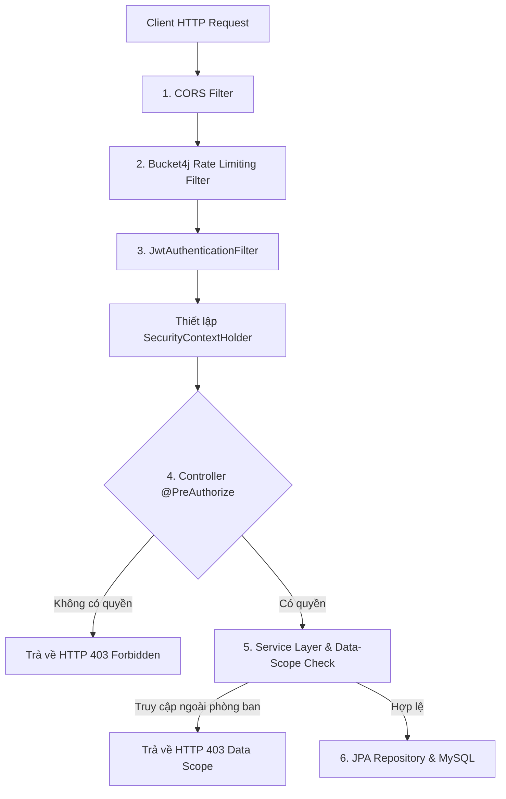

# TÀI LIỆU 05: KIẾN TRÚC HỆ THỐNG VÀ NGĂN XẾP CÔNG NGHỆ (ARCHITECTURE & TECH STACK)
**Dự án:** Employee Management System  
**Mô hình kiến trúc:** Modular Monolith (Package-by-Feature)  
**Phiên bản:** 1.0.0  
**Ngày cập nhật:** 13/10/2026  
**Trạng thái:** Confirmed / Baseline  

---

## 1. TỔNG QUAN KIẾN TRÚC & BIỆN HỘ MÔ HÌNH (MODULAR MONOLITH)

### 1.1. Tại sao chọn Modular Monolith thay vì Microservices?
Đối với doanh nghiệp quy mô từ 50 đến 300 nhân sự hoạt động tại một chi nhánh ở Việt Nam:
1. **Tính Toàn vẹn Dữ liệu (ACID Transactions):** Các nghiệp vụ xếp ca tuần, phát hiện xung đột và trừ quỹ ngày phép đòi hỏi tính giao dịch tức thời (ACID). Nếu chia thành Microservices, việc đảm bảo tính nhất quán qua các service độc lập sẽ phải dùng Distributed Transactions (Saga pattern, 2-phase commit), làm tăng độ phức tạp kỹ thuật lên gấp 5 lần mà không mang lại giá trị kinh doanh thực tế.
2. **Chi phí Hạ tầng & Vận hành (DevOps Overhead):** Một ứng dụng Modular Monolith chạy gọn gàng trên 1 máy chủ VPS (4 vCPU, 8GB RAM) với Docker Compose, tiết kiệm 80% chi phí so với việc dựng cụm Kubernetes, API Gateway, Service Mesh và Distributed Tracing.
3. **Thân thiện với Đội ngũ Kỹ thuật:** Giúp lập trình viên Java backend dễ dàng làm chủ toàn bộ luồng dữ liệu, debug dễ dàng với một điểm breakpoint duy nhất trong IDE.

### 1.2. Nguyên tắc "Package-by-Feature" (Đóng gói theo Tính năng)
Khác với mô hình cổ điển "Package-by-Layer" (gom tất cả Controller vào một thư mục, tất cả Service vào một thư mục), kiến trúc này chia mã nguồn theo từng **Bounded Context (Ranh giới Nghiệp vụ)**:
- Mỗi module nghiệp vụ (`employee`, `schedule`, `attendance`, `leave`) là một gói tự trị (Self-contained package) chứa đầy đủ Controller, Service, Repository, Entity và DTO của riêng mình.
- **Ranh giới giao tiếp:** Module A chỉ được gọi Service Interface công khai của Module B; nghiêm cấm Module A can thiệp trực tiếp vào Repository hoặc Entity nội bộ của Module B.

---

## 2. NGĂN XẾP CÔNG NGHỆ (TECH STACK SPECIFICATIONS)

### 2.1. Backend Tech Stack
- **Ngôn ngữ:** Java 21 LTS (Tận dụng Virtual Threads cho I/O non-blocking, Record classes, Pattern matching).
- **Framework chính:** Spring Boot 3.3.x (Spring Framework 6.x, namespace `jakarta.*`).
- **Web & REST:** Spring Boot Starter Web (Tomcat nhúng, REST Controllers).
- **ORM & Data Access:** Spring Data JPA, Hibernate 6.x.
- **Bảo mật:** Spring Security 6 (Stateless JWT Filter Chain, `@PreAuthorize`).
- **Validation:** Hibernate Validator (Jakarta Bean Validation 3.0).
- **DTO Mapping:** MapStruct 1.5.x (Sinh code ánh xạ Entity $\leftrightarrow$ DTO tại compile-time, zero runtime reflection).
- **Build Tool:** Apache Maven 3.9+.
- **Database Driver & Migration:** MySQL Connector/J 8.3+, Flyway Core 10.x.
- **API Documentation:** Springdoc OpenAPI 2.5+ (Swagger UI).
- **Testing:** JUnit 5, Mockito, Testcontainers (chạy MySQL thật trong container khi test tích hợp).

### 2.2. Frontend Tech Stack
- **Ngôn ngữ:** TypeScript 5.4+ (Strict mode bật 100%).
- **Thư viện UI Core:** React 18.3+ (hoặc 19 stable).
- **Build & Dev Tool:** Vite 5.x / Vite 6.x (Hỗ trợ Fast Refresh, build siêu tốc qua esbuild và Rollup).
- **Kiểm thử Đơn vị & Tích hợp (Testing):** **Vitest 5.x** (Test runner chạy song song siêu tốc dựa trên Vite, môi trường DOM ảo `jsdom`, hỗ trợ globals, tương thích bộ test tại `src/utils/__tests__/`).
- **Định tuyến (Routing):** React Router DOM v6.
- **UI Component Framework:** **Ant Design 5.x** (Bản địa hóa `vi_VN` trọn vẹn, hệ thống Table/Form phong phú).
- **Quản lý Server State & Caching:** **TanStack Query v5 (React Query)** (Tự động caching, refetch on window focus, optimistic mutation).
- **Quản lý Form & Validation:** **React Hook Form** kết hợp **Zod** (Schema validation an toàn kiểu dữ liệu).
- **Biểu đồ & Lịch tuần:**
  - Bảng lịch tuần (SCR-11): **Custom CSS Grid / Virtual Table** kết hợp **TanStack Virtual**.
  - Lịch tháng tổng quan: Ant Design Calendar.
  - Biểu đồ Dashboard: **Recharts** (Lightweight, tương thích React hoàn hảo).
- **Xử lý Ngày giờ:** **Day.js** (kèm plugins: timezone, utc, customParseFormat).
- **Icons:** `@ant-design/icons` và `lucide-react`.

### 2.3. Cơ Chế Vite Dev Proxy & Thứ Tự Khởi Động (Development Proxy & Startup Sequence)
Trong môi trường phát triển cục bộ (Local Development), Frontend chạy tại `http://localhost:5173` và chuyển tiếp các yêu cầu `/api/*` tới Backend Spring Boot qua proxy cấu hình tại `vite.config.ts`:
1. **Chuẩn hóa Địa chỉ IPv4 (`http://127.0.0.1:8080`):**
   - Cấu hình proxy `target` được trỏ trực tiếp tới `http://127.0.0.1:8080` (hoặc biến môi trường `VITE_BACKEND_URL`).
   - *Lý do kỹ thuật:* Trên hệ điều hành Windows kết hợp Node.js 18+, việc cấu hình `localhost` kích hoạt cơ chế `internalConnectMultiple` ưu tiên phân giải IPv6 `::1`, dễ dẫn đến lỗi kết nối bị từ chối `AggregateError [ECONNREFUSED]` khi Backend chỉ lắng nghe trên IPv4.
2. **Bộ Xử Lý Lỗi Proxy Thân Thiện (Proxy Error Interceptor):**
   - Tích hợp hook `configure(proxy)` lắng nghe sự kiện `error` của proxy socket.
   - Khi Backend chưa hoàn tất khởi động hoặc ngoại tuyến, Vite tự động ghi nhận cảnh báo ngắn gọn trên terminal và phản hồi HTTP `503 Service Unavailable` dạng JSON chuẩn (`code: BACKEND_UNAVAILABLE`) thay vì ném stacktrace lỗi thô gây treo socket trình duyệt.
3. **Quy Tắc Thứ Tự Khởi Động Dịch Vụ (Strict Startup Dependency Order):**
   - **Bước 1:** Khởi động cơ sở dữ liệu MySQL 8.0 (cổng 3306).
   - **Bước 2:** Khởi chạy Backend Spring Boot (`mvn clean spring-boot:run`) và **bắt buộc chờ cho đến khi console xuất hiện thông báo `Started HrmsApplication in ... seconds`** (xác nhận CSDL đã nạp xong Flyway migrations từ V1 đến V6).
   - **Bước 3:** Khởi chạy Frontend Vite (`npm run dev`) và truy cập `http://localhost:5173`.

---

## 3. CẤU TRÚC THƯ MỤC DỰ ÁN (PROJECT DIRECTORY STRUCTURE)

### 3.1. Cấu trúc Backend (Spring Boot Package-by-Feature)
```text
backend/
├── pom.xml
└── src/
    ├── main/
    │   ├── java/com/company/hrms/
    │   │   ├── HrmsApplication.java
    │   │   ├── common/                       <-- Dùng chung toàn hệ thống
    │   │   │   ├── config/                   <-- OpenAPI, Timezone, Jackson, WebMvc Config
    │   │   │   ├── exception/                <-- GlobalExceptionHandler, BusinessException
    │   │   │   ├── response/                 <-- ApiResponse, PageResponse, ErrorResponse
    │   │   │   ├── audit/                    <-- AuditableEntity, UserAuditorAware
    │   │   │   └── util/                     <-- DateTimeUtils, SecurityUtils
    │   │   ├── security/                     <-- Hệ thống xác thực & phân quyền
    │   │   │   ├── config/                   <-- SecurityFilterChain, PasswordEncoderConfig
    │   │   │   ├── jwt/                      <-- JwtTokenProvider, JwtAuthenticationFilter
    │   │   │   └── service/                  <-- CustomUserDetailsService, UserPrincipal
    │   │   ├── modules/                      <-- CÁC MODULE NGHIỆP VỤ (Package-by-Feature)
    │   │   │   ├── auth/                     <-- Đăng nhập, đổi mật khẩu, refresh token
    │   │   │   │   ├── controller/
    │   │   │   │   ├── dto/
    │   │   │   │   └── service/
    │   │   │   ├── employee/                 <-- Quản lý hồ sơ nhân viên
    │   │   │   │   ├── controller/
    │   │   │   │   ├── domain/               <-- Employee.java entity
    │   │   │   │   ├── dto/
    │   │   │   │   ├── mapper/
    │   │   │   │   ├── repository/
    │   │   │   │   └── service/
    │   │   │   ├── department/               <-- Phòng ban & Chức danh
    │   │   │   ├── shift/                    <-- Mẫu ca làm việc (Work Shifts)
    │   │   │   ├── schedule/                 <-- Phân ca & Lịch tuần (CORE ENGINE)
    │   │   │   │   ├── controller/
    │   │   │   │   ├── domain/               <-- Schedule.java, ShiftAssignment.java
    │   │   │   │   ├── dto/
    │   │   │   │   ├── engine/               <-- ConflictDetectionEngine, OvertimeCalculator
    │   │   │   │   ├── repository/
    │   │   │   │   └── service/
    │   │   │   ├── attendance/               <-- Chấm công & Giải trình
    │   │   │   ├── leave/                    <-- Nghỉ phép & Ngày lễ
    │   │   │   ├── report/                   <-- Báo cáo & Xuất Excel/CSV (Apache POI)
    │   │   │   ├── setting/                  <-- Cấu hình tham số chính sách (system_settings)
    │   │   │   └── audit/                    <-- AuditLog service & repository
    │   └── resources/
    │       ├── application.yml               <-- Cấu hình chính
    │       ├── application-dev.yml
    │       ├── application-prod.yml
    │       ├── logback-spring.xml            <-- Cấu hình structured logging
    │       └── db/migration/                 <-- Flyway migration scripts
    │           ├── V1__init_schema.sql
    │           ├── V2__seed_master_data.sql
    │           └── V3__seed_admin_user.sql
    └── test/
        └── java/com/company/hrms/
            ├── modules/schedule/engine/ConflictDetectionEngineTest.java
            └── modules/attendance/AttendanceCalculationTest.java
```

### 3.2. Cấu trúc Frontend (React Feature-based)
```text
frontend/
├── package.json
├── tsconfig.json
├── vite.config.ts
├── index.html
└── src/
    ├── main.tsx                              <-- Điểm khởi chạy React, bọc Providers
    ├── App.tsx                               <-- Cấu hình Routes chính
    ├── assets/                               <-- Ảnh logo, icons, fonts
    ├── components/                           <-- Các thành phần UI dùng chung
    │   ├── layout/                           <-- AppLayout, Sidebar, Header, Breadcrumbs
    │   ├── feedback/                         <-- LoadingSkeleton, ErrorBoundary, EmptyState
    │   └── common/                           <-- StatusBadge, ConfirmModal
    ├── context/                              <-- AuthContext, ThemeContext
    ├── hooks/                                <-- useAuth, useDebounce, usePermission
    ├── lib/                                  <-- apiClient (Axios instance), dayjsConfig
    ├── features/                             <-- CÁC PHÂN HỆ GIAO DIỆN CHÍNH
    │   ├── auth/                             <-- Trang Login, Đổi mật khẩu
    │   ├── dashboard/                        <-- Dashboard widgets & biểu đồ
    │   ├── employees/                        <-- Danh sách, Form thêm/sửa, Chi tiết hồ sơ
    │   ├── departments/                      <-- Quản lý phòng ban & chức danh
    │   ├── shifts/                           <-- Quản lý mẫu ca
    │   ├── schedules/                        <-- PHÂN CA & LỊCH TUẦN (CORE)
    │   │   ├── components/
    │   │   │   ├── WeeklyRosterGrid.tsx      <-- Custom Matrix Grid (Nhân viên x Ngày)
    │   │   │   ├── ShiftChip.tsx             <-- Thẻ ca làm việc với màu WCAG
    │   │   │   ├── ConflictBadge.tsx         <-- Cờ cảnh báo Mandatory/Warning
    │   │   │   ├── AssignShiftDrawer.tsx     <-- Drawer gán ca & giải trình ghi đè
    │   │   │   └── PublishBar.tsx            <-- Thanh công bố lịch tuần
    │   │   ├── hooks/useScheduleRoster.ts
    │   │   └── types/schedule.types.ts
    │   ├── attendance/                       <-- Điểm danh web, Bảng công ngày, Giải trình
    │   ├── leaves/                           <-- Đơn xin nghỉ phép, Phê duyệt
    │   ├── reports/                          <-- Báo cáo tháng, Báo cáo đối chiếu, Nút Xuất
    │   └── settings/                         <-- Quản lý tài khoản & Tham số hệ thống
    ├── utils/                                <-- Hàm tiện ích (date.utils, code-generator.utils)
    │   └── __tests__/                        <-- Bộ bài kiểm thử đơn vị Vitest (15 unit tests)
    └── types/                                <-- Kiểu dữ liệu TypeScript dùng chung
        └── api.types.ts                      <-- ApiResponse, PaginationMeta, UserRole
```

---

## 4. KIẾN TRÚC BẢO MẬT VÀ XÁC THỰC (SECURITY ARCHITECTURE)



### 4.1. Cơ chế Hoạt động của Bộ lọc Bảo mật
1. **CORS Filter:** Cấu hình tường minh danh sách domain được phép truy cập (`http://localhost:5173` trên môi trường dev, domain chính thức trên prod). Bật `allowCredentials(true)` để cho phép truyền cookie `refresh_token`.
2. **Rate Limiting Filter (Bucket4j):** Giới hạn tối đa 5 yêu cầu đăng nhập sai trong 15 phút trên mỗi IP/tài khoản. Trả về `429 Too Many Requests` khi vượt ngưỡng.
3. **JwtAuthenticationFilter:**
   - Trích xuất token từ Header: `Authorization: Bearer <token>`.
   - Giải mã và xác thực chữ ký số bằng khóa bí mật (`JWT_SECRET` tối thiểu 256 bits).
   - Kiểm tra hạn sử dụng (15 phút).
   - Nạp thông tin người dùng (`UserPrincipal`) vào `SecurityContextHolder`.
4. **Phân quyền Hai Lớp (Two-tier Authorization):**
   - *Lớp 1 (Role-level):* Chặn tại Controller bằng `@PreAuthorize("hasAnyRole('ADMIN', 'HR_MANAGER')")`.
   - *Lớp 2 (Data-scope level):* Kiểm tra ngữ cảnh dữ liệu tại tầng Service. Ví dụ: Nếu người gọi là `ROLE_DEPT_MANAGER`, service kiểm tra xem `department_id` của tài nguyên có thuộc phòng ban mà manager quản lý hay không. Nếu cố tình truy vấn phòng ban khác $\rightarrow$ Chặn ngay lập tức và ghi log cảnh báo an ninh.

---

## 5. XỬ LÝ LỖI TOÀN CỤC VÀ NHẬT KÝ KIỂM TOÁN (GLOBAL EXCEPTION & LOGGING)

### 5.1. Bộ Xử lý Ngoại lệ Toàn cục (`@RestControllerAdvice`)
Tất cả các lỗi xảy ra trong backend đều được gom về một lớp điều khiển duy nhất `GlobalExceptionHandler` để đảm bảo định dạng trả về luôn thống nhất:

```java
@RestControllerAdvice
@Slf4j
public class GlobalExceptionHandler {

    // 1. Bắt lỗi Validation form (Bean Validation @Valid)
    @ExceptionHandler(MethodArgumentNotValidException.class)
    public ResponseEntity<ApiResponse<Void>> handleValidation(MethodArgumentNotValidException ex) {
        List<ValidationErrorDetail> details = ex.getBindingResult().getFieldErrors().stream()
            .map(err -> new ValidationErrorDetail(err.getField(), err.getRejectedValue(), err.getDefaultMessage()))
            .toList();
        return ResponseEntity.badRequest().body(ApiResponse.validationError(details));
    }

    // 2. Bắt lỗi Nghiệp vụ (BusinessException - ví dụ: vi phạm quy tắc phân ca BR-001)
    @ExceptionHandler(BusinessException.class)
    public ResponseEntity<ApiResponse<Void>> handleBusiness(BusinessException ex) {
        log.warn("Business rule violation: code={}, message={}", ex.getErrorCode(), ex.getMessage());
        return ResponseEntity.status(ex.getHttpStatus()).body(ApiResponse.error(ex.getErrorCode(), ex.getMessage()));
    }

    // 3. Bắt lỗi Xung đột Khóa Lạc quan (OptimisticLockException)
    @ExceptionHandler(OptimisticLockException.class)
    public ResponseEntity<ApiResponse<Void>> handleOptimisticLock(OptimisticLockException ex) {
        return ResponseEntity.status(HttpStatus.CONFLICT)
            .body(ApiResponse.error("OPTIMISTIC_LOCK_CONFLICT", "Dữ liệu vừa được cập nhật bởi người dùng khác. Vui lòng làm mới trang."));
    }

    // 4. Bắt lỗi Không có quyền truy cập (AccessDeniedException)
    @ExceptionHandler(AccessDeniedException.class)
    public ResponseEntity<ApiResponse<Void>> handleAccessDenied(AccessDeniedException ex) {
        return ResponseEntity.status(HttpStatus.FORBIDDEN)
            .body(ApiResponse.error("FORBIDDEN", "Bạn không có quyền thực hiện thao tác này."));
    }

    // 5. Bắt toàn bộ lỗi máy chủ không mong muốn còn lại (500)
    @ExceptionHandler(Exception.class)
    public ResponseEntity<ApiResponse<Void>> handleGeneral(Exception ex, HttpServletRequest request) {
        log.error("Unhandled internal server error at path: {}", request.getRequestURI(), ex);
        return ResponseEntity.status(HttpStatus.INTERNAL_SERVER_ERROR)
            .body(ApiResponse.error("INTERNAL_SERVER_ERROR", "Đã xảy ra sự cố kỹ thuật. Vui lòng liên hệ quản trị viên."));
    }
}
```

### 5.2. Chuẩn Hóa Nhật Ký Ứng Dụng (Structured Logging)
- Ứng dụng sử dụng **Slf4j** kết hợp **Logback** xuất định dạng JSON trên môi trường Production để tương thích với các hệ thống phân tích log tập trung (ELK / Grafana Loki).
- **Mặt nạ dữ liệu nhạy cảm (PII Masking):** Cấu hình bộ lọc log tự động làm mờ các trường nhạy cảm như `password`, `national_id` (CCCD) và mã PIN để tuân thủ Nghị định 13/2023/NĐ-CP.

---

## 6. KẾ HOẠCH TRIỂN KHAI DOCKER COMPOSE (DEVOPS CONTAINER LAYOUT)

Hệ thống được đóng gói thành các dịch vụ Docker độc lập để triển khai dễ dàng bằng một lệnh `docker compose up -d`:

```yaml
# docker-compose.yml (Kế hoạch kiến trúc phục vụ triển khai)
version: '3.8'

services:
  mysql-db:
    image: mysql:8.0.36
    container_name: hrms-mysql
    restart: always
    environment:
      MYSQL_DATABASE: hrms_db
      MYSQL_ROOT_PASSWORD: ${MYSQL_ROOT_PASSWORD}
      MYSQL_USER: hrms_user
      MYSQL_PASSWORD: ${MYSQL_PASSWORD}
      TZ: Asia/Ho_Chi_Minh
    ports:
      - "3306:3306"
    volumes:
      - mysql_data:/var/lib/mysql
    command: --character-set-server=utf8mb4 --collation-server=utf8mb4_unicode_ci --default-time-zone='+07:00'
    healthcheck:
      test: ["CMD", "mysqladmin", "ping", "-h", "localhost"]
      interval: 10s
      timeout: 5s
      retries: 5

  backend-app:
    build:
      context: ./backend
      dockerfile: Dockerfile
    container_name: hrms-backend
    restart: always
    depends_on:
      mysql-db:
        condition: service_healthy
    environment:
      SPRING_PROFILES_ACTIVE: prod
      DB_HOST: mysql-db
      DB_PORT: 3306
      DB_NAME: hrms_db
      DB_USERNAME: hrms_user
      DB_PASSWORD: ${MYSQL_PASSWORD}
      JWT_SECRET: ${JWT_SECRET}
      TZ: Asia/Ho_Chi_Minh
    ports:
      - "8080:8080"

  frontend-app:
    build:
      context: ./frontend
      dockerfile: Dockerfile
    container_name: hrms-frontend
    restart: always
    depends_on:
      - backend-app
    ports:
      - "80:80"

volumes:
  mysql_data:
```

---
*Kết thúc Tài liệu 05.*
