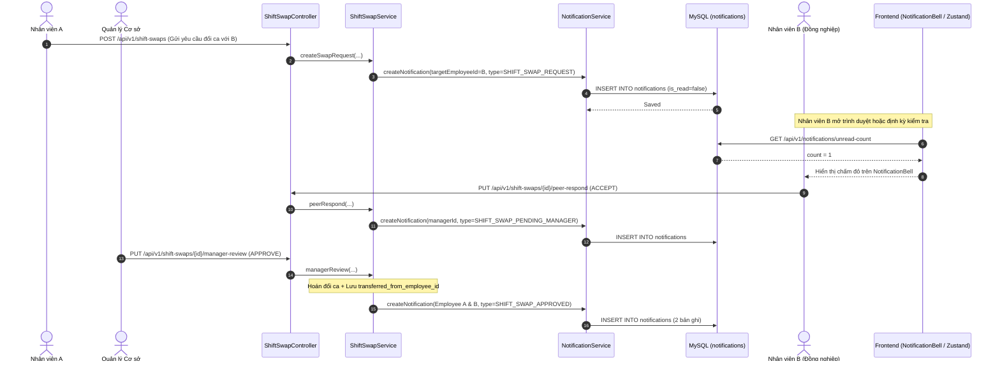
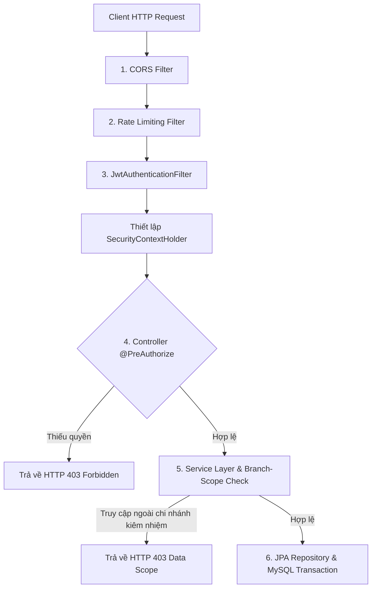

# TÀI LIỆU 05: KIẾN TRÚC HỆ THỐNG VÀ NGĂN XẾP CÔNG NGHỆ (ARCHITECTURE & TECH STACK)
**Dự án:** Employee Management System  
**Mô hình kiến trúc:** Modular Monolith (Package-by-Feature)  
**Phiên bản:** 3.0.0  
**Ngày cập nhật:** 09/11/2026  
**Trạng thái:** Confirmed / Production Ready  

---

## 1. TỔNG QUAN KIẾN TRÚC & BIỆN HỘ MÔ HÌNH (MODULAR MONOLITH)

### 1.1. Tại sao chọn Modular Monolith thay vì Microservices?
Đối với doanh nghiệp dịch vụ/bán lẻ quy mô từ 50 đến 500 nhân sự hoạt động tại nhiều cơ sở / chi nhánh:
1. **Tính Toàn vẹn Dữ liệu Nghiệp vụ (ACID Transactions):** Các nghiệp vụ phức tạp như xếp ca tuần, mô phỏng xung đột 9 luật lao động, phê duyệt hoán đổi ca/nhường ca (`ShiftSwap`) và khấu trừ số dư phép năm đòi hỏi tính giao dịch nguyên tử (ACID). Nếu phân rã thành Microservices, việc đảm bảo tính nhất quán trên các dịch vụ độc lập sẽ buộc phải sử dụng Distributed Transactions (Saga pattern, Outbox pattern, 2-phase commit), làm tăng độ phức tạp kỹ thuật lên gấp 5 lần mà không đem lại giá trị thặng dư kinh doanh tương xứng.
2. **Chi phí Hạ tầng & Vận hành (DevOps Overhead):** Một ứng dụng Modular Monolith chạy gọn gàng trên 1 máy chủ VPS (4 vCPU, 8GB RAM) với Docker Compose, tiết kiệm hơn 80% chi phí vận hành so với việc dựng cụm Kubernetes, API Gateway, Service Mesh, Distributed Tracing và Event Bus phân tán (Kafka/RabbitMQ).
3. **Thân thiện với Đội ngũ Kỹ thuật & Tốc độ Phát triển:** Giúp lập trình viên kiểm soát toàn bộ luồng dữ liệu đầu cuối, debug dễ dàng với một điểm breakpoint duy nhất trong IDE, dễ dàng refactor code và tái cấu trúc nghiệp vụ khi mở rộng chi nhánh.

### 1.2. Nguyên tắc "Package-by-Feature" (Đóng gói theo Tính năng)
Hệ thống kiên quyết nói không với mô hình cổ điển "Package-by-Layer" (gom tất cả Controller vào một thư mục, tất cả Service vào một thư mục). Thay vào đó, mã nguồn được phân rã thành **14 Bounded Contexts độc lập** tại Backend và **11 Features tương ứng** tại Frontend:
- Mỗi module nghiệp vụ (`employee`, `schedule`, `swap`, `notification`, `attendance`, `leave`, `report`, ...) là một gói tự trị (Self-contained package) đóng gói trọn vẹn Controller, Service, Repository, Entity và DTO của riêng mình.
- **Ranh giới giao tiếp (Encapsulation Boundary):** Module A chỉ được gọi Service Interface công khai của Module B; nghiêm cấm Module A truy cập trực tiếp vào Repository hoặc Entity nội bộ của Module B.
- **Kiến trúc Bất biến Ca làm việc (Immutable Shift Snapshotting):** Dữ liệu phân ca trong `shift_assignments` độc lập hoàn toàn với thay đổi giờ ca mẫu `work_shifts`, bảo toàn độ tin cậy lịch sử chấm công và tính lương.

---

## 2. NGĂN XẾP CÔNG NGHỆ CHUẨN XÁC (REAL TECH STACK SPECIFICATIONS)

### 2.1. Backend Tech Stack
- **Ngôn ngữ:** **Java 21 LTS** (Tận dụng Virtual Threads cho I/O non-blocking, Record classes, Pattern matching, Sealed classes).
- **Framework chính:** **Spring Boot 3.3.4** (Spring Framework 6.1.x, namespace `jakarta.*`).
- **Web & RESTful API:** Spring Boot Starter Web (Tomcat nhúng, REST Controllers chuẩn RESTful, JSON API UTF-8).
- **ORM & Data Access:** Spring Data JPA, Hibernate 6.5.3 (Cơ chế `@Version` cho Optimistic Locking, Dirty Checking).
- **Bảo mật & Phân quyền:** Spring Security 6.3.3 (Stateless JWT Filter Chain, `@PreAuthorize` kiểm soát 4 vai trò chuẩn `ROLE_DIRECTOR`, `ROLE_MANAGER`, `ROLE_EMPLOYEE`, `ROLE_ADMIN`).
- **Xác thực Token:** **jjwt 0.12.5** (JSON Web Token HMAC-SHA256, Access Token 15 phút, Refresh Token HttpOnly Cookie 7 ngày).
- **Validation:** Hibernate Validator 8.0.x (Jakarta Bean Validation 3.0 với các custom constraint annotations).
- **Cơ sở dữ liệu & Migration:** **MySQL 8.0**, MySQL Connector/J 8.3.0, **Flyway 10.18.0** (27 migration scripts tuần tự từ `V1` đến `V27`).
- **Xử lý Xuất Báo cáo:** **Apache POI 5.2.5** (Sinh bảng tính Microsoft Excel `.xlsx` chuyên nghiệp có định dạng ô, màu sắc tiêu đề và UTF-8 CSV BOM).
- **DTO Mapping & Boilerplate:** Lombok (Generate Getter, Setter, Builder, Slf4j) kết hợp Handcrafted Type-safe Mappers (Kiểm soát 100% logic chuyển đổi Entity $\leftrightarrow$ DTO, zero magic reflection).
- **Tài liệu API Tự động:** Springdoc OpenAPI 2.5.0 (Swagger UI tương tác tại `/swagger-ui.html`).
- **Kiểm thử Tự động:** JUnit 5, Mockito.

### 2.2. Frontend Tech Stack (Purified & Zero-bloat)
> [!IMPORTANT]
> Toàn bộ các thư viện giao diện nặng nề hoặc lỗi thời như Ant Design, TanStack Query, React Hook Form, Zod, Day.js và `@ant-design/icons` đã được loại bỏ hoàn toàn khỏi mã nguồn.

- **Ngôn ngữ:** **TypeScript ~6.0.2** (Strict mode 100%, strictNullChecks, noImplicitAny).
- **Thư viện UI Core:** **React 19.2.8** (React DOM, React Server-ready hooks).
- **Công cụ Build & Dev Server:** **Vite ^8.3.0** (ESBuild transpile siêu tốc, Rollup bundler tối ưu hóa chunk splitting).
- **Định tuyến Ứng dụng (Routing):** **React Router DOM ^7.18.4** (Client-side routing, protected routes, dynamic branch params).
- **Quản lý Trạng thái Ứng dụng (State Management):** **Zustand ^5.0.15**
  - Mô hình Micro-stores phân tách theo từng feature:
    - `useAuthStore`: Quản lý phiên đăng nhập, access token, thông tin user và chi nhánh làm việc.
    - `useScheduleStore`: Quản lý ma trận lịch tuần, bộ lọc chi nhánh/ngày, danh sách xung đột và state kéo thả/gán ca.
    - `useNotificationStore`: Quản lý danh sách thông báo in-app và polling badge số đếm chưa đọc.
    - `useLeaveStore`: Quản lý số dư phép năm và danh sách đơn nghỉ phép.
    - `useUIStore`: Quản lý đóng/mở sidebar, modal, dialog xác nhận và toast notifications.
- **Hệ thống Giao diện & Định kiểu (Styling System):** **Vanilla CSS Design Tokens**
  - Hệ thống tokens tập trung tại `src/styles/tokens.css` (màu sắc semantic, spacing, typography, shadow, border radius, z-index).
  - Định dạng bảng lịch ma trận bằng CSS Grid chuyên dụng (`schedule.css`), đạt chuẩn tương phản màu sắc WCAG 2.1 AA.
  - Tải trang tức thì, zero CSS-in-JS runtime overhead.
- **Xử lý Ngày Giờ & Bản Địa Hóa:** **Date-fns ^4.4.0** (`date-fns/locale/vi` cho định dạng thứ, ngày, tháng tiếng Việt chuẩn ISO-8601).
- **Thư viện Biểu Tượng (Icons):** **Lucide React ^1.55.0** (Hơn 1000+ vector icon tối ưu hóa bundle qua tree-shaking).
- **Công cụ Kiểm Tra Mã Nguồn (Linter):** **Oxlint ^1.81.0** (Linter thế hệ mới bằng Rust, tốc độ nhanh hơn ESLint 50-100 lần).
- **Kiểm thử Giao diện (Testing):** **Vitest ^5.0.0** (Môi trường `jsdom`, chạy song song siêu tốc cho các unit test tính toán công và format lịch).
- **Giao tiếp API (Network Client):** **Native Fetch-based `apiClient.ts`**
  - Singleton bọc native `fetch()`, tự động đính kèm `Authorization: Bearer <token>`.
  - Tích hợp interceptor bắt lỗi `401 Unauthorized` để tự động gọi `POST /api/v1/auth/refresh-token` và thử lại request ban đầu.
  - Chuẩn hóa kiểu trả về theo `ApiResponse<T>` và `PageResponse<T>`.

### 2.3. Cơ Chế Vite Dev Proxy & Thứ Tự Khởi Động (Development Proxy & Startup Sequence)
Trong môi trường phát triển cục bộ (Local Development), Frontend chạy tại `http://localhost:5173` và chuyển tiếp các yêu cầu `/api/*` tới Backend Spring Boot qua proxy cấu hình tại `vite.config.ts`:
1. **Chuẩn hóa Địa chỉ IPv4 (`http://127.0.0.1:8080`):**
   - Cấu hình proxy `target` được trỏ trực tiếp tới `http://127.0.0.1:8080` (hoặc biến môi trường `VITE_BACKEND_URL`).
   - *Lý do kỹ thuật:* Trên hệ điều hành Windows kết hợp Node.js 18+, việc cấu hình `localhost` kích hoạt cơ chế `internalConnectMultiple` ưu tiên phân giải IPv6 `::1`, dễ dẫn đến lỗi kết nối bị từ chối `AggregateError [ECONNREFUSED]` khi Backend Spring Boot chỉ lắng nghe trên giao diện mạng IPv4.
2. **Bộ Xử Lý Lỗi Proxy Thân Thiện (Proxy Error Interceptor):**
   - Tích hợp hook `configure(proxy)` lắng nghe sự kiện `error` của proxy socket.
   - Khi Backend chưa hoàn tất khởi động hoặc ngoại tuyến, Vite tự động ghi nhận cảnh báo ngắn gọn trên terminal và phản hồi HTTP `503 Service Unavailable` dạng JSON chuẩn (`code: BACKEND_UNAVAILABLE`) thay vì ném stacktrace lỗi thô gây treo socket trình duyệt.
3. **Quy Tắc Thứ Tự Khởi Động Dịch Vụ (Strict Startup Dependency Order):**
   - **Bước 1:** Khởi động cơ sở dữ liệu MySQL 8.0 (cổng 3306).
   - **Bước 2:** Khởi chạy Backend Spring Boot (`mvn clean spring-boot:run`) và **bắt buộc chờ cho đến khi console xuất hiện thông báo `Started HrmsApplication in ... seconds`** (xác nhận CSDL đã nạp xong 27 Flyway migrations từ `V1` đến `V27`).
   - **Bước 3:** Khởi chạy Frontend Vite (`npm run dev`) và truy cập `http://localhost:5173`.

---

## 3. CẤU TRÚC MÃ NGUỒN DỰ ÁN (PROJECT DIRECTORY STRUCTURE)

### 3.1. Cấu trúc Backend (Spring Boot 14 Modules Package-by-Feature)
```text
backend/
├── pom.xml                                   <-- Spring Boot 3.3.4, Java 21, Flyway 10.18.0, POI 5.2.5
└── src/
    ├── main/
    │   ├── java/com/company/hrms/
    │   │   ├── HrmsApplication.java
    │   │   ├── common/                       <-- Thư viện và tầng dùng chung toàn hệ thống
    │   │   │   ├── config/                   <-- Jackson, OpenAPI, WebMvc, Async Config
    │   │   │   ├── exception/                <-- GlobalExceptionHandler, BusinessException
    │   │   │   ├── response/                 <-- ApiResponse, PageResponse
    │   │   │   ├── audit/                    <-- AuditableEntity, AuditLog
    │   │   │   └── util/                     <-- DateTimeUtils, SecurityUtils
    │   │   ├── security/                     <-- Tầng xác thực & phân quyền RBAC
    │   │   │   ├── config/                   <-- SecurityConfig (SecurityFilterChain)
    │   │   │   ├── jwt/                      <-- JwtTokenProvider, JwtAuthenticationFilter
    │   │   │   └── service/                  <-- CustomUserDetailsService, UserPrincipal
    │   │   └── modules/                      <-- 14 MODULES NGHIỆP VỤ PACKAGE-BY-FEATURE
    │   │       ├── auth/                     <-- Đăng nhập, đổi mật khẩu, refresh token, thu hồi phiên
    │   │       ├── employee/                 <-- Hồ sơ nhân sự, ảnh đại diện (avatar), chi nhánh kiêm nhiệm
    │   │       ├── availability/             <-- Lịch rảnh tuần và danh mục ca làm việc ưu tiên
    │   │       ├── branch/                   <-- Quản lý chi nhánh / cơ sở làm việc đa điểm
    │   │       ├── position/                 <-- Quản lý vị trí & chức danh chuyên môn
    │   │       ├── shift/                    <-- Mẫu ca làm việc tiêu chuẩn (Work Shifts)
    │   │       ├── schedule/                 <-- Xếp ca, ma trận lịch tuần, nhận ca trống (CORE ENGINE)
    │   │       │   ├── controller/           <-- ScheduleController.java
    │   │       │   ├── domain/               <-- Schedule.java, ShiftAssignment.java
    │   │       │   ├── dto/                  <-- WeeklyScheduleResponse, ClaimShiftRequest, ...
    │   │       │   ├── engine/               <-- ConflictDetectionEngine (9 luật BLLĐ), OvertimeCalculator
    │   │       │   ├── repository/           <-- ScheduleRepository, ShiftAssignmentRepository
    │   │       │   └── service/              <-- ScheduleService, ScheduleAssignmentService
    │   │       ├── swap/                     <-- Đổi ca chéo & nhường ca trực, mô phỏng xung đột
    │   │       │   ├── controller/           <-- ShiftSwapController.java
    │   │       │   ├── domain/               <-- ShiftSwapRequest.java (SwapType, SwapStatus)
    │   │       │   ├── dto/                  <-- SimulateSwapRequest, CreateSwapRequest, ...
    │   │       │   ├── repository/           <-- ShiftSwapRequestRepository.java
    │   │       │   └── service/              <-- ShiftSwapService.java
    │   │       ├── notification/             <-- Trung tâm thông báo in-app (đổi ca, duyệt phép, công bố lịch)
    │   │       │   ├── controller/           <-- NotificationController.java
    │   │       │   ├── domain/               <-- Notification.java
    │   │       │   ├── dto/                  <-- NotificationDto.java
    │   │       │   ├── repository/           <-- NotificationRepository.java
    │   │       │   └── service/              <-- NotificationService.java
    │   │       ├── attendance/               <-- Chấm công Web, tính giờ công/OT/đêm, giải trình công
    │   │       ├── leave/                    <-- Quỹ phép năm, nộp đơn nghỉ phép, duyệt/hủy đơn
    │   │       ├── report/                   <-- Báo cáo tổng hợp tháng, xuất Microsoft Excel & CSV UTF-8
    │   │       ├── dashboard/                <-- Chỉ số KPI hôm nay, danh sách đơn chờ duyệt, xu hướng 7 ngày
    │   │       └── setting/                  <-- Cấu hình tham số hệ thống & trần chính sách lao động
    │   └── resources/
    │       ├── application.yml
    │       ├── application-dev.yml
    │       ├── application-prod.yml
    │       └── db/migration/                 <-- 27 FLYWAY MIGRATIONS (V1 -> V27)
    │           ├── V1__init_schema.sql
    │           ├── ...
    │           ├── V26__create_notifications_table.sql
    │           └── V27__add_indexes_to_notifications.sql
    └── test/java/com/company/hrms/
```

### 3.2. Cấu trúc Frontend (React 19 + Zustand 5 + 11 Features)
```text
frontend/
├── package.json                              <-- React 19.2.8, TypeScript ~6.0.2, Zustand ^5.0.15, Date-fns ^4.4.0
├── tsconfig.json
├── vite.config.ts                            <-- Vite 8, IPv4 proxy 127.0.0.1:8080, error interceptor
├── index.html
└── src/
    ├── main.tsx                              <-- Điểm khởi chạy ứng dụng React
    ├── App.tsx                               <-- Cấu hình định tuyến React Router DOM v7
    ├── components/                           <-- Thành phần UI dùng chung
    │   ├── layout/                           <-- AppLayout, Sidebar, Header, NotificationBell
    │   ├── feedback/                         <-- LoadingSkeleton, ErrorBoundary, EmptyState, Toast
    │   └── common/                           <-- StatusBadge, ConfirmModal, Pagination
    ├── hooks/                                <-- Custom hooks dùng chung (useDebounce, usePermission)
    ├── services/
    │   └── apiClient.ts                      <-- Native fetch singleton, 401 refresh token interceptor
    ├── stores/                               <-- ZUSTAND 5 MICRO-STORES
    │   ├── authStore.ts                      <-- Token, Current User, Active Branch, Roles
    │   ├── scheduleStore.ts                  <-- Weekly Roster Data, Conflicts, Selected Cell
    │   ├── notificationStore.ts              <-- In-App Notifications, Unread Count Polling
    │   ├── leaveStore.ts                     <-- Leave Balances, Requests
    │   └── uiStore.ts                        <-- Sidebar Toggle, Active Modals
    ├── styles/                               <-- VANILLA CSS DESIGN TOKENS
    │   ├── tokens.css                        <-- Bảng mã màu semantic, font, spacing, shadow
    │   ├── reset.css                         <-- CSS reset chuẩn hóa cross-browser
    │   ├── global.css                        <-- Typography, layout utilities, scrollbar
    │   └── schedule.css                      <-- CSS Grid chuyên dụng cho ma trận lịch tuần
    ├── features/                             <-- 11 PHÂN HỆ GIAO DIỆN CHÍNH
    │   ├── auth/                             <-- Đăng nhập, đổi mật khẩu cá nhân
    │   ├── dashboard/                        <-- KPI cards, đơn chờ duyệt, biểu đồ xu hướng
    │   ├── employee/                         <-- Danh sách nhân sự, avatar upload, chi nhánh kiêm nhiệm
    │   ├── branch/                           <-- Quản lý danh mục cơ sở làm việc
    │   ├── position/                         <-- Quản lý chức danh
    │   ├── shift/                            <-- Quản lý danh mục ca mẫu
    │   ├── schedule/                         <-- Ma trận phân ca tuần, nhận ca trống (CORE)
    │   │   ├── components/                   <-- WeeklyGrid, ShiftCard, ConflictIndicator, OpenShiftModal
    │   │   └── types/                        <-- Schedule types & interfaces
    │   ├── swap/                             <-- Đơn đổi ca chéo & nhường ca, mô phỏng xung đột
    │   ├── notification/                     <-- Popover thông báo, danh sách thông báo, đánh dấu đọc
    │   ├── attendance/                       <-- Check-in/out web, bảng chấm công, nộp/duyệt giải trình
    │   ├── leave/                            <-- Đơn nghỉ phép, xem số dư phép, duyệt đơn
    │   ├── report/                           <-- Báo cáo công tháng, nút xuất Excel/CSV
    │   └── setting/                          <-- Cấu hình tham số hệ thống
    ├── utils/                                <-- Hàm tiện ích (date formatting, conflict helper)
    │   └── __tests__/                        <-- Bộ unit tests Vitest
    └── types/                                <-- TypeScript Interfaces & DTOs
```

---

## 4. LUỒNG XỬ LÝ SỰ KIỆN THÔNG BÁO NỘI BỘ (IN-APP NOTIFICATION PIPELINE)

Hệ thống tích hợp quy trình phát sinh thông báo sự kiện đồng bộ từ Backend xuống CSDL và cập nhật tức thì tới giao diện người dùng:



---

## 5. KIẾN TRÚC BẢO MẬT VÀ PHÂN QUYỀN ĐA CƠ SỞ (MULTI-BRANCH RBAC)



### 5.1. Bốn Vai Trò Người Dùng Chuẩn Hóa
1. `ROLE_DIRECTOR` (Giám đốc điều hành):
   - Phạm vi truy cập: Toàn hệ thống (Cross-branch).
   - Quyền hạn: Thêm/sửa/xóa cơ sở, chức danh, cấu hình tham số hệ thống, phê duyệt bất kỳ đơn từ và xem báo cáo hợp nhất toàn công ty.
2. `ROLE_MANAGER` (Quản lý chi nhánh):
   - Phạm vi truy cập: Giới hạn nghiêm ngặt trong chi nhánh chính (`branch_id`) và các chi nhánh kiêm nhiệm được phân công (`secondary_branches`).
   - Quyền hạn: Quản lý hồ sơ nhân viên trong cơ sở, xếp lịch tuần, phê duyệt đổi ca/nhường ca, duyệt đơn nghỉ phép và đơn giải trình chấm công.
3. `ROLE_EMPLOYEE` (Nhân viên):
   - Phạm vi truy cập: Cá nhân (Self-service).
   - Quyền hạn: Xem lịch làm việc cá nhân, đăng ký lịch rảnh, tự nhận ca trống (`SELF_CLAIM`), nộp đơn đổi ca/nhường ca, check-in/out web, nộp giải trình và đơn nghỉ phép.
4. `ROLE_ADMIN` (Quản trị viên kỹ thuật):
   - Quyền hạn bảo trì hệ thống, quản lý tài khoản và nhật ký kiểm toán.

---

## 6. XỬ LÝ LỖI TOÀN CỤC VÀ NHẬT KÝ KIỂM TOÁN (GLOBAL EXCEPTION & LOGGING)

### 6.1. Bộ Xử lý Ngoại lệ Toàn cục (`@RestControllerAdvice`)
Tất cả các lỗi xảy ra trong backend đều được thu thập và đóng gói đồng nhất qua `GlobalExceptionHandler`:

```java
@RestControllerAdvice
@Slf4j
public class GlobalExceptionHandler {

    @ExceptionHandler(MethodArgumentNotValidException.class)
    public ResponseEntity<ApiResponse<Void>> handleValidation(MethodArgumentNotValidException ex) {
        List<ValidationErrorDetail> details = ex.getBindingResult().getFieldErrors().stream()
            .map(err -> new ValidationErrorDetail(err.getField(), err.getRejectedValue(), err.getDefaultMessage()))
            .toList();
        return ResponseEntity.badRequest().body(ApiResponse.validationError(details));
    }

    @ExceptionHandler(BusinessException.class)
    public ResponseEntity<ApiResponse<Void>> handleBusiness(BusinessException ex) {
        log.warn("Business rule violation: code={}, message={}", ex.getErrorCode(), ex.getMessage());
        return ResponseEntity.status(ex.getHttpStatus()).body(ApiResponse.error(ex.getErrorCode(), ex.getMessage()));
    }

    @ExceptionHandler(OptimisticLockException.class)
    public ResponseEntity<ApiResponse<Void>> handleOptimisticLock(OptimisticLockException ex) {
        return ResponseEntity.status(HttpStatus.CONFLICT)
            .body(ApiResponse.error("OPTIMISTIC_LOCK_CONFLICT", "Dữ liệu lịch vừa được cập nhật bởi quản lý khác. Vui lòng làm mới trang."));
    }

    @ExceptionHandler(AccessDeniedException.class)
    public ResponseEntity<ApiResponse<Void>> handleAccessDenied(AccessDeniedException ex) {
        return ResponseEntity.status(HttpStatus.FORBIDDEN)
            .body(ApiResponse.error("FORBIDDEN", "Bạn không có quyền hạn hoặc tài nguyên nằm ngoài chi nhánh phụ trách."));
    }

    @ExceptionHandler(Exception.class)
    public ResponseEntity<ApiResponse<Void>> handleGeneral(Exception ex, HttpServletRequest request) {
        log.error("Unhandled internal server error at path: {}", request.getRequestURI(), ex);
        return ResponseEntity.status(HttpStatus.INTERNAL_SERVER_ERROR)
            .body(ApiResponse.error("INTERNAL_SERVER_ERROR", "Đã xảy ra sự cố kỹ thuật. Vui lòng liên hệ quản trị viên."));
    }
}
```

### 6.2. Chuẩn Hóa Nhật Ký Ứng Dụng (Structured Logging)
- Ứng dụng sử dụng **Slf4j** kết hợp **Logback** xuất định dạng JSON trên môi trường Production để tương thích với các hệ thống phân tích log tập trung.
- **Mặt nạ dữ liệu nhạy cảm (PII Masking):** Cấu hình bộ lọc log tự động làm mờ các trường nhạy cảm như `password`, `national_id` (CCCD) và mã xác thực để tuân thủ Nghị định 13/2023/NĐ-CP.

---

## 7. KẾ HOẠCH TRIỂN KHAI DOCKER COMPOSE (DEVOPS CONTAINER LAYOUT)

Hệ thống được đóng gói thành các dịch vụ Docker độc lập để triển khai bằng lệnh `docker compose up -d`:

```yaml
# docker-compose.yml (Kế hoạch kiến trúc phục vụ triển khai)
version: '3.8'

services:
  mysql-db:
    image: mysql:8.0.36
    container_name: hrms-mysql
    restart: always
    environment:
      MYSQL_DATABASE: hrms_db
      MYSQL_ROOT_PASSWORD: ${MYSQL_ROOT_PASSWORD}
      MYSQL_USER: hrms_user
      MYSQL_PASSWORD: ${MYSQL_PASSWORD}
      TZ: Asia/Ho_Chi_Minh
    ports:
      - "3306:3306"
    volumes:
      - mysql_data:/var/lib/mysql
    command: --character-set-server=utf8mb4 --collation-server=utf8mb4_unicode_ci --default-time-zone='+07:00'
    healthcheck:
      test: ["CMD", "mysqladmin", "ping", "-h", "localhost"]
      interval: 10s
      timeout: 5s
      retries: 5

  backend-app:
    build:
      context: ./backend
      dockerfile: Dockerfile
    container_name: hrms-backend
    restart: always
    depends_on:
      mysql-db:
        condition: service_healthy
    environment:
      SPRING_PROFILES_ACTIVE: prod
      DB_HOST: mysql-db
      DB_PORT: 3306
      DB_NAME: hrms_db
      DB_USERNAME: hrms_user
      DB_PASSWORD: ${MYSQL_PASSWORD}
      JWT_SECRET: ${JWT_SECRET}
      TZ: Asia/Ho_Chi_Minh
    ports:
      - "8080:8080"

  frontend-app:
    build:
      context: ./frontend
      dockerfile: Dockerfile
    container_name: hrms-frontend
    restart: always
    depends_on:
      - backend-app
    ports:
      - "80:80"

volumes:
  mysql_data:
```

---
*Kết thúc Tài liệu 05.*
