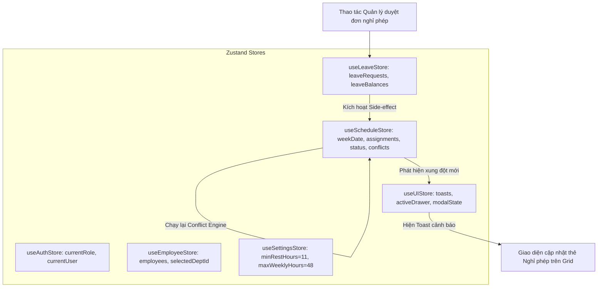

# TÀI LIỆU 10: KẾ HOẠCH KIẾN TRÚC VÀ THIẾT KẾ KỸ THUẬT FRONTEND
**Dự án:** Employee Management System  
**Phân hệ trọng tâm:** Lịch phân ca (Weekly Work Schedule Roster - SCR-11)  
**Phiên bản:** 1.0.0  
**Ngày cập nhật:** 13/10/2026  
**Trạng thái:** Confirmed / Baseline  

---

## 1. NGĂN XẾP CÔNG NGHỆ CHÍNH THỨC & BIỆN HỘ KỸ THUẬT (TECH STACK RATIONALE)

*Phần này được viết bằng ngôn ngữ giải thích trực quan, đối chiếu với các khái niệm tương đương trong hệ sinh thái Java / Spring Boot để các kỹ sư backend dễ dàng nắm bắt.*

```
SƠ ĐỒ TƯƠNG ĐƯƠNG KHÁI NIỆM GIỮA JAVA SPRING BOOT VÀ REACT TYPESCRIPT
┌─────────────────────────────────────────┐    ┌─────────────────────────────────────────┐
│     HỆ SINH THÁI JAVA SPRING BOOT       │    │     NGĂN XẾP FRONTEND REACT TYPESCRIPT  │
├─────────────────────────────────────────┤    ├─────────────────────────────────────────┤
│ Java 21 LTS (Strict Type System)        │ ── │ TypeScript 5.4+ (Strict Mode)           │
│ Maven / Gradle (Build & Dependency)     │ ── │ Vite 5.x + NPM (Ultra-fast Dev Server)  │
│ Spring Web MVC / Controller             │ ── │ React Router DOM v6 (Client-side Route) │
│ Spring Singleton Service / State        │ ── │ Zustand v4 (Centralized Shared Store)   │
│ Plain HTML/CSS Template / Custom Style  │ ── │ Plain CSS + Design Tokens (CSS Vars)    │
│ Java `java.time.*` (LocalDate, Instant) │ ── │ date-fns v3 (Immutable Pure Functions)  │
│ JUnit 5 + Mockito (Unit Testing)        │ ── │ Vitest + Testing Library                │
│ Jackson JSON Serialization              │ ── │ TypeScript Interfaces + Zod Validation  │
└─────────────────────────────────────────┘    └─────────────────────────────────────────┘
```

### 1.1. Chi tiết Ngăn xếp & Đánh đổi Kiến trúc
1. **React 18.3+ / 19 kết hợp TypeScript 5.4+ (Strict Mode):**
   - *Khái niệm:* TypeScript mang lại sự an toàn kiểu dữ liệu tương đương Java Compile-time Type Safety. Toàn bộ `any` bị cấm hoàn toàn (`noImplicitAny: true`, `strictNullChecks: true`).
   - *Lý do:* Ứng dụng HRMS có hàng chục trường dữ liệu thời gian, ca kíp và trạng thái duyệt. TypeScript ngăn chặn 100% các lỗi kinh điển như `undefined is not a function` hoặc truy cập sai thuộc tính ca làm việc ngay tại lúc gõ code.
2. **Vite 5.x (Build & Dev Tool):**
   - *Khái niệm:* Hoạt động như một compiler siêu tốc. Sử dụng Native ES Modules, khởi động dev server trong vòng dưới 200ms và phản hồi thay đổi mã nguồn (Hot Module Replacement - HMR) gần như tức thì.
3. **React Router v6:**
   - *Khái niệm:* Điều hướng hoàn toàn phía trình duyệt (Client-side Routing / SPA). Người dùng chuyển đổi giữa các màn hình mà không cần nạp lại trang (không trắng màn hình), giữ nguyên trạng thái ứng dụng.
4. **Plain CSS với Design Tokens (CSS Variables):**
   - *Lý do chọn thay vì Ant Design / MUI / Tailwind:* Đối chiếu tại `FDEC-001`. Ma trận lịch tuần đòi hỏi chia lưới CSS Grid chính xác từng pixel cho 8 cột (1 cột nhân viên cố định và 7 cột thứ). Sử dụng CSS thuần với các biến `:root` (`--color-primary`, `--space-md`) giúp không bị vendor lock-in, bundle siêu nhẹ, dễ dàng bảo trì.
5. **date-fns v3:**
   - *Khái niệm:* Tương đương với `java.time.temporal.*` trong Java. Mỗi hàm (`addDays`, `startOfWeek`, `differenceInMinutes`) là một hàm thuần túy (pure function) nhận vào đối tượng `Date` và trả về một `Date` mới mà không làm đột biến đối tượng cũ.
6. **Zustand v4+ (State Management):**
   - *Khái niệm:* Tương đương với việc quản lý một In-memory Database / Cache trong Java Spring Service. Cho phép truy xuất và cập nhật dữ liệu từ bất kỳ đâu, hỗ trợ Atomic Selectors giúp tối ưu render ma trận 175 ô dữ liệu.
7. **Vitest (Unit Testing):**
   - *Khái niệm:* Tương đương với JUnit 5 trong Java. Chạy cực nhanh, tích hợp sẵn với cấu hình Vite, hỗ trợ đầy đủ cú pháp `describe`, `it`, `expect`.

---

## 2. CẤU TRÚC THƯ MỤC CHUẨN CỦA DỰ ÁN `frontend/`

```text
frontend/
├── index.html                                 # Điểm vào HTML chính, thiết lập thẻ meta và font Be Vietnam Pro
├── package.json                               # Danh mục dependencies và scripts (dev, build, test, lint)
├── tsconfig.json                              # Cấu hình TypeScript Strict Mode 100%
├── tsconfig.node.json                         # Cấu hình TypeScript cho Vite build tools
├── vite.config.ts                             # Cấu hình Vite, alias '@/', port 5173
├── vitest.config.ts                           # Cấu hình môi trường test Vitest (jsdom)
│
├── public/                                    # Tài nguyên tĩnh ngoại tuyến
│   ├── favicon.ico                            # Icon ứng dụng
│   └── logo-company.svg                       # Logo nhận diện thương hiệu
│
└── src/
    ├── main.tsx                               # Khởi động ứng dụng React, nạp CSS tokens toàn cục
    ├── App.tsx                                # Bố cục App tổng thể, thiết lập RouterProvider
    │
    ├── assets/                                # Tài nguyên ảnh nội bộ, font ngoại tuyến
    │   └── fonts/                             # @fontsource nạp offline
    │
    ├── styles/                                # HỆ THỐNG THIẾT KẾ & CSS TOÀN CỤC
    │   ├── tokens.css                         # CSS Variables (Màu sắc, Spacing, Radius, Shadows, Typography)
    │   ├── reset.css                          # Chuẩn hóa Box-sizing, margin, font-smoothing
    │   ├── typography.css                     # Định dạng H1-H3, body, caption
    │   └── global.css                         # Phong cách chung cho scrollbars, layout canvas
    │
    ├── types/                                 # ĐỊNH NGHĨA KIỂU DỮ LIỆU TOÀN ỨNG DỤNG
    │   ├── domain.types.ts                    # Thực thể: Employee, Department, ShiftTemplate, Assignment...
    │   ├── schedule.types.ts                  # Kiểu chuyên sâu phân ca: WeekStatus, Conflict, MatrixCell...
    │   ├── api.types.ts                       # Phong bì dữ liệu ApiResponse, PageResponse, ErrorResponse
    │   └── ui.types.ts                        # Kiểu dữ liệu UI: Toast, Dialog, TableColumn, RoleType
    │
    ├── utils/                                 # CÁC HÀM TIỆN ÍCH THUẦN TÚY (PURE FUNCTIONS)
    │   ├── date.utils.ts                      # Thao tác ngày tháng, thứ, offset tuần, format dd/MM/yyyy
    │   ├── schedule-calc.utils.ts             # Tính số giờ Gross, Net, tách giờ qua đêm, tổng tuần
    │   ├── conflict-detector.utils.ts         # Engine kiểm tra 6 quy tắc xung đột xếp ca (BR-001..BR-007)
    │   ├── csv-exporter.utils.ts              # Xuất file CSV tiếng Việt chuẩn UTF-8 BOM
    │   └── format.utils.ts                    # Format số điện thoại, định dạng giờ HH:mm, tên người Việt
    │
    ├── data/                                  # TẦNG DỮ LIỆU MẪU (MOCK DATA & SEED ENGINE)
    │   ├── repositories/                      # Interface kho dữ liệu chuẩn hóa
    │   │   ├── employee.repository.ts         # Interface CRUD nhân viên
    │   │   ├── schedule.repository.ts         # Interface Lịch tuần, gán ca, sao chép
    │   │   ├── attendance.repository.ts       # Interface Chấm công, giải trình
    │   │   └── leave.repository.ts            # Interface Đơn nghỉ phép, số dư phép
    │   │
    │   ├── mock/                              # Dữ liệu hạt giống (Seed Data) xác định
    │   │   ├── departments.mock.ts            # 5 phòng ban mẫu
    │   │   ├── positions.mock.ts              # 8 chức danh mẫu
    │   │   ├── shift-templates.mock.ts        # 4 mẫu ca chuẩn (Sáng, Chiều, Tối, Đêm qua đêm)
    │   │   ├── employees.mock.ts              # 25 hồ sơ nhân viên đầy đủ
    │   │   ├── holidays.mock.ts               # Danh mục ngày lễ trong kỳ
    │   │   ├── schedule-seed.mock.ts          # Ma trận ca tuần hiện tại (W0), tuần trước (W-1), tuần sau (W+1)
    │   │   ├── attendance.mock.ts             # Bản ghi chấm công mẫu đối chiếu
    │   │   ├── leaves.mock.ts                 # Đơn nghỉ phép mẫu đã duyệt và chờ duyệt
    │   │   └── settings.mock.ts               # Tham số chính sách hệ thống (Demo thresholds)
    │   │
    │   └── services/                          # Tầng triển khai Mock Service (sẵn sàng swap REST)
    │       ├── mock-employee.service.ts       # Giả lập API nhân viên kèm delay 150ms
    │       ├── mock-schedule.service.ts       # Giả lập API lịch tuần, validate xung đột
    │       ├── mock-attendance.service.ts     # Giả lập check-in, check-out, đơn giải trình
    │       └── mock-leave.service.ts          # Giả lập nộp đơn phép, phê duyệt
    │
    ├── store/                                 # QUẢN LÝ TRẠNG THÁI ZUSTAND (CLIENT STATE)
    │   ├── useAuthStore.ts                    # Phiên đăng nhập mô phỏng, Visual Role Switcher
    │   ├── useScheduleStore.ts                # Store chính của Lịch tuần: assignments, conflicts, history
    │   ├── useEmployeeStore.ts                # Danh sách nhân viên, bộ lọc phòng ban, phân trang
    │   ├── useAttendanceStore.ts              # Trạng thái chấm công hôm nay, lịch sử công tháng
    │   ├── useLeaveStore.ts                   # Danh sách đơn phép, quỹ phép năm
    │   ├── useSettingsStore.ts                # Tham số chính sách (ngưỡng nghỉ 11h/12h, trần tuần 48h)
    │   └── useUIStore.ts                      # Toasts thông báo, Modal trạng thái, Sidebar collapse
    │
    ├── hooks/                                 # CUSTOM REACT HOOKS
    │   ├── useWeeklySchedule.ts               # Điều phối tải lịch tuần, chuyển tuần, tính toán tổng hợp
    │   ├── useConflictValidation.ts           # Hook chạy engine quét cảnh báo thời gian thực
    │   ├── useDebounce.ts                     # Trì hoãn gõ tìm kiếm danh sách 300ms
    │   ├── useKeyboardNavigation.ts           # Điều hướng phím mũi tên trong ma trận lưới ARIA
    │   └── useModalFocusTrap.ts               # Quản lý tiêu điểm (Focus trap) khi mở Dialog / Drawer
    │
    ├── components/                            # THÀNH PHẦN GIAO DIỆN DÙNG CHUNG
    │   ├── ui/                                # Component cơ bản (Design System Primitives)
    │   │   ├── Button/                        # Nút bấm: Primary, Default, Danger, Link, Loading state
    │   │   ├── Input/                         # Ô nhập văn bản, tìm kiếm có icon
    │   │   ├── Select/                        # Dropdown chọn phòng ban, chức danh
    │   │   ├── Badge/                         # Huy hiệu trạng thái (Success, Warning, Error, Info)
    │   │   ├── Dialog/                        # Hộp thoại xác nhận, cảnh báo (Accessible Modal)
    │   │   ├── Drawer/                        # Bảng trượt bên phải (gán ca, xem chi tiết)
    │   │   ├── Table/                         # Bảng dữ liệu chuẩn có phân trang
    │   │   ├── Toast/                         # Thông báo nổi góc màn hình
    │   │   └── Skeleton/                      # Khung xương nhấp nháy mô phỏng loading
    │   │
    │   ├── layout/                            # Khung bố cục tổng thể
    │   │   ├── AppLayout.tsx                  # Layout chính (Sidebar + Topbar + Content Canvas)
    │   │   ├── Sidebar.tsx                    # Menu điều hướng bên trái (co giãn 250px / 80px)
    │   │   ├── Topbar.tsx                     # Thanh tiêu đề: Breadcrumb, Real-time Clock, Role Switcher
    │   │   └── RoleSwitcher.tsx               # Nút chuyển vai trò nhanh (Admin, Manager, Employee)
    │   │
    │   ├── feedback/                          # Trạng thái phản hồi
    │   │   ├── EmptyState.tsx                 # Hiển thị khi không có dữ liệu kèm nút hành động
    │   │   ├── ErrorState.tsx                 # Hiển thị khi có lỗi xử lý
    │   │   └── ConflictNoticeModal.tsx        # Modal cảnh báo vi phạm xếp ca kèm ô nhập giải trình
    │   │
    │   └── charts/                            # Biểu đồ SVG thuần túy
    │       ├── TrendBarChart.tsx              # Biểu đồ cột SVG xu hướng 7 ngày
    │       └── DonutRatioChart.tsx            # Biểu đồ tròn SVG tỷ lệ có mặt
    │
    ├── features/                              # CÁC MÀN HÌNH TÍNH NĂNG THEO PHÂN HỆ
    │   ├── schedule/                          # MÀN HÌNH CỐT LÕI: LỊCH PHÂN CA (SCR-11, SCR-12)
    │   │   ├── SchedulePage.tsx               # Trang container chính
    │   │   ├── components/
    │   │   │   ├── ScheduleToolbar.tsx        # Thanh công cụ: chọn tuần, phòng ban, nút công bố, copy
    │   │   │   ├── ScheduleFiltersBar.tsx     # Bộ lọc nhân viên, chức danh, loại ca, cờ chỉ xem xung đột
    │   │   │   ├── ScheduleSummaryCards.tsx   # 4 thẻ chỉ số: Tổng ca, Tổng giờ, Cảnh báo, Nhân sự thiếu
    │   │   │   ├── WeeklyGrid.tsx             # Ma trận chính (Header ngày, Hàng nhân viên, Ô phân ca)
    │   │   │   ├── GridHeader.tsx             # Cột tiêu đề ngày Thứ 2 - Chủ Nhật kèm định biên
    │   │   │   ├── EmployeeRow.tsx            # Hàng thông tin nhân viên + 7 ô ca
    │   │   │   ├── ScheduleCell.tsx           # Ô ngày đơn lẻ (ShiftCard, Nút cộng, Thẻ nghỉ phép)
    │   │   │   ├── ShiftCard.tsx              # Thẻ ca trực quan (màu sắc, icon, badge cảnh báo)
    │   │   │   ├── MonthViewGrid.tsx          # Chế độ xem lịch tháng tổng quan
    │   │   │   ├── ScheduleLegend.tsx         # Bảng chú giải màu sắc mẫu ca và phím tắt
    │   │   │   └── dialogs/
    │   │   │       ├── AssignShiftDrawer.tsx  # Drawer gán/sửa ca đơn lẻ & giải trình ghi đè
    │   │   │       ├── BulkAssignDialog.tsx   # Modal gán ca hàng loạt cho nhiều người
    │   │   │       ├── CopyWeekDialog.tsx     # Modal xem trước và cấu hình sao chép tuần
    │   │   │       ├── PublishConfirmDialog.tsx # Modal xác nhận công bố lịch
    │   │   │       ├── ChangeReasonDialog.tsx # Modal bắt buộc nhập lý do khi sửa lịch Published
    │   │   │       └── ChangeHistoryDrawer.tsx# Drawer xem nhật ký thay đổi của tuần
    │   │
    │   ├── dashboard/                         # Màn hình Tổng quan (SCR-02)
    │   │   ├── DashboardPage.tsx
    │   │   └── components/QuickAttendanceCard.tsx
    │   │
    │   ├── employees/                         # Màn hình Nhân sự (SCR-03, SCR-04, SCR-05)
    │   │   ├── EmployeeListPage.tsx
    │   │   ├── EmployeeDetailPage.tsx
    │   │   └── components/EmployeeFormModal.tsx
    │   │
    │   ├── attendance/                        # Màn hình Chấm công (SCR-08, SCR-09)
    │   │   ├── AttendanceOverviewPage.tsx
    │   │   └── components/AttendanceCorrectionModal.tsx
    │   │
    │   ├── shifts/                            # Màn hình Mẫu ca làm việc (SCR-10)
    │   │   ├── ShiftTemplatesPage.tsx
    │   │   └── components/ShiftTemplateFormModal.tsx
    │   │
    │   ├── leaves/                            # Màn hình Nghỉ phép (SCR-13, SCR-14)
    │   │   ├── LeaveRequestsPage.tsx
    │   │   └── components/LeaveRequestModal.tsx
    │   │
    │   ├── reports/                           # Màn hình Báo cáo & Thống kê (SCR-15)
    │   │   ├── ReportsPage.tsx
    │   │   └── components/ScheduledVsActualTable.tsx
    │   │
    │   └── settings/                          # Màn hình Cài đặt Tham số & Tài khoản (SCR-16)
    │       ├── SettingsPage.tsx
    │       └── components/PolicyThresholdsForm.tsx
    │
    └── routes/                                # CẤU HÌNH ĐỊNH TUYẾN
        ├── AppRoutes.tsx                      # Bảng định tuyến Router, Role Guards
        └── route-paths.ts                     # Hằng số định danh URL
```

---

## 3. QUY TẮC PHÂN TẦNG VÀ KIỂM SOÁT PHỤ THUỘC (LAYERING & IMPORT RULES)

Hệ thống tuân thủ mô hình kiến trúc phân tầng đơn hướng (Unidirectional Layering). Nghiêm cấm tuyệt đối việc tạo vòng lặp phụ thuộc (Circular Dependency).

```
SƠ ĐỒ PHÂN TẦNG ĐƠN HƯỚNG VÀ LUỒNG IMPORT PHỤ THUỘC
┌─────────────────────────────────────────────────────────────┐
│ 1. Pages (routes & feature page containers)                 │
└──────────────────────────────┬──────────────────────────────┘
                               ▼
┌─────────────────────────────────────────────────────────────┐
│ 2. Feature Components (Toolbar, Grid, Cells, Dialogs)       │
└──────────────────────────────┬──────────────────────────────┘
                               ▼
┌─────────────────────────────────────────────────────────────┐
│ 3. UI Primitives (Button, Dialog, Drawer, Badge) & Hooks     │
└──────────────────────────────┬──────────────────────────────┘
                               ▼
┌─────────────────────────────────────────────────────────────┐
│ 4. State Management (Zustand Stores)                        │
└──────────────────────────────┬──────────────────────────────┘
                               ▼
┌─────────────────────────────────────────────────────────────┐
│ 5. Data Repositories & Mock Services                        │
└──────────────────────────────┬──────────────────────────────┘
                               ▼
┌─────────────────────────────────────────────────────────────┐
│ 6. Pure Utilities (Calculators, Conflict Engine, Formats)   │
└──────────────────────────────┬──────────────────────────────┘
                               ▼
┌─────────────────────────────────────────────────────────────┐
│ 7. Domain Types & CSS Tokens (Không import bất kỳ ai)       │
└─────────────────────────────────────────────────────────────┘
```

### Bảng Quy Tắc Import Cụ Thể:
1. **Pages:** Được phép import Feature Components, Custom Hooks, UI Primitives, Store, Types.
2. **Components:** Chỉ được import Component con, UI Primitives, Hooks, Utils, Types. Không được import trực tiếp Data Layer.
3. **Hooks:** Được phép import Store, Utils, Types.
4. **Store:** Được phép import Data Services (để nạp/lưu dữ liệu), Utils, Types.
5. **Data Services / Repositories:** Được phép import Mock Data, Utils, Types. Không bao giờ import Store hoặc Component.
6. **Utils:** Chỉ được import các Utils khác, thư viện `date-fns`, và Types. **Cấm tuyệt đối import React Hooks hoặc Store** (đảm bảo 100% là hàm thuần túy để test không cần mock môi trường React).
7. **Types:** Không bao giờ import từ bất kỳ tầng nào khác.

---

## 4. THIẾT KẾ TẦNG DỮ LIỆU: MOCK SERVICE SẴN SÀNG HOÁN ĐỔI REST API

Để đảm bảo sau này kết nối Spring Boot Backend mà **không phải sửa một dòng mã nào trong component UI**, toàn bộ tương tác dữ liệu phải thông qua các Interface trừu tượng tương ứng với danh mục API trong `docs/04-api-specification.md`.

```typescript
// src/data/repositories/schedule.repository.ts
import { 
  WeeklyScheduleData, 
  ConflictValidationResult, 
  ShiftAssignment, 
  ChangeHistoryEntry 
} from '@/types/domain.types';

export interface IScheduleRepository {
  /** Map to API-022: GET /api/v1/schedules/weekly */
  getWeeklyRoster(departmentId: number, startDate: string): Promise<WeeklyScheduleData>;

  /** Map to API-023: POST /api/v1/schedules/validate-conflicts */
  validateConflicts(
    departmentId: number, 
    assignments: Array<{ employeeId: number; workShiftId: number; workDate: string }>
  ): Promise<ConflictValidationResult>;

  /** Map to API-024: POST /api/v1/schedules/assignments */
  assignSingleShift(payload: {
    scheduleId: number;
    employeeId: number;
    workShiftId: number;
    workDate: string;
    overrideRule?: string;
    overrideReason?: string;
    changeReason?: string;
  }): Promise<ShiftAssignment>;

  /** Map to API-024B: POST /api/v1/schedules/bulk-assign */
  bulkAssignShifts(payload: {
    scheduleId: number;
    employeeIds: number[];
    workShiftId: number;
    fromDate: string;
    toDate: string;
    overrideReason?: string;
  }): Promise<ShiftAssignment[]>;

  /** Map to API-024C: POST /api/v1/schedules/copy-week */
  copyPreviousWeek(payload: {
    departmentId: number;
    sourceStartDate: string;
    targetStartDate: string;
    targetScheduleId: number;
    mode: 'SKIP_OCCUPIED' | 'REPLACE_ALL';
  }): Promise<{ copiedCount: number; skippedCount: number }>;

  /** Map to API-024D: POST /api/v1/schedules/{id}/publish */
  publishSchedule(scheduleId: number, version: number): Promise<{ status: 'PUBLISHED'; publishedAt: string }>;

  /** Map to API-024E: POST /api/v1/schedules/{id}/unpublish */
  unpublishSchedule(scheduleId: number): Promise<{ status: 'DRAFT' }>;

  /** Xóa 1 phân ca */
  deleteAssignment(assignmentId: number, changeReason?: string): Promise<void>;

  /** Lấy lịch sử thay đổi của tuần */
  getChangeHistory(scheduleId: number): Promise<ChangeHistoryEntry[]>;
}
```

---

## 5. BẢNG ĐỊNH TUYẾN (ROUTING TABLE) VÀ PHÂN QUYỀN TRUY CẬP

Hệ thống định tuyến sử dụng `createBrowserRouter` của React Router DOM v6. Mọi trang đều được bọc trong `<AppLayout />` chung (chứa Sidebar, Topbar và Canvas làm việc).

| Đường Dẫn (Path) | Tên Màn Hình / Component | Mã SCR | Quyền Truy Cập (Roles) | Vị Trí Trên Sidebar | Mô Tả Trách Nhiệm |
|:---|:---|:---:|:---|:---|:---|
| `/` | Điều hướng tự động về `/schedule` | - | All | - | Redirect mặc định |
| `/schedule` | `SchedulePage` | **SCR-11** | Admin, Manager, Employee | `📅 Lịch phân ca` (Menu chính) | **TRỌNG TÂM:** Bảng ma trận tuần, gán ca, xuất bản, xuất CSV |
| `/dashboard` | `DashboardPage` | **SCR-02** | All (Giao diện đổi theo Role) | `📊 Tổng quan` | KPI quân số, điểm danh nhanh, widget duyệt đơn |
| `/employees` | `EmployeeListPage` | **SCR-03** | Admin, Manager (Dept scope) | `👥 Nhân sự` | Danh sách hồ sơ nhân viên, tìm kiếm, lọc phòng ban |
| `/employees/:id`| `EmployeeDetailPage` | **SCR-05** | All (Xem chính mình / Cấp dưới) | - (Từ bảng SCR-03) | Chi tiết 4 tabs: Lý lịch, Lịch ca, Bảng công, Nghỉ phép |
| `/attendance` | `AttendanceOverviewPage` | **SCR-08** | Admin, Manager | `⏱️ Chấm công` | Điểm danh ngày, theo dõi đi muộn, duyệt giải trình |
| `/shifts` | `ShiftTemplatesPage` | **SCR-10** | Admin, HR Manager | `⚙️ Ca làm việc` | CRUD danh mục mẫu ca (Sáng, Chiều, Tối, Đêm) |
| `/leaves` | `LeaveRequestsPage` | **SCR-13** | All | `🏖️ Nghỉ phép` | Danh sách đơn xin nghỉ phép, nộp đơn, duyệt đơn |
| `/reports` | `ReportsPage` | **SCR-15** | Admin, Manager | `📈 Báo cáo` | Tổng hợp công tháng, Scheduled vs Actual, xuất CSV |
| `/settings` | `SettingsPage` | **SCR-16** | Admin | `🛠️ Cài đặt` | Chỉnh ngưỡng cảnh báo (11h/12h, 48h), đổi mật khẩu |
| `*` | `NotFoundPage` | - | All | - | Trang báo lỗi 404 không tìm thấy đường dẫn |

---

## 6. MÔ HÌNH TRẠNG THÁI ỨNG DỤNG (STATE MANAGEMENT ARCHITECTURE)

Hệ thống trạng thái tập trung trong Zustand được phân tách thành các lát cắt (Slices), đồng thời hỗ trợ đồng bộ chéo (Cross-slice side effects).



### 6.1. Các Lát cắt Trạng thái Chính (Store Slices)
1. **`useAuthStore`:**
   - State: `currentUser: Employee`, `currentRole: 'ROLE_ADMIN' | 'ROLE_DEPT_MANAGER' | 'ROLE_EMPLOYEE'`.
   - Actions: `setRole(role: RoleType)`, `toggleRole()`.
2. **`useScheduleStore`:**
   - State:
     - `currentStartDate: string` (YYYY-MM-DD của Thứ Hai đang xem).
     - `scheduleId: number`, `scheduleStatus: 'DRAFT' | 'PUBLISHED'`.
     - `scheduleVersion: number`.
     - `assignments: Record<string, ShiftAssignment>` (Key định danh dạng `${employeeId}_${workDate}`).
     - `conflicts: Record<string, ScheduleConflict[]>`.
     - `changeHistory: ChangeHistoryEntry[]`.
     - `viewMode: 'WEEK' | 'MONTH'`.
     - `filterOptions: { departmentId: number; searchTerm: string; shiftCodeFilter: string; onlyShowConflicts: boolean }`.
   - Actions:
     - `loadWeeklySchedule(deptId, mondayDate)`.
     - `assignShift(empId, shiftId, date, overrideReason, changeReason)`.
     - `deleteShift(assignmentId, changeReason)`.
     - `bulkAssign(empIds, shiftId, fromDate, toDate)`.
     - `copyWeek(sourceMonday, targetMonday, mode)`.
     - `publish()`, `unpublish()`.
     - `recomputeAllConflicts()`.
3. **`useSettingsStore`:**
   - State: `minRestHours: 11.0`, `maxDailyHours: 12.0`, `maxWeeklyHours: 48.0`, `gracePeriodMinutes: 5`.
   - Actions: `updateThresholds(newSettings)`, `resetToDefaults()`.

---

## 7. ĐỊNH NGHĨA KIỂU DỮ LIỆU DOMAIN TYPESCRIPT (DOMAIN INTERFACES)

*Được thiết kế khớp 100% với tên bảng và cột tại `docs/03-database-design.md` và mã API tại `docs/04-api-specification.md`.*

```typescript
// src/types/domain.types.ts

/** Vai trò người dùng */
export type RoleType = 'ROLE_ADMIN' | 'ROLE_HR_MANAGER' | 'ROLE_DEPT_MANAGER' | 'ROLE_EMPLOYEE';

/** Phòng ban */
export interface Department {
  id: number;
  departmentCode: string;
  departmentName: string;
  managerId: number | null;
  parentDepartmentId: number | null;
}

/** Chức danh */
export interface Position {
  id: number;
  positionCode: string;
  positionName: string;
}

/** Trạng thái làm việc của nhân sự */
export type EmploymentStatus = 'PROBATION' | 'OFFICIAL' | 'ON_LEAVE' | 'RESIGNED';

/** Hồ sơ nhân viên (khớp bảng employees) */
export interface Employee {
  id: number;
  employeeCode: string;
  fullName: string;
  email: string;
  phoneNumber: string;
  departmentId: number;
  positionId: number;
  managerId: number | null;
  employmentStatus: EmploymentStatus;
  hireDate: string; // YYYY-MM-DD
  avatarUrl?: string;
  isActive: boolean;
}

/** Mẫu ca làm việc (khớp bảng work_shifts) */
export interface ShiftTemplate {
  id: number;
  shiftCode: string;
  shiftName: string;
  startTime: string; // HH:mm:ss
  endTime: string;   // HH:mm:ss
  breakMinutes: number;
  isCrossMidnight: boolean;
  colorCode: string; // Mã Hex
  textColor: string;  // Mã Hex đảm bảo WCAG
  minStaffing: number;
  maxStaffing: number;
  applicableDays: string; // "1,2,3,4,5,6,7"
  isActive: boolean;
}

/** Trạng thái Lịch tuần */
export type ScheduleStatus = 'DRAFT' | 'PUBLISHED' | 'ARCHIVED';

/** Khung lịch tuần của phòng ban (khớp bảng schedules) */
export interface ScheduleWeek {
  id: number;
  departmentId: number;
  startDate: string; // Thứ Hai YYYY-MM-DD
  endDate: string;   // Chủ Nhật YYYY-MM-DD
  status: ScheduleStatus;
  version: number;
  publishedAt: string | null;
  publishedBy: number | null;
}

/** Bản ghi Phân ca Nhân viên có Snapshot (khớp bảng shift_assignments) */
export interface ShiftAssignment {
  id: number;
  scheduleId: number;
  employeeId: number;
  workShiftId: number;
  workDate: string; // YYYY-MM-DD (Ngày bắt đầu ca)
  
  // Snapshot bất biến bảo vệ kiểm toán
  snapshotShiftName: string;
  snapshotStartTime: string;
  snapshotEndTime: string;
  snapshotBreakMinutes: number;
  snapshotCrossMidnight: boolean;
  snapshotColorCode: string;

  // Thời điểm mốc tuyệt đối UTC ISO string
  plannedStartTime: string; // ISO-8601 UTC
  plannedEndTime: string;   // ISO-8601 UTC

  status: 'ASSIGNED' | 'CANCELLED' | 'COMPLETED';
  overrideRule: string | null;
  overrideReason: string | null;
  version: number;
}

/** Mức độ nghiêm trọng của xung đột */
export type ConflictSeverity = 'MANDATORY' | 'WARNING';

/** Bản ghi Xung đột xếp ca */
export interface ScheduleConflict {
  id: string; // Unique string `${ruleCode}_${employeeId}_${date}`
  ruleCode: 'BR-001' | 'BR-002' | 'BR-003' | 'BR-004' | 'BR-005' | 'BR-006' | 'BR-007';
  severity: ConflictSeverity;
  employeeId: number;
  workDate: string;
  message: string;
  canOverride: boolean;
}

/** Bản ghi Chấm công (khớp bảng attendance_records) */
export interface AttendanceRecord {
  id: number;
  employeeId: number;
  shiftAssignmentId: number | null;
  workDate: string;
  checkInTime: string | null;
  checkOutTime: string | null;
  actualHours: number;
  regularHours: number;
  overtimeHours: number;
  nightHours: number;
  lateMinutes: number;
  earlyLeaveMinutes: number;
  status: 'PRESENT' | 'LATE' | 'EARLY_LEAVE' | 'MISSING_CHECKOUT' | 'CORRECTED' | 'ABSENT';
  source: 'WEB_PORTAL' | 'MANUAL_CORRECTION';
  isManuallyCorrected: boolean;
}

/** Đơn xin Giải trình Chấm công (khớp bảng attendance_corrections) */
export interface AttendanceCorrection {
  id: number;
  attendanceRecordId: number;
  employeeId: number;
  originalCheckIn: string | null;
  originalCheckOut: string | null;
  requestedCheckIn: string;
  requestedCheckOut: string;
  reason: string;
  status: 'PENDING' | 'APPROVED' | 'REJECTED';
  reviewedBy: number | null;
  reviewedAt: string | null;
  rejectionReason: string | null;
}

/** Đơn xin Nghỉ phép (khớp bảng leave_requests) */
export interface LeaveRequest {
  id: number;
  employeeId: number;
  leaveTypeId: number;
  leaveTypeName: string;
  startDate: string; // YYYY-MM-DD
  endDate: string;   // YYYY-MM-DD
  totalDays: number;
  reason: string;
  status: 'SUBMITTED' | 'APPROVED' | 'REJECTED' | 'CANCELLED';
  tier1ReviewedBy: number | null;
  tier2ReviewedBy: number | null;
}

/** Ngày lễ công ty (khớp bảng company_holidays) */
export interface CompanyHoliday {
  id: number;
  holidayDate: string; // YYYY-MM-DD
  holidayName: string;
  isPaid: boolean;
}

/** Nhật ký Thay đổi Lịch đã Công bố (khớp bảng schedule_change_history) */
export interface ChangeHistoryEntry {
  id: number;
  scheduleId: number;
  shiftAssignmentId: number;
  employeeId: number;
  employeeName: string;
  workDate: string;
  actionType: 'ADDED' | 'MODIFIED' | 'DELETED';
  oldValue: Partial<ShiftAssignment> | null;
  newValue: Partial<ShiftAssignment> | null;
  changeReason: string;
  changedByRole: RoleType;
  changedAt: string; // ISO UTC
}

/** Cấu hình Demo & Tham số Hệ thống */
export interface DemoSettings {
  minRestBetweenShiftsHours: number; // Mặc định 11.0, toggle sang 12.0
  maxWeeklyHours: number;            // Mặc định 48.0
  maxDailyHours: number;             // Mặc định 12.0 (bao gồm OT)
  gracePeriodMinutes: number;        // Mặc định 5
  leaveConflictSeverity: 'WARNING' | 'MANDATORY'; // Mặc định WARNING
  overnightAttribution: 'START_DATE'; // Cố định theo START_DATE
}
```

---

## 8. THUẬT TOÁN PHÂN CA & PHÁT HIỆN XUNG ĐỘT (SCHEDULING PSEUDO-CODE)

Toàn bộ các thuật toán được chuẩn hóa thành các hàm thuần túy (pure functions).

### 8.1. Thuật toán Tính Thời Lượng Ca (Gross & Net Hours) và Xử lý Qua Đêm
```text
FUNCTION calculateShiftDurations(startTimeStr: "HH:mm", endTimeStr: "HH:mm", breakMinutes: Int, isCrossMidnight: Boolean)
  INPUT: 
    startTimeStr: Ví dụ "08:00" hoặc "22:00"
    endTimeStr:   Ví dụ "17:00" hoặc "06:00"
    breakMinutes: Ví dụ 60 hoặc 0
    isCrossMidnight: True nếu ca kết thúc vào ngày hôm sau
  OUTPUT:
    grossHours: Float (Tổng thời gian từ bắt đầu đến kết thúc)
    netHours: Float (Tổng thời gian trừ đi thời gian nghỉ không lương)
    nightHours: Float (Số giờ rơi vào khung 22:00 - 06:00)

  LET startMin = parseTimeToMinutes(startTimeStr) // "08:00" -> 480
  LET endMin = parseTimeToMinutes(endTimeStr)     // "17:00" -> 1020

  IF isCrossMidnight THEN
    // Ca qua đêm: kết thúc ở ngày hôm sau (+ 24 tiếng = + 1440 phút)
    endMin = endMin + 1440
  END IF

  LET durationMinutes = endMin - startMin
  LET grossHours = roundToTwoDecimals(durationMinutes / 60.0)
  
  LET netMinutes = max(0, durationMinutes - breakMinutes)
  LET netHours = roundToTwoDecimals(netMinutes / 60.0)

  // Tính giờ làm ban đêm (từ 22:00 đến 06:00)
  LET nightHours = calculateNightWindowMinutes(startMin, endMin) / 60.0

  RETURN { grossHours, netHours, nightHours }
END FUNCTION
```

### 8.2. Thuật toán Kiểm tra Trùng Ca (BR-001 Overlap Detection)
```text
FUNCTION checkShiftOverlap(newShift: ShiftRange, existingShiftsOfEmployee: List<ShiftRange>)
  INPUT: 
    newShift: [S_new, E_new] (tính theo Timestamp tuyệt đối UTC)
    existingShifts: Danh sách các ca đã gán của nhân viên trong tuần (và ca đêm CN tuần trước)
  OUTPUT:
    hasOverlap: Boolean
    conflictingShift: ShiftRange | Null

  FOR EACH shift IN existingShifts DO
    IF shift.id == newShift.id THEN CONTINUE // Bỏ qua chính nó nếu đang chỉnh sửa
    
    // Điều kiện giao thoa thời gian chuẩn toán học:
    // max(S1, S2) < min(E1, E2)
    LET overlapStart = max(newShift.startTimeUtc, shift.startTimeUtc)
    LET overlapEnd = min(newShift.endTimeUtc, shift.endTimeUtc)

    IF overlapStart < overlapEnd THEN
      RETURN { 
        hasOverlap: TRUE, 
        conflictingShift: shift,
        message: "Trùng khung giờ từ " + formatTime(overlapStart) + " đến " + formatTime(overlapEnd)
      }
    END IF
  END FOR

  RETURN { hasOverlap: FALSE, conflictingShift: NULL }
END FUNCTION
```

### 8.3. Thuật toán Kiểm tra Thời Gian Nghỉ Ngơi Tối Thiểu Giữa 2 Ca (BR-006 Rest Check)
```text
FUNCTION checkRestTimeBetweenShifts(currentShift: ShiftRange, allShiftsOfEmployee: List<ShiftRange>, minRestHours: Float)
  INPUT:
    currentShift: Ca đang kiểm tra [S_cur, E_cur]
    allShiftsOfEmployee: Tất cả các ca đã được sắp xếp theo thời gian tăng dần
    minRestHours: Mặc định 11.0 (hoặc 12.0)
  OUTPUT:
    isRestViolated: Boolean
    actualRestHours: Float
    adjacentShift: ShiftRange | Null

  // 1. Kiểm tra với ca liền trước (Previous Shift)
  LET prevShift = findLatestShiftEndingBefore(allShiftsOfEmployee, currentShift.startTimeUtc)
  IF prevShift != NULL THEN
    LET restFromPrev = differenceInHours(currentShift.startTimeUtc, prevShift.endTimeUtc)
    IF restFromPrev < minRestHours THEN
      RETURN {
        isRestViolated: TRUE,
        actualRestHours: restFromPrev,
        adjacentShift: prevShift,
        direction: "PREVIOUS",
        message: "Khoảng nghỉ sau ca trước chỉ có " + restFromPrev + "h (dưới " + minRestHours + "h)"
      }
    END IF
  END IF

  // 2. Kiểm tra với ca liền sau (Next Shift)
  LET nextShift = findEarliestShiftStartingAfter(allShiftsOfEmployee, currentShift.endTimeUtc)
  IF nextShift != NULL THEN
    LET restToNext = differenceInHours(nextShift.startTimeUtc, currentShift.endTimeUtc)
    IF restToNext < minRestHours THEN
      RETURN {
        isRestViolated: TRUE,
        actualRestHours: restToNext,
        adjacentShift: nextShift,
        direction: "NEXT",
        message: "Khoảng nghỉ trước ca sau chỉ có " + restToNext + "h (dưới " + minRestHours + "h)"
      }
    END IF
  END IF

  RETURN { isRestViolated: FALSE, actualRestHours: 999.0, adjacentShift: NULL }
END FUNCTION
```

### 8.4. Thuật toán Sao Chép Lịch Tuần (Copy-Week Merge Algorithm)
```text
FUNCTION copyScheduleWeek(sourceAssignments: List<Assignment>, targetAssignments: List<Assignment>, mode: 'SKIP_OCCUPIED' | 'REPLACE_ALL')
  INPUT:
    sourceAssignments: Danh sách ca của tuần trước (đã map sang ngày tuần mới: workDate + 7 days)
    targetAssignments: Danh sách ca đang có tại tuần hiện tại
    mode: 'SKIP_OCCUPIED' (mặc định) hoặc 'REPLACE_ALL'
  OUTPUT:
    mergedAssignments: List<Assignment>
    copiedCount: Int
    skippedCount: Int

  LET targetMap = buildMapByEmployeeAndDate(targetAssignments) // Key: `${empId}_${targetDate}`
  LET result = []
  LET copiedCount = 0
  LET skippedCount = 0

  IF mode == 'REPLACE_ALL' THEN
    // Xóa sạch ca cũ ở tuần đích, nhận 100% ca từ tuần nguồn
    FOR EACH src IN sourceAssignments DO
      LET cloned = cloneAssignmentWithNewDate(src, addDays(src.workDate, 7))
      result.append(cloned)
      copiedCount = copiedCount + 1
    END FOR
    RETURN { mergedAssignments: result, copiedCount, skippedCount: 0 }
  END IF

  // Chế độ SKIP_OCCUPIED (Mặc định)
  // 1. Giữ nguyên toàn bộ ca hiện tại của tuần đích
  FOR EACH tgt IN targetAssignments DO
    result.append(tgt)
  END FOR

  // 2. Duyệt qua ca tuần nguồn: nếu ô đích chưa có ai gán -> thêm vào; nếu đã có -> bỏ qua
  FOR EACH src IN sourceAssignments DO
    LET targetDate = addDays(src.workDate, 7)
    LET targetKey = src.employeeId + "_" + targetDate

    IF targetMap.has(targetKey) THEN
      // Ô đã có ca -> Bỏ qua
      skippedCount = skippedCount + 1
    ELSE
      // Ô còn trống -> Chép ca sang
      LET cloned = cloneAssignmentWithNewDate(src, targetDate)
      result.append(cloned)
      copiedCount = copiedCount + 1
      targetMap.set(targetKey, cloned) // Đánh dấu đã chiếm ô
    END IF
  END FOR

  RETURN { mergedAssignments: result, copiedCount, skippedCount }
END FUNCTION
```

### 8.5. Đánh Giá Độ Phức Tạp Thuật Toán & Chiến Lược Hiệu Năng
- **Quy mô bình thường (25 nhân viên x 7 ngày = 175 ô):**
  - Thời gian duyệt kiểm tra xung đột: Sử dụng `Map<string, ShiftAssignment>` cho phép truy xuất ô trong $O(1)$.
  - Tổng thời gian tính toán toàn bộ lưới: Dưới **1.5 mili-giây** trên CPU trình duyệt tiêu chuẩn.
- **Quy mô tối đa (300 nhân viên x 31 ngày = 9,300 ô):**
  - Nếu duyệt lồng 2 vòng for không tối ưu: $O(N^2) \approx 9,300^2 \approx 8.6 \times 10^7$ phép tính $\rightarrow$ Gây đơ trình duyệt 3-5 giây!
  - **Chiến lược tối ưu hiệu năng của kiến trúc:**
    1. **Băm chỉ mục theo Nhân viên (Indexing by EmployeeId):** Gom nhóm ca theo từng nhân viên `shiftsByEmployeeMap: Map<number, ShiftAssignment[]>`. Thuật toán kiểm tra trùng ca chỉ duyệt trên tập ca của chính nhân viên đó ($K \le 31$), giảm độ phức tạp xuống $O(N \times K)$ với $300 \times 31 \approx 9,300$ phép tính $\rightarrow$ Thực thi hoàn tất trong **dưới 15 mili-giây**.
    2. **Memoization:** Sử dụng `React.memo` bọc từng `<ScheduleCell />`. Khi người dùng sửa 1 ca, chỉ duy nhất ô đó và ô liền kề được render lại; 9,298 ô còn lại giữ nguyên DOM cache.
    3. **Virtualization Decision:** Với quy mô $\le 50$ nhân viên, render trực tiếp HTML Table/CSS Grid đảm bảo tốc độ mượt mà nhất. Khi danh sách nhân viên vượt quá 100 người, component `<WeeklyGrid />` kích hoạt tích hợp `@tanstack/react-virtual` để chỉ render ~15 hàng hiển thị trên khung nhìn màn hình (Viewport).

---

## 9. GIẢI PHÁP CÁC VẤN ĐỀ LIÊN NGÀNH (CROSS-CUTTING CONCERNS)

### 9.1. Hệ Thống Thông Báo Nổi (Toast Notification System)
- Quản lý qua `useUIStore.showToast(message, type: 'success' | 'warning' | 'error' | 'info', duration = 3000)`.
- Toast tự động xếp chồng (stack) góc trên bên phải, có thanh tiến độ đếm ngược thời gian tắt, hỗ trợ nút đóng nhanh và phím `Escape`.

### 9.2. Quản Lý Hộp Thoại và Tiêu Điểm Bàn Phím (Dialog & Accessible Focus Trap)
- Mọi Modal và Drawer khi mở ra đều kích hoạt hook `useModalFocusTrap`:
  - Khóa cuộn trang nền (`document.body.style.overflow = 'hidden'`).
  - Đưa con trỏ (Focus) vào phần tử tương tác đầu tiên bên trong Modal (ví dụ ô nhập đầu tiên hoặc nút Hủy).
  - Phím `Tab` và `Shift + Tab` chỉ xoay vòng bên trong Modal, không lọt ra ngoài trang nền.
  - Nhấn phím `Escape` tự động đóng Modal (nếu form chưa bị thay đổi, hoặc hiện cảnh báo xác nhận nếu có dữ liệu chưa lưu).
  - Khi đóng Modal, tiêu điểm tự động trả về phần tử kích hoạt trước đó (trigger element).

### 9.3. Chiến Lược Xác Thực Dữ Liệu Biểu Mẫu (Form Validation Strategy)
- Sử dụng mô hình Validation hai lớp:
  - **Lớp 1 (Inline Client-side):** Kiểm tra tức thì khi người dùng `onBlur` hoặc `onChange` (định dạng email doanh nghiệp, số điện thoại 10 số, giờ kết thúc phải sau giờ bắt đầu).
  - **Lớp 2 (Business Rule Engine):** Kiểm tra xung đột logic thời gian thực khi chọn ca trên Drawer gán ca. Nếu vi phạm `MANDATORY` $\rightarrow$ Vô hiệu hóa nút Lưu; nếu vi phạm `WARNING` $\rightarrow$ Mở ô bắt buộc nhập lý do giải trình.

### 9.4. Tổ Chức Chuỗi Văn Bản Sẵn Sàng Quốc Tế Hóa (i18n-ready Organization)
- Mặc dù hiện tại giao diện hiển thị 100% tiếng Việt, mọi thông điệp, nhãn nút, tiêu đề cột và câu báo lỗi đều được gom tập trung vào file từ điển `src/constants/messages.vi.ts`:
  - Tuyệt đối không hard-code chuỗi văn bản rải rác trong JSX.
  - Cấu trúc khóa phân cấp: `MESSAGES.SCHEDULE.PUBLISH_SUCCESS`, `MESSAGES.VALIDATION.REST_TIME_ERROR`.
  - Trong tương lai, việc bổ sung tiếng Anh (`messages.en.ts`) chỉ cần thay thế file nguồn từ điển mà không phải tìm kiếm thay thế trong component.

### 9.5. Tiện Ích Xuất CSV Tiếng Việt Khử Lỗi Font (UTF-8 BOM CSV Utility)
```typescript
// src/utils/csv-exporter.utils.ts
export function exportToCsv(filename: string, headers: string[], rows: (string | number)[][]): void {
  // 1. Ký tự Byte Order Mark giúp Excel nhận diện UTF-8
  const BOM = '\uFEFF';
  
  // 2. Escape ký tự đặc biệt (dấu phẩy, ngoặc kép, xuống dòng)
  const formatCell = (val: string | number): string => {
    const str = String(val ?? '');
    if (str.includes(',') || str.includes('"') || str.includes('\n')) {
      return `"${str.replace(/"/g, '""')}"`;
    }
    return str;
  };

  const headerLine = headers.map(formatCell).join(',');
  const rowLines = rows.map(row => row.map(formatCell).join(',')).join('\r\n');
  const csvContent = BOM + headerLine + '\r\n' + rowLines;

  // 3. Kích hoạt tải về phía trình duyệt
  const blob = new Blob([csvContent], { type: 'text/csv;charset=utf-8;' });
  const url = URL.createObjectURL(blob);
  const link = document.createElement('a');
  link.setAttribute('href', url);
  link.setAttribute('download', `${filename}.csv`);
  document.body.appendChild(link);
  link.click();
  document.body.removeChild(link);
  URL.revokeObjectURL(url);
}
```

### 9.6. Chiến Lược Tiếp Cận (Accessibility WCAG 2.1 AA)
- Toàn bộ các ô phân ca ma trận đều có thuộc tính ARIA đầy đủ:
  - Lưới sử dụng `role="grid"`, hàng sử dụng `role="row"`, ô sử dụng `role="gridcell"`.
  - Thẻ ca có thuộc tính `aria-label`: *"Nguyễn Văn An, Thứ Hai 12/10, Ca Sáng từ 08:00 đến 17:00, 8.0 giờ, trạng thái bình thường"*.
  - Nếu có cảnh báo: Bổ sung vào aria-label: *"Cảnh báo: Vi phạm thời gian nghỉ giữa 2 ca dưới 11 giờ"*.
  - Hỗ trợ hoàn toàn điều hướng bằng phím: Phím mũi tên (Arrow Up, Down, Left, Right) di chuyển giữa các ô; `Enter` hoặc `Space` để mở Drawer chỉnh sửa; `Delete` để xóa ca.

### 9.7. Quy Chuẩn Mã Nguồn (Code Conventions & Linting)
1. **Quy tắc đặt tên:**
   - Component React và Types: `PascalCase` (ví dụ: `WeeklyRosterGrid.tsx`, `ShiftAssignment`).
   - Hàm, biến, hooks: `camelCase` (ví dụ: `useWeeklySchedule`, `calculateNetHours`).
   - Hằng số và Enums: `UPPER_SNAKE_CASE` (ví dụ: `MAX_WEEKLY_HOURS`).
   - File CSS Modules / styles: `kebab-case.css` (ví dụ: `schedule-grid.css`).
2. **Kỷ luật TypeScript:**
   - Cấm tuyệt đối kiểu `any`. Sử dụng `unknown` kèm Type Guards nếu chưa rõ kiểu dữ liệu.
   - Luôn định nghĩa tường minh `interface Props` cho từng component.
   - Bắt buộc kiểm tra null/undefined trước khi truy cập thuộc tính mảng hoặc đối tượng.

---
*Kết thúc Tài liệu 10.*
