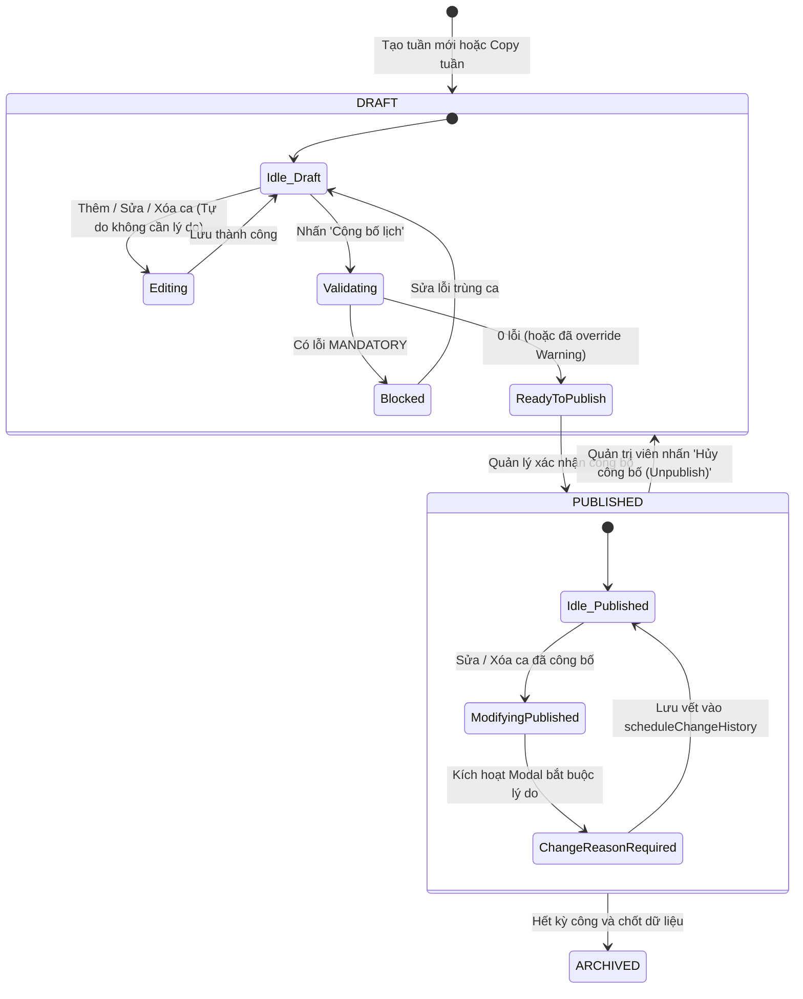

# TÀI LIỆU 11: ĐẶC TẢ CHI TIẾT MÀN HÌNH LỊCH PHÂN CA (SCHEDULE SCREEN SPECIFICATION)
**Mã màn hình:** SCR-11 (Bảng lịch tuần) & SCR-12 (Gán ca & Điều chỉnh phân ca)  
**Phân hệ:** Core Work Scheduling (Quản lý Phân ca cốt lõi)  
**Phiên bản:** 1.0.0  
**Ngày cập nhật:** 13/10/2026  
**Trạng thái:** Confirmed / Baseline  

---

## 1. GIẢI PHẪU MÀN HÌNH & BẢN VẼ WIREFRAME ASCII TOÀN DIỆN (PAGE ANATOMY & WIREFRAMES)

Màn hình Lịch phân ca (SCR-11) là trung tâm điều hành quan trọng nhất của hệ thống, phục vụ Trưởng bộ phận và Quản trị viên nhân sự trong việc phân bổ nhân sự, theo dõi định biên, phát hiện xung đột thời gian thực và công bố lịch làm việc chính thức.

```
SƠ ĐỒ CẤU TRÚC GIẢI PHẪU MÀN HÌNH LỊCH TUẦN (DESKTOP)
┌────────────────────────────────────────────────────────────────────────────────────────────────┐
│ 1. HEADER & TOPBAR (Logo, Breadcrumb, Đồng hồ thời gian thực, Visual Role Switcher, Avatar)   │
├────────────────────────────────────────────────────────────────────────────────────────────────┤
│ 2. SCHEDULE TOOLBAR (Chọn phòng ban, Tuần trước/Tuần sau, Hôm nay, Đổi Week/Month, Publish,...)│
├────────────────────────────────────────────────────────────────────────────────────────────────┤
│ 3. FILTERS & ACTIVE CHIPS (Tìm kiếm tên/mã, Lọc ca, Lọc chức danh, Cờ chỉ hiện xung đột)       │
├────────────────────────────────────────────────────────────────────────────────────────────────┤
│ 4. SUMMARY METRIC CARDS (Tổng ca phân bổ, Tổng giờ kế hoạch, Số cảnh báo xung đột, Thiếu ĐB)   │
├────────────────────────────────────────────────────────────────────────────────────────────────┤
│ 5. MAIN SCHEDULE GRID                                                                          │
│    ├── Sticky Column: Nhân viên (Mã, Họ tên, Chức danh, Tiến độ giờ tuần / 48h)                │
│    └── 7 Cột Ngày (T2 -> CN): Tiêu đề ngày, Định biên (Staffing), Thẻ ca (Shift Cards), Phép   │
├────────────────────────────────────────────────────────────────────────────────────────────────┤
│ 6. FOOTER LEGEND & SHORTCUTS (Mã màu ca WCAG, Cảnh báo, Phím tắt điều hướng bàn phím)          │
└────────────────────────────────────────────────────────────────────────────────────────────────┘
```

---

### 1.1. Wireframe ASCII: Chế độ Xem Lịch Tuần trên Desktop (Desktop Week View)
```text
+-------------------------------------------------------------------------------------------------------------------------------------------------------------------+
| [LOGO] EMS HRMS  | Trang chủ > Quản lý phân ca > Lịch tuần          | 🕒 Thứ Hai, 12/10/2026 08:30:00 (GMT+7) | [🎭 Vai trò: Trưởng bộ phận ▼] | (Avatar) Nguyễn Văn An ▼ |
+-------------------------------------------------------------------------------------------------------------------------------------------------------------------+
| PHÒNG BAN: [ Phòng Vận hành Dịch vụ ▼ ]  |  [< Tuần trước] [ Tuần 42 (12/10 - 18/10/2026) ] [Tuần sau >]  [Hôm nay]  |  Chế độ: (•) Tuần  ( ) Tháng                  |
| Trạng thái lịch: [ 🟡 BẢN NHÁP (DRAFT) - v4 ]                                           [📋 Chép tuần trước] [⚡ Gán hàng loạt] [🧹 Xóa tuần]  [🚀 CÔNG BỐ LỊCH (2⚠️)]    |
+-------------------------------------------------------------------------------------------------------------------------------------------------------------------+
| [🔍 Tìm tên, mã NV... (EMP-001)] | [Chức danh: Tất cả ▼] | [Ca làm việc: Tất cả ▼] | [ ] Chỉ hiện nhân viên có cảnh báo ⚠️ | [ 🔄 Tải lại ]  [ 📥 Xuất lịch (CSV) ]      |
| Bộ lọc đang kích hoạt: [Phòng: Vận hành (x)] [Chức danh: Tất cả] (Xóa tất cả bộ lọc)                                                                             |
+-------------------------------------------------------------------------------------------------------------------------------------------------------------------+
| [ 👥 TỔNG PHÂN CA ]       | [ ⏱️ TỔNG GIỜ KẾ HOẠCH ]     | [ ⚠️ CẢNH BÁO XUNG ĐỘT ]      | [ 🚩 THIẾU ĐỊNH BIÊN CA ]     | [ 🏖️ ĐANG NGHỈ PHÉP ]             |
|       118 ca              |       944.0 giờ              |       3 cảnh báo (0 lỗi chặn) |       1 ca thiếu người        |       2 nhân viên                  |
+-------------------------------------------------------------------------------------------------------------------------------------------------------------------+
| NHÂN VIÊN (25)            | T2 (12/10)     | T3 (13/10)     | T4 (14/10)     | T5 (15/10)     | T6 (16/10)     | T7 (17/10)     | CN (18/10)     | HÀNH ĐỘNG      |
| [ ] Chọn tất cả           | ĐB: 4/4 người  | ĐB: 4/4 người  | ĐB: 3/4 ⚠️     | ĐB: 4/4 người  | ĐB: 4/4 người  | ĐB: 2/2 người  | [🚩 NGHỈ LỄ]   |                |
|---------------------------+----------------+----------------+----------------+----------------+----------------+----------------+----------------+----------------|
| [ ] Nguyễn Văn An         | [☀️ CA SÁNG]   | [☀️ CA SÁNG]   | [☀️ CA SÁNG]   | [☀️ CA SÁNG]   | [☀️ CA SÁNG]   |      ---       |      ---       | [ ✏️ Sửa nhanh ]|
| EMP-001 | Ca trưởng       | 08:00 - 17:00  | 08:00 - 17:00  | 08:00 - 17:00  | 08:00 - 17:00  | 08:00 - 17:00  | (Nghỉ tuần)    | (Nghỉ tuần)    | [ 📋 Chép dòng]|
| 40.0h / 48h [========--]  | (8.0h net)     | (8.0h net)     | (8.0h net)     | (8.0h net)     | (8.0h net)     |                |                | [ 🧹 Xóa dòng ]|
|---------------------------+----------------+----------------+----------------+----------------+----------------+----------------+----------------+----------------|
| [ ] Trần Thị Bích         | [🌤️ CA CHIỀU]  | [☀️ CA SÁNG]⚠️ | [🌤️ CA CHIỀU]  | [🏖️ PHÉP NĂM]  | [🌤️ CA CHIỀU]  | [🌤️ CA CHIỀU]  |      ---       | [ ✏️ Sửa nhanh ]|
| EMP-002 | Kỹ thuật viên   | 14:00 - 22:00  | 06:00 - 14:00  | 14:00 - 22:00  | Đã phê duyệt   | 14:00 - 22:00  | 14:00 - 22:00  | (Nghỉ tuần)    | [ 📋 Chép dòng]|
| 40.0h / 48h [========--]  | (8.0h net)     | *Nghỉ < 11h!   | (8.0h net)     | (Hưởng lương)  | (8.0h net)     | (8.0h net)     |                | [ 🧹 Xóa dòng ]|
|---------------------------+----------------+----------------+----------------+----------------+----------------+----------------+----------------+----------------|
| [ ] Lê Văn Cường          |      ---       | [🌙 CA ĐÊM (+1)|      ---       | [🌙 CA ĐÊM (+1)|      ---       | [🌙 CA ĐÊM (+1)|      ---       | [ ✏️ Sửa nhanh ]|
| EMP-003 | Nhân viên ca    | (Nghỉ bù)      | 22:00 - 06:00  | (Nghỉ sau đêm) | 22:00 - 06:00  | (Nghỉ sau đêm) | 22:00 - 06:00  | (Nghỉ tuần)    | [ 📋 Chép dòng]|
| 24.0h / 48h [=====-----]  |                | 8.0h (+1 ngày) |                | 8.0h (+1 ngày) |                | 8.0h (+1 ngày) |                | [ 🧹 Xóa dòng ]|
|---------------------------+----------------+----------------+----------------+----------------+----------------+----------------+----------------+----------------|
| [ ] Phạm Văn Dũng         | [☀️ CA SÁNG]   | [☀️ CA SÁNG]   | [☀️ CA SÁNG]   | [☀️ CA SÁNG]   | [☀️ CA SÁNG]   | [☀️ CA SÁNG]   | [☀️ CA SÁNG]⚠️ | [ ✏️ Sửa nhanh ]|
| EMP-004 | Nhân viên ca    | 08:00 - 17:00  | 08:00 - 17:00  | 08:00 - 17:00  | 08:00 - 17:00  | 08:00 - 17:00  | 08:00 - 17:00  | 08:00 - 17:00  | [ 📋 Chép dòng]|
| 56.0h / 48h [==========]🔴| (8.0h net)     | (8.0h net)     | (8.0h net)     | (8.0h net)     | (8.0h net)     | (8.0h net)     | *Vượt trần 48h!| [ 🧹 Xóa dòng ]|
+-------------------------------------------------------------------------------------------------------------------------------------------------------------------+
| CHÚ GIẢI CA: [☀️ Sáng: 08-17h] [🌤️ Chiều: 14-22h] [🌙 Đêm: 22-06h] [🏖️ Phép] [🚩 Lễ] | PHÍM TẮT: [Click ô: Gán/Sửa] [Del: Xóa] [Phím mũi tên: Di chuyển ô]     |
| [ 🔄 Khôi phục dữ liệu Demo ] | [ 📜 Xem lịch sử thay đổi (4) ] | Hiển thị 1 - 4 trong tổng số 25 nhân sự                              | [<<] [<] [1] [2] [>] [>>]        |
+-------------------------------------------------------------------------------------------------------------------------------------------------------------------+
```

---

### 1.2. Wireframe ASCII: Chế độ Xem Lịch Tháng Tổng Quan (Month View Grid)
```text
+------------------------------------------------------------------------------------------------------------------------------------------+
| LỊCH LÀM VIỆC THEO THÁNG: PHÒNG VẬN HÀNH DỊCH VỤ                                          [ Tuần trước ] Tháng 10/2026 [ Tuần sau ]      |
| Chế độ: ( ) Tuần  (•) Tháng  |  Lọc nhân sự: [ Nguyễn Văn An (EMP-001) ▼ ]               | Tổng công tháng: 168.0 giờ / 21 ca làm việc   |
+------------------------------------------------------------------------------------------------------------------------------------------+
| THỨ HAI        | THỨ BA         | THỨ TƯ         | THỨ NĂM        | THỨ SÁU        | THỨ BẢY        | CHỦ NHẬT       |
|----------------+----------------+----------------+----------------+----------------+----------------+----------------|
| 28/09 (Tháng 9)| 29/09          | 30/09          | 01/10          | 02/10          | 03/10          | 04/10          |
| [☀️ Sáng 8h]   | [☀️ Sáng 8h]   | [☀️ Sáng 8h]   | [☀️ Sáng 8h]   | [☀️ Sáng 8h]   | --- Nghỉ ---   | --- Nghỉ ---   |
|----------------+----------------+----------------+----------------+----------------+----------------+----------------|
| 05/10 (Tuần 41)| 06/10          | 07/10          | 08/10          | 09/10          | 10/10          | 11/10          |
| [☀️ Sáng 8h]   | [☀️ Sáng 8h]   | [☀️ Sáng 8h]   | [☀️ Sáng 8h]   | [☀️ Sáng 8h]   | --- Nghỉ ---   | --- Nghỉ ---   |
|----------------+----------------+----------------+----------------+----------------+----------------+----------------|
| 12/10 (Tuần 42)| 13/10          | 14/10 [Hôm nay]| 15/10          | 16/10          | 17/10          | 18/10          |
| [☀️ Sáng 8h]   | [☀️ Sáng 8h]   | [☀️ Sáng 8h]   | [☀️ Sáng 8h]   | [☀️ Sáng 8h]   | --- Nghỉ ---   | [🚩 NGHỈ LỄ]   |
|----------------+----------------+----------------+----------------+----------------+----------------+----------------|
| 19/10 (Tuần 43)| 20/10          | 21/10          | 22/10          | 23/10          | 24/10          | 25/10          |
| [🌤️ Chiều 8h]  | [🌤️ Chiều 8h]  | [🏖️ PHÉP NĂM]  | [🌤️ Chiều 8h]  | [🌤️ Chiều 8h]  | --- Nghỉ ---   | --- Nghỉ ---   |
+------------------------------------------------------------------------------------------------------------------------------------------+
```

---

### 1.3. Wireframe ASCII: Chế độ Xem trên Máy Tính Bảng (Tablet View - 768px đến 1024px)
Trên màn hình Tablet, thanh Sidebar thu gọn thành 80px (chỉ hiện icon), ma trận lịch giữ nguyên 7 cột nhưng cột nhân viên co gọn và nội dung ô hiển thị cô đọng:
```text
+-----------------------------------------------------------------------------------------------------------------------+
| [=] EMS | [Phòng: Vận hành ▼] | [ < ] Tuần 42 (12-18/10) [ > ] | [🟡 DRAFT] | [⚡ Gán] [🚀 CÔNG BỐ] | [Role: Mgr ▼]    |
+-----------------------------------------------------------------------------------------------------------------------+
| NHÂN VIÊN       | T2 (12/10)    | T3 (13/10)    | T4 (14/10)    | T5 (15/10)    | T6 (16/10)    | T7 (17) | CN (18)   |
|-----------------+---------------+---------------+---------------+---------------+---------------+---------+-----------|
| N. V. An        | [☀️ 08-17h]   | [☀️ 08-17h]   | [☀️ 08-17h]   | [☀️ 08-17h]   | [☀️ 08-17h]   |   ---   |    ---    |
| 40h [====--]    | 8h            | 8h            | 8h            | 8h            | 8h            | Nghỉ    | Nghỉ      |
|-----------------+---------------+---------------+---------------+---------------+---------------+---------+-----------|
| T. T. Bích      | [🌤️ 14-22h]   | [☀️ 06-14h]⚠️ | [🌤️ 14-22h]   | [🏖️ PHÉP]    | [🌤️ 14-22h]   | [🌤️ 14] |    ---    |
| 40h [====--]    | 8h            | *Nghỉ < 11h!  | 8h            | Phép năm      | 8h            | 8h      | Nghỉ      |
+-----------------------------------------------------------------------------------------------------------------------+
```

---

### 1.4. Wireframe ASCII: Chế độ Xem trên Điện Thoại Di Động (Phone Day-by-Day List View < 768px)
Trên màn hình điện thoại, ma trận tuần tự động chuyển thành **Bộ chọn thứ dạng Tab trượt ngang (Day Tabs Slider)** kết hợp **Danh sách ca theo ngày (Day-by-Day List)**:
```text
+----------------------------------------------------+
| [ ☰ ] LỊCH PHÂN CA             [ 🎭 Vai trò: Mgr ] |
+----------------------------------------------------+
| Tuần 42 (12/10 - 18/10/2026)      [🟡 BẢN NHÁP]    |
| [<]--------------------------------------------[>] |
| [ T2 ] [ T3 ] [• T4 •] [ T5 ] [ T6 ] [ T7 ] [ CN ] |
|  12/10  13/10  14/10    15/10  16/10  17/10  18/10 |
+----------------------------------------------------+
| HÔM NAY: THỨ TƯ, 14/10/2026 (Định biên: 3/4 người⚠️)|
|----------------------------------------------------|
| 👤 1. Nguyễn Văn An (EMP-001) - Ca trưởng          |
|    [☀️ CA SÁNG: 08:00 - 17:00] (8.0 giờ)           |
|    [ ✏️ Đổi ca ]  [ 🗑️ Xóa ]                        |
|----------------------------------------------------|
| 👤 2. Trần Thị Bích (EMP-002) - Kỹ thuật viên      |
|    [🌤️ CA CHIỀU: 14:00 - 22:00] (8.0 giờ)          |
|    [ ✏️ Đổi ca ]  [ 🗑️ Xóa ]                        |
|----------------------------------------------------|
| 👤 3. Lê Văn Cường (EMP-003) - Nhân viên ca        |
|    [--- NGHỈ BÙ SAU CA ĐÊM ---]                    |
|    [ + Gán ca làm việc ]                           |
|----------------------------------------------------|
| 👤 4. Phạm Văn Dũng (EMP-004) - Nhân viên ca       |
|    [☀️ CA SÁNG: 08:00 - 17:00] (8.0 giờ)           |
|    [ ✏️ Đổi ca ]  [ 🗑️ Xóa ]                        |
+----------------------------------------------------+
| [ + Gán ca cho người khác ]   [ 🚀 CÔNG BỐ LỊCH ]  |
+----------------------------------------------------+
```

---

### 1.5. Wireframes ASCII: Danh mục Toàn bộ 7 Hộp thoại & Bảng trượt (Dialogs & Drawers)

#### Dialog 1: Drawer Gán / Chỉnh sửa Phân ca Đơn lẻ (SCR-12 AssignShiftDrawer)
```text
+-------------------------------------------------------------------+
| GÁN CA LÀM VIỆC                                             [ X ] |
+-------------------------------------------------------------------+
| Nhân viên: Trần Thị Bích (EMP-002)                                |
| Chức danh: Kỹ thuật viên | Phòng: Vận hành Dịch vụ                |
| Ngày phân ca: Thứ Ba, 13/10/2026                                  |
| Tổng giờ đã xếp trong tuần: 32.0 giờ / 48.0 giờ                   |
+-------------------------------------------------------------------+
| CHỌN MẪU CA LÀM VIỆC:                                             |
| ( ) [☀️ Ca Sáng Tiêu Chuẩn]    08:00 - 17:00 (Nghỉ 60p, Net: 8h)   |
| (*) [🌤️ Ca Sáng Sớm]           06:00 - 14:00 (Nghỉ 0p, Net: 8h)    |
| ( ) [🌤️ Ca Chiều]              14:00 - 22:00 (Nghỉ 0p, Net: 8h)    |
| ( ) [🌙 Ca Đêm (+1 ngày)]      22:00 - 06:00 (Nghỉ 0p, Net: 8h)    |
| ( ) [--- Đánh dấu Ngày nghỉ tuần / Nghỉ bù ---]                   |
+-------------------------------------------------------------------+
| ⚠️ CẢNH BÁO PHÁT HIỆN XUNG ĐỘT (POLICY WARNING):                   |
| ┌───────────────────────────────────────────────────────────────┐ |
| │ [BR-006] Ca liền trước kết thúc lúc 22:00 ngày T2 (12/10).    │ |
| │ Khoảng nghỉ thực tế: 8.0 giờ (Dưới mức tối thiểu 11.0 giờ).   │ |
| └───────────────────────────────────────────────────────────────┘ |
| [x] Tôi xác nhận đặc cách phân công ca làm việc này               |
| Lý do giải trình (Bắt buộc tối thiểu 10 ký tự):                   |
| [ Nhân viên đồng ý đổi ca hỗ trợ kiểm kê khẩn cấp............. ]  |
+-------------------------------------------------------------------+
| Ghi chú bổ sung cho nhân viên (Tùy chọn):                         |
| [ Nhận bàn giao chìa khóa tại phòng bảo vệ                      ] |
+-------------------------------------------------------------------+
| [ 🗑️ Xóa ca này ]        [ Hủy bỏ ]               [ Lưu phân ca ] |
+-------------------------------------------------------------------+
```

#### Dialog 2: Modal Sao chép Lịch từ Tuần trước (CopyWeekDialog)
```text
+-------------------------------------------------------------------+
| SAO CHÉP LỊCH TỪ TUẦN TRƯỚC                                 [ X ] |
+-------------------------------------------------------------------+
| Tuần nguồn (Sao chép từ): Tuần 41 (05/10/2026 - 11/10/2026)       |
| Tuần đích  (Áp dụng vào): Tuần 42 (12/10/2026 - 18/10/2026)       |
+-------------------------------------------------------------------+
| KẾT QUẢ RÀ SOÁT DỮ LIỆU TUẦN ĐÍCH:                                |
| • Tổng số ca ở tuần nguồn:            112 ca                      |
| • Số ô đang trống ở tuần hiện tại:    85 ô                        |
| • Số ô ĐÃ CÓ CA hoặc ĐANG NGHỈ PHÉP:  27 ô                        |
+-------------------------------------------------------------------+
| CHỌN PHƯƠNG THỨC SAO CHÉP:                                        |
| (*) BỎ QUA CÁC Ô ĐÃ CÓ CA (Khuyến nghị)                           |
|     Giữ nguyên 27 ca và đơn phép hiện tại, chỉ điền vào 85 ô trống|
|                                                                   |
| ( ) GHI ĐÈ TOÀN BỘ                                                |
|     Xóa 27 ca hiện tại và chép đè toàn bộ 112 ca từ tuần trước     |
|     (Các đơn nghỉ phép đã duyệt vẫn được bảo lưu an toàn)         |
+-------------------------------------------------------------------+
| [ Hủy bỏ ]                                  [ Bắt đầu sao chép ]  |
+-------------------------------------------------------------------+
```

#### Dialog 3: Modal Xác nhận Công bố Lịch Tuần (PublishConfirmDialog)
```text
+-------------------------------------------------------------------+
| XÁC NHẬN CÔNG BỐ LỊCH LÀM VIỆC CHÍNH THỨC                   [ X ] |
+-------------------------------------------------------------------+
| Bạn đang chuẩn bị công bố lịch cho:                               |
| • Phòng ban: Phòng Vận hành Dịch vụ                               |
| • Thời gian: Tuần 42 (12/10/2026 - 18/10/2026)                    |
| • Tổng số ca phân công: 118 ca (25 nhân viên)                     |
+-------------------------------------------------------------------+
| ⚠️ TỔNG HỢP CẢNH BÁO TRƯỚC KHI CÔNG BỐ:                            |
| • 0 Lỗi nghiêm trọng (MANDATORY ERROR)                            |
| • 2 Cảnh báo chính sách (WARNING) đã được nhập lý do ghi đè:      |
|   1. Trần Thị Bích: Nghỉ giữa ca 8.0h (< 11.0h) ngày 13/10        |
|   2. Phạm Văn Dũng: Vượt 48h tuần (56.0h) ngày 18/10              |
+-------------------------------------------------------------------+
| 📢 LƯU Ý QUAN TRỌNG:                                              |
| Sau khi công bố, lịch sẽ chuyển sang trạng thái PUBLISHED:        |
| - Nhân viên sẽ nhìn thấy ca làm việc trên cổng thông tin cá nhân. |
| - Mọi thao tác chỉnh sửa sau này đều bắt buộc phải nhập lý do.    |
+-------------------------------------------------------------------+
| [ Quay lại chỉnh sửa ]                [ Xác nhận CÔNG BỐ LỊCH ]   |
+-------------------------------------------------------------------+
```

#### Dialog 4: Modal Xác nhận Xóa Phân ca / Xóa Lịch (DeleteConfirmDialog)
```text
+-------------------------------------------------------------------+
| XÁC NHẬN XÓA CA LÀM VIỆC                                    [ X ] |
+-------------------------------------------------------------------+
| Bạn có chắc chắn muốn xóa ca làm việc sau:                        |
| • Nhân viên: Nguyễn Văn An (EMP-001)                              |
| • Ngày làm việc: Thứ Hai, 12/10/2026                              |
| • Ca: Ca Sáng Tiêu Chuẩn (08:00 - 17:00)                          |
+-------------------------------------------------------------------+
| Thao tác này sẽ giải phóng ô lịch của nhân viên về trạng thái     |
| chưa phân ca. Không thể hoàn tác sau khi lưu.                     |
+-------------------------------------------------------------------+
| [ Giữ lại ca ]                                 [ Xác nhận XÓA ]   |
+-------------------------------------------------------------------+
```

#### Dialog 5: Modal Cảnh báo Xung đột & Yêu cầu Giải trình (ConflictNoticeModal)
```text
+-------------------------------------------------------------------+
| PHÁT HIỆN XUNG ĐỘT PHÂN CA                                  [ X ] |
+-------------------------------------------------------------------+
| Thao tác phân ca cho [ Nguyễn Văn An ] vi phạm quy tắc sau:       |
|                                                                   |
| ⛔ LỖI BẮT BUỘC: [BR-001] TRÙNG KHUNG GIỜ LÀM VIỆC                 |
| - Ca mới: Ca Hành chính (13:00 - 21:00)                           |
| - Ca cũ đã có: Ca Sáng (08:00 - 16:00)                            |
| - Khoảng giao thoa: 13:00 đến 16:00 (Trùng 3.0 giờ)               |
+-------------------------------------------------------------------+
| HỆ THỐNG CHẶN LƯU THAO TÁC NÀY.                                   |
| Không một vai trò nào được phép ghi đè lỗi trùng giờ vật lý.      |
| Vui lòng chọn ca khác hoặc xóa ca cũ trước khi phân bổ.           |
+-------------------------------------------------------------------+
|                                                     [ Đã hiểu ]   |
+-------------------------------------------------------------------+
```

#### Dialog 6: Modal Nhập Lý do Thay đổi Lịch Đã Công bố (ChangeReasonDialog)
```text
+-------------------------------------------------------------------+
| ĐIỀU CHỈNH LỊCH ĐÃ CÔNG BỐ (PUBLISHED)                      [ X ] |
+-------------------------------------------------------------------+
| Lịch tuần 42 hiện đang ở trạng thái CHÍNH THỨC (PUBLISHED).       |
| Nhân viên đã xem lịch làm việc này.                               |
|                                                                   |
| Thao tác: Đổi ca của [ Trần Thị Bích ] ngày 14/10/2026            |
| Từ: [ Ca Chiều (14:00 - 22:00) ] $\rightarrow$ Thành: [ Ca Sáng (08:00 - 17:00) ]|
+-------------------------------------------------------------------+
| LÝ DO ĐIỀU CHỈNH (Bắt buộc nhập tối thiểu 5 ký tự):               |
| [ Nhân viên xin đổi ca để đi khám sức khỏe định kỳ............. ] |
+-------------------------------------------------------------------+
| Hành động này sẽ được ghi vết vĩnh viễn vào Nhật ký kiểm toán.    |
+-------------------------------------------------------------------+
| [ Hủy bỏ ]                               [ Xác nhận điều chỉnh ]  |
+-------------------------------------------------------------------+
```

#### Dialog 7: Drawer Xem Lịch sử Thay đổi (ChangeHistoryDrawer)
```text
+-------------------------------------------------------------------+
| NHẬT KÝ THAY ĐỔI LỊCH TUẦN 42                               [ X ] |
+-------------------------------------------------------------------+
| Tổng số lần chỉnh sửa sau khi công bố: 3 lần                      |
|-------------------------------------------------------------------|
| 🕒 13/10/2026 14:20:15 | Bởi: Quản lý Nguyễn Văn An (Manager)     |
| • Nhân viên: Trần Thị Bích (EMP-002) - Ngày: 14/10/2026           |
| • Hành động: [ MODIFIED ] Đổi ca làm việc                         |
| • Ca cũ: Ca Chiều (14:00 - 22:00)                                 |
| • Ca mới: Ca Sáng (08:00 - 17:00)                                 |
| • Lý do: "Nhân viên xin đổi ca để đi khám sức khỏe định kỳ"       |
|-------------------------------------------------------------------|
| 🕒 13/10/2026 09:15:00 | Bởi: Quản trị viên Lê Hoàng (HR)          |
| • Nhân viên: Lê Văn Cường (EMP-003) - Ngày: 16/10/2026            |
| • Hành động: [ ADDED ] Gán thêm ca trực đêm khẩn cấp              |
| • Ca mới: Ca Đêm (22:00 - 06:00)                                  |
| • Lý do: "Tăng cường hỗ trợ trực sự kiện bảo trì máy chủ công ty" |
+-------------------------------------------------------------------+
| [ Đóng bảng lịch sử ]                                             |
+-------------------------------------------------------------------+
```

---

## 2. BẢNG KIỂM KÊ THÀNH PHẦN GIAO DIỆN CHI TIẾT (COMPONENT INVENTORY)

Mọi component trên màn hình phân ca đều được định nghĩa rõ ràng về Props, State nội bộ và các Sự kiện (Events/Callbacks) phát ra.

| Tên Component | Mục Đích & Vị Trí | TypeScript Props (Đầu vào) | State Nội Bộ | Events & Callbacks (Đầu ra) |
|:---|:---|:---|:---|:---|
| `<ScheduleToolbar />` | Thanh công cụ điều khiển tuần, phòng ban, đổi view | `departmentId: number`<br>`startDate: string`<br>`status: ScheduleStatus`<br>`version: number`<br>`viewMode: 'WEEK' \| 'MONTH'` | Dropdown open state | `onDeptChange(id)`<br>`onWeekChange(newMonday)`<br>`onTodayClick()`<br>`onViewModeChange(mode)`<br>`onPublishClick()`<br>`onCopyWeekClick()`<br>`onExportCsvClick()` |
| `<ScheduleFiltersBar />`| Thanh tìm kiếm và bộ lọc nhanh | `searchTerm: string`<br>`positions: Position[]`<br>`shifts: ShiftTemplate[]`<br>`selectedPositionId: number \| null`<br>`selectedShiftId: number \| null`<br>`onlyConflicts: boolean` | Draft search term (debounced) | `onSearchChange(term)`<br>`onPositionChange(id)`<br>`onShiftChange(id)`<br>`onOnlyConflictsToggle(checked)`<br>`onResetFilters()` |
| `<ScheduleSummaryCards />`| 4 Thẻ KPI thống kê trên đỉnh lưới | `totalShifts: number`<br>`totalScheduledHours: number`<br>`totalConflicts: number`<br>`understaffedCount: number`<br>`onLeaveCount: number` | Không (Stateless) | `onConflictCardClick()` (Tự động bật lọc nhân sự có cảnh báo) |
| `<WeeklyGrid />` | Khung ma trận phân ca chính | `employees: Employee[]`<br>`weekDays: Date[]`<br>`assignments: Record<string, ShiftAssignment>`<br>`conflicts: Record<string, ScheduleConflict[]>`<br>`holidays: CompanyHoliday[]`<br>`readOnly: boolean` | Selected cell coordinates `{empId, dateStr}` | `onCellClick(empId, dateStr)`<br>`onCellDelete(assignmentId)`<br>`onCopyRow(sourceEmpId, targetEmpId)` |
| `<GridHeader />` | Hàng tiêu đề 7 ngày + định biên | `weekDays: Date[]`<br>`staffingByDate: Record<string, { current: number; min: number; max: number }>`<br>`holidays: CompanyHoliday[]` | Không | `onHeaderDayClick(date)` (Xem nhanh theo ngày) |
| `<EmployeeRow />` | Một hàng nhân viên (Avatar, Giờ, 7 ô) | `employee: Employee`<br>`weekDays: Date[]`<br>`assignmentsOfEmp: ShiftAssignment[]`<br>`weeklyHours: number`<br>`conflictsOfEmp: ScheduleConflict[]`<br>`readOnly: boolean` | Hover action bar | `onRowSelect(empId)`<br>`onAssignClick(dateStr)`<br>`onRowDeleteAll(empId)` |
| `<ScheduleCell />` | Một ô giao điểm giữa Nhân viên x Ngày | `employeeId: number`<br>`workDate: string`<br>`assignment: ShiftAssignment \| null`<br>`leaveInfo: LeaveRequest \| null`<br>`holidayInfo: CompanyHoliday \| null`<br>`conflicts: ScheduleConflict[]`<br>`readOnly: boolean` | Hover button `+` | `onClick()`<br>`onDelete()`<br>`onQuickCopy()` |
| `<ShiftCard />` | Thẻ ca hiển thị bên trong ô | `assignment: ShiftAssignment`<br>`conflicts: ScheduleConflict[]`<br>`readOnly: boolean` | Tooltip visible | `onClick()`<br>`onContextMenu()` |
| `<ScheduleLegend />` | Chú giải màu sắc và phím tắt | `shiftTemplates: ShiftTemplate[]` | Collapsed state | Không |
| `<AssignShiftDrawer />`| Bảng trượt gán ca & giải trình | `isOpen: boolean`<br>`employee: Employee \| null`<br>`workDate: string`<br>`currentAssignment: ShiftAssignment \| null`<br>`shiftTemplates: ShiftTemplate[]`<br>`existingShifts: ShiftAssignment[]` | `selectedShiftId`<br>`overrideConfirmed`<br>`overrideReason`<br>`note` | `onClose()`<br>`onSave(payload)`<br>`onDelete(id)` |
| `<BulkAssignDialog />` | Modal gán ca cho nhiều nhân viên | `isOpen: boolean`<br>`employees: Employee[]`<br>`shiftTemplates: ShiftTemplate[]`<br>`currentWeekRange: { start: string; end: string }` | `selectedEmpIds[]`<br>`selectedShiftId`<br>`selectedDays[]` | `onClose()`<br>`onExecute(payload)` |

---

## 3. BẢNG QUY TẮC ĐIỀU KHIỂN NÚT BẤM VÀ PHÂN QUYỀN (CONTROLS & PERMISSIONS MATRIX)

| Tên Nút / Điều Khiển | Nhãn Tiếng Việt | Hành Vi Nghiệp Vụ Khi Click | Điều Kiện ENABLED | Điều Kiện DISABLED & Lý Do | Kết Quả Đạt Được |
|:---|:---|:---|:---|:---|:---|
| **Btn Publish** | `[ 🚀 Công bố lịch tuần ]` | Mở `PublishConfirmDialog`. Nếu có lỗi Mandatory thì chặn không cho mở. | Role: `ADMIN`, `DEPT_MANAGER` VÀ Lịch = `DRAFT` VÀ Không có lỗi Mandatory. | Bị Disable khi: Lịch đã `PUBLISHED`, hoặc đang có lỗi `MANDATORY` chưa giải quyết, hoặc Role = `EMPLOYEE`. | Lịch chuyển sang `PUBLISHED`, nhân viên nhìn thấy ca. |
| **Btn Unpublish**| `[ ↩️ Hủy công bố ]` | Đưa lịch từ `PUBLISHED` quay lại `DRAFT`. | Role: `ADMIN`, `HR_MANAGER`. | Disable với `DEPT_MANAGER` (trừ khi được cấp quyền riêng) và `EMPLOYEE`. | Lịch về `DRAFT`, nhân viên không thấy lịch nữa. |
| **Btn Copy Week**| `[ 📋 Sao chép tuần trước ]`| Quét ca tuần $W-1$ và mở `CopyWeekDialog` hiển thị số ca. | Role: `ADMIN`, `DEPT_MANAGER` VÀ Lịch = `DRAFT`. | Disable khi Lịch đã `PUBLISHED` hoặc Role = `EMPLOYEE`. | Điền ca từ tuần trước sang tuần này theo chế độ chọn. |
| **Btn Bulk Assign**| `[ ⚡ Gán hàng loạt ]` | Mở `BulkAssignDialog` chọn nhiều nhân viên và dải ngày. | Role: `ADMIN`, `DEPT_MANAGER`. | Disable khi Role = `EMPLOYEE`. | Gán đồng loạt hàng chục ca chỉ với 1 cú click. |
| **Btn Clear Week**| `[ 🧹 Xóa lịch tuần ]` | Mở Modal xác nhận xóa toàn bộ phân ca của tuần. | Role: `ADMIN`, `DEPT_MANAGER` VÀ Lịch = `DRAFT`. | Disable khi Lịch đã `PUBLISHED`. | Xóa toàn bộ ca của tuần về lưới trống. |
| **Btn Export CSV**| `[ 📥 Xuất lịch (CSV) ]` | Kích hoạt hàm `exportToCsv` tải file CSV UTF-8 BOM về máy. | Luôn luôn Enabled cho mọi vai trò. | Không bao giờ bị disable. | File `Lich_Phan_Ca_Tuan_42.csv` được tải về máy. |
| **Cell Click** | Click vào ô ma trận | Nếu ô trống: mở Drawer gán mới. Nếu đã có ca: mở Drawer sửa ca. | Lịch = `DRAFT` HOẶC (Lịch = `PUBLISHED` + có quyền Quản lý). | Khi Role = `EMPLOYEE` (Chỉ xem). | Mở `AssignShiftDrawer`. |
| **Btn History** | `[ 📜 Lịch sử thay đổi (N) ]`| Mở `ChangeHistoryDrawer` xem nhật ký kiểm toán của tuần. | Có ít nhất 1 bản ghi thay đổi sau công bố. | Disable (hoặc ẩn) khi chưa có lịch sử thay đổi nào. | Drawer trượt ra hiển thị danh sách kiểm toán. |

---

## 4. MÔ HÌNH MÁY TRẠNG THÁI TƯƠNG TÁC (INTERACTION STATE MACHINES)

### 4.1. Máy Trạng thái Vòng đời Lịch Tuần (Weekly Schedule Lifecycle State Machine)


### 4.2. Máy Trạng thái Gán Ca & Kiểm Soát Xung Đột (Assign Shift & Conflict Guard)
```mermaid
flowchart TD
    ClickCell([1. Quản lý Click vào ô Ngày]) --> OpenDrawer[2. Mở AssignShiftDrawer]
    OpenDrawer --> SelectShift[3. Chọn Mẫu ca làm việc]
    SelectShift --> RunEngine[4. Chạy Client Conflict Engine]
    RunEngine --> CheckErrors{5. Kết quả kiểm tra?}
    
    CheckErrors -- "Có lỗi MANDATORY (BR-001, BR-002)" --> StateMandatory[Banner Đỏ: Trùng giờ / Nhân viên nghỉ việc]
    StateMandatory --> DisableSave[Vô hiệu hóa nút 'Lưu phân ca']
    DisableSave --> SelectShift
    
    CheckErrors -- "Có cảnh báo WARNING (BR-003..BR-007)" --> StateWarning[Banner Vàng: Nghỉ < 11h, Vượt 48h]
    StateWarning --> PromptOverride[Hiện Checkbox 'Xác nhận đặc cách' & Ô nhập lý do (>=10 ký tự)]
    PromptOverride --> UserInputReason{Quản lý nhập lý do?}
    UserInputReason -- Chưa nhập đủ --> DisableSave
    UserInputReason -- Đã nhập đủ --> EnableSave[Kích hoạt nút 'Lưu phân ca']
    
    CheckErrors -- "Không có xung đột" --> EnableSave
    EnableSave --> ClickSave[6. Nhấn 'Lưu phân ca']
    ClickSave --> IsPublished{Lịch đã PUBLISHED?}
    IsPublished -- Có --> PromptChangeReason[Hiện Modal nhập lý do sửa lịch chính thức]
    PromptChangeReason --> SaveState[Cập nhật Zustand Store + Ghi log kiểm toán]
    IsPublished -- Không (Draft) --> SaveState
    SaveState --> CloseDrawer([Đóng Drawer, ô lịch cập nhật Thẻ ca])
```

---

## 5. MA TRẬN XÁC THỰC NGHIỆP VỤ TOÀN DIỆN (COMPLETE VALIDATION MATRIX)

| Mã Quy Tắc | Phân Loại Severity | Điều Kiện Kích Hoạt Xung Đột | Thông Báo Lỗi Tiếng Việt Chuẩn Xác | Hành Động Khả Dụng Của Người Dùng | Vị Trí Hiển Thị Trên Giao Diện |
|:---:|:---:|:---|:---|:---|:---|
| **BR-001** | **MANDATORY** (Lỗi Chặn) | $\max(S_{new}, S_{old}) < \min(E_{new}, E_{old})$<br>(Trùng khung giờ ca khác của nhân viên) | `Lỗi chặn: Nhân viên [Tên] đã có [Tên ca cũ] ([Giờ cũ]) trùng khung giờ với ca này. Không thể xếp 2 ca cùng lúc.` | Không được phép lưu. Bắt buộc chọn ca khác hoặc xóa ca cũ. | Banner đỏ trong Drawer; Chấm đỏ nhấp nháy góc thẻ ca; Tooltip ô. |
| **BR-002** | **MANDATORY** (Lỗi Chặn) | Nhân viên có trạng thái `RESIGNED`, hoặc `isActive = false`, hoặc ngày gán $< \text{hireDate}$. | `Lỗi chặn: Hồ sơ nhân viên ở trạng thái không hoạt động hoặc chưa đến ngày vào làm việc chính thức.` | Chặn hoàn toàn. Không thể phân ca cho nhân sự này. | Modal thông báo lỗi; Vô hiệu hóa toàn bộ ô hàng nhân viên. |
| **BR-003** | **WARNING** (Cảnh Báo) | Xếp ca vào ngày mà nhân viên đã có đơn nghỉ phép ở trạng thái `APPROVED`. | `Cảnh báo: Nhân viên đã được phê duyệt nghỉ [Loại phép] vào ngày [Ngày]. Bạn có chắc chắn muốn điều động đi làm không?` | Cho phép tiếp tục nếu tích chọn "Xác nhận đặc cách" và nhập lý do điều động $\ge 10$ ký tự. | Banner vàng trong Drawer; Thẻ phép hiển thị viền vàng; Tooltip cảnh báo. |
| **BR-004** | **WARNING** (Cảnh Báo) | Tổng số giờ làm việc theo kế hoạch trong tuần của nhân viên $> 48.0$ giờ. | `Cảnh báo: Tổng giờ làm trong tuần là [Tổng] giờ (vượt giới hạn quy định 48.0 giờ/tuần theo Bộ luật Lao động).` | Cho phép tiếp tục. Cần xác nhận đặc cách tăng ca của Trưởng bộ phận. | Thanh tiến độ giờ nhân viên đổi sang màu đỏ `[56h/48h]`; Badge cảnh báo tuần. |
| **BR-005** | **WARNING** (Cảnh Báo) | Tổng số giờ làm việc theo kế hoạch trong 1 ngày của nhân viên $> 12.0$ giờ. | `Cảnh báo: Tổng giờ làm trong ngày là [Tổng] giờ (vượt trần tối đa 12.0 giờ/ngày bao gồm tăng ca).` | Yêu cầu nhập lý do giải trình ca trực khẩn cấp. | Viền ô ngày đổi màu cam; Badge cảnh báo trên ô. |
| **BR-006** | **WARNING** (Cảnh Báo) | Khoảng cách nghỉ giữa ca trước và ca sau $< 11.0$ giờ (hoặc $< 12.0$ giờ). | `Cảnh báo: Khoảng cách nghỉ giữa 2 ca liên tiếp chỉ đạt [Số giờ] giờ (thiếu [Số thiếu] giờ so với mức tối thiểu 11.0 giờ).` | Tích chọn "Xác nhận đặc cách" và nhập lý do nhân viên tự nguyện đổi ca hỗ trợ. | Dấu chấm than vàng ⚠️ góc thẻ ca; Thông báo chi tiết trong Drawer. |
| **BR-007** | **WARNING** (Cảnh Báo) | Xếp ca vào ngày được định nghĩa là Ngày lễ công ty (`CompanyHoliday`). | `Thông tin: Ngày này là ngày nghỉ lễ [Tên ngày lễ]. Ca làm việc này sẽ được tính hệ số lương làm thêm ngày lễ.` | Nhấn "Xác nhận phân ca ngày lễ" để tiếp tục. | Tiêu đề cột ngày đổi nền hồng đỏ; Icon cờ đỏ [🚩 LỄ]; Viền thẻ ca màu hồng. |

---

## 6. THIẾT KẾ ĐIỀU HƯỚNG BÀN PHÍM VÀ TIẾP CẬN (KEYBOARD MAP & ARIA DESIGN)

### 6.1. Bản Đồ Phím Tắt Điều Hướng Ma Trận Lưới (Keyboard Navigation Map)
Người quản lý có thể xếp lịch cho toàn bộ tuần mà **không cần chạm vào chuột**:

| Phím Bấm | Ngữ Cảnh Hoạt Động | Hành Vi Hệ Thống | Tiêu Điểm Kế Tiếp (Focus Target) |
|:---|:---|:---|:---|
| `Arrow Right` ($\rightarrow$) | Đang focus tại 1 ô | Di chuyển sang ô ngày tiếp theo của cùng nhân viên | Ô ngày kế tiếp ($Date + 1$) |
| `Arrow Left` ($\leftarrow$) | Đang focus tại 1 ô | Di chuyển sang ô ngày trước đó của cùng nhân viên | Ô ngày liền trước ($Date - 1$) |
| `Arrow Down` ($\downarrow$) | Đang focus tại 1 ô | Di chuyển xuống ô cùng ngày của nhân viên bên dưới | Ô của nhân viên bên dưới |
| `Arrow Up` ($\uparrow$) | Đang focus tại 1 ô | Di chuyển lên ô cùng ngày của nhân viên bên trên | Ô của nhân viên bên trên |
| `Enter` hoặc `Space` | Đang focus tại 1 ô | Mở `AssignShiftDrawer` để gán ca mới hoặc sửa ca cũ | Tiêu điểm chuyển vào ô chọn ca đầu tiên trong Drawer |
| `Delete` hoặc `Backspace`| Đang focus tại ô có ca | Mở Modal xác nhận xóa ca của ô đó | Nút "Xác nhận xóa" |
| `Escape` | Đang mở Drawer / Modal | Đóng Drawer / Modal và hủy thao tác | Tiêu điểm quay trở lại ô ma trận ban đầu |
| `Tab` | Bên trong Drawer / Modal | Xoay vòng tiêu điểm giữa các trường nhập liệu (Focus Trap)| Trường tiếp theo trong form |

### 6.2. Cấu Trúc Ngữ Nghĩa ARIA Dành Cho Trình Đọc Màn Hình (Screen Readers)
- Phần tử lưới ngoài cùng: `<div role="grid" aria-label="Bảng phân ca làm việc tuần 42 phòng Vận hành" aria-rowcount="26" aria-colcount="8">`.
- Tiêu đề cột ngày: `<div role="columnheader" aria-colindex="2"> Thứ Hai, ngày 12 tháng 10 năm 2026, Định biên 4 trên 4 nhân sự </div>`.
- Ô dữ liệu ma trận:
  ```html
  <div 
    role="gridcell" 
    tabindex="0" 
    aria-rowindex="2" 
    aria-colindex="3"
    aria-label="Nhân viên Trần Thị Bích, Thứ Ba ngày 13 tháng 10 năm 2026, Ca Sáng Sớm từ 06:00 đến 14:00, 8.0 giờ làm việc. Cảnh báo: Thời gian nghỉ giữa 2 ca chỉ đạt 8.0 giờ, dưới mức quy định 11 giờ."
  >
    <!-- ShiftCard DOM -->
  </div>
  ```

---

## 7. CÁC TRẠNG THÁI GIAO DIỆN & BỘ CHUYỂN TRẠNG THÁI DEMO (DEMO-STATE SWITCHER)

Hệ thống hỗ trợ đầy đủ 4 trạng thái phản hồi giao diện chuẩn:
1. **Loading State (Đang nạp dữ liệu):** Hiển thị `<ScheduleSkeletonGrid />` gồm 5 hàng xám nhấp nháy mô phỏng avatar, tên nhân viên và các ô ca để không gây giật màn hình khi tải.
2. **Empty State (Tuần hoàn toàn trống):** Khi chọn một tuần mới chưa xếp lịch, lưới hiển thị thông điệp nhẹ nhàng: *"Tuần này chưa có ca làm việc nào được phân bổ. Bạn có thể [Sao chép từ tuần trước] hoặc [Gán ca hàng loạt] để bắt đầu"*.
3. **No Results State (Không tìm thấy kết quả lọc):** Khi gõ tìm kiếm không khớp nhân viên nào: *"Không tìm thấy nhân viên phù hợp với từ khóa '[Từ khóa]'. Bấm [Xóa bộ lọc] để xem tất cả"*.
4. **Error State (Lỗi kết nối):** Hiển thị nút "Thử lại (Retry)" kèm thông điệp thân thiện.

### Bộ Chuyển Trạng Thái Demo (Demo-State Switcher Controls):
Trên thanh công cụ phía dưới màn hình (Footer), cung cấp thanh công cụ đặc biệt dành riêng cho người kiểm thử:
- `[ 🔄 Reset Demo Data ]`: Xóa toàn bộ dữ liệu cục bộ trong localStorage và khôi phục lại 100% dữ liệu hạt giống ban đầu.
- `[ ⚙️ Ngưỡng nghỉ: (•) 11 giờ  ( ) 12 giờ ]`: Toggle nhanh ngưỡng nghỉ ngơi để xem các cảnh báo vi phạm tự động xuất hiện hoặc biến mất ngay lập tức.
- `[ 🎭 Vai trò: [ Trưởng bộ phận ▼ ] ]`: Đổi tức thì góc nhìn người dùng giữa Admin, Manager và Employee.

---

## 8. BẢNG 10 KỊCH BẢN THỰC TẾ WORKED EXAMPLES (ĐẦY ĐỦ PHÉP TOÁN VÀ SỐ LIỆU ĐỐI SOÁT)

Dưới đây là 10 kịch bản nghiệp vụ thực tế được kiểm thử chi tiết đến từng phút và từng con số:

| STT | Tên Kịch Bản | Dữ Liệu Đầu Vào Chi Tiết | Quy Tắc Kích Hoạt | Kết Quả Giao Diện & Thông Báo | Số Liệu Đối Soát Chi Tiết |
|:---:|:---|:---|:---:|:---|:---|
| **EX-01** | **Ca làm việc Qua đêm (Overnight Shift)** | NV: Lê Văn Cường (EMP-003).<br>Ngày: Thứ Ba 13/10.<br>Ca: Ca Đêm (`22:00` đến `06:00` hôm sau, nghỉ 0p). | **BR-011**, **FDEC-008** | Thẻ ca hiển thị tại ô Thứ Ba có nhãn `[🌙 Ca Đêm (+1 ngày)]`. Không hiển thị thẻ ở Thứ Tư (chỉ có dòng ghi chú mờ "Nghỉ sau đêm"). | • Duration: $(24 - 22) + 6 = 8.0$ giờ.<br>• Gross = Net = 8.0h.<br>• Giờ tính 1 lần vào Thứ Ba và Tuần 42.<br>• Night hours = 8.0h. |
| **EX-02** | **Tràn Ca Đêm Chủ Nhật sang Thứ Hai tuần sau (Sunday Spill)** | NV: Lê Văn Cường.<br>Ngày: Chủ Nhật 18/10 (Tuần 42).<br>Ca: Ca Đêm (`22:00` CN đến `06:00` T2 tuần 43).<br>Thao tác: Quản lý mở tuần 43 gán Ca Sáng 08:00 T2. | **BR-006**, **FDEC-008** | Khi sang tuần 43 gán ca sáng 08:00 T2: Hệ thống cảnh báo vi phạm thời gian nghỉ giữa 2 ca! | • Kết thúc ca đêm: 06:00 Thứ Hai.<br>• Bắt đầu ca sáng: 08:00 Thứ Hai.<br>• Khoảng nghỉ thực tế: $08:00 - 06:00 = 2.0$ giờ (< 11.0h). Cảnh báo kích hoạt chuẩn xác. |
| **EX-03** | **Trùng Ca trong cùng một ngày (Shift Overlap)** | NV: Nguyễn Văn An (EMP-001).<br>Ngày: Thứ Hai 12/10.<br>Đã có: Ca Sáng (`08:00` - `17:00`).<br>Cố gán thêm: Ca Chiều (`14:00` - `22:00`). | **BR-001** (MANDATORY) | ⛔ Chặn lưu hoàn toàn! Nút "Lưu phân ca" bị vô hiệu hóa. Banner đỏ báo lỗi trùng 3 giờ từ 14:00 đến 17:00. | • Giao thoa: $\max(08:00, 14:00) < \min(17:00, 22:00) \Leftrightarrow 14:00 < 17:00$.<br>• Thời gian trùng: 3.0 giờ. Giao dịch bị chặn. |
| **EX-04** | **Phân ca trùng Đơn nghỉ phép đã duyệt (Leave Conflict)** | NV: Trần Thị Bích (EMP-002).<br>Ngày: Thứ Năm 15/10.<br>Đơn phép: Phép năm (ANNUAL_LEAVE) đã `APPROVED`.<br>Quản lý thao tác: Gán Ca Chiều (14:00 - 22:00). | **BR-003** (WARNING) | Ô lịch có sẵn thẻ `[🏖️ Phép năm]`. Khi gán ca, xuất hiện hộp thoại cảnh báo nhân viên đang nghỉ phép. Yêu cầu nhập lý do điều động. | Sau khi nhập lý do "Hỗ trợ đoàn kiểm toán", ô hiển thị ca làm việc nhưng có viền vàng cảnh báo điều động trong ngày phép. |
| **EX-05** | **Vượt trần giờ làm việc trong tuần (> 48h/tuần)** | NV: Phạm Văn Dũng (EMP-004).<br>Đã gán 6 ca sáng từ T2 đến T7: $6 \times 8.0 = 48.0$ giờ.<br>Chủ Nhật 18/10: Gán thêm 1 Ca Sáng 8.0 giờ. | **BR-004** (WARNING) | Giao diện cảnh báo: "Tổng giờ làm trong tuần đạt 56.0 giờ (vượt 48.0 giờ)". Thanh tiến độ giờ của nhân viên chuyển sang màu đỏ `[56.0h / 48h] 🔴`. | • Giờ cũ: 48.0h.<br>• Giờ ca mới: 8.0h.<br>• Tổng tuần mới: 56.0h.<br>• Số giờ vượt trần: $56.0 - 48.0 = 8.0$ giờ tăng ca. |
| **EX-06** | **Vi phạm Thời gian nghỉ giữa 2 ca (< 11.0h)** | NV: Trần Thị Bích (EMP-002).<br>T2 12/10: Ca Chiều (`14:00` - `22:00`).<br>T3 13/10: Quản lý gán Ca Sáng Sớm (`06:00` - `14:00`). | **BR-006** (WARNING) | Xuất hiện cờ cảnh báo màu vàng. Tooltip: "Khoảng nghỉ giữa 2 ca chỉ có 8.0 giờ (dưới mức tối thiểu 11.0 giờ)". | • Ca 1 kết thúc: 22:00 ngày T2.<br>• Ca 2 bắt đầu: 06:00 ngày T3.<br>• Khoảng nghỉ: $24:00 - 22:00 + 6 = 8.0$ giờ.<br>• Thiếu: $11.0 - 8.0 = 3.0$ giờ. |
| **EX-07** | **Phân ca vào Ngày nghỉ Lễ Công ty (Holiday Shift)** | NV: Phạm Văn Dũng (EMP-004).<br>Ngày: Chủ Nhật 18/10 (Ngày lễ nội bộ công ty).<br>Gán: Ca Sáng (`08:00` - `17:00`). | **BR-007** (WARNING) | Tiêu đề cột Chủ Nhật có cờ đỏ `[🚩 NGHỈ LỄ]`. Khi gán ca, hệ thống thông báo ca này rơi vào ngày lễ và sẽ tính phụ cấp lễ. | Thẻ ca hiển thị có viền màu hồng đỏ, ghi chú: "Ca trực lễ (Hưởng lương lễ)". |
| **EX-08** | **Sao chép Tuần lên Tuần đã có dữ liệu (Copy Merge)** | Tuần nguồn W41: 100 ca.<br>Tuần đích W42: Đang có sẵn 20 ca và 5 đơn nghỉ phép.<br>Quản lý bấm: "Sao chép từ tuần trước". | **FDEC-009** | Modal Preview hiện: "Nguồn: 100 ca. Đích: 25 ô đã chiếm, 80 ô trống. Chọn: Bỏ qua ô đã có ca". | • Bấm xác nhận: Giữ nguyên 25 ô hiện tại.<br>• Số ca được chép thêm: 75 ca.<br>• Tổng ca sau chép: $20 + 75 = 95$ ca. Không bị mất dữ liệu cũ. |
| **EX-09** | **Chỉnh sửa Ca trên Lịch ĐÃ CÔNG BỐ (Published Edit)** | Tuần 42 đang ở trạng thái `PUBLISHED`.<br>Quản lý bấm sửa ca của Nguyễn Văn An ngày Thứ Tư từ Ca Sáng sang Ca Chiều. | **BR-015**, **FDEC-013** | Xuất hiện Modal `ChangeReasonDialog` bắt buộc nhập lý do điều chỉnh lịch đã công bố. | • Nhập lý do: "Đổi ca theo nguyện vọng cá nhân".<br>• Lưu thành công: Sinh 1 bản ghi vào `scheduleChangeHistory`. Nút Lịch sử tăng lên `(1)`. |
| **EX-10** | **Gán Ca Hàng Loạt gặp 1 người có xung đột (Bulk Assign)** | Chọn 5 nhân viên (EMP-001 đến EMP-005).<br>Gán Ca Sáng từ T2 đến T6.<br>Trong đó EMP-002 đã có đơn nghỉ phép ngày Thứ Năm. | **FR-018**, **BR-003** | Modal tổng hợp hiển thị: "4 nhân viên hợp lệ (20 ca). 1 nhân viên có cảnh báo: Trần Thị Bích trùng ngày nghỉ phép Thứ Năm". | Cho phép tùy chọn: "Bỏ qua ngày Thứ Năm của Trần Thị Bích và gán các ca còn lại". Kết quả: 24 ca được tạo thành công, 1 ca bị bỏ qua an toàn. |

---
*Kết thúc Tài liệu 11.*
