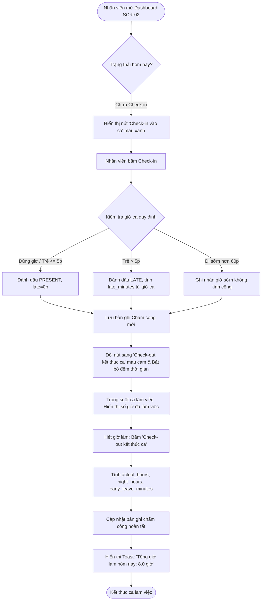
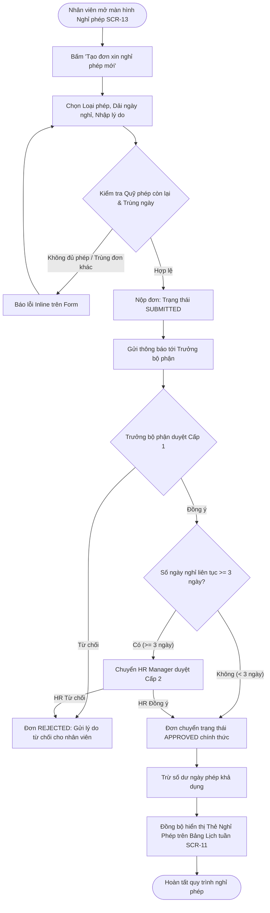
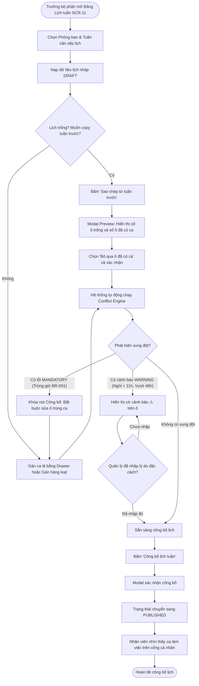

# TÀI LIỆU 12: HỆ THỐNG THIẾT KẾ VÀ ĐẶC TẢ CÁC MÀN HÌNH PHỤ (DESIGN SYSTEM & SECONDARY SCREENS)
**Dự án:** Employee Management System  
**Phiên bản:** 1.0.0  
**Ngày cập nhật:** 13/10/2026  
**Trạng thái:** Confirmed / Baseline  

---

## 1. HỆ THỐNG THIẾT KẾ & THƯ VIỆN TOKEN (DESIGN TOKENS SPECIFICATION)

Toàn bộ hệ thống giao diện được kiểm soát bằng biến CSS (CSS Variables) định nghĩa tập trung tại `:root` trong `src/styles/tokens.css`.

### 1.1. Bảng Màu Ngữ Nghĩa (Semantic Color Palette)
Mọi màu sắc đều được kiểm định độ tương phản theo chuẩn **WCAG 2.1 AA** (Tỷ lệ tối thiểu 4.5:1 đối với chữ thông thường và 3.0:1 đối với chữ lớn/biểu tượng).

| Tên Token CSS | Giá trị Mã Hex | Độ Tương Phản trên Nền Trắng / Sử Dụng | Mục Đích Nghiệp Vụ |
|:---|:---:|:---:|:---|
| `--color-primary` | `#1677FF` | 4.62:1 (Đạt WCAG AA chữ lớn/nút) | Màu thương hiệu chính: Nút hành động chính, tab active, focus ring |
| `--color-primary-hover`| `#4096FF` | Trạng thái tương tác chuột | Hover nút chính, link hover |
| `--color-primary-active`| `#0958D9`| 6.42:1 (Đạt WCAG AA) | Active state, nút bấm khi nhấn giữ |
| `--color-bg-layout` | `#F5F7FA` | Canvas tổng thể | Nền xám nhạt toàn ứng dụng, dịu mắt nhân viên văn phòng |
| `--color-surface` | `#FFFFFF` | Nền component | Nền card, ô nhập liệu, modal, popup (Pure White) |
| `--color-surface-hover`| `#FAFAFA`| Trạng thái hover dòng | Hover dòng bảng, hover ô lịch |
| `--color-border` | `#D9D9D9` | 1.85:1 (Viền cấu trúc UI) | Phân cách bảng, viền ô nhập liệu, đường kẻ lịch tuần |
| `--color-border-subtle`| `#F0F0F0`| Đường kẻ phụ | Đường kẻ ô giữa các thứ trong ma trận lịch |
| `--color-text-primary`| `#1F1F1F` | **12.63:1 (Vượt chuẩn AAA)** | Chữ chính, tiêu đề, tên nhân viên, giờ ca, số liệu báo cáo |
| `--color-text-secondary`|`#595959` | **7.01:1 (Đạt chuẩn AAA)** | Chữ phụ, mã nhân viên, mô tả, nhãn trường form |
| `--color-text-muted` | `#8C8C8C` | **4.54:1 (Đạt chuẩn AA)** | Placeholder, timestamp, chú thích nhỏ (Caption) |
| `--color-success` | `#52C41A` | 2.53:1 (Dùng với chữ trắng) | Trạng thái Có mặt, Đơn đã duyệt, Lịch đã công bố |
| `--color-warning` | `#FAAD14` | Dùng làm cờ cảnh báo | Trạng thái Đi muộn, Về sớm, Cảnh báo phân ca (Warning) |
| `--color-error` | `#FF4D4F` | 4.05:1 (Dùng với chữ trắng) | Trạng thái Vắng mặt, Đơn bị từ chối, Lỗi chặn phân ca (Mandatory)|
| `--color-info` | `#1890FF` | Thông tin hướng dẫn | Trạng thái Bản nháp (Draft), Thông tin ca |

---

### 1.2. Bảng Màu Ca Làm Việc An Toàn Cho Người Mù Màu (Colorblind-Safe Shift Palette)
*Quy tắc bắt buộc: Mỗi loại ca đều được chỉ định bộ ba màu: Nền (`bg`), Viền (`border`) và Chữ (`text`), kèm Icon đặc trưng để người suy giảm thị lực nhận diện chính xác.*

| Loại Ca Làm Việc | Màu Nền (`bg`) | Màu Viền (`border`) | Màu Chữ (`text`) | Tỷ Lệ Tương Phản Text/Bg | Đánh Giá WCAG 2.1 | Icon & Nhãn Chữ |
|:---|:---:|:---:|:---:|:---:|:---:|:---|
| **Ca Sáng (08:00 - 17:00)** | `#E6F7FF` | `#91CAFF` | `#0958D9` | **5.32:1** | ✅ Đạt AA | ☀️ **SÁNG** |
| **Ca Sáng Sớm (06:00 - 14:00)**| `#E6FFFB` | `#87E8DE` | `#08979C` | **4.78:1** | ✅ Đạt AA | 🌤️ **SÁNG SỚM** |
| **Ca Chiều (14:00 - 22:00)**| `#FFF7E6` | `#FFD591` | `#D46B08` | **4.65:1** | ✅ Đạt AA | 🌤️ **CHIỀU** |
| **Ca Tối (18:00 - 24:00)** | `#F9F0FF` | `#D3ADF7` | `#531DAB` | **6.12:1** | ✅ Đạt AA | 🌆 **TỐI** |
| **Ca Đêm (22:00 - 06:00)** | `#FFF1F0` | `#FFA39E` | `#CF1322` | **4.89:1** | ✅ Đạt AA | 🌙 **ĐÊM (+1)** |
| **Nghỉ Phép Đã Duyệt** | `#F6FFED` | `#B7EB8F` | `#389E0D` | **4.72:1** | ✅ Đạt AA | 🏖️ **PHÉP** |
| **Ngày Lễ Công Ty** | `#FFF0F6` | `#FFADD2` | `#C41D7F` | **5.45:1** | ✅ Đạt AA | 🚩 **LỄ** |

---

### 1.3. Thang Cỡ Chữ (Typography Scale)
- **Font Stack:** `'Be Vietnam Pro', 'Inter', -apple-system, BlinkMacSystemFont, 'Segoe UI', Roboto, sans-serif`.

| Tên Cỡ Chữ | Kích Thước (`font-size`) | Chiều Cao Dòng (`line-height`) | Trọng Số (`font-weight`) | Vị Trí Áp Dụng |
|:---|:---:|:---:|:---:|:---|
| `--font-h1` | 24px (1.5rem) | 32px (1.33) | 600 (Semi-bold) | Tiêu đề màn hình chính (H1) |
| `--font-h2` | 20px (1.25rem)| 28px (1.40) | 600 (Semi-bold) | Tiêu đề phân khu, Modal title (H2)|
| `--font-h3` | 16px (1.0rem) | 24px (1.50) | 600 (Semi-bold) | Tiêu đề Card, Drawer header (H3) |
| `--font-body-md`| 14px (0.875rem)| 22px (1.57) | 500 (Medium) | Nhãn nút, tiêu đề cột bảng, tên ca |
| `--font-body` | 14px (0.875rem)| 22px (1.57) | 400 (Regular) | Nội dung bảng, ô nhập liệu, text |
| `--font-caption`| 12px (0.75rem)| 18px (1.50) | 400 (Regular) | Giờ ca, timestamp, chú thích nhỏ |
| `--font-badge` | 11px (0.6875rem)| 16px (1.45)| 600 (Semi-bold) | Badge cảnh báo, đếm số lượng ca |

---

### 1.4. Hệ Thống Spacing, Bo Góc, Độ Nổi & Breakpoints
- **Spacing (Hệ số 8pt):**
  - `--space-xxs`: `4px` | `--space-xs`: `8px` | `--space-sm`: `12px` | `--space-md`: `16px` | `--space-lg`: `24px` | `--space-xl`: `32px` | `--space-xxl`: `48px`.
- **Bo góc (Border Radius):**
  - `--radius-sm`: `4px` (Badge, Chip nhỏ) | `--radius-md`: `6px` (Nút bấm, Input, Tag) | `--radius-lg`: `8px` (Card, Table, Modal) | `--radius-full`: `9999px` (Pill, Avatar tròn).
- **Độ nổi & Bóng đổ (Elevations & Shadows):**
  - `--shadow-sm`: `0 1px 2px 0 rgba(0, 0, 0, 0.05)` (Thẻ card bảng, Thẻ ca trên lịch).
  - `--shadow-md`: `0 4px 6px -1px rgba(0, 0, 0, 0.1), 0 2px 4px -1px rgba(0, 0, 0, 0.06)` (Dropdown, Popover, Active Cell).
  - `--shadow-lg`: `0 10px 15px -3px rgba(0, 0, 0, 0.1), 0 4px 6px -2px rgba(0, 0, 0, 0.05)` (Modal Dialog, Drawer bên phải).
- **Thứ tự Lớp Hiển Thị (Z-index Stack):**
  - `--z-base`: `1` | `--z-sticky`: `10` (Sticky Column nhân viên & Header) | `--z-dropdown`: `100` | `--z-modal-backdrop`: `1000` | `--z-modal`: `1001` | `--z-drawer`: `1002` | `--z-toast`: `2000` | `--z-tooltip`: `3000`.
- **Điểm Ngắt Đáp Ứng (Responsive Breakpoints):**
  - Mobile: `< 768px` (Chuyển sang Day Tabs View dạng danh sách).
  - Tablet: `768px - 1024px` (Thu gọn Sidebar icon 80px, co giản cột ma trận).
  - Desktop Standard: `1024px - 1440px` (Mở rộng Sidebar 250px, hiển thị đầy đủ 7 cột tuần).
  - Large Desktop: `> 1440px` (Tối ưu không gian hiển thị rộng rãi cho 10+ cột dữ liệu).

---

## 2. QUY CHUẨN THÀNH PHẦN GIAO DIỆN CƠ BẢN (UI COMPONENT SPECIFICATIONS)

### 2.1. Nút Bấm (Button Variants)
- **Primary:** Nền xanh `#1677FF`, chữ trắng `#FFFFFF`, viền trong suốt. Áp dụng cho hành động chính duy nhất trên view (ví dụ: `[ 🚀 Công bố lịch tuần ]`, `[ Lưu phân ca ]`).
- **Default (Secondary):** Nền trắng `#FFFFFF`, viền xám `#D9D9D9`, chữ `#1F1F1F`. Áp dụng cho hành động phụ (ví dụ: `[ Hủy bỏ ]`, `[ Tải lại ]`). Hover đổi viền sang `#4096FF`.
- **Danger:** Nền đỏ nhạt `#FFF1F0`, viền đỏ `#FFA39E`, chữ đỏ `#CF1322`. Áp dụng cho thao tác nhạy cảm (ví dụ: `[ 🗑️ Xóa ca này ]`, `[ 🧹 Xóa lịch tuần ]`).
- **Ghost / Link:** Nền trong suốt, không viền, chữ xanh `#1677FF`. Áp dụng cho link thao tác nhanh trong dòng.
- **Trạng thái Loading:** Hiển thị vòng xoay spinner kích thước 14px, vô hiệu hóa `pointer-events`, giữ nguyên chiều rộng nút để không gây nhảy bố cục (layout shift).

### 2.2. Ô Nhập Liệu & Bộ Chọn (Inputs & Select)
- **Text & Search Input:** Chiều cao chuẩn 36px, padding `0 12px`, viền `#D9D9D9`, bo góc 6px. Trạng thái focus: Viền `#4096FF`, bóng mờ `0 0 0 2px rgba(22, 119, 255, 0.2)`. Ô tìm kiếm có tích hợp icon kính lúp bên trái và nút `x` xóa nhanh bên phải.
- **Select Dropdown:** Hiển thị mũi tên `▼` bên phải, danh sách lựa chọn có trạng thái hover xám nhạt `#FAFAFA` và tích xanh cho mục đang chọn.

### 2.3. Hộp Thoại & Bảng Trượt (Dialog Modal & Drawer)
- **Modal:** Căn giữa màn hình, chiều rộng mặc định 520px (hoặc 680px cho modal lớn). Nền mờ Backdrop `rgba(0, 0, 0, 0.45)`. Có tiêu đề rõ ràng, icon đóng `[ X ]` góc trên phải, vùng nội dung và chân trang chứa 2 nút (Hủy bỏ và Xác nhận).
- **Drawer:** Trượt mượt mà từ cạnh phải màn hình (CSS Transition 300ms `ease-out`), chiều rộng cố định 450px trên Desktop (100% full width trên Mobile).

### 2.4. Huy Hiệu Trạng Thái (Status Badges)
- Gồm một chấm tròn đường kính 6px kết hợp với nhãn chữ:
  - `🟢 Hoạt động`: Chấm `#52C41A`, nền xanh nhạt `#F6FFED`, chữ xanh lá.
  - `🟡 Bản nháp / Thử việc`: Chấm `#FAAD14`, nền cam nhạt `#FFFBE6`, chữ cam đậm.
  - `🔴 Đã thôi việc / Lỗi chặn`: Chấm `#FF4D4F`, nền đỏ nhạt `#FFF1F0`, chữ đỏ.
  - `🔵 Đã công bố / Thông tin`: Chấm `#1677FF`, nền xanh lam `#E6F7FF`, chữ xanh lam.

### 2.5. Thanh Điều Hướng (Sidebar & Topbar)
- **Sidebar:** Chiều rộng mở rộng 250px, chiều rộng thu gọn 80px. Nền trắng, viền phải `#D9D9D9`. Mục menu active có nền xanh nhạt `#E6F7FF` và viền chỉ báo xanh đậm 3px ở mép trái.
- **Topbar:** Chiều cao 64px, cố định trên cùng (Sticky). Chứa Breadcrumbs phân cấp, Đồng hồ số thời gian thực chuẩn GMT+7, Nút chuyển vai trò nhanh `<RoleSwitcher />`, và Menu tài khoản người dùng.

---

## 3. ĐẶC TẢ CHI TIẾT 7 MÀN HÌNH PHỤ (SECONDARY SCREEN SPECIFICATIONS)

---

### SCR-02: Bảng Điều Khiển Tổng Quan (Dashboard)
- **Mục đích & Ý nghĩa:** Cung cấp bức tranh tổng thể về tình hình quân số hôm nay, tỷ lệ đi làm, ca làm việc sắp diễn ra và danh sách đơn từ chờ duyệt.
- **Vai trò xem:** Đổi view theo vai trò: Admin/HR (Toàn công ty), Dept Manager (Phòng ban), Employee (Cá nhân).
- **Liên kết:** FR-001, FR-002, FR-003, FR-012 | API-003, API-025, API-026.
- **Bố cục & Wireframe ASCII:**
```text
+----------------------------------------------------------------------------------------------------+
| TỔNG QUAN HỆ THỐNG - PHÒNG VẬN HÀNH DỊCH VỤ                                                        |
+----------------------------------------------------------------------------------------------------+
| [ 👥 TỔNG QUÂN SỐ ]    | [ 🟢 ĐANG CÓ MẶT ]     | [ 🟡 ĐI MUỘN/VỀ SỚM ]   | [ 🏖️ ĐANG NGHỈ PHÉP ]  |
|       45 người         |       38 người         |       2 người           |       3 người          |
+----------------------------------------------------------------------------------------------------+
| XU HƯỚNG ĐI LÀM 7 NGÀY QUA (SVG Bar Chart)   | ĐIỂM DANH HÔM NAY (QUICK ATTENDANCE CARD)           |
| 100%| [█] [█] [█] [█] [█]                    | Nhân viên: Nguyễn Văn An (EMP-001)                  |
|  80%| [█] [█] [█] [█] [█] [█] [█]            | Trạng thái: [ 🟢 ĐÃ CHECK-IN LÚC 07:55 ]            |
|     |  T2  T3  T4  T5  T6  T7  CN            | Thời gian làm việc: 2 giờ 15 phút                   |
|     (Xanh: Đúng giờ | Vàng: Muộn | Đỏ: Vắng) | [ Nút: Check-out kết thúc ca ] (Màu cam)            |
+----------------------------------------------------------------------------------------------------+
| DANH SÁCH ĐƠN CHỜ PHÊ DUYỆT CỦA BỘ PHẬN (3 ĐƠN)                                       [Xem tất cả] |
|----------------------------------------------------------------------------------------------------|
| 1. Trần Thị Bích (EMP-002) | Nghỉ phép năm (16/10)     | Lý do: Việc gia đình | [Duyệt] [Từ chối]  |
| 2. Lê Văn Cường (EMP-003)  | Giải trình quên check-out | Lý do: Máy tính hỏng | [Duyệt] [Từ chối]  |
+----------------------------------------------------------------------------------------------------+
```
- **Hành động:** Nút Check-in / Check-out thời gian thực; Duyệt nhanh đơn nghỉ phép và đơn giải trình.

---

### SCR-03: Danh Sách Nhân Viên (Employee List)
- **Mục đích:** Quản lý tập trung toàn bộ danh sách nhân sự, hỗ trợ tìm kiếm đa tiêu chí, phân trang và điều hướng chi tiết.
- **Vai trò xem:** Admin, HR Manager (Toàn quyền), Dept Manager (Chỉ xem nhân sự thuộc phòng ban quản lý).
- **Liên kết:** FR-004, FR-006 | API-006.
- **Bố cục & Wireframe ASCII:**
```text
+----------------------------------------------------------------------------------------------------+
| DANH SÁCH NHÂN SỰ                                                  [ + Thêm nhân viên ] [ Xuất CSV ]|
+----------------------------------------------------------------------------------------------------+
| [🔍 Tìm tên, mã NV, email, SĐT...] | [Phòng ban: Tất cả ▼] | [Trạng thái: Đang làm việc ▼]          |
+----------------------------------------------------------------------------------------------------+
| [ ] | MÃ NV   | HỌ VÀ TÊN         | PHÒNG BAN     | CHỨC DANH      | TRẠNG THÁI     | HÀNH ĐỘNG    |
|-----+---------+-------------------+---------------+----------------+----------------+--------------|
| [ ] | EMP-001 | Nguyễn Văn An     | Vận hành      | Ca trưởng      | [🟢 Chính thức] | [👁️] [✏️] [🔒]|
| [ ] | EMP-002 | Trần Thị Bích     | Vận hành      | Kỹ thuật viên  | [🟢 Chính thức] | [👁️] [✏️] [🔒]|
| [ ] | EMP-003 | Lê Văn Cường      | Vận hành      | Nhân viên ca   | [🟡 Thử việc ]  | [👁️] [✏️] [🔒]|
| [ ] | EMP-004 | Phạm Văn Dũng     | Vận hành      | Nhân viên ca   | [🟢 Chính thức] | [👁️] [✏️] [🔒]|
+----------------------------------------------------------------------------------------------------+
| Hiển thị 1 - 4 trong tổng số 25 nhân viên                          | [< Trang trước] [1] [Trang sau >] |
+----------------------------------------------------------------------------------------------------+
```
- **Hành động:** Tìm kiếm tức thời (Debounce 300ms); Nút mở Modal thêm mới; Nút xem hồ sơ chi tiết (SCR-05); Nút khóa tài khoản.

---

### SCR-04: Thêm Mới / Sửa Nhân Viên (Employee Form Modal)
- **Mục đích:** Nhập liệu và cập nhật đầy đủ hồ sơ thông tin nhân viên.
- **Vai trò xem:** Admin, HR Manager.
- **Liên kết:** FR-005 | API-007, API-009.
- **Bố cục Form 2 Cột:**
  - Cột 1: Thông tin cá nhân (Mã NV `EMP-xxxxx`, Họ và tên, Email, Số ĐT 10 số, Ngày sinh, CCCD/CMND, Địa chỉ).
  - Cột 2: Thông tin công việc (Phòng ban, Chức danh, Người quản lý trực tiếp, Ngày vào làm, Loại hợp đồng `FULL_TIME`/`PART_TIME`, Trạng thái).
- **Validation:** Bắt buộc nhập đầy đủ trường có dấu `*`; Regex kiểm tra email chuẩn doanh nghiệp; Kiểm tra số điện thoại di động Việt Nam.

---

### SCR-05: Chi Tiết Hồ Sơ Nhân Viên (Employee Detail)
- **Mục đích:** Cung cấp góc nhìn 360 độ về một nhân viên với 4 Tabs thông tin liên kết chặt chẽ.
- **Vai trò xem:** Toàn bộ vai trò (Nhân viên xem hồ sơ mình; Quản lý xem nhân viên cấp dưới).
- **Liên kết:** FR-007 | API-008.
- **Cấu trúc 4 Tabs:**
  - **Tab 1: Lý lịch & Hợp đồng:** Thông tin cá nhân, liên hệ, người báo cáo trực tiếp, ngày vào làm.
  - **Tab 2: Lịch phân ca (Month View):** Lịch làm việc các ca trong tháng của riêng nhân viên này.
  - **Tab 3: Bảng chấm công thực tế:** Giờ check-in, check-out thực tế, tổng giờ công và giờ OT trong tháng.
  - **Tab 4: Nghỉ phép & Quỹ phép:** Số dư phép năm còn lại (ví dụ: `8.5 / 12.0 ngày`), lịch sử các đơn đã duyệt.

---

### SCR-08: Bảng Tổng Quan Chấm Công (Attendance Overview)
- **Mục đích:** Giám sát thời gian có mặt làm việc thực tế hàng ngày, đối chiếu đi muộn, về sớm, vắng mặt.
- **Vai trò xem:** Admin, HR Manager, Dept Manager.
- **Liên kết:** FR-012, FR-013, FR-026 | API-027.
- **Bố cục Bảng:** Cột: Mã NV, Tên NV, Ca quy định, Giờ Check-in, Giờ Check-out, Đi muộn (phút), Về sớm (phút), Tổng giờ thực tế (`actual_hours`), Giờ đêm, Trạng thái (Đúng giờ, Đi muộn, Về sớm, Thiếu checkout, Nghỉ phép).
- **Hành động:** Nút "Xuất CSV điểm danh ngày"; Nút bấm mở đơn giải trình cho ngày đó.

---

### SCR-10: Cấu Hình Mẫu Ca Làm Việc (Shift Templates)
- **Mục đích:** Khai báo danh mục các ca làm việc chuẩn hóa được sử dụng để phân bổ trên bảng lịch tuần.
- **Vai trò xem:** Admin, HR Manager (Toàn quyền CRUD), Dept Manager (Chỉ xem danh mục).
- **Liên kết:** FR-016 | API-019, API-020, API-021.
- **Bố cục Danh sách Thẻ Mẫu Ca (Card Grid):** Mỗi card mang màu sắc đại diện của ca, hiển thị:
  - Tên ca, Mã ca (ví dụ `SHIFT-MORN`).
  - Khung giờ: Giờ bắt đầu - Giờ kết thúc (ví dụ `08:00 - 17:00`).
  - Thời gian nghỉ không lương: `60 phút`.
  - Giờ làm việc thực tế (Net hours): `8.0 giờ`.
  - Định biên nhân sự: Tối thiểu 2 người, Tối đa 6 người.
  - Cờ ca qua đêm: `is_cross_midnight`.
- **Validation:** Giờ kết thúc phải lớn hơn giờ bắt đầu (nếu không bật ca qua đêm); Định biên tối đa phải $\ge$ định biên tối thiểu.

---

### SCR-13: Quản Lý Đơn Xin Nghỉ Phép (Leave Requests)
- **Mục đích:** Quản lý toàn bộ danh sách đơn xin nghỉ phép của nhân viên, số dư phép và thực hiện phê duyệt phân cấp.
- **Vai trò xem:** Toàn bộ vai trò (Nhân viên xem đơn mình; Quản lý duyệt cấp 1; HR duyệt cấp 2).
- **Liên kết:** FR-021, FR-022, FR-023, FR-024 | API-031, API-032, API-033, API-034.
- **Cột Bảng:** Mã đơn, Nhân viên, Loại phép (Phép năm, Nghỉ ốm, Việc riêng), Từ ngày, Đến ngày, Số ngày nghỉ, Lý do, Trạng thái (`SUBMITTED`, `APPROVED`, `REJECTED`), Người duyệt.
- **Hành động:** Nút "Tạo đơn xin nghỉ phép mới" (Modal SCR-14); Nút "Chấp thuận (Approve)" và "Từ chối (Reject)".

---

### SCR-15: Trung Tâm Báo Cáo & Thống Kê (Reports & Analytics)
- **Mục đích:** Cung cấp các báo cáo tổng hợp phục vụ đánh giá năng suất và chuyển giao dữ liệu cho bộ phận kế toán tiền lương.
- **Vai trò xem:** Admin, HR Manager, Dept Manager.
- **Liên kết:** FR-026, FR-027, FR-028, FR-029 | API-035, API-036, API-037.
- **3 Phân hệ Báo cáo:**
  1. **Báo cáo Tổng hợp Công tháng:** Ma trận số công chuẩn, số giờ OT, số giờ làm đêm của từng nhân viên.
  2. **Báo cáo Đối chiếu Kế hoạch vs Thực tế (Scheduled vs Actual):** So sánh số giờ được xếp trên lịch tuần với số giờ nhân viên thực sự đi làm, tính toán tỷ lệ hoàn thành (%) và phát hiện chênh lệch thừa/thiếu.
  3. **Báo cáo Vi phạm Kỷ luật lao động:** Tổng hợp số lần đi muộn, về sớm, quên check-out trong tháng.
- **Hành động:** Nút "Xuất file CSV báo cáo (UTF-8 BOM)" tải dữ liệu tức thì.

---

### SCR-16: Quản Lý Tài Khoản & Cài Đặt Tham Số (Settings & Policies)
- **Mục đích:** Tinh chỉnh các tham số chính sách công ty (ngưỡng cảnh báo nghỉ ngơi, trần giờ tuần, thời gian ân hạn).
- **Vai trò xem:** Admin (Toàn quyền), HR Manager (Xem và đề xuất).
- **Liên kết:** FR-031, FR-032, FR-033 | API-038, API-040, API-041.
- **Trường Dữ liệu Cấu hình:**
  - `MIN_REST_BETWEEN_SHIFTS_HOURS`: Giá trị mặc định `11.0` giờ (hỗ trợ chuyển sang `12.0` giờ).
  - `MAX_WEEKLY_REGULAR_HOURS`: Giá trị mặc định `48.0` giờ/tuần.
  - `MAX_DAILY_HOURS_INCLUDING_OT`: Giá trị mặc định `12.0` giờ/ngày.
  - `GRACE_PERIOD_MINUTES`: Giá trị mặc định `5` phút.
  - `LEAVE_CONFLICT_SEVERITY`: Mặc định `'WARNING'`.

---

## 4. BẢN ĐỒ ĐIỀU HƯỚNG & CÁC SƠ ĐỒ LUỒNG NGƯỜI DÙNG (USER FLOW MERMAID DIAGRAMS)

---

### Luồng 1: Nhân viên thực hiện Check-in / Check-out trên Giao diện Web


---

### Luồng 2: Nhân viên Nộp đơn Nghỉ phép & Phê duyệt Phân cấp Đồng bộ sang Lịch tuần


---

### Luồng 3: Trưởng bộ phận Lập, Kiểm tra Xung đột và Công bố Lịch Tuần


---

### Luồng 4: Trưởng bộ phận Điều chỉnh Ca trên Lịch Đã Công bố & Xem Lịch sử Kiểm toán
```mermaid
flowchart TD
    StartMod([Lịch đang ở trạng thái PUBLISHED]) --> ClickCellMod[Quản lý click vào ca cần đổi của nhân viên]
    ClickCellMod --> OpenDrawerMod[Mở AssignShiftDrawer chỉnh sửa ca]
    OpenDrawerMod --> ChangeShift[Chọn mẫu ca mới]
    ChangeShift --> CheckValidMod[Kiểm tra xung đột ca mới]
    CheckValidMod --> ClickSaveMod[Bấm 'Lưu phân ca']
    ClickSaveMod --> TriggerReasonModal[Hệ thống phát hiện Lịch đã PUBLISHED: Kích hoạt ChangeReasonDialog]
    TriggerReasonModal --> InputReason[Quản lý bắt buộc nhập lý do điều chỉnh >= 5 ký tự]
    InputReason --> SubmitReason[Bấm 'Xác nhận điều chỉnh']
    SubmitReason --> SaveToHistory[Lưu bản ghi mới vào scheduleChangeHistory]
    SaveToHistory --> UpdateRosterState[Cập nhật ô ma trận với ca mới]
    UpdateRosterState --> UpdateBadgeHistory[Tăng số lượng bản ghi trên nút 'Lịch sử thay đổi (N)']
    UpdateBadgeHistory --> ViewHistory[Quản lý có thể bấm xem toàn bộ lịch sử trong Drawer]
    ViewHistory --> EndMod([Hoàn tất điều chỉnh có kiểm toán])
```

---
*Kết thúc Tài liệu 12.*
