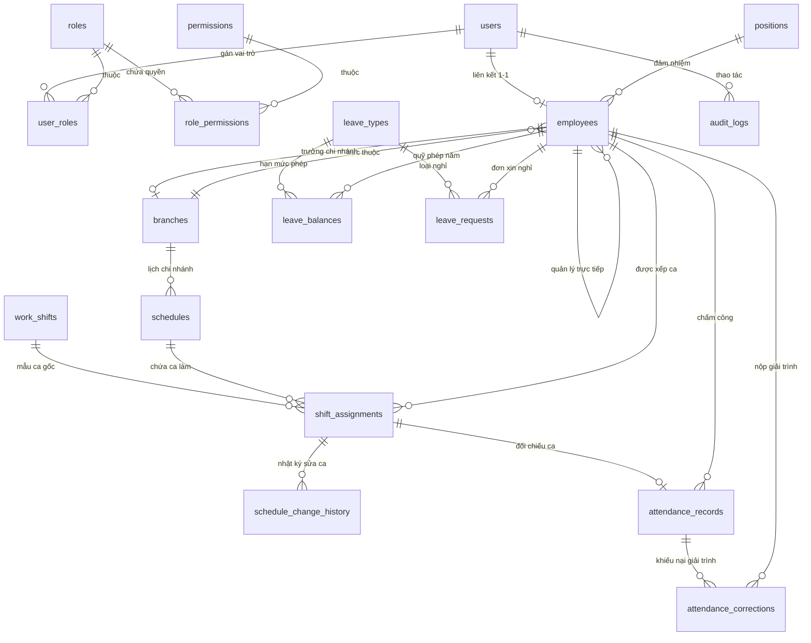

# TỪ ĐIỂN DỮ LIỆU CƠ SỞ DỮ LIỆU (DATA DICTIONARY)

- **Hệ thống:** Quản lý Nhân sự & Lịch ca (Employee Management System - HRMS)
- **Hệ quản trị CSDL:** MySQL 8.0+ (InnoDB Engine, utf8mb4_unicode_ci)
- **Công cụ quản lý migration:** Flyway Migration (V1 - V5)
- **Ngày cập nhật:** 19/10/2026

---

## 1. SƠ ĐỒ THỰC THỂ QUAN HỆ (MERMAID ER DIAGRAM)

---

## 2. BẢNG TỔNG HỢP DANH MỤC 20 BẢNG CSDL

| STT | Tên Bảng (Table) | Tên Tiếng Việt | Phân Hệ Nghiệp Vụ | Mô Tả Tóm Tắt |
| :---: | :---|:---|:---|:---|
| 1 | `users` | Tài khoản người dùng | Xác thực & Phân quyền | Lưu thông tin đăng nhập, bảo mật mật khẩu và khóa tài khoản |
| 2 | `roles` | Vai trò người dùng | Xác thực & Phân quyền | Danh mục 3 vai trò: Giám đốc, Quản lý cơ sở, Nhân viên |
| 3 | `permissions` | Quyền hạn chi tiết | Xác thực & Phân quyền | Danh mục các quyền chức năng chi tiết trong hệ thống |
| 4 | `user_roles` | Phân vai trò người dùng | Xác thực & Phân quyền | Bảng trung gian gán vai trò (`roles`) cho tài khoản (`users`) |
| 5 | `role_permissions` | Phân quyền vai trò | Xác thực & Phân quyền | Bảng trung gian phân quyền (`permissions`) cho vai trò (`roles`) |
| 6 | `branches` | Chi nhánh / Cơ sở | Tổ chức & Nhân sự | Quản lý danh sách chi nhánh/cơ sở làm việc của chuỗi cửa hàng |
| 7 | `positions` | Vị trí / Chức danh | Tổ chức & Nhân sự | Danh mục chức danh công việc của nhân viên |
| 8 | `employees` | Hồ sơ nhân viên | Tổ chức & Nhân sự | Quản lý hồ sơ lý lịch, thông tin hợp đồng và chi nhánh trực thuộc |
| 9 | `work_shifts` | Mẫu ca làm việc | Ca làm việc & Xếp lịch | Định nghĩa các ca chuẩn (giờ vào, giờ ra, định biên nhân sự) |
| 10 | `schedules` | Kế hoạch lịch tuần | Ca làm việc & Xếp lịch | Kế hoạch lịch làm việc theo tuần của từng chi nhánh |
| 11 | `shift_assignments` | Chi tiết phân ca | Ca làm việc & Xếp lịch | Phân ca làm việc chi tiết cho từng nhân viên theo từng ngày |
| 12 | `schedule_change_history` | Nhật ký đổi lịch ca | Ca làm việc & Xếp lịch | Ghi vết các lần sửa/đổi/hủy ca sau khi lịch tuần đã công bố |
| 13 | `attendance_records` | Dữ liệu chấm công | Chấm công & Giải trình | Ghi nhận thời gian vào/ra thực tế, tính công, đi trễ, về sớm, OT |
| 14 | `attendance_corrections` | Đơn giải trình chấm công | Chấm công & Giải trình | Đơn xin bổ sung/sửa đổi giờ công khi quên check-in/out |
| 15 | `leave_types` | Danh mục loại nghỉ phép | Quản lý Nghỉ phép | Các loại phép (phép năm, phép ốm, nghỉ không lương, thai sản) |
| 16 | `leave_balances` | Quỹ phép nhân viên | Quản lý Nghỉ phép | Theo dõi số ngày phép được cấp, đã dùng và còn lại theo năm |
| 17 | `leave_requests` | Đơn xin nghỉ phép | Quản lý Nghỉ phép | Đơn xin nghỉ phép và luồng phê duyệt 2 cấp (Quản lý & Giám đốc) |
| 18 | `company_holidays` | Ngày lễ tết | Quản lý Nghỉ phép | Danh mục các ngày nghỉ lễ hưởng nguyên lương của công ty |
| 19 | `audit_logs` | Nhật ký kiểm toán | Cấu hình & Nhật ký | Ghi vết mọi hành vi thêm, sửa, xóa quan trọng trên toàn hệ thống |
| 20 | `system_settings` | Cấu hình hệ thống | Cấu hình & Nhật ký | Lưu trữ các tham số cấu hình vận hành (dung sai đi trễ, giờ chốt) |

---

## 3. CHI TIẾT TỪNG TRƯỜNG DỮ LIỆU TRONG 20 BẢNG

### Phân Hệ 1: Xác Thực & Phân Quyền (Auth & RBAC)

#### 1. Bảng `users` (Tài khoản người dùng)
| Tên Cột (Column) | Kiểu Dữ Liệu | Ràng Buộc | Ý Nghĩa Dữ Liệu |
|:---|:---|:---|:---|
| `id` | BIGINT UNSIGNED | PK, AI | Khóa chính tự tăng, định danh duy nhất của tài khoản. |
| `username` | VARCHAR(50) | NOT NULL, UNIQUE | Tên đăng nhập vào hệ thống. |
| `password_hash` | VARCHAR(255) | NOT NULL | Chuỗi mật khẩu đã được băm mã hóa bảo mật (BCrypt). |
| `email` | VARCHAR(100) | NOT NULL, UNIQUE | Email nhận thông báo, xác thực và đặt lại mật khẩu. |
| `must_change_password` | BOOLEAN | NOT NULL, DEFAULT TRUE | Cờ bắt buộc người dùng phải đổi mật khẩu ở lần đăng nhập đầu tiên. |
| `failed_login_attempts` | INT UNSIGNED | NOT NULL, DEFAULT 0 | Đếm số lần đăng nhập sai mật khẩu liên tiếp. |
| `locked_until` | DATETIME | NULL, INDEX | Thời điểm tài khoản hết bị tạm khóa do nhập sai pass quá số lần cho phép. |
| `last_login_at` | DATETIME | NULL | Thời điểm tài khoản đăng nhập thành công gần nhất. |
| `is_active` | BOOLEAN | NOT NULL, DEFAULT TRUE | Trạng thái tài khoản (1: Đang hoạt động, 0: Bị vô hiệu hóa). |
| `deleted_at` | DATETIME | NULL | Thời điểm xóa mềm tài khoản khỏi hệ thống. |
| `created_at` | DATETIME | NOT NULL, DEFAULT NOW | Thời điểm khởi tạo tài khoản. |
| `updated_at` | DATETIME | NOT NULL, DEFAULT NOW | Thời điểm cập nhật thông tin tài khoản gần nhất. |

#### 2. Bảng `roles` (Vai trò người dùng)
| Tên Cột (Column) | Kiểu Dữ Liệu | Ràng Buộc | Ý Nghĩa Dữ Liệu |
|:---|:---|:---|:---|
| `id` | BIGINT UNSIGNED | PK, AI | Khóa chính tự tăng, định danh vai trò. |
| `role_code` | VARCHAR(50) | NOT NULL, UNIQUE | Mã vai trò duy nhất (`ROLE_DIRECTOR`, `ROLE_MANAGER`, `ROLE_EMPLOYEE`). |
| `role_name` | VARCHAR(100) | NOT NULL | Tên hiển thị của vai trò (Giám đốc, Quản lý cơ sở, Nhân viên). |
| `description` | VARCHAR(255) | NULL | Diễn giải trách nhiệm và phạm vi quyền hạn của vai trò. |
| `created_at` | DATETIME | NOT NULL, DEFAULT NOW | Thời điểm tạo vai trò trong hệ thống. |

#### 3. Bảng `permissions` (Quyền hạn chi tiết)
| Tên Cột (Column) | Kiểu Dữ Liệu | Ràng Buộc | Ý Nghĩa Dữ Liệu |
|:---|:---|:---|:---|
| `id` | BIGINT UNSIGNED | PK, AI | Khóa chính tự tăng, định danh quyền chức năng. |
| `permission_code` | VARCHAR(100) | NOT NULL, UNIQUE | Mã quyền duy nhất (vd: `employee:view`, `schedule:edit`, `leave:approve`). |
| `permission_name` | VARCHAR(150) | NOT NULL | Tên hiển thị mô tả chức năng của quyền. |
| `module_name` | VARCHAR(50) | NOT NULL | Tên module nghiệp vụ quản lý quyền (`EMPLOYEE`, `SCHEDULE`, `ATTENDANCE`,...). |

#### 4. Bảng `user_roles` (Phân vai trò cho tài khoản)
| Tên Cột (Column) | Kiểu Dữ Liệu | Ràng Buộc | Ý Nghĩa Dữ Liệu |
|:---|:---|:---|:---|
| `user_id` | BIGINT UNSIGNED | PK, FK -> `users.id` | Tài khoản người dùng được gán vai trò. |
| `role_id` | BIGINT UNSIGNED | PK, FK -> `roles.id` | Vai trò được gán cho tài khoản. |

#### 5. Bảng `role_permissions` (Phân quyền cho vai trò)
| Tên Cột (Column) | Kiểu Dữ Liệu | Ràng Buộc | Ý Nghĩa Dữ Liệu |
|:---|:---|:---|:---|
| `role_id` | BIGINT UNSIGNED | PK, FK -> `roles.id` | Vai trò được cấu hình danh sách quyền. |
| `permission_id` | BIGINT UNSIGNED | PK, FK -> `permissions.id` | Quyền chức năng được cấp cho vai trò. |

---

### Phân Hệ 2: Cơ Cấu Tổ Chức & Nhân Sự (Org & Employees)

#### 6. Bảng `branches` (Chi nhánh / Cơ sở làm việc)
| Tên Cột (Column) | Kiểu Dữ Liệu | Ràng Buộc | Ý Nghĩa Dữ Liệu |
|:---|:---|:---|:---|
| `id` | BIGINT UNSIGNED | PK, AI | Khóa chính tự tăng, định danh chi nhánh/cơ sở. |
| `branch_code` | VARCHAR(50) | NOT NULL, UNIQUE | Mã chi nhánh duy nhất (vd: `CN_CAUGIAY`, `CN_DONGDA`). |
| `branch_name` | VARCHAR(150) | NOT NULL | Tên gọi đầy đủ của chi nhánh / cơ sở làm việc. |
| `address` | VARCHAR(255) | NULL | Địa chỉ cụ thể nơi chi nhánh hoạt động. |
| `phone_number` | VARCHAR(20) | NULL | Số điện thoại liên lạc tại chi nhánh. |
| `manager_id` | BIGINT UNSIGNED | NULL, FK -> `employees.id` | Quản lý trưởng phụ trách cơ sở/chi nhánh này. |
| `is_active` | BOOLEAN | NOT NULL, DEFAULT TRUE | Trạng thái hoạt động của chi nhánh (1: Hoạt động, 0: Đóng cửa). |
| `deleted_at` | DATETIME | NULL | Thời điểm xóa mềm chi nhánh. |
| `version` | INT UNSIGNED | NOT NULL, DEFAULT 0 | Phiên bản bản ghi phục vụ khóa lạc quan (Optimistic Locking). |
| `created_at` | DATETIME | NOT NULL, DEFAULT NOW | Thời điểm tạo bản ghi chi nhánh. |
| `created_by` | BIGINT UNSIGNED | NULL | Người khởi tạo bản ghi chi nhánh. |
| `updated_at` | DATETIME | NOT NULL, DEFAULT NOW | Thời điểm cập nhật bản ghi gần nhất. |
| `updated_by` | BIGINT UNSIGNED | NULL | Người cập nhật bản ghi gần nhất. |

#### 7. Bảng `positions` (Vị trí / Chức danh công việc)
| Tên Cột (Column) | Kiểu Dữ Liệu | Ràng Buộc | Ý Nghĩa Dữ Liệu |
|:---|:---|:---|:---|
| `id` | BIGINT UNSIGNED | PK, AI | Khóa chính tự tăng, định danh vị trí công việc. |
| `position_code` | VARCHAR(50) | NOT NULL, UNIQUE | Mã chức danh công việc duy nhất (vd: `POS_BARISTA`, `POS_CASHIER`). |
| `position_name` | VARCHAR(150) | NOT NULL | Tên chức danh công việc hiển thị. |
| `description` | TEXT | NULL | Mô tả nhiệm vụ, yêu cầu của vị trí công việc. |
| `is_active` | BOOLEAN | NOT NULL, DEFAULT TRUE | Trạng thái áp dụng chức danh (1: Đang dùng, 0: Ngừng dùng). |
| `deleted_at` | DATETIME | NULL | Thời điểm xóa mềm vị trí công việc. |

#### 8. Bảng `employees` (Hồ sơ nhân viên)
| Tên Cột (Column) | Kiểu Dữ Liệu | Ràng Buộc | Ý Nghĩa Dữ Liệu |
|:---|:---|:---|:---|
| `id` | BIGINT UNSIGNED | PK, AI | Khóa chính tự tăng, định danh hồ sơ nhân viên. |
| `user_id` | BIGINT UNSIGNED | NULL, FK -> `users.id` | Tài khoản đăng nhập hệ thống liên kết với nhân viên (quan hệ 1-1). |
| `employee_code` | VARCHAR(50) | NOT NULL, UNIQUE | Mã số nhân viên định danh nội bộ (vd: `NV001`, `NV002`). |
| `full_name` | VARCHAR(150) | NOT NULL | Họ và tên đầy đủ của nhân viên. |
| `email` | VARCHAR(100) | NOT NULL, UNIQUE | Email cá nhân hoặc liên hệ công việc của nhân viên. |
| `phone_number` | VARCHAR(20) | NOT NULL, UNIQUE | Số điện thoại di động chính để liên hệ. |
| `national_id` | VARCHAR(20) | NULL, UNIQUE | Số CCCD, CMND hoặc hộ chiếu. |
| `date_of_birth` | DATE | NULL | Ngày tháng năm sinh của nhân viên. |
| `gender` | VARCHAR(10) | NULL | Giới tính của nhân viên (`MALE`, `FEMALE`, `OTHER`). |
| `address` | VARCHAR(255) | NULL | Địa chỉ nơi cư trú hoặc tạm trú của nhân viên. |
| `branch_id` | BIGINT UNSIGNED | NOT NULL, FK -> `branches.id` | Chi nhánh / Cơ sở làm việc trực thuộc của nhân viên. |
| `position_id` | BIGINT UNSIGNED | NOT NULL, FK -> `positions.id` | Vị trí / Chức danh đảm nhiệm của nhân viên. |
| `manager_id` | BIGINT UNSIGNED | NULL, FK -> `employees.id` | Nhân viên quản lý trực tiếp (người tiếp nhận báo cáo). |
| `employment_status` | VARCHAR(20) | NOT NULL, DEFAULT 'PROBATION' | Tình trạng lao động (`PROBATION`, `ACTIVE`, `SUSPENDED`, `RESIGNED`). |
| `employment_type` | VARCHAR(20) | NOT NULL, DEFAULT 'FULL_TIME' | Hình thức làm việc (`FULL_TIME`, `PART_TIME`, `INTERN`). |
| `hire_date` | DATE | NOT NULL | Ngày chính thức nhận việc hoặc ký hợp đồng thử việc. |
| `resignation_date` | DATE | NULL | Ngày chấm dứt hợp đồng lao động và nghỉ việc. |
| `is_active` | BOOLEAN | NOT NULL, DEFAULT TRUE | Trạng thái làm việc (1: Đang làm việc, 0: Đã nghỉ/khóa hồ sơ). |
| `deleted_at` | DATETIME | NULL | Thời điểm xóa mềm hồ sơ nhân viên. |
| `version` | INT UNSIGNED | NOT NULL, DEFAULT 0 | Phiên bản bản ghi phục vụ khóa lạc quan (Optimistic Locking). |
| `created_at` | DATETIME | NOT NULL, DEFAULT NOW | Thời điểm tạo hồ sơ nhân viên. |
| `created_by` | BIGINT UNSIGNED | NULL | Người tạo hồ sơ nhân viên. |
| `updated_at` | DATETIME | NOT NULL, DEFAULT NOW | Thời điểm cập nhật hồ sơ gần nhất. |
| `updated_by` | BIGINT UNSIGNED | NULL | Người cập nhật hồ sơ gần nhất. |

---

### Phân Hệ 3: Ca Làm Việc & Xếp Lịch (Shifts & Scheduling)

#### 9. Bảng `work_shifts` (Mẫu ca làm việc chuẩn)
| Tên Cột (Column) | Kiểu Dữ Liệu | Ràng Buộc | Ý Nghĩa Dữ Liệu |
|:---|:---|:---|:---|
| `id` | BIGINT UNSIGNED | PK, AI | Khóa chính tự tăng, định danh mẫu ca làm việc. |
| `shift_code` | VARCHAR(50) | NOT NULL, UNIQUE | Mã định danh mẫu ca (vd: `CA_SANG`, `CA_CHIEU`, `CA_TOI`). |
| `shift_name` | VARCHAR(100) | NOT NULL | Tên ca làm việc hiển thị trên giao diện (Ca Sáng, Ca Gãy,...). |
| `start_time` | TIME | NOT NULL | Giờ bắt đầu ca làm việc tiêu chuẩn (vd: 08:00:00). |
| `end_time` | TIME | NOT NULL | Giờ kết thúc ca làm việc tiêu chuẩn (vd: 16:30:00). |
| `break_minutes` | INT UNSIGNED | NOT NULL, DEFAULT 0 | Tổng thời gian nghỉ giữa ca không tính công (tính bằng phút). |
| `is_cross_midnight` | BOOLEAN | NOT NULL, DEFAULT FALSE | Ca làm việc có kéo dài xuyên đêm qua 0h00 ngày hôm sau không. |
| `color_code` | VARCHAR(20) | NOT NULL, DEFAULT '#1677FF' | Mã màu nền HEX đại diện cho ca trên bảng lịch tuần. |
| `text_color` | VARCHAR(20) | NOT NULL, DEFAULT '#FFFFFF' | Mã màu chữ HEX hiển thị trên ô ca làm việc. |
| `min_staffing` | INT UNSIGNED | NOT NULL, DEFAULT 1 | Số lượng nhân sự tối thiểu cần có trong ca này để mở cửa cơ sở. |
| `max_staffing` | INT UNSIGNED | NOT NULL, DEFAULT 10 | Số lượng nhân sự tối đa cho phép phân vào ca để tránh thừa định biên. |
| `applicable_days` | VARCHAR(50) | NOT NULL, DEFAULT '1,2,3,4,5,6,7' | Các thứ trong tuần được phép xếp ca (1: Thứ 2 đến 7: Chủ nhật). |
| `is_active` | BOOLEAN | NOT NULL, DEFAULT TRUE | Trạng thái mẫu ca (1: Đang áp dụng, 0: Ngừng dùng). |
| `deleted_at` | DATETIME | NULL | Thời điểm xóa mềm mẫu ca làm việc. |

#### 10. Bảng `schedules` (Bảng kế hoạch lịch tuần theo chi nhánh)
| Tên Cột (Column) | Kiểu Dữ Liệu | Ràng Buộc | Ý Nghĩa Dữ Liệu |
|:---|:---|:---|:---|
| `id` | BIGINT UNSIGNED | PK, AI | Khóa chính tự tăng, định danh bảng lịch tuần. |
| `branch_id` | BIGINT UNSIGNED | NOT NULL, FK -> `branches.id` | Chi nhánh / Cơ sở áp dụng bảng lịch tuần này. |
| `start_date` | DATE | NOT NULL | Ngày đầu tuần áp dụng lịch (thường là Thứ Hai). |
| `end_date` | DATE | NOT NULL | Ngày cuối tuần áp dụng lịch (thường là Chủ Nhật). |
| `status` | VARCHAR(20) | NOT NULL, DEFAULT 'DRAFT' | Trạng thái lịch (`DRAFT`: Bản nháp quản lý đang xếp, `PUBLISHED`: Đã công bố cho nhân viên xem). |
| `published_at` | DATETIME | NULL | Thời điểm Quản lý bấm nút công bố lịch tuần. |
| `published_by` | BIGINT UNSIGNED | NULL, FK -> `users.id` | Tài khoản Quản lý đã thực hiện công bố lịch. |
| `version` | INT UNSIGNED | NOT NULL, DEFAULT 0 | Phiên bản lịch tuần chống xung đột khi nhiều người xếp ca đồng thời. |
| `created_at` | DATETIME | NOT NULL, DEFAULT NOW | Thời điểm tạo bảng lịch tuần. |
| `updated_at` | DATETIME | NOT NULL, DEFAULT NOW | Thời điểm cập nhật bảng lịch tuần gần nhất. |

#### 11. Bảng `shift_assignments` (Chi tiết phân ca nhân viên theo ngày)
| Tên Cột (Column) | Kiểu Dữ Liệu | Ràng Buộc | Ý Nghĩa Dữ Liệu |
|:---|:---|:---|:---|
| `id` | BIGINT UNSIGNED | PK, AI | Khóa chính tự tăng, định danh bản ghi phân ca. |
| `schedule_id` | BIGINT UNSIGNED | NOT NULL, FK -> `schedules.id` | Thuộc bảng lịch tuần nào. |
| `employee_id` | BIGINT UNSIGNED | NOT NULL, FK -> `employees.id` | Nhân viên được phân công làm ca này. |
| `work_shift_id` | BIGINT UNSIGNED | NOT NULL, FK -> `work_shifts.id` | Mẫu ca làm việc gốc được chọn để phân công. |
| `work_date` | DATE | NOT NULL | Ngày làm việc cụ thể của ca phân công. |
| `snapshot_shift_name` | VARCHAR(100) | NOT NULL | Bản sao tên ca tại thời điểm xếp lịch (bảo vệ dữ liệu lịch sử nếu ca gốc bị sửa). |
| `snapshot_start_time` | TIME | NOT NULL | Bản sao giờ bắt đầu ca tại thời điểm xếp lịch. |
| `snapshot_end_time` | TIME | NOT NULL | Bản sao giờ kết thúc ca tại thời điểm xếp lịch. |
| `snapshot_break_minutes`| INT UNSIGNED | NOT NULL, DEFAULT 0 | Bản sao số phút nghỉ giải lao tại thời điểm xếp lịch. |
| `snapshot_cross_midnight`| BOOLEAN | NOT NULL, DEFAULT FALSE | Bản sao cờ ca qua đêm tại thời điểm xếp lịch. |
| `snapshot_color_code` | VARCHAR(20) | NOT NULL, DEFAULT '#1677FF' | Bản sao màu sắc ca tại thời điểm xếp lịch. |
| `planned_start_time` | DATETIME | NOT NULL | Ngày giờ bắt đầu ca dự kiến chính xác (kết hợp `work_date` + `start_time`). |
| `planned_end_time` | DATETIME | NOT NULL | Ngày giờ kết thúc ca dự kiến chính xác (tính cả trường hợp qua đêm). |
| `status` | VARCHAR(20) | NOT NULL, DEFAULT 'ASSIGNED'| Trạng thái phân ca (`ASSIGNED`: Đã xếp ca, `CONFIRMED`: Đã xác nhận đi làm, `CANCELLED`: Đã hủy). |
| `override_rule` | VARCHAR(50) | NULL | Tên quy tắc kiểm tra bị ghi đè ngoại lệ (vd: `ALLOW_OVERTIME_LIMIT`). |
| `override_reason` | TEXT | NULL | Lý do Quản lý quyết định đặc cách ghi đè quy tắc phân ca. |
| `version` | INT UNSIGNED | NOT NULL, DEFAULT 0 | Phiên bản bản ghi phục vụ khóa lạc quan. |
| `created_at` | DATETIME | NOT NULL, DEFAULT NOW | Thời điểm tạo phân ca. |
| `updated_at` | DATETIME | NOT NULL, DEFAULT NOW | Thời điểm cập nhật phân ca gần nhất. |

#### 12. Bảng `schedule_change_history` (Nhật ký thay đổi lịch ca công bố)
| Tên Cột (Column) | Kiểu Dữ Liệu | Ràng Buộc | Ý Nghĩa Dữ Liệu |
|:---|:---|:---|:---|
| `id` | BIGINT UNSIGNED | PK, AI | Khóa chính tự tăng, định danh bản ghi lịch sử thay đổi. |
| `schedule_id` | BIGINT UNSIGNED | NOT NULL, FK -> `schedules.id` | Bảng lịch tuần bị điều chỉnh. |
| `shift_assignment_id`| BIGINT UNSIGNED | NOT NULL | Bản ghi phân ca bị thay đổi nội dung. |
| `action_type` | VARCHAR(20) | NOT NULL | Hành động sửa đổi (`ADD`: Thêm ca, `UPDATE`: Sửa ca, `REMOVE`: Xóa ca, `SWAP`: Đổi ca). |
| `old_value` | JSON | NULL | Dữ liệu cũ dạng JSON trước khi thực hiện sửa đổi. |
| `new_value` | JSON | NULL | Dữ liệu mới dạng JSON sau khi sửa đổi. |
| `change_reason` | TEXT | NOT NULL | Lý do điều chỉnh ca sau khi lịch đã được công bố. |
| `changed_by` | BIGINT UNSIGNED | NOT NULL, FK -> `users.id` | Tài khoản người dùng đã thực hiện điều chỉnh ca. |
| `created_at` | DATETIME | NOT NULL, DEFAULT NOW | Thời điểm thực hiện điều chỉnh ca. |

---

### Phân Hệ 4: Chấm Công & Giải Trình (Attendance & Corrections)

#### 13. Bảng `attendance_records` (Dữ liệu chấm công thực tế)
| Tên Cột (Column) | Kiểu Dữ Liệu | Ràng Buộc | Ý Nghĩa Dữ Liệu |
|:---|:---|:---|:---|
| `id` | BIGINT UNSIGNED | PK, AI | Khóa chính tự tăng, định danh bản ghi chấm công. |
| `employee_id` | BIGINT UNSIGNED | NOT NULL, FK -> `employees.id` | Nhân viên chấm công. |
| `shift_assignment_id`| BIGINT UNSIGNED | NULL, FK -> `shift_assignments.id` | Ca làm việc kế hoạch tương ứng của ngày hôm đó (nếu có xếp ca). |
| `work_date` | DATE | NOT NULL | Ngày làm việc được ghi nhận công. |
| `check_in_time` | DATETIME | NULL | Thời điểm thực tế nhân viên quét vào ca. |
| `check_out_time` | DATETIME | NULL | Thời điểm thực tế nhân viên quét ra về khi hết ca. |
| `actual_hours` | DECIMAL(5,2) | NOT NULL, DEFAULT 0.00 | Tổng số giờ nhân viên thực tế có mặt làm việc tại cơ sở. |
| `regular_hours` | DECIMAL(5,2) | NOT NULL, DEFAULT 0.00 | Số giờ làm việc tiêu chuẩn được tính lương cơ bản. |
| `overtime_hours` | DECIMAL(5,2) | NOT NULL, DEFAULT 0.00 | Số giờ làm thêm ngoài giờ được tính hệ số tăng ca (OT). |
| `night_hours` | DECIMAL(5,2) | NOT NULL, DEFAULT 0.00 | Số giờ làm việc rơi vào khung giờ đêm hưởng phụ cấp ca đêm. |
| `late_minutes` | INT UNSIGNED | NOT NULL, DEFAULT 0 | Số phút nhân viên đến muộn so với giờ vào ca quy định. |
| `early_leave_minutes`| INT UNSIGNED | NOT NULL, DEFAULT 0 | Số phút nhân viên về sớm trước giờ tan ca quy định. |
| `status` | VARCHAR(20) | NOT NULL, DEFAULT 'PRESENT' | Đánh giá ngày công (`PRESENT`: Có mặt, `ABSENT`: Vắng mặt, `LATE`: Đi muộn, `ON_LEAVE`: Nghỉ phép). |
| `source` | VARCHAR(30) | NOT NULL, DEFAULT 'WEB_PORTAL' | Phương thức chấm công (`WEB_PORTAL`, `MOBILE_APP`, `BIOMETRIC_DEVICE`, `IMPORT`). |
| `is_manually_corrected`| BOOLEAN | NOT NULL, DEFAULT FALSE | Đánh dấu bản ghi công đã từng được can thiệp điều chỉnh qua giải trình. |
| `check_in_ip` | VARCHAR(45) | NULL | Địa chỉ IP mạng lúc nhân viên thực hiện check-in (chống gian lận). |
| `check_out_ip` | VARCHAR(45) | NULL | Địa chỉ IP mạng lúc nhân viên thực hiện check-out. |
| `created_at` | DATETIME | NOT NULL, DEFAULT NOW | Thời điểm tạo bản ghi chấm công. |
| `updated_at` | DATETIME | NOT NULL, DEFAULT NOW | Thời điểm cập nhật bản ghi chấm công gần nhất. |

#### 14. Bảng `attendance_corrections` (Đơn giải trình / Khiếu nại chấm công)
| Tên Cột (Column) | Kiểu Dữ Liệu | Ràng Buộc | Ý Nghĩa Dữ Liệu |
|:---|:---|:---|:---|
| `id` | BIGINT UNSIGNED | PK, AI | Khóa chính tự tăng, định danh đơn giải trình chấm công. |
| `attendance_record_id`| BIGINT UNSIGNED | NOT NULL, FK -> `attendance_records.id` | Bản ghi chấm công cần được đính chính thông tin. |
| `employee_id` | BIGINT UNSIGNED | NOT NULL, FK -> `employees.id` | Nhân viên làm đơn khiếu nại / giải trình. |
| `original_check_in` | DATETIME | NULL | Thời gian check-in cũ đang lưu trên hệ thống trước giải trình. |
| `original_check_out` | DATETIME | NULL | Thời gian check-out cũ đang lưu trên hệ thống trước giải trình. |
| `requested_check_in` | DATETIME | NOT NULL | Thời gian check-in mới mà nhân viên đề xuất công nhận lại. |
| `requested_check_out`| DATETIME | NOT NULL | Thời gian check-out mới mà nhân viên đề xuất công nhận lại. |
| `reason` | TEXT | NOT NULL | Lý do giải trình (quên check-in, mạng cơ sở lỗi, đi công tác,...). |
| `attachment_url` | VARCHAR(255) | NULL | Đường dẫn ảnh/tài liệu minh chứng đính kèm (ảnh chụp camera, xác nhận). |
| `status` | VARCHAR(20) | NOT NULL, DEFAULT 'PENDING' | Trạng thái xét duyệt đơn (`PENDING`: Chờ duyệt, `APPROVED`: Đã duyệt, `REJECTED`: Từ chối). |
| `reviewed_by` | BIGINT UNSIGNED | NULL, FK -> `users.id` | Tài khoản Quản lý đã xét duyệt đơn. |
| `reviewed_at` | DATETIME | NULL | Thời điểm Quản lý thực hiện phê duyệt hoặc từ chối. |
| `rejection_reason` | TEXT | NULL | Lý do từ chối đơn giải trình (nếu không duyệt). |
| `created_at` | DATETIME | NOT NULL, DEFAULT NOW | Thời điểm nộp đơn giải trình. |

---

### Phân Hệ 5: Quản Lý Nghỉ Phép & Ngày Lễ (Leaves & Holidays)

#### 15. Bảng `leave_types` (Danh mục loại nghỉ phép)
| Tên Cột (Column) | Kiểu Dữ Liệu | Ràng Buộc | Ý Nghĩa Dữ Liệu |
|:---|:---|:---|:---|
| `id` | BIGINT UNSIGNED | PK, AI | Khóa chính tự tăng, định danh loại nghỉ phép. |
| `type_code` | VARCHAR(50) | NOT NULL, UNIQUE | Mã loại nghỉ phép duy nhất (`ANNUAL`: Phép năm, `SICK`: Nghỉ ốm, `UNPAID`: Không lương, `MATERNITY`: Thai sản). |
| `type_name` | VARCHAR(100) | NOT NULL | Tên loại nghỉ phép hiển thị khi nhân viên làm đơn. |
| `is_paid` | BOOLEAN | NOT NULL, DEFAULT TRUE | Có được hưởng nguyên lương khi nghỉ loại phép này hay không. |
| `requires_attachment`| BOOLEAN | NOT NULL, DEFAULT FALSE | Bắt buộc phải đính kèm giấy tờ chứng minh (vd: giấy viện C65) hay không. |
| `is_active` | BOOLEAN | NOT NULL, DEFAULT TRUE | Trạng thái loại phép (1: Được phép đăng ký, 0: Ngừng áp dụng). |

#### 16. Bảng `leave_balances` (Quỹ phép nhân viên theo năm)
| Tên Cột (Column) | Kiểu Dữ Liệu | Ràng Buộc | Ý Nghĩa Dữ Liệu |
|:---|:---|:---|:---|
| `id` | BIGINT UNSIGNED | PK, AI | Khóa chính tự tăng, định danh bản ghi quỹ phép. |
| `employee_id` | BIGINT UNSIGNED | NOT NULL, FK -> `employees.id` | Nhân viên sở hữu quỹ phép. |
| `leave_type_id` | BIGINT UNSIGNED | NOT NULL, FK -> `leave_types.id` | Loại phép tương ứng của quỹ này. |
| `year` | INT UNSIGNED | NOT NULL | Năm dương lịch áp dụng quỹ phép (vd: 2026). |
| `total_allocated` | DECIMAL(4,1) | NOT NULL, DEFAULT 12.0 | Tổng số ngày phép được cấp cho nhân viên trong năm. |
| `used_days` | DECIMAL(4,1) | NOT NULL, DEFAULT 0.0 | Số ngày phép nhân viên đã xin nghỉ và đã được duyệt. |
| `pending_days` | DECIMAL(4,1) | NOT NULL, DEFAULT 0.0 | Số ngày phép trong các đơn xin nghỉ đang chờ duyệt (tạm giữ chỗ). |
| `carried_over_days` | DECIMAL(4,1) | NOT NULL, DEFAULT 0.0 | Số ngày phép còn dư từ năm trước chuyển sang áp dụng cho năm nay. |

#### 17. Bảng `leave_requests` (Đơn xin nghỉ phép)
| Tên Cột (Column) | Kiểu Dữ Liệu | Ràng Buộc | Ý Nghĩa Dữ Liệu |
|:---|:---|:---|:---|
| `id` | BIGINT UNSIGNED | PK, AI | Khóa chính tự tăng, định danh đơn xin nghỉ phép. |
| `employee_id` | BIGINT UNSIGNED | NOT NULL, FK -> `employees.id` | Nhân viên làm đơn xin nghỉ phép. |
| `leave_type_id` | BIGINT UNSIGNED | NOT NULL, FK -> `leave_types.id` | Loại phép nhân viên đăng ký xin nghỉ. |
| `start_date` | DATE | NOT NULL | Ngày bắt đầu đợt nghỉ phép. |
| `end_date` | DATE | NOT NULL | Ngày kết thúc đợt nghỉ phép. |
| `total_days` | DECIMAL(4,1) | NOT NULL | Tổng số ngày xin nghỉ (hỗ trợ nghỉ nửa ngày như 0.5, 1.5 ngày). |
| `reason` | TEXT | NOT NULL | Lý do xin nghỉ phép cụ thể của nhân viên. |
| `attachment_url` | VARCHAR(255) | NULL | Link file hoặc ảnh tài liệu minh chứng đính kèm đơn xin nghỉ. |
| `status` | VARCHAR(20) | NOT NULL, DEFAULT 'SUBMITTED' | Trạng thái xử lý đơn (`SUBMITTED`: Đã nộp, `TIER1_APPROVED`: Quản lý duyệt cấp 1, `APPROVED`: Giám đốc duyệt hoàn tất, `REJECTED`: Từ chối, `CANCELLED`: Nhân viên hủy). |
| `tier1_reviewed_by` | BIGINT UNSIGNED | NULL, FK -> `users.id` | Tài khoản Quản lý duyệt đơn ở cấp 1. |
| `tier1_reviewed_at` | DATETIME | NULL | Thời điểm Quản lý cấp 1 xét duyệt đơn. |
| `tier2_reviewed_by` | BIGINT UNSIGNED | NULL, FK -> `users.id` | Tài khoản Giám đốc duyệt đơn ở cấp 2 (phê duyệt cuối). |
| `tier2_reviewed_at` | DATETIME | NULL | Thời điểm Giám đốc cấp 2 xét duyệt đơn. |
| `rejection_reason` | TEXT | NULL | Lý do từ chối đơn xin nghỉ (nếu đơn không được duyệt). |
| `created_at` | DATETIME | NOT NULL, DEFAULT NOW | Thời điểm nộp đơn xin nghỉ phép. |

#### 18. Bảng `company_holidays` (Danh mục ngày nghỉ lễ)
| Tên Cột (Column) | Kiểu Dữ Liệu | Ràng Buộc | Ý Nghĩa Dữ Liệu |
|:---|:---|:---|:---|
| `id` | BIGINT UNSIGNED | PK, AI | Khóa chính tự tăng, định danh ngày nghỉ lễ. |
| `holiday_date` | DATE | NOT NULL, UNIQUE | Ngày diễn ra dịp nghỉ lễ (vd: `2026-05-01`). |
| `holiday_name` | VARCHAR(150) | NOT NULL | Tên gọi của ngày lễ (vd: Quốc tế Lao động, Quốc khánh). |
| `is_recurring` | BOOLEAN | NOT NULL, DEFAULT FALSE | Cờ xác định ngày lễ có tự động lặp lại hàng năm theo dương lịch không. |
| `is_paid` | BOOLEAN | NOT NULL, DEFAULT TRUE | Nhân viên nghỉ ngày lễ này có được tính nguyên lương không. |

---

### Phân Hệ 6: Kiểm Toán & Cấu Hình Hệ Thống (Audit & System Settings)

#### 19. Bảng `audit_logs` (Nhật ký kiểm toán toàn hệ thống)
| Tên Cột (Column) | Kiểu Dữ Liệu | Ràng Buộc | Ý Nghĩa Dữ Liệu |
|:---|:---|:---|:---|
| `id` | BIGINT UNSIGNED | PK, AI | Khóa chính tự tăng, định danh bản ghi nhật ký kiểm toán. |
| `user_id` | BIGINT UNSIGNED | NULL, FK -> `users.id` | Người dùng đã thực hiện thao tác (null nếu là tiến trình ngầm hệ thống). |
| `action` | VARCHAR(50) | NOT NULL | Hành động nghiệp vụ thực hiện (vd: `LOGIN`, `CREATE_SCHEDULE`, `APPROVE_LEAVE`). |
| `entity_name` | VARCHAR(50) | NOT NULL | Tên bảng hoặc thực thể bị tác động (vd: `Employee`, `Schedule`, `ShiftAssignment`). |
| `entity_id` | BIGINT UNSIGNED | NULL | Khóa chính ID của đối tượng bị thay đổi dữ liệu. |
| `ip_address` | VARCHAR(45) | NULL | Địa chỉ IP của máy khách gửi yêu cầu (IPv4 hoặc IPv6). |
| `user_agent` | VARCHAR(255) | NULL | Thông tin trình duyệt web và hệ điều hành của người gửi yêu cầu. |
| `details` | JSON | NULL | Chi tiết thay đổi dữ liệu dạng JSON (giá trị trước và sau khi thao tác). |
| `created_at` | DATETIME | NOT NULL, DEFAULT NOW | Thời điểm xảy ra hành vi thao tác trên hệ thống. |

#### 20. Bảng `system_settings` (Tham số cấu hình hệ thống)
| Tên Cột (Column) | Kiểu Dữ Liệu | Ràng Buộc | Ý Nghĩa Dữ Liệu |
|:---|:---|:---|:---|
| `id` | BIGINT UNSIGNED | PK, AI | Khóa chính tự tăng, định danh tham số cấu hình. |
| `setting_key` | VARCHAR(100) | NOT NULL, UNIQUE | Tên khóa định danh của tham số cấu hình (vd: `GRACE_PERIOD_LATE_MINUTES`). |
| `setting_value` | VARCHAR(255) | NOT NULL | Giá trị thiết lập hiện tại của tham số (vd: `15`). |
| `data_type` | VARCHAR(20) | NOT NULL, DEFAULT 'STRING' | Kiểu dữ liệu của giá trị cấu hình (`STRING`, `INTEGER`, `BOOLEAN`, `JSON`). |
| `description` | VARCHAR(255) | NULL | Diễn giải ý nghĩa và mức độ tác động của tham số tới hệ thống. |
| `updated_by` | BIGINT UNSIGNED | NULL, FK -> `users.id` | Tài khoản người dùng cập nhật cấu hình này gần nhất. |
| `updated_at` | DATETIME | NOT NULL, DEFAULT NOW | Thời điểm lưu cấu hình gần nhất. |
