# TỪ ĐIỂN DỮ LIỆU CƠ SỞ DỮ LIỆU (DATA DICTIONARY)

- **Hệ thống:** Quản lý Nhân sự & Lịch ca Đa Chi Nhánh (Employee Management & Shift Scheduling System - HRMS)
- **Hệ quản trị CSDL:** MySQL 8.0+ (InnoDB Engine, utf8mb4_unicode_ci)
- **Công cụ quản lý migration:** Flyway Migration (27 Scripts: V1 -> V27)
- **Phiên bản tài liệu:** 3.0.0
- **Ngày cập nhật:** 09/11/2026
- **Trạng thái:** Confirmed / Production Baseline

---

## 1. SƠ ĐỒ THỰC THỂ QUAN HỆ TỔNG THỂ (MERMAID ER DIAGRAM)

```mermaid
erDiagram
    users ||--o{ user_roles : "gán vai trò"
    roles ||--o{ user_roles : "thuộc"
    roles ||--o{ role_permissions : "chứa quyền"
    permissions ||--o{ role_permissions : "thuộc"
    users ||--o| employees : "liên kết tài khoản (1-1)"
    users ||--o{ notifications : "nhận thông báo (user)"

    branches ||--o{ employees : "cơ sở chính"
    branches ||--o{ employee_secondary_branches : "cơ sở kiêm nhiệm"
    branches ||--o{ work_shifts : "sở hữu ca"
    branches ||--o{ schedules : "lịch tuần cơ sở"
    branches ||--o{ shift_swap_requests : "đổi ca tại cơ sở"
    positions ||--o{ employees : "đảm nhiệm chức danh"
    positions ||--o{ employee_secondary_branches : "chức danh kiêm nhiệm"

    employees ||--o{ employee_secondary_branches : "danh sách kiêm nhiệm"
    employees ||--o{ employee_availabilities : "đăng ký ca rảnh"
    employees ||--o{ employee_preferred_shifts : "đăng ký ca ưu tiên"
    employees ||--o{ shift_assignments : "phân công ca (thực tế)"
    employees ||--o{ shift_assignments : "nhường ca ban đầu (transferred_from)"
    employees ||--o{ attendance_records : "chấm công"
    employees ||--o{ attendance_corrections : "nộp đơn giải trình"
    employees ||--o{ leave_balances : "sổ cái quỹ phép"
    employees ||--o{ leave_requests : "đơn xin nghỉ"
    employees ||--o{ shift_swap_requests : "người yêu cầu (requester)"
    employees ||--o{ shift_swap_requests : "người nhận (target)"
    employees ||--o{ notifications : "nhận thông báo (employee)"

    work_shifts ||--o{ shift_assignments : "mẫu ca gốc"
    work_shifts ||--o{ employee_availabilities : "khả dụng theo ca"
    work_shifts ||--o{ employee_preferred_shifts : "ca mong muốn"

    schedules ||--o{ shift_assignments : "chứa các ca"
    schedules ||--o{ schedule_change_history : "nhật ký sửa lịch"
    shift_assignments ||--o{ schedule_change_history : "nhật ký sửa ca"
    shift_assignments ||--o| attendance_records : "đối chiếu ca 1-1"
    shift_assignments ||--o{ shift_swap_requests : "ca yêu cầu đổi"
    shift_assignments ||--o{ shift_swap_requests : "ca đích hoán đổi"

    attendance_records ||--o{ attendance_corrections : "khiếu nại giờ công"

    leave_types ||--o{ leave_balances : "hạn mức loại phép"
    leave_types ||--o{ leave_requests : "loại nghỉ áp dụng"

    users ||--o{ audit_logs : "thao tác kiểm toán"
```

---

## 2. BẢNG TỔNG HỢP DANH MỤC 25 BẢNG CSDL (22 SPRING JPA ENTITIES)

| STT | Tên Bảng (Table) | Tên Tiếng Việt | Phân Hệ Nghiệp Vụ | Mô Tả Tóm Tắt |
| :---: | :---|:---|:---|:---|
| 1 | `users` | Tài khoản người dùng | Xác thực & Phân quyền | Lưu thông tin đăng nhập, bảo mật mật khẩu BCrypt và trạng thái khóa |
| 2 | `roles` | Vai trò người dùng | Xác thực & Phân quyền | Danh mục vai trò: `ROLE_DIRECTOR`, `ROLE_MANAGER`, `ROLE_EMPLOYEE` |
| 3 | `permissions` | Quyền hạn chi tiết | Xác thực & Phân quyền | Danh mục các quyền chức năng chi tiết trong hệ thống |
| 4 | `user_roles` | Phân vai trò người dùng | Xác thực & Phân quyền | Bảng trung gian gán vai trò (`roles`) cho tài khoản (`users`) |
| 5 | `role_permissions` | Phân quyền vai trò | Xác thực & Phân quyền | Bảng trung gian phân quyền (`permissions`) cho vai trò (`roles`) |
| 6 | `branches` | Chi nhánh / Cơ sở | Cơ Cấu & Nhân Sự | Quản lý danh sách chi nhánh, địa chỉ, người quản lý, ngày khai trương |
| 7 | `positions` | Vị trí / Chức danh | Cơ Cấu & Nhân Sự | 3 Chức danh chuẩn hóa: Giám đốc (1), Quản lý (2), Nhân viên (3) |
| 8 | `employees` | Hồ sơ nhân viên | Cơ Cấu & Nhân Sự | Hồ sơ nhân sự, mã NV, avatar, chức danh, chi nhánh chính, `@Version` |
| 9 | `employee_secondary_branches` | Chi nhánh kiêm nhiệm | Cơ Cấu & Nhân Sự | Quản lý danh sách cơ sở làm việc phụ và chức danh kiêm nhiệm |
| 10 | `employee_availabilities` | Lịch khả dụng nhân viên | Ca Làm & Xếp Lịch | Đăng ký ca rảnh theo thứ trong tuần hỗ trợ xếp ca tự động |
| 11 | `employee_preferred_shifts` | Ca làm mong muốn | Ca Làm & Xếp Lịch | Danh mục các ca làm việc ưu tiên mong muốn của nhân viên |
| 12 | `work_shifts` | Mẫu ca làm việc | Ca Làm & Xếp Lịch | Danh mục ca chuẩn theo chi nhánh, giờ vào/ra, cờ qua đêm, định biên |
| 13 | `schedules` | Kế hoạch lịch tuần | Ca Làm & Xếp Lịch | Lịch làm việc tuần từng chi nhánh, trạng thái DRAFT / PUBLISHED |
| 14 | `shift_assignments` | Chi tiết phân ca | Ca Làm & Xếp Lịch | Phân ca ngày, Snapshot đóng băng, lưu vết nhường ca, nguồn gán/nhận |
| 15 | `schedule_change_history` | Nhật ký đổi lịch ca | Ca Làm & Xếp Lịch | Ghi vết sửa/đổi/hủy ca sau khi lịch tuần đã được công bố |
| 16 | `shift_swap_requests` | Yêu cầu đổi / nhường ca | Ca Làm & Xếp Lịch | Quy trình đổi ca chéo (SWAP) và nhường ca 1 chiều (HANDOVER) |
| 17 | `notifications` | Thông báo nội bộ | Trung Tâm Thông Báo | Thông báo in-app gửi tới người dùng (nghỉ phép, đổi ca, nhận ca) |
| 18 | `attendance_records` | Dữ liệu chấm công | Chấm Công & Giải Trình | Ghi nhận quẹt thẻ vào/ra, tính công, đi trễ, về sớm, giờ làm đêm |
| 19 | `attendance_corrections` | Đơn giải trình chấm công | Chấm Công & Giải Trình | Đơn giải trình quên quẹt thẻ vào/ra và kết quả phê duyệt |
| 20 | `leave_types` | Danh mục loại phép | Quản Lý Nghỉ Phép | Các loại phép (phép năm, việc riêng, ốm đau, không lương, thai sản) |
| 21 | `leave_balances` | Quỹ phép nhân viên | Quản Lý Nghỉ Phép | Sổ cái theo dõi số ngày phép cấp, đã dùng, chờ duyệt và tồn năm trước |
| 22 | `leave_requests` | Đơn xin nghỉ phép | Quản Lý Nghỉ Phép | Đơn xin nghỉ phép và quy trình xét duyệt phân cấp |
| 23 | `company_holidays` | Ngày nghỉ Lễ Tết | Quản Lý Nghỉ Phép | Danh mục các ngày nghỉ lễ hưởng nguyên lương của doanh nghiệp |
| 24 | `audit_logs` | Nhật ký kiểm toán | Cấu Hình & Kiểm Toán | Ghi vết mọi hành vi thay đổi dữ liệu trọng yếu trên toàn hệ thống |
| 25 | `system_settings` | Cấu hình hệ thống | Cấu Hình & Kiểm Toán | Các tham số cấu hình vận hành theo Luật Lao Động 2019 |

---

## 3. CHI TIẾT TỪNG TRƯỜNG DỮ LIỆU TRONG 25 BẢNG

### Phân Hệ 1: Xác Thực & Phân Quyền (Auth & RBAC)

#### 1. Bảng `users` (Tài khoản người dùng)
| Tên Cột (Column) | Kiểu Dữ Liệu | Ràng Buộc | Ý Nghĩa Dữ Liệu |
|:---|:---|:---|:---|
| `id` | BIGINT UNSIGNED | PK, AI | Khóa chính tự tăng, định danh duy nhất của tài khoản. |
| `username` | VARCHAR(50) | NOT NULL, UNIQUE | Tên đăng nhập vào hệ thống (mặc định trùng `employee_code`). |
| `password_hash` | VARCHAR(255) | NOT NULL | Chuỗi mật khẩu băm mã hóa bảo mật BCrypt. |
| `email` | VARCHAR(100) | NOT NULL, UNIQUE | Email nhận thông báo, xác thực và đặt lại mật khẩu. |
| `must_change_password` | BOOLEAN | NOT NULL, DEFAULT TRUE | Cờ bắt buộc đổi mật khẩu ở lần đăng nhập đầu tiên. |
| `failed_login_attempts` | INT UNSIGNED | NOT NULL, DEFAULT 0 | Đếm số lần đăng nhập sai mật khẩu liên tiếp. |
| `locked_until` | DATETIME | NULL, INDEX | Thời điểm tài khoản hết bị tạm khóa do nhập sai quá số lần. |
| `last_login_at` | DATETIME | NULL | Thời điểm tài khoản đăng nhập thành công gần nhất. |
| `is_active` | BOOLEAN | NOT NULL, DEFAULT TRUE | Trạng thái tài khoản (1: Đang hoạt động, 0: Bị khóa). |
| `deleted_at` | DATETIME | NULL | Thời điểm xóa mềm tài khoản khỏi hệ thống. |
| `created_at` | DATETIME | NOT NULL, DEFAULT NOW | Thời điểm khởi tạo tài khoản. |
| `updated_at` | DATETIME | NOT NULL, DEFAULT NOW | Thời điểm cập nhật thông tin tài khoản gần nhất. |

#### 2. Bảng `roles` (Vai trò người dùng)
| Tên Cột (Column) | Kiểu Dữ Liệu | Ràng Buộc | Ý Nghĩa Dữ Liệu |
|:---|:---|:---|:---|
| `id` | BIGINT UNSIGNED | PK, AI | Khóa chính tự tăng, định danh vai trò. |
| `role_code` | VARCHAR(50) | NOT NULL, UNIQUE | Mã vai trò duy nhất (`ROLE_DIRECTOR`, `ROLE_MANAGER`, `ROLE_EMPLOYEE`). |
| `role_name` | VARCHAR(100) | NOT NULL | Tên hiển thị của vai trò (Giám đốc, Quản lý cơ sở, Nhân viên). |
| `description` | VARCHAR(255) | NULL | Diễn giải trách nhiệm và phạm vi quyền hạn của vai trò. |
| `created_at` | DATETIME | NOT NULL, DEFAULT NOW | Thời điểm tạo vai trò trong hệ thống. |

#### 3. Bảng `permissions` (Quyền hạn chi tiết)
| Tên Cột (Column) | Kiểu Dữ Liệu | Ràng Buộc | Ý Nghĩa Dữ Liệu |
|:---|:---|:---|:---|
| `id` | BIGINT UNSIGNED | PK, AI | Khóa chính tự tăng, định danh quyền chức năng. |
| `permission_code` | VARCHAR(100) | NOT NULL, UNIQUE | Mã quyền duy nhất (vd: `employee:view`, `schedule:edit`, `leave:approve`). |
| `permission_name` | VARCHAR(150) | NOT NULL | Tên hiển thị mô tả chức năng của quyền. |
| `module_name` | VARCHAR(50) | NOT NULL | Tên module nghiệp vụ quản lý quyền (`EMPLOYEE`, `SCHEDULE`, `ATTENDANCE`,...). |

#### 4. Bảng `user_roles` (Phân vai trò cho tài khoản)
| Tên Cột (Column) | Kiểu Dữ Liệu | Ràng Buộc | Ý Nghĩa Dữ Liệu |
|:---|:---|:---|:---|
| `user_id` | BIGINT UNSIGNED | PK, FK -> `users.id` | Tài khoản người dùng được gán vai trò. |
| `role_id` | BIGINT UNSIGNED | PK, FK -> `roles.id` | Vai trò được gán cho tài khoản. |

#### 5. Bảng `role_permissions` (Phân quyền cho vai trò)
| Tên Cột (Column) | Kiểu Dữ Liệu | Ràng Buộc | Ý Nghĩa Dữ Liệu |
|:---|:---|:---|:---|
| `role_id` | BIGINT UNSIGNED | PK, FK -> `roles.id` | Vai trò được cấu hình danh sách quyền. |
| `permission_id` | BIGINT UNSIGNED | PK, FK -> `permissions.id` | Quyền chức năng được cấp cho vai trò. |

---

### Phân Hệ 2: Cơ Cấu Tổ Chức & Nhân Sự (Org & Employees)

#### 6. Bảng `branches` (Chi nhánh / Cơ sở làm việc)
| Tên Cột (Column) | Kiểu Dữ Liệu | Ràng Buộc | Ý Nghĩa Dữ Liệu |
|:---|:---|:---|:---|
| `id` | BIGINT UNSIGNED | PK, AI | Khóa chính tự tăng, định danh chi nhánh/cơ sở. |
| `branch_code` | VARCHAR(50) | NOT NULL, UNIQUE | Mã chi nhánh duy nhất (vd: `CN_CAUGIAY`, `CN_DONGDA`). |
| `branch_name` | VARCHAR(150) | NOT NULL | Tên gọi đầy đủ của chi nhánh / cơ sở làm việc. |
| `address` | VARCHAR(255) | NULL | Địa chỉ cụ thể nơi chi nhánh hoạt động. |
| `phone_number` | VARCHAR(20) | NULL | Số điện thoại liên lạc tại chi nhánh. |
| `opened_date` | DATE | NULL | Ngày khai trương hoạt động của chi nhánh (Flyway V12). |
| `manager_id` | BIGINT UNSIGNED | NULL, FK -> `employees.id` | Quản lý trưởng phụ trách cơ sở/chi nhánh này. |
| `is_active` | BOOLEAN | NOT NULL, DEFAULT TRUE | Trạng thái hoạt động của chi nhánh (1: Hoạt động, 0: Đóng cửa). |
| `deleted_at` | DATETIME | NULL | Thời điểm xóa mềm chi nhánh. |
| `version` | INT UNSIGNED | NOT NULL, DEFAULT 0 | Phiên bản bản ghi phục vụ khóa lạc quan (Optimistic Locking). |
| `created_at` | DATETIME | NOT NULL, DEFAULT NOW | Thời điểm tạo bản ghi chi nhánh. |
| `created_by` | BIGINT UNSIGNED | NULL | Người khởi tạo bản ghi chi nhánh. |
| `updated_at` | DATETIME | NOT NULL, DEFAULT NOW | Thời điểm cập nhật bản ghi gần nhất. |
| `updated_by` | BIGINT UNSIGNED | NULL | Người cập nhật bản ghi gần nhất. |

#### 7. Bảng `positions` (Vị trí / Chức danh công việc)
| Tên Cột (Column) | Kiểu Dữ Liệu | Ràng Buộc | Ý Nghĩa Dữ Liệu |
|:---|:---|:---|:---|
| `id` | BIGINT UNSIGNED | PK, AI | Khóa chính tự tăng, định danh vị trí công việc. |
| `position_code` | VARCHAR(50) | NOT NULL, UNIQUE | Mã chức danh công việc duy nhất (`DIRECTOR`, `MANAGER`, `EMPLOYEE`). |
| `position_name` | VARCHAR(150) | NOT NULL | Tên chức danh: Giám đốc (1), Quản lý chi nhánh (2), Nhân viên (3). |
| `description` | TEXT | NULL | Mô tả nhiệm vụ, yêu cầu của vị trí công việc. |
| `is_active` | BOOLEAN | NOT NULL, DEFAULT TRUE | Trạng thái áp dụng chức danh (1: Đang dùng, 0: Ngừng dùng). |
| `deleted_at` | DATETIME | NULL | Thời điểm xóa mềm vị trí công việc. |

#### 8. Bảng `employees` (Hồ sơ nhân viên)
| Tên Cột (Column) | Kiểu Dữ Liệu | Ràng Buộc | Ý Nghĩa Dữ Liệu |
|:---|:---|:---|:---|
| `id` | BIGINT UNSIGNED | PK, AI | Khóa chính tự tăng, định danh hồ sơ nhân viên. |
| `user_id` | BIGINT UNSIGNED | NULL, FK -> `users.id` | Tài khoản đăng nhập hệ thống liên kết với nhân viên (quan hệ 1-1). |
| `employee_code` | VARCHAR(50) | NOT NULL, UNIQUE | Mã số nhân viên tự động tăng định danh nội bộ (vd: `EMP-001`). |
| `full_name` | VARCHAR(150) | NOT NULL | Họ và tên đầy đủ của nhân viên. |
| `email` | VARCHAR(100) | NOT NULL, UNIQUE | Email cá nhân hoặc liên hệ công việc của nhân viên. |
| `phone_number` | VARCHAR(20) | NOT NULL, UNIQUE | Số điện thoại di động chính để liên hệ. |
| `national_id` | VARCHAR(20) | NULL, UNIQUE | Số CCCD, CMND hoặc hộ chiếu. |
| `avatar_url` | VARCHAR(500) | NULL | Đường dẫn file ảnh đại diện nhân sự trên server (Flyway V13). |
| `date_of_birth` | DATE | NULL | Ngày tháng năm sinh của nhân viên. |
| `gender` | VARCHAR(10) | NULL | Giới tính của nhân viên (`MALE`, `FEMALE`, `OTHER`). |
| `address` | VARCHAR(255) | NULL | Địa chỉ nơi cư trú hoặc tạm trú của nhân viên. |
| `branch_id` | BIGINT UNSIGNED | NOT NULL, FK -> `branches.id` | Chi nhánh / Cơ sở làm việc chính trực thuộc của nhân viên. |
| `position_id` | BIGINT UNSIGNED | NOT NULL, FK -> `positions.id` | Vị trí / Chức danh đảm nhiệm chính của nhân viên. |
| `manager_id` | BIGINT UNSIGNED | NULL, FK -> `employees.id` | Nhân viên quản lý trực tiếp (người tiếp nhận báo cáo). |
| `employment_status` | VARCHAR(20) | NOT NULL, DEFAULT 'PROBATION' | Tình trạng lao động (`PROBATION`, `ACTIVE`, `SUSPENDED`, `RESIGNED`). |
| `employment_type` | VARCHAR(20) | NOT NULL, DEFAULT 'FULL_TIME' | Hình thức làm việc (`FULL_TIME`, `PART_TIME`, `INTERN`). |
| `hire_date` | DATE | NOT NULL | Ngày chính thức nhận việc hoặc ký hợp đồng thử việc. |
| `resignation_date` | DATE | NULL | Ngày chấm dứt hợp đồng lao động và nghỉ việc. |
| `is_active` | BOOLEAN | NOT NULL, DEFAULT TRUE | Trạng thái làm việc (1: Đang làm việc, 0: Đã nghỉ/khóa hồ sơ). |
| `deleted_at` | DATETIME | NULL | Thời điểm xóa mềm hồ sơ nhân viên. |
| `version` | INT UNSIGNED | NOT NULL, DEFAULT 0 | Phiên bản bản ghi phục vụ khóa lạc quan (Optimistic Locking). |
| `created_at` | DATETIME | NOT NULL, DEFAULT NOW | Thời điểm tạo hồ sơ nhân viên. |
| `created_by` | BIGINT UNSIGNED | NULL | Người tạo hồ sơ nhân viên. |
| `updated_at` | DATETIME | NOT NULL, DEFAULT NOW | Thời điểm cập nhật hồ sơ gần nhất. |
| `updated_by` | BIGINT UNSIGNED | NULL | Người cập nhật hồ sơ gần nhất. |

#### 9. Bảng `employee_secondary_branches` (Cơ sở kiêm nhiệm đa chi nhánh)
*(Tạo bởi Flyway V9 & V10)*
| Tên Cột (Column) | Kiểu Dữ Liệu | Ràng Buộc | Ý Nghĩa Dữ Liệu |
|:---|:---|:---|:---|
| `id` | BIGINT UNSIGNED | PK, AI | Khóa chính tự tăng của bản ghi kiêm nhiệm. |
| `employee_id` | BIGINT UNSIGNED | NOT NULL, FK -> `employees.id` | Nhân sự được phân công làm việc tại cơ sở phụ. |
| `branch_id` | BIGINT UNSIGNED | NOT NULL, FK -> `branches.id` | Cơ sở phụ / chi nhánh kiêm nhiệm. |
| `position_id` | BIGINT UNSIGNED | NULL, FK -> `positions.id` | Chức danh đảm nhiệm cụ thể tại cơ sở phụ này (Flyway V10). |
| `notes` | VARCHAR(255) | NULL | Ghi chú điều động công tác kiêm nhiệm. |
| `created_at` | DATETIME | NOT NULL, DEFAULT NOW | Thời điểm gán cơ sở kiêm nhiệm. |
| `updated_at` | DATETIME | NOT NULL, DEFAULT NOW | Thời điểm cập nhật cơ sở kiêm nhiệm. |
- **Ràng buộc duy nhất:** `UNIQUE (employee_id, branch_id)` đảm bảo không trùng lặp chi nhánh kiêm nhiệm cho cùng 1 nhân sự.

---

### Phân Hệ 3: Ca Làm Việc & Xếp Lịch (Shifts & Scheduling)

#### 10. Bảng `employee_availabilities` (Lịch khả dụng đăng ký ca làm việc)
*(Tạo bởi Flyway V8)*
| Tên Cột (Column) | Kiểu Dữ Liệu | Ràng Buộc | Ý Nghĩa Dữ Liệu |
|:---|:---|:---|:---|
| `id` | BIGINT UNSIGNED | PK, AI | Khóa chính tự tăng, định danh bản ghi khả dụng. |
| `employee_id` | BIGINT UNSIGNED | NOT NULL, FK -> `employees.id` | Nhân sự đăng ký lịch khả dụng. |
| `work_shift_id` | BIGINT UNSIGNED | NOT NULL, FK -> `work_shifts.id` | Ca làm việc đăng ký có thể đi làm. |
| `day_of_week` | TINYINT UNSIGNED | NOT NULL | Thứ trong tuần theo chuẩn ISO-8601 (1 = Thứ Hai ... 7 = Chủ Nhật). |
| `is_available` | BOOLEAN | NOT NULL, DEFAULT TRUE | Trạng thái rảnh (1: Có thể đi làm, 0: Bận). |
| `created_at` | DATETIME | NOT NULL, DEFAULT NOW | Thời điểm đăng ký lịch khả dụng. |
| `updated_at` | DATETIME | NOT NULL, DEFAULT NOW | Thời điểm cập nhật lịch khả dụng. |
- **Ràng buộc duy nhất:** `UNIQUE (employee_id, work_shift_id, day_of_week)`.

#### 11. Bảng `employee_preferred_shifts` (Ca làm việc mong muốn ưu tiên)
*(Tạo bởi Flyway V11)*
| Tên Cột (Column) | Kiểu Dữ Liệu | Ràng Buộc | Ý Nghĩa Dữ Liệu |
|:---|:---|:---|:---|
| `id` | BIGINT UNSIGNED | PK, AI | Khóa chính tự tăng, định danh bản ghi ca ưu tiên. |
| `employee_id` | BIGINT UNSIGNED | NOT NULL, FK -> `employees.id` | Nhân sự đăng ký nguyện vọng. |
| `work_shift_id` | BIGINT UNSIGNED | NOT NULL, FK -> `work_shifts.id` | Ca làm việc mong muốn ưu tiên được xếp. |
| `created_at` | DATETIME | NOT NULL, DEFAULT NOW | Thời điểm đăng ký ca ưu tiên. |
- **Ràng buộc duy nhất:** `UNIQUE (employee_id, work_shift_id)`.

#### 12. Bảng `work_shifts` (Mẫu ca làm việc chuẩn theo chi nhánh)
| Tên Cột (Column) | Kiểu Dữ Liệu | Ràng Buộc | Ý Nghĩa Dữ Liệu |
|:---|:---|:---|:---|
| `id` | BIGINT UNSIGNED | PK, AI | Khóa chính tự tăng, định danh mẫu ca làm việc. |
| `branch_id` | BIGINT UNSIGNED | NOT NULL, FK -> `branches.id` | Chi nhánh sở hữu mẫu ca làm việc này (Flyway V14, V15). |
| `shift_code` | VARCHAR(50) | NOT NULL, UNIQUE | Mã định danh mẫu ca (vd: `CA_SANG`, `CA_CHIEU`, `CA_TOI`). |
| `shift_name` | VARCHAR(100) | NOT NULL | Tên ca làm việc hiển thị trên giao diện (Ca Sáng, Ca Gãy,...). |
| `start_time` | TIME | NOT NULL | Giờ bắt đầu ca làm việc tiêu chuẩn (vd: 08:00:00). |
| `end_time` | TIME | NOT NULL | Giờ kết thúc ca làm việc tiêu chuẩn (vd: 16:30:00). |
| `break_minutes` | INT UNSIGNED | NOT NULL, DEFAULT 0 | Tổng thời gian nghỉ giữa ca không tính công (phút). |
| `is_cross_midnight` | BOOLEAN | NOT NULL, DEFAULT FALSE | Ca làm việc có vắt qua nửa đêm sang hôm sau không. |
| `color_code` | VARCHAR(20) | NULL | Mã màu nền HEX đại diện cho ca trên bảng lịch (Flyway V23 cho phép null). |
| `text_color` | VARCHAR(20) | NOT NULL, DEFAULT '#FFFFFF' | Mã màu chữ HEX hiển thị trên ô ca làm việc. |
| `min_staffing` | INT UNSIGNED | NOT NULL, DEFAULT 1 | Số lượng nhân sự tối thiểu cần có trong ca này để mở cửa cơ sở. |
| `max_staffing` | INT UNSIGNED | NOT NULL, DEFAULT 10 | Số lượng nhân sự tối đa cho phép phân vào ca để tránh thừa định biên. |
| `applicable_days` | VARCHAR(50) | NOT NULL, DEFAULT '1,2,3,4,5,6,7' | Các thứ trong tuần được phép xếp ca (1: Thứ 2 đến 7: Chủ nhật). |
| `is_active` | BOOLEAN | NOT NULL, DEFAULT TRUE | Trạng thái mẫu ca (1: Đang áp dụng, 0: Ngừng dùng). |
| `deleted_at` | DATETIME | NULL | Thời điểm xóa mềm mẫu ca làm việc (Flyway V22). |

#### 13. Bảng `schedules` (Bảng kế hoạch lịch tuần theo chi nhánh)
| Tên Cột (Column) | Kiểu Dữ Liệu | Ràng Buộc | Ý Nghĩa Dữ Liệu |
|:---|:---|:---|:---|
| `id` | BIGINT UNSIGNED | PK, AI | Khóa chính tự tăng, định danh bảng lịch tuần. |
| `branch_id` | BIGINT UNSIGNED | NOT NULL, FK -> `branches.id` | Chi nhánh / Cơ sở áp dụng bảng lịch tuần này. |
| `start_date` | DATE | NOT NULL | Ngày đầu tuần áp dụng lịch (Thứ Hai). |
| `end_date` | DATE | NOT NULL | Ngày cuối tuần áp dụng lịch (Chủ Nhật). |
| `status` | VARCHAR(20) | NOT NULL, DEFAULT 'DRAFT' | Trạng thái lịch (`DRAFT`: Bản nháp đang xếp, `PUBLISHED`: Đã công bố). |
| `published_at` | DATETIME | NULL | Thời điểm Quản lý bấm nút công bố lịch tuần. |
| `published_by` | BIGINT UNSIGNED | NULL, FK -> `users.id` | Tài khoản Quản lý đã thực hiện công bố lịch. |
| `version` | INT UNSIGNED | NOT NULL, DEFAULT 0 | Phiên bản lịch tuần chống xung đột cập nhật đồng thời. |
| `created_at` | DATETIME | NOT NULL, DEFAULT NOW | Thời điểm tạo bảng lịch tuần. |
| `updated_at` | DATETIME | NOT NULL, DEFAULT NOW | Thời điểm cập nhật bảng lịch tuần gần nhất. |

#### 14. Bảng `shift_assignments` (Chi tiết phân ca nhân viên theo ngày)
| Tên Cột (Column) | Kiểu Dữ Liệu | Ràng Buộc | Ý Nghĩa Dữ Liệu |
|:---|:---|:---|:---|
| `id` | BIGINT UNSIGNED | PK, AI | Khóa chính tự tăng, định danh bản ghi phân ca. |
| `schedule_id` | BIGINT UNSIGNED | NOT NULL, FK -> `schedules.id` | Thuộc bảng lịch tuần nào. |
| `employee_id` | BIGINT UNSIGNED | NOT NULL, FK -> `employees.id` | Nhân viên được phân công làm ca này (người đi làm thực tế). |
| `transferred_from_employee_id` | BIGINT UNSIGNED | NULL, FK -> `employees.id` | Nhân sự được phân bổ ban đầu trước khi nhường ca (Flyway V24). |
| `work_shift_id` | BIGINT UNSIGNED | NOT NULL, FK -> `work_shifts.id` | Mẫu ca làm việc gốc được chọn để phân công. |
| `work_date` | DATE | NOT NULL | Ngày làm việc cụ thể của ca phân công. |
| `snapshot_shift_name` | VARCHAR(100) | NOT NULL | Bản sao tên ca tại thời điểm xếp lịch (bảo vệ lịch sử khi sửa mẫu ca gốc). |
| `snapshot_start_time` | TIME | NOT NULL | Bản sao giờ bắt đầu ca tại thời điểm xếp lịch. |
| `snapshot_end_time` | TIME | NOT NULL | Bản sao giờ kết thúc ca tại thời điểm xếp lịch. |
| `snapshot_break_minutes`| INT UNSIGNED | NOT NULL, DEFAULT 0 | Bản sao số phút nghỉ giải lao tại thời điểm xếp lịch. |
| `snapshot_cross_midnight`| BOOLEAN | NOT NULL, DEFAULT FALSE | Bản sao cờ ca qua đêm tại thời điểm xếp lịch. |
| `snapshot_color_code` | VARCHAR(20) | NULL | Bản sao màu sắc ca tại thời điểm xếp lịch. |
| `planned_start_time` | DATETIME | NOT NULL | Mốc thời gian bắt đầu ca dự kiến chính xác (`work_date` + `start_time`). |
| `planned_end_time` | DATETIME | NOT NULL | Mốc thời gian kết thúc ca dự kiến chính xác (tính cả qua đêm). |
| `status` | VARCHAR(20) | NOT NULL, DEFAULT 'ASSIGNED'| Trạng thái phân ca (`ASSIGNED`: Đã xếp ca, `CONFIRMED`: Đã xác nhận đi làm, `CANCELLED`: Đã hủy). |
| `source` | VARCHAR(20) | NOT NULL, DEFAULT 'MANAGER' | Nguồn gốc phân ca: `MANAGER` (Quản lý phân bổ) hoặc `SELF_CLAIM` (Nhân viên tự nguyện nhận ca) (Flyway V25). |
| `override_rule` | VARCHAR(50) | NULL | Tên quy tắc kiểm tra bị ghi đè ngoại lệ (vd: `ALLOW_OVERTIME_LIMIT`). |
| `override_reason` | TEXT | NULL | Lý do Quản lý quyết định đặc cách ghi đè quy tắc phân ca / lý do nhường ca. |
| `version` | INT UNSIGNED | NOT NULL, DEFAULT 0 | Phiên bản bản ghi phục vụ khóa lạc quan. |
| `created_at` | DATETIME | NOT NULL, DEFAULT NOW | Thời điểm tạo phân ca. |
| `updated_at` | DATETIME | NOT NULL, DEFAULT NOW | Thời điểm cập nhật phân ca gần nhất. |

#### 15. Bảng `schedule_change_history` (Nhật ký thay đổi lịch ca công bố)
| Tên Cột (Column) | Kiểu Dữ Liệu | Ràng Buộc | Ý Nghĩa Dữ Liệu |
|:---|:---|:---|:---|
| `id` | BIGINT UNSIGNED | PK, AI | Khóa chính tự tăng, định danh bản ghi lịch sử thay đổi. |
| `schedule_id` | BIGINT UNSIGNED | NOT NULL, FK -> `schedules.id` | Bảng lịch tuần bị điều chỉnh. |
| `shift_assignment_id`| BIGINT UNSIGNED | NOT NULL | Bản ghi phân ca bị thay đổi nội dung. |
| `action_type` | VARCHAR(20) | NOT NULL | Hành động sửa đổi (`ADD`, `UPDATE`, `REMOVE`, `SWAP`). |
| `old_value` | JSON | NULL | Dữ liệu cũ dạng JSON trước khi thực hiện sửa đổi. |
| `new_value` | JSON | NULL | Dữ liệu mới dạng JSON sau khi sửa đổi. |
| `change_reason` | TEXT | NOT NULL | Lý do điều chỉnh ca sau khi lịch đã được công bố. |
| `changed_by` | BIGINT UNSIGNED | NOT NULL, FK -> `users.id` | Tài khoản người dùng đã thực hiện điều chỉnh ca. |
| `created_at` | DATETIME | NOT NULL, DEFAULT NOW | Thời điểm thực hiện điều chỉnh ca. |

#### 16. Bảng `shift_swap_requests` (Yêu cầu đổi ca / nhường ca giữa nhân sự)
*(Tạo bởi Flyway V17)*
| Tên Cột (Column) | Kiểu Dữ Liệu | Ràng Buộc | Ý Nghĩa Dữ Liệu |
|:---|:---|:---|:---|
| `id` | BIGINT UNSIGNED | PK, AI | Khóa chính tự tăng của yêu cầu hoán đổi. |
| `request_code` | VARCHAR(50) | NOT NULL, UNIQUE | Mã yêu cầu duy nhất (vd: `SWAP-20261109-001`, `HANDOVER-001`). |
| `branch_id` | BIGINT UNSIGNED | NOT NULL, FK -> `branches.id` | Chi nhánh diễn ra việc hoán đổi ca làm việc. |
| `requester_id` | BIGINT UNSIGNED | NOT NULL, FK -> `employees.id` | Nhân sự khởi tạo yêu cầu đổi/nhường ca. |
| `requester_assignment_id`| BIGINT UNSIGNED| NOT NULL, FK -> `shift_assignments.id` | Ca làm việc của người yêu cầu muốn đổi hoặc nhường đi. |
| `target_id` | BIGINT UNSIGNED | NOT NULL, FK -> `employees.id` | Đồng nghiệp được chỉ định để đổi ca hoặc nhận chuyển giao ca. |
| `target_assignment_id`| BIGINT UNSIGNED | NULL, FK -> `shift_assignments.id` | Ca của đồng nghiệp muốn đổi lấy (đối với `SWAP`; `NULL` đối với `HANDOVER`). |
| `type` | VARCHAR(20) | NOT NULL | Loại yêu cầu: `SWAP` (Đổi ca 2 chiều) hoặc `HANDOVER` (Nhường ca 1 chiều). |
| `reason` | VARCHAR(255) | NOT NULL | Lý do xin đổi/nhường ca của người tạo đơn. |
| `status` | VARCHAR(30) | NOT NULL, DEFAULT 'PENDING_PEER' | Trạng thái: `PENDING_PEER`, `PEER_ACCEPTED`, `PEER_REJECTED`, `APPROVED`, `MANAGER_REJECTED`, `CANCELLED`. |
| `peer_note` | VARCHAR(255) | NULL | Phản hồi hoặc ghi chú từ đồng nghiệp khi chấp thuận/từ chối. |
| `peer_responded_at`| DATETIME | NULL | Thời điểm đồng nghiệp thực hiện phản hồi yêu cầu. |
| `manager_id` | BIGINT UNSIGNED | NULL, FK -> `employees.id` | Quản lý phụ trách xem xét và phê duyệt đơn. |
| `manager_note` | VARCHAR(255) | NULL | Ý kiến phê duyệt hoặc lý do từ chối của Quản lý chi nhánh. |
| `approved_at` | DATETIME | NULL | Thời điểm Quản lý phê duyệt đơn thành công. |
| `version` | INT UNSIGNED | NOT NULL, DEFAULT 0 | Khóa lạc quan chống xung đột thao tác duyệt đồng thời. |
| `created_at` | DATETIME | NOT NULL, DEFAULT NOW | Thời điểm tạo yêu cầu đổi ca. |
| `updated_at` | DATETIME | NOT NULL, DEFAULT NOW | Thời điểm cập nhật trạng thái yêu cầu gần nhất. |
| `created_by` | VARCHAR(50) | NULL | Username của người tạo yêu cầu. |
| `updated_by` | VARCHAR(50) | NULL | Username của người duyệt hoặc cập nhật yêu cầu. |

---

### Phân Hệ 4: Trung Tâm Thông Báo (Notifications)

#### 17. Bảng `notifications` (Thông báo nội bộ ứng dụng)
*(Tạo bởi Flyway V26, tinh chỉnh bởi V27)*
| Tên Cột (Column) | Kiểu Dữ Liệu | Ràng Buộc | Ý Nghĩa Dữ Liệu |
|:---|:---|:---|:---|
| `id` | BIGINT UNSIGNED | PK, AI | Khóa chính tự tăng của bản ghi thông báo. |
| `recipient_employee_id`| BIGINT UNSIGNED| NULL, FK -> `employees.id` | Nhân sự nhận thông báo (null nếu gửi trực tiếp theo tài khoản User). |
| `recipient_user_id` | BIGINT UNSIGNED | NULL, FK -> `users.id` | Tài khoản User nhận thông báo (dùng cho Giám đốc/Admin chưa gắn Employee). |
| `branch_id` | BIGINT UNSIGNED | NULL | Chi nhánh liên quan đến nội dung thông báo (nếu có). |
| `type` | VARCHAR(40) | NOT NULL | Phân loại thông báo: `LEAVE_REQUEST`, `LEAVE_STATUS_CHANGED`, `SHIFT_SWAP_REQUEST`, `SHIFT_SWAP_STATUS_CHANGED`, `SHIFT_CLAIMED`. |
| `title` | VARCHAR(150) | NOT NULL | Tiêu đề ngắn gọn của thông báo hiển thị trên chuông Topbar. |
| `message` | VARCHAR(500) | NOT NULL | Nội dung chi tiết diễn giải sự kiện thông báo. |
| `ref_type` | VARCHAR(30) | NULL | Loại thực thể liên kết tham chiếu (`LEAVE_REQUEST`, `SHIFT_SWAP`, `SCHEDULE`). |
| `ref_id` | BIGINT UNSIGNED | NULL | Khóa chính ID của đối tượng liên kết phục vụ điều hướng nhanh. |
| `is_read` | TINYINT(1) | NOT NULL, DEFAULT 0 | Trạng thái đọc (0: Chưa đọc, 1: Đã đọc). |
| `read_at` | DATETIME | NULL | Thời điểm người dùng mở xem hoặc đánh dấu đã đọc. |
| `created_at` | DATETIME | NOT NULL, DEFAULT NOW | Thời điểm hệ thống phát sinh thông báo. |
- **Đánh chỉ mục:** `idx_notif_recipient_read (recipient_employee_id, is_read, created_at)` và `idx_notif_user_read (recipient_user_id, is_read, created_at)` tối ưu hóa truy vấn chuông thông báo.

---

### Phân Hệ 5: Chấm Công & Giải Trình (Attendance & Corrections)

#### 18. Bảng `attendance_records` (Dữ liệu chấm công thực tế)
| Tên Cột (Column) | Kiểu Dữ Liệu | Ràng Buộc | Ý Nghĩa Dữ Liệu |
|:---|:---|:---|:---|
| `id` | BIGINT UNSIGNED | PK, AI | Khóa chính tự tăng, định danh bản ghi chấm công. |
| `employee_id` | BIGINT UNSIGNED | NOT NULL, FK -> `employees.id` | Nhân viên chấm công. |
| `shift_assignment_id`| BIGINT UNSIGNED| NULL, FK -> `shift_assignments.id` | Ca làm việc kế hoạch tương ứng của ngày hôm đó (nếu có xếp ca). |
| `work_date` | DATE | NOT NULL | Ngày làm việc được ghi nhận công. |
| `check_in_time` | DATETIME | NULL | Thời điểm thực tế nhân viên quét vào ca. |
| `check_out_time` | DATETIME | NULL | Thời điểm thực tế nhân viên quét ra về khi hết ca. |
| `actual_hours` | DECIMAL(5,2) | NOT NULL, DEFAULT 0.00 | Tổng số giờ nhân viên thực tế có mặt làm việc tại cơ sở. |
| `regular_hours` | DECIMAL(5,2) | NOT NULL, DEFAULT 0.00 | Số giờ làm việc tiêu chuẩn được tính lương cơ bản. |
| `overtime_hours` | DECIMAL(5,2) | NOT NULL, DEFAULT 0.00 | Số giờ làm thêm ngoài giờ được tính hệ số tăng ca (OT). |
| `night_hours` | DECIMAL(5,2) | NOT NULL, DEFAULT 0.00 | Số giờ làm việc rơi vào khung giờ đêm (`22:00 - 06:00`) hưởng phụ cấp ca đêm. |
| `status` | VARCHAR(20) | NOT NULL, DEFAULT 'PRESENT' | Trạng thái công (`PRESENT`: Đủ công, `LATE`: Đi muộn, `EARLY_LEAVE`: Về sớm, `ABSENT`: Vắng mặt). |
| `late_minutes` | INT UNSIGNED | NOT NULL, DEFAULT 0 | Số phút đi muộn so với giờ vào ca (đã khấu trừ thời gian ân hạn). |
| `early_leave_minutes`| INT UNSIGNED | NOT NULL, DEFAULT 0 | Số phút về sớm trước giờ kết thúc ca làm việc. |
| `created_at` | DATETIME | NOT NULL, DEFAULT NOW | Thời điểm tạo bản ghi chấm công. |
| `updated_at` | DATETIME | NOT NULL, DEFAULT NOW | Thời điểm cập nhật bản ghi chấm công gần nhất. |

#### 19. Bảng `attendance_corrections` (Đơn giải trình bổ sung giờ công)
| Tên Cột (Column) | Kiểu Dữ Liệu | Ràng Buộc | Ý Nghĩa Dữ Liệu |
|:---|:---|:---|:---|
| `id` | BIGINT UNSIGNED | PK, AI | Khóa chính tự tăng, định danh đơn giải trình. |
| `attendance_record_id`| BIGINT UNSIGNED| NOT NULL, FK -> `attendance_records.id` | Bản ghi chấm công gốc cần khiếu nại hoặc điều chỉnh. |
| `employee_id` | BIGINT UNSIGNED | NOT NULL, FK -> `employees.id` | Nhân viên nộp đơn giải trình. |
| `target_date` | DATE | NOT NULL | Ngày công cần điều chỉnh thời gian quẹt thẻ. |
| `corrected_check_in` | DATETIME | NULL | Giờ vào ca đúng nhân viên đề xuất điều chỉnh lại. |
| `corrected_check_out`| DATETIME | NULL | Giờ ra ca đúng nhân viên đề xuất điều chỉnh lại. |
| `reason` | TEXT | NOT NULL | Lý do quên quẹt thẻ hoặc giải trình lý do khách quan. |
| `attachment_url` | VARCHAR(255) | NULL | Đường dẫn ảnh chụp minh chứng hoặc camera làm việc đính kèm. |
| `status` | VARCHAR(20) | NOT NULL, DEFAULT 'PENDING' | Trạng thái xử lý (`PENDING`: Đang chờ, `APPROVED`: Đã duyệt, `REJECTED`: Từ chối). |
| `reviewed_by` | BIGINT UNSIGNED | NULL, FK -> `users.id` | Tài khoản Quản lý chi nhánh đã xem xét và phê duyệt đơn. |
| `reviewed_at` | DATETIME | NULL | Thời điểm Quản lý thực hiện phê duyệt/từ chối đơn. |
| `rejection_reason` | VARCHAR(255) | NULL | Lý do Quản lý từ chối không chấp nhận đơn giải trình. |
| `created_at` | DATETIME | NOT NULL, DEFAULT NOW | Thời điểm gửi đơn giải trình lên hệ thống. |
| `updated_at` | DATETIME | NOT NULL, DEFAULT NOW | Thời điểm cập nhật trạng thái đơn gần nhất. |

---

### Phân Hệ 6: Quản Lý Nghỉ Phép & Ngày Lễ (Leaves & Holidays)

#### 20. Bảng `leave_types` (Danh mục loại nghỉ phép)
| Tên Cột (Column) | Kiểu Dữ Liệu | Ràng Buộc | Ý Nghĩa Dữ Liệu |
|:---|:---|:---|:---|
| `id` | BIGINT UNSIGNED | PK, AI | Khóa chính tự tăng, định danh loại nghỉ phép. |
| `type_code` | VARCHAR(50) | NOT NULL, UNIQUE | Mã loại nghỉ phép duy nhất (`ANNUAL`: Phép năm, `SICK`: Nghỉ ốm, `UNPAID`: Không lương, `MATERNITY`: Thai sản). |
| `type_name` | VARCHAR(100) | NOT NULL | Tên loại nghỉ phép hiển thị khi nhân viên làm đơn. |
| `is_paid` | BOOLEAN | NOT NULL, DEFAULT TRUE | Có được hưởng nguyên lương khi nghỉ loại phép này hay không. |
| `requires_attachment`| BOOLEAN | NOT NULL, DEFAULT FALSE | Bắt buộc phải đính kèm giấy tờ chứng minh (vd: giấy viện C65) hay không. |
| `is_active` | BOOLEAN | NOT NULL, DEFAULT TRUE | Trạng thái loại phép (1: Được phép đăng ký, 0: Ngừng áp dụng). |

#### 21. Bảng `leave_balances` (Quỹ phép nhân viên theo năm)
| Tên Cột (Column) | Kiểu Dữ Liệu | Ràng Buộc | Ý Nghĩa Dữ Liệu |
|:---|:---|:---|:---|
| `id` | BIGINT UNSIGNED | PK, AI | Khóa chính tự tăng, định danh bản ghi quỹ phép. |
| `employee_id` | BIGINT UNSIGNED | NOT NULL, FK -> `employees.id` | Nhân viên sở hữu quỹ phép. |
| `leave_type_id` | BIGINT UNSIGNED | NOT NULL, FK -> `leave_types.id` | Loại phép tương ứng của quỹ này. |
| `year` | INT UNSIGNED | NOT NULL | Năm dương lịch áp dụng quỹ phép (vd: 2026). |
| `total_allocated` | DECIMAL(4,1) | NOT NULL, DEFAULT 12.0 | Tổng số ngày phép được cấp cho nhân viên trong năm. |
| `used_days` | DECIMAL(4,1) | NOT NULL, DEFAULT 0.0 | Số ngày phép nhân viên đã xin nghỉ và đã được duyệt. |
| `pending_days` | DECIMAL(4,1) | NOT NULL, DEFAULT 0.0 | Số ngày phép trong các đơn xin nghỉ đang chờ duyệt (tạm giữ chỗ). |
| `carried_over_days` | DECIMAL(4,1) | NOT NULL, DEFAULT 0.0 | Số ngày phép còn dư từ năm trước chuyển sang áp dụng cho năm nay. |

#### 22. Bảng `leave_requests` (Đơn xin nghỉ phép)
| Tên Cột (Column) | Kiểu Dữ Liệu | Ràng Buộc | Ý Nghĩa Dữ Liệu |
|:---|:---|:---|:---|
| `id` | BIGINT UNSIGNED | PK, AI | Khóa chính tự tăng, định danh đơn xin nghỉ phép. |
| `employee_id` | BIGINT UNSIGNED | NOT NULL, FK -> `employees.id` | Nhân viên làm đơn xin nghỉ phép. |
| `leave_type_id` | BIGINT UNSIGNED | NOT NULL, FK -> `leave_types.id` | Loại phép nhân viên đăng ký xin nghỉ. |
| `start_date` | DATE | NOT NULL | Ngày bắt đầu đợt nghỉ phép. |
| `end_date` | DATE | NOT NULL | Ngày kết thúc đợt nghỉ phép. |
| `total_days` | DECIMAL(4,1) | NOT NULL | Tổng số ngày xin nghỉ (hỗ trợ nghỉ nửa ngày như 0.5, 1.5 ngày). |
| `reason` | TEXT | NOT NULL | Lý do xin nghỉ phép cụ thể của nhân viên. |
| `attachment_url` | VARCHAR(255) | NULL | Link file hoặc ảnh tài liệu minh chứng đính kèm đơn xin nghỉ. |
| `status` | VARCHAR(20) | NOT NULL, DEFAULT 'SUBMITTED' | Trạng thái xử lý đơn (`SUBMITTED`: Đã nộp, `APPROVED`: Đã duyệt trừ phép, `REJECTED`: Từ chối, `CANCELLED`: Nhân viên hủy hoàn phép). |
| `approver_id` | BIGINT UNSIGNED | NULL, FK -> `employees.id` | Quản lý hoặc Giám đốc xét duyệt đơn. |
| `approved_at` | DATETIME | NULL | Thời điểm xét duyệt đơn hoàn tất. |
| `rejection_reason` | TEXT | NULL | Lý do từ chối đơn xin nghỉ (nếu đơn không được duyệt). |
| `created_at` | DATETIME | NOT NULL, DEFAULT NOW | Thời điểm nộp đơn xin nghỉ phép. |

#### 23. Bảng `company_holidays` (Danh mục ngày nghỉ lễ)
| Tên Cột (Column) | Kiểu Dữ Liệu | Ràng Buộc | Ý Nghĩa Dữ Liệu |
|:---|:---|:---|:---|
| `id` | BIGINT UNSIGNED | PK, AI | Khóa chính tự tăng, định danh ngày nghỉ lễ. |
| `holiday_date` | DATE | NOT NULL, UNIQUE | Ngày diễn ra dịp nghỉ lễ (vd: `2026-05-01`). |
| `holiday_name` | VARCHAR(150) | NOT NULL | Tên gọi của ngày lễ (vd: Quốc tế Lao động, Quốc khánh). |
| `is_recurring` | BOOLEAN | NOT NULL, DEFAULT FALSE | Cờ xác định ngày lễ có tự động lặp lại hàng năm theo dương lịch không. |
| `is_paid` | BOOLEAN | NOT NULL, DEFAULT TRUE | Nhân viên nghỉ ngày lễ này có được tính nguyên lương không. |

---

### Phân Hệ 7: Kiểm Toán & Cấu Hình Hệ Thống (Audit & System Settings)

#### 24. Bảng `audit_logs` (Nhật ký kiểm toán toàn hệ thống)
| Tên Cột (Column) | Kiểu Dữ Liệu | Ràng Buộc | Ý Nghĩa Dữ Liệu |
|:---|:---|:---|:---|
| `id` | BIGINT UNSIGNED | PK, AI | Khóa chính tự tăng, định danh bản ghi nhật ký kiểm toán. |
| `user_id` | BIGINT UNSIGNED | NULL, FK -> `users.id` | Người dùng đã thực hiện thao tác (null nếu là tiến trình ngầm hệ thống). |
| `action` | VARCHAR(50) | NOT NULL | Hành động nghiệp vụ thực hiện (vd: `LOGIN`, `CREATE_SCHEDULE`, `APPROVE_LEAVE`). |
| `entity_name` | VARCHAR(50) | NOT NULL | Tên bảng hoặc thực thể bị tác động (vd: `Employee`, `Schedule`, `ShiftAssignment`). |
| `entity_id` | BIGINT UNSIGNED | NULL | Khóa chính ID của đối tượng bị thay đổi dữ liệu. |
| `ip_address` | VARCHAR(45) | NULL | Địa chỉ IP của máy khách gửi yêu cầu (IPv4 hoặc IPv6). |
| `user_agent` | VARCHAR(255) | NULL | Thông tin trình duyệt web và hệ điều hành của người gửi yêu cầu. |
| `details` | JSON | NULL | Chi tiết thay đổi dữ liệu dạng JSON (giá trị trước và sau khi thao tác). |
| `created_at` | DATETIME | NOT NULL, DEFAULT NOW | Thời điểm xảy ra hành vi thao tác trên hệ thống. |

#### 25. Bảng `system_settings` (Tham số cấu hình hệ thống)
| Tên Cột (Column) | Kiểu Dữ Liệu | Ràng Buộc | Ý Nghĩa Dữ Liệu |
|:---|:---|:---|:---|
| `id` | BIGINT UNSIGNED | PK, AI | Khóa chính tự tăng, định danh tham số cấu hình. |
| `setting_key` | VARCHAR(100) | NOT NULL, UNIQUE | Tên khóa định danh của tham số cấu hình (vd: `GRACE_PERIOD_LATE_MINUTES`, `MIN_REST_HOURS_BETWEEN_SHIFTS`). |
| `setting_value` | VARCHAR(255) | NOT NULL | Giá trị thiết lập hiện tại của tham số (vd: `15`, `11`). |
| `data_type` | VARCHAR(20) | NOT NULL, DEFAULT 'STRING' | Kiểu dữ liệu của giá trị cấu hình (`STRING`, `INTEGER`, `BOOLEAN`, `JSON`). |
| `description` | VARCHAR(255) | NULL | Diễn giải ý nghĩa và mức độ tác động của tham số tới hệ thống. |
| `updated_by` | BIGINT UNSIGNED | NULL, FK -> `users.id` | Tài khoản người dùng cập nhật cấu hình này gần nhất. |
| `updated_at` | DATETIME | NOT NULL, DEFAULT NOW | Thời điểm lưu cấu hình gần nhất. |
